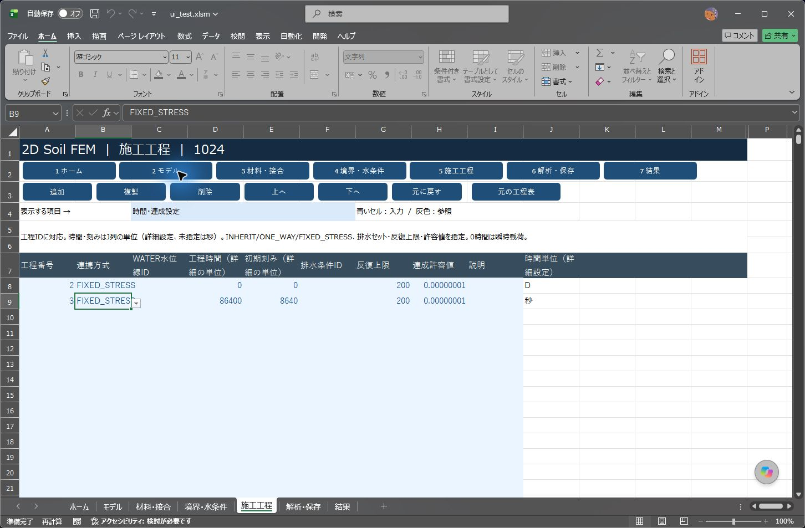
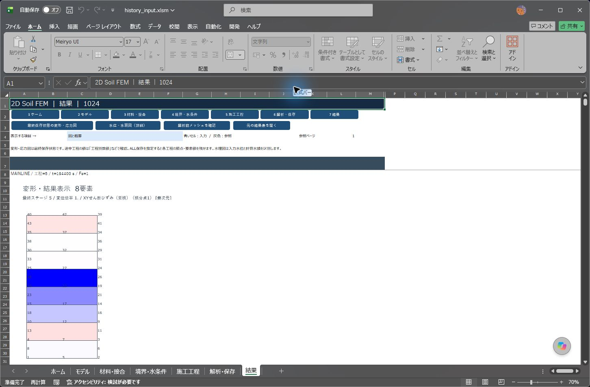
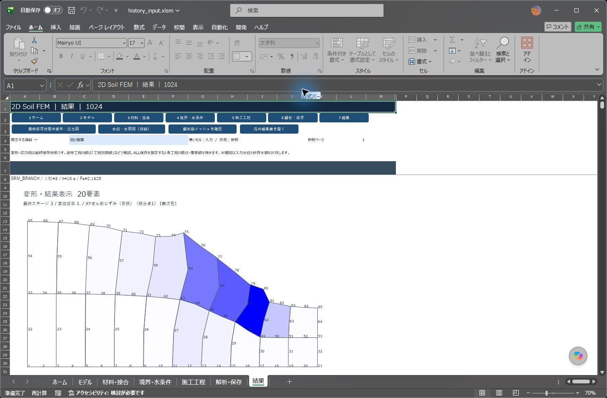
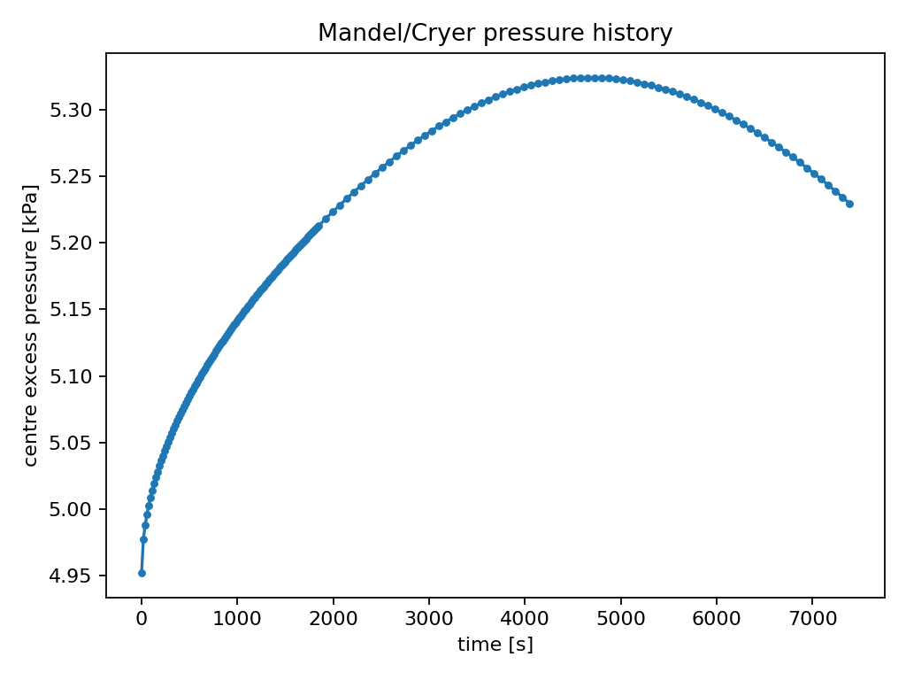
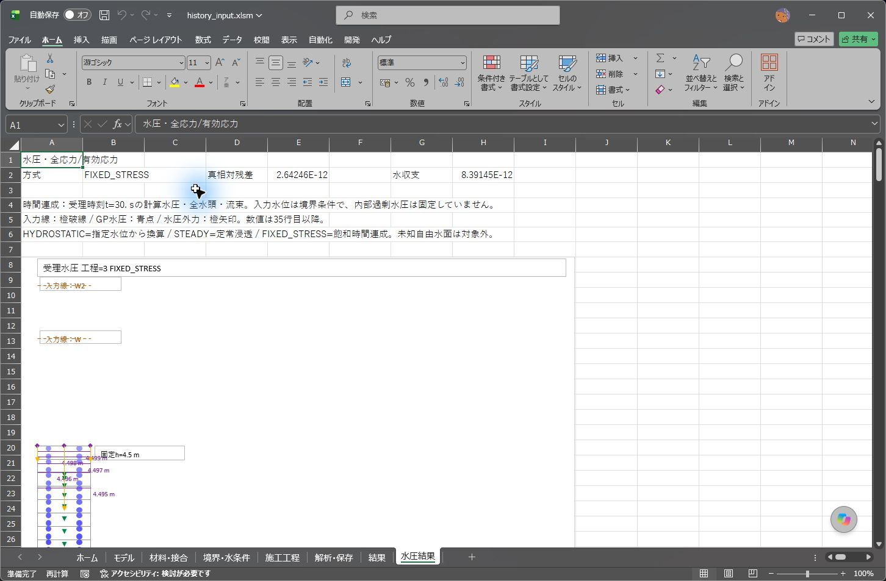

# fixed-stress工程連成の受入検証

対象は1024版の7画面を維持した`20261024_FIXED_STRESS_05`。倍精度、材料則、既存の力学収束条件・SRM探索条件を保持する。飽和・小ひずみBiot連成を、各受理刻みの元の連続式残差、水量、力学残差と反復変化で確認した。Windows 64bit Excel 16.0 build 20430で実行。数値検証後に水理図の見出し・説明文3箇所だけを修正し、17入力の再回帰と全変位・応力・Fs・残差の完全一致を確認した。さらに最終配布候補では実装済み入力欄の「予約」表記と灰色を除き、コンパイル・再読込・拘束柱の一括計算／再開・実画面を確認した。計算識別05は同じで、修正前後のブックSHA256を受入集計へ記録する。

## 数値検算

|検証|比較対象|結果|
|---|---|---|
|Q8/Q4・T6/P1の局所行列|独立したPython積分、貯留・異方透水・結合・重力|Q8最大1.11e-15、T6最大2.22e-16。拘束付き・閉鎖PCG解との差1.11e-16|
|拘束柱の全受理時刻|分離反復を使わない独立monolithic Biot連立解|全変位最大2.80e-12 m、水圧2.42e-8 kPa。α=0.65・異方透水も2.50e-12 m／2.77e-8 kPa|
|Mandel二次元圧密|独立級数解、全節点ux・内部uy、物理座標の積分点水圧|τ=0.1までの共通50時刻で、圧力差0.27241→0.02606 kPa（比0.09566）。全節点ux・内部uyの最大差9.35e-8 m。事前基準0.2 kPa／比0.7以下に合格|
|途中SRMの有無|同一施工の全86変位自由度、全544応力スロット|2.51e-13 m／3.23e-9 kPa|
|SRM保存枝|親の時刻・水圧|時刻進行0、水圧差0|
|飽和斜面の全探索|親水圧を保持したSRM|Fs区間[2.1625,2.1750]、施工本線の最終残差1.47e-11。数値的な収束境界であり、実地盤の設計安全率を保証する例ではない|

Mandelの上面変位は解析解から与える境界条件。これを自由な沈下応答の検算とは数えず、全節点uxと内部uyを別途級数解から求め、水圧とともに比較する。t=0の離散圧力投影と、t>0の時間応答は区別する。中間の細分化試験で当初の基準を満たさなかった結果も比較記録へ残す。誤差基準は緩めていない。最初の空間・時間細分化だけでは圧力差0.25881 kPa／比0.9501となり不合格だったため、初期時間刻みをさらに1/4にした。最終比較は早期12時刻だけに限定せず、当初のτ=0.1までの50共通時刻で判定した。

## 施工・保存・入力

盛土直後のSRM→30日圧密→SRM→次施工、水位の時間折点、閉鎖境界、湿潤掘削・再盛土・線形自重載荷、JOINTの固定水理接続、名前付き載荷・0への除荷を実行した。17入力は正常終了または想定した理由の拒否を確認した。結果とチェックポイントを保存後、再開した全変位・応力・Fs・残差・反力を照合した。別プロセスの途中再開では、湿潤再盛土中の全43節点変位差8.86e-13 m、水圧・応力差3.36e-10 kPa以下、水位変動中は7.84e-13 m／1.07e-13 kPa／7.48e-12 kPaとなった。

新しい入力操作は7画面の実イベントで確認した。工程IDに結び付く単位・時間・載荷セットの追加、複製、移動、削除、取消しを検証する。時刻別図は保存時の有効要素だけを表示し、工程ID・時刻・施工本線／SRM枝を明示する。再盛土中の8要素、SRM枝の20要素を実画面で確認した。表示後の再開も表示したExcelで完了し、別プロセスの再開と同じ差分になった。

負の受理候補水圧、圧力不定の閉鎖系、反復不足、SRMへの時間指定、不正な工程IDを拒否する。未受理の変位・水圧・応力が残っていないことを最後の受理状態と比べた。巻戻しの独立照合は全節点変位、全積分点水圧とsx/sy/τxy/szを対象とする。CSVに保存しない他の応力診断スロットと境界内部変数は照合範囲に含めない。保存枝から施工へ再開できないこと、材料・α・間隙率の変更で旧結果を無効にすることも確認する。

最終配布候補では、7個のQ8と2個のT6（44節点）が接続する混在圧密も実行した。一括計算と保存再開の変位・応力・反力・残差の照合に合格。混在全体系に対する独立解析解の比較とは区別する。[実計算記録](fixed-stress-evidence/20261024/mixed_records.zip)。

## 水位変化・外水圧

工程を継承する`*`と、固定する個別水位線IDを区別する。水頭と外水圧は同じ時間補間を使う。開始・終了の折点位置が異なる場合は両方のX折点を採用する。上面が水没した幅1 mの柱で、水位4→5 mの変化に対し外水圧合力・モーメントを独立積分と照合した。等分4時刻の全鉛直荷重差は約7e-12 kN以下、最終反力69.43 kNとの差は2.84e-14 kN。開始・終了でX折点が異なる例を含む17項目の境界水頭・面荷重・モーメントも合格した。

## 従来機能

乾燥INCONSISTENT／DAVIS、水理の静水圧・箱・遮水・分離域・BIRTH、DLL OFF/AUTO、水理付きSRM・保存再開、ネイティブ表示と増分図を原版PR #47と比較した。全面回帰は候補04で実施し、候補05はfixed-stress内の回復処理の反復回数計上だけを修正した。この差分は従来の片方向経路を通らず、05で全連成入力を再実行した。乾燥例170変位自由度・Fs・残差は原版と一致。水理SRM区間は両者[1.55,1.5625]で一致した。配布DLLは従来と同じ1個。新しい連成計算の時間を、従来の片方向計算の高速化率として扱わない。

## 再現と資料

入力は`tests/fixtures/fixed_stress`、実行は`tests/run_fixed_stress_regression.ps1`。Pythonの独立検算は`tests/requirements-fixed-stress.txt`の環境を用いた。詳細なコマンド、合否、計算時間、再開比較、保存ブック・CSV・ログは受入記録に残す。

未知の自由水面、不飽和、JOINTの開口による流体貯留、過渡圧密中のRESET/MATSET、施工途中の再メッシュ、クリープ・有限変形・新しい梁／軸対称連成は対象外。これらを対応済みとしない。

## 実行時間と画面

下表は見出し修正前の数値検証候補30の時間。再回帰候補31と最終配布候補32の各時間は追加回帰記録に残す。時間は検証PC上の解析呼出しから戻るまでの1回実測で、Excel起動・試験用入力書込み・JSON整理は含まない。高速化率や一般的な所要時間の保証には使わない。

|入力|解析呼出し時間 [s]|
|---|---:|
|拘束柱|9.44|
|α=0.65・異方透水柱|9.28|
|塑性柱・途中SRM|11.17|
|盛土→30日圧密→SRM→次施工|10.67|
|湿潤掘削・再盛土の線形載荷|15.47|
|水位変動と外水圧|8.07|
|飽和斜面SRM全探索|15.65|
|Mandel時間細分化176保存状態|375.34|

入力操作の確認画面。工程2の時間単位変更と工程3の秒単位を独立に保持することを確認している。



再盛土工程の途中（t=194400秒）。未施工の将来状態ではなく、その保存時刻の有効8要素を表示する。



親水圧を保持したSRM照査枝。表示上のFs=2.1625とt=10秒を確認した。



Mandelの中央過剰水圧履歴。上昇後に消散する二次元圧密応答を確認する。



時刻30秒の水理図。見出しもFIXED_STRESSとなり、入力水位線W/W2と途中の固定境界水頭4.5 m、計算全水頭・Darcy流束を区別する。



## 実行環境に関する記録

非表示の自動化Excelで、図表示直後の再開呼出しが計算ログ作成前に戻らなくなる事象を1回確認した。この試行は合格に数えていない。ユーザー許可の上でその検証用Excelのみ終了した。同じ最新版で、別セッションの再開と、実画面に図を表示してからの再開をそれぞれ実行して合格した。再現原因は特定していないため、非表示自動化で表示と計算を連続実行する運用の安定性までは保証しない。

## 再現コマンドと公開記録

```powershell
pwsh -NoProfile -File tests/run_fixed_stress_regression.ps1 -Book workbook/ui_20261024/2DSoilFEM_ui_20261024.xlsm -Out <新規フォルダー>
pwsh -NoProfile -File tests/run_fixed_stress_matrix.ps1 -Book workbook/ui_20261024/2DSoilFEM_ui_20261024.xlsm -Out <行列検証フォルダー>
python tests/check_fixed_stress_matrix.py <行列検証フォルダー>/actual.json
```

Mandelの粗・細・時間細分化入力と判定手順は[入力一覧](../tests/fixtures/fixed_stress/README.md)を参照。既にExcelが起動している場合は試験を開始しない。検証中の計算を時間だけで停止する仕組みは入れていない。

[受入集計](fixed-stress-evidence/20261024/validation.json)、[最終配布候補の17入力・全数値比較](fixed-stress-evidence/20261024/final_comparison.json)、[最終候補のログと結果ブック](fixed-stress-evidence/20261024/final_release_records.zip)、[実計算・ログ・選定した結果ブック](fixed-stress-evidence/20261024/accepted_records.zip)、[従来機能の比較記録](fixed-stress-evidence/20261024/legacy_records.zip)、[Mandelの粗・細分化記録](fixed-stress-evidence/20261024/mandel_refinement_records.zip)、[別プロセス再開・表示・入力操作の記録](fixed-stress-evidence/20261024/continuation_records.zip)。ZIP内のarchive_manifest.jsonで各ファイルのSHA256を確認できる。結果ブックと対応する外部の出力フォルダーは、ZIP全体を展開して同じ相対位置に保つ。

## XLSMの後続issue対応

計算ビルド06では、水圧・SRM成功状態の復元、工程IDとRESET後の表示、静水圧の水位差検査、内部HEADの入力拒否、新規解析の塑性結果消去を修正しました。[修正内容・実Excel照合・最新配布候補の回帰記録](XLSM_ISSUE_VALIDATION.md)を参照してください。上記候補30～32の記録は、その時点の検証履歴として保持します。
