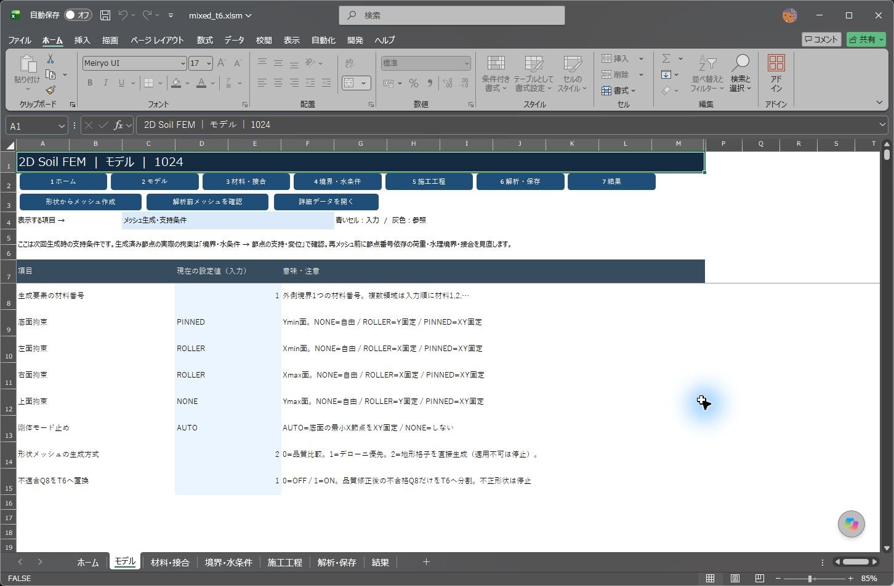
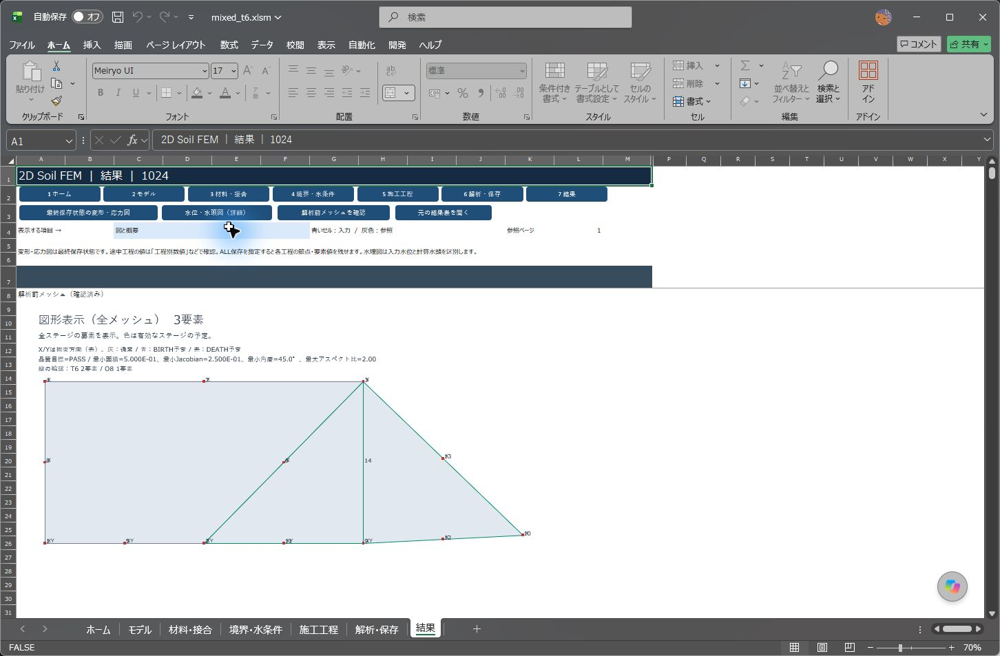

# 品質修正後のQ8/T6混在メッシュ

## 入力と確認

1024版の「モデル」→「メッシュ生成・支持条件」で、**不適合Q8をT6へ置換**を選びます。`0`はOFF、`1`はONです。初期値は0です。詳細表では「メッシュ設定」C30、設定キーは`MESH_T6_FALLBACK`です。

1. 形状、材料領域、格子間隔と品質目標を入力します。
2. T6置換を使用するときは1にし、形状からメッシュを生成します。
3. 生成処理はQ8の品質修正を先に行い、なお品質目標を満たさないQ8だけを、対角線で2個のT6へ分割します。正常なQ8は保持します。
4. 解析前の図でQ8/T6の件数と形状を確認します。T6の輪郭は緑色です。詳細の「要素データ」K列にもQ8/T6を保存します。
5. 支持条件、荷重、材料、施工工程を確認して解析します。再メッシュした場合は節点・要素・辺番号が変わるため、境界・載荷・接合・水理境界の設定も再確認します。

左の正常Q8を保持し、右の品質目標未達Q8だけを2個のT6へ分割した検証例です。

ONは、どんな不良形状も計算できるようにする設定ではありません。逆転、自己交差、面積ゼロ、辺の中間節点が接続先と一致しない形状はエラーです。分割後のT6も最小面積・角度・辺長比の品質目標を満たす必要があります。細長い形状は点配置や格子間隔から直します。

置換の判定には、生成時の幾何品質（面積、Jacobian、角度、辺長比）を使います。分割で要素数・自由度が増えるため、計算時間も増える場合があります。

## 要素と対応範囲

T6は頂点3個と辺中点3個の二次三角形です。Q8との共通辺では端点と中間節点を共有し、変位と現在の定常浸透の水頭を接続します。既存の8スロット保存形式を使い、DLLの引数・構造体は変更していません。DLLは従来と同じ1個です。

計算識別は`20261024_MIXED_01`です。外部ファイルからの再開には、同じ計算識別で保存した成功状態を使います。旧版のチェックポイントはビルド照合で停止するため、新版で再計算してください。

「要素データ」の接続欄には、T6の頂点を反時計回りにA・B・C、辺中点をAB・BC・CAとすると、`A, B, C, C, AB, BC, C, CA`の順で保存します。水理の辺指定は**1=AB、2=BC、4=CA**です。3は縮退辺なので指定できません。生成結果のK列を手動でT6へ変えるだけでは、接続や辺中点は変換されません。

| 項目 | 対応 |
|---|---|
| Q8のみ・Q8/T6混在・T6のみ | 対応 |
| 弾性、自重、載荷、弾塑性、SRM | 対応。Double・材料則・収束条件・SRM探索条件を維持 |
| 外水圧、飽和定常浸透→力学、固定水圧SRM | 対応 |
| JOINT、BIRTH/DEATH、結果保存・再開 | 対応。JOINT自体は従来形式。再開は全変位・応力・Fs等を確認 |
| 解析前メッシュ・変形応力図・水理図・増分図 | T6の形状・積分点・面積平均に対応 |
| 曲線辺を持つT6 | 非対応。円形境界は直線辺による多角形近似 |
| 混在メッシュを使った適応再分割・SMOOTH候補 | 停止して形状からの再生成を案内 |
| fixed-stress時間圧密 | 今回の実装範囲に含まない |

直線辺のT6には正の4点積分を使います。変位・ひずみ・応力、間隙水圧、Darcy流束の積分位置も三角形に対応します。Q8用のhourglass安定化はT6へ適用しません。要素平均は積分重みで計算し、図の中心は三角形の重心です。

品質欄のT6のJacobianは、辺長2の基準三角形に対する`面積/2`で評価します。Duffy変換を含む各積分点のdetJとは別の値です。計算時は各積分点のdetJを使います。

外部チェックポイントからの再開では、増分図用の最終収束増分は復元しません。最大せん断ひずみ増分・塑性主ひずみ増分クロスを表示するときは、最初から計算した結果を保存して使用します。通常のブック保存・再オープンでは、その増分図を再表示できます。累積塑性履歴の範囲は「結果塑性」の「累積の範囲」で確認します。

混在化すると自由度・積分点配置が変わるため、Q8だけの結果と値が完全一致するとは限りません。局所応力だけでなく、変位、反力、残差、SRM区間とメッシュ依存性を併せて確認します。[実Excelでの検証記録](MESH_MIXED_T6_VALIDATION.md)。
