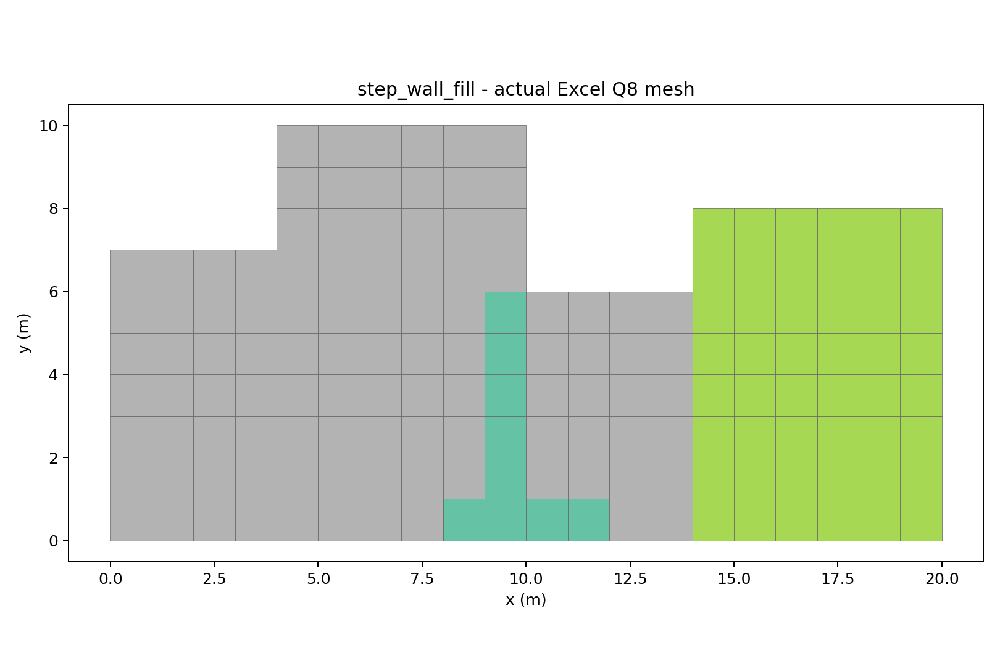
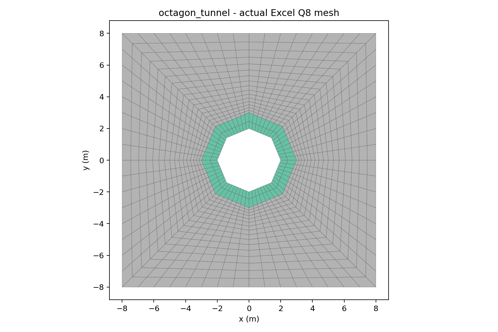
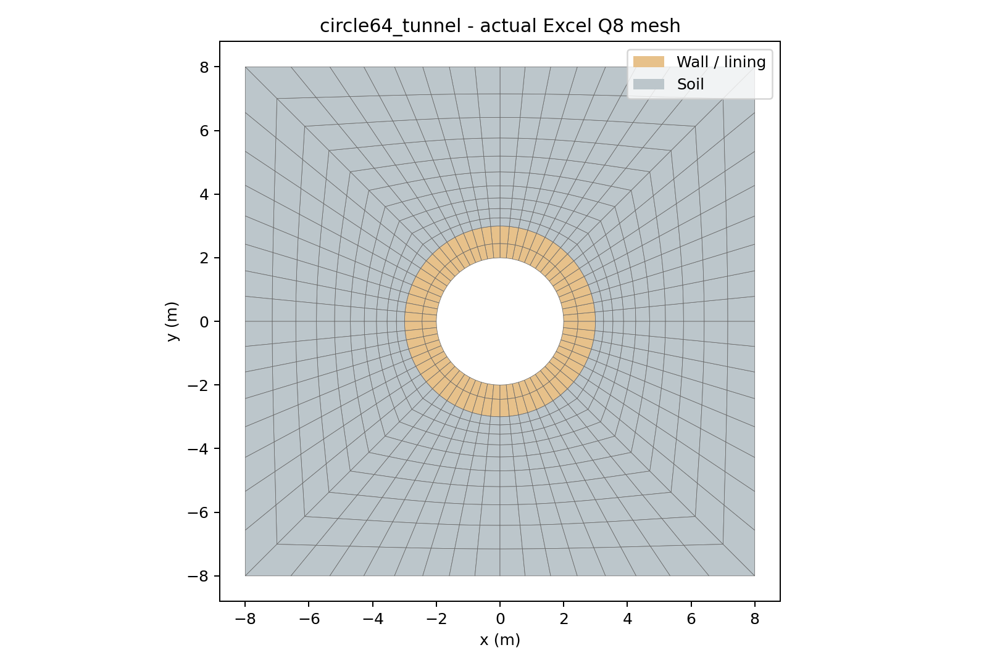
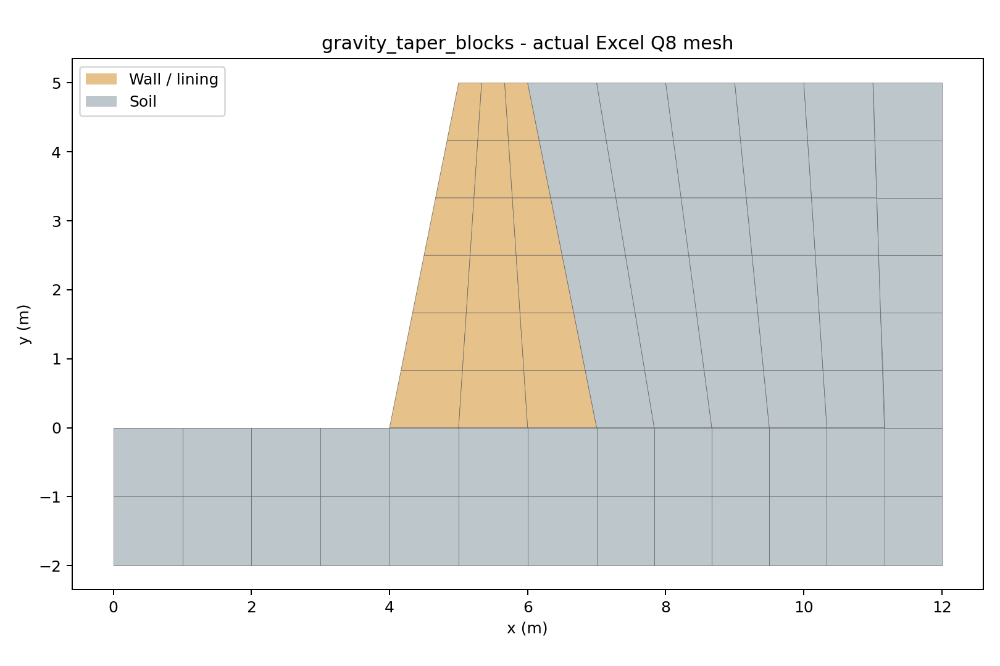
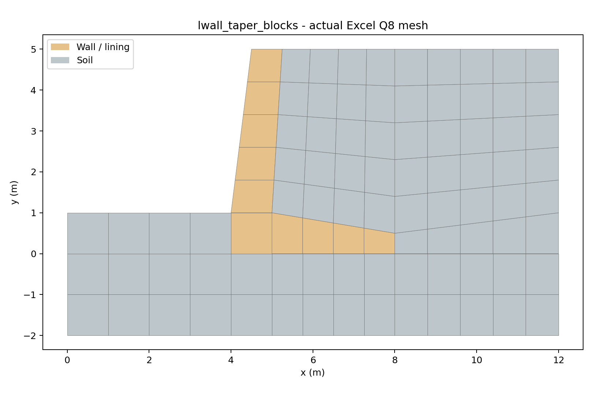
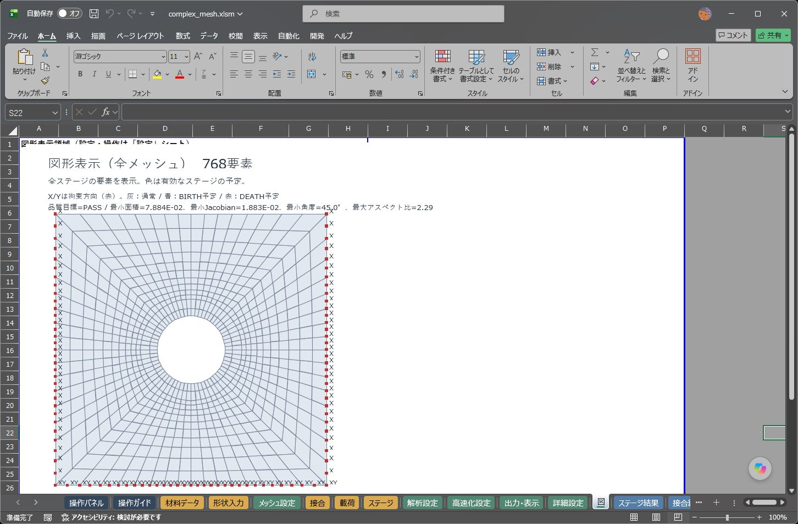
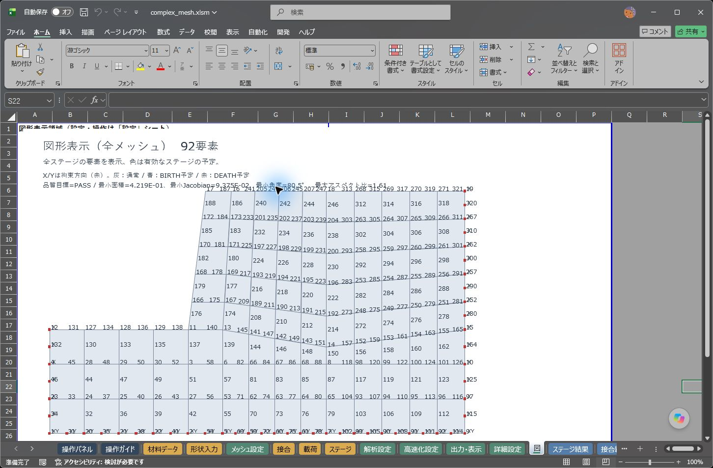

# 段差・複数材料・トンネルの地形格子

「メッシュ設定」の生成方式を **2（地形格子を直接生成）** にすると、従来の単純な地形追従格子に加え、次の形状をデローニ分割なしで作成できます。適用できない場合は理由を表示して停止します。

| 対象 | 分割方法・条件 |
|---|---|
| 従来の斜面・水平地盤 | 水平底面から地表面へ追従する従来の直接格子を維持 |
| 段差、切土、L型擁壁、別材料の盛土 | 全境界が水平・鉛直の多角形。凹形領域と複数材料に対応 |
| ボックス空洞・矩形トンネルと覆工 | 全境界が水平・鉛直。複数の穴にも対応 |
| 多角形トンネルと覆工 | 凸多角形の空洞1つ。覆工外周、地盤外周も凸形状で、完全な入れ子にする |
| 重力式擁壁、テーパー付き縦壁・底盤、斜めの材料境界 | 土・構造体を重ならない凸四辺形ブロックに分けて入力。隣接ブロックは辺全体を共有。穴なし |

任意の凹多角形から四辺形ブロックを自動で作る機能ではありません。凹形の覆工、複数の非直交トンネル、開口を持つ覆工も放射格子の対象外です。斜めの地表面・擁壁・材料境界は、凸四辺形ブロックに分割できる場合に対応します。円形は円周上の点を結んだ多角形近似で、真円の曲線要素ではありません。

## 入力と確認

1. 「形状入力」の **B:D列・8行目以降**に点番号、X、Yを入力します。
2. **G:J列・8行目以降**に境界番号、種類、点番号順、格子間隔を入力します。種類は「外側」または「内側」、点番号順はカンマ区切りです。始点を末尾へ重ねません。
3. 材料領域を「外側」、除去する空洞を「内側」として入力します。外側境界が複数ある場合、**外側境界の入力順が材料番号1、2、3…**になります。G列の境界番号を材料番号として使うものではありません。「材料データ」に該当番号を登録してください。
4. 直交格子・トンネル放射格子で重なる外側領域は先の領域が優先されます。擁壁・別材料盛土などの小領域を先に、背景地盤を後に入力します。全ての穴を差し引いた後に、材料を割り当てます。完全に隠れて要素がなくなる材料領域はエラーです。四辺形ブロック方式では領域の重なりを許しません。外側1つの場合は従来どおり「メッシュ設定」の材料番号を使います。
5. トンネルの放射格子では、**覆工外周→地盤外周**のように内側から外側へ外側境界を並べ、空洞輪郭を「内側」で入力します。全ての輪郭が空洞中心を囲む必要があります。内外周で点数が違っても、全頂点の方向を共有して分割します。
6. 「メッシュ設定」で生成方式2を選び、形状メッシュを作成します。解析前の確認図で外形、空洞、拘束を、要素データJ列で材料番号を確認します。確認図の色は施工ステージを表す既存仕様で、材料色ではありません。入力例は[再現用JSON](../tests/fixtures/complex_terrain.json)、実行・解析済みブックは下記の検証記録ZIPに収録しています。

### テーパー付き擁壁のブロック入力

四辺形ブロック方式では、全ての「外側」を**凸形状の4点**で入力し、「内側」は使いません。壁体・底盤・周辺土・基盤を重ならないブロックで埋めます。隣接ブロックは同じ2端点の辺全体を共有します。辺の途中に別ブロックの端点が付くT字接続は拒否します。例えば、底盤の一辺へ幅の狭い縦壁が付く場合、底盤とその下の基盤も縦壁の端点で分けてください。対辺・共有辺の要素分割数は自動でそろえます。

ブロックごとに材料番号が変わるため、同じ地盤を複数ブロックに分けた場合は、各番号に同じ地盤物性を登録します。壁体・底盤も、同じ材料であれば同じ物性を複数番号へ登録します。施工ステージでは必要な材料番号をまとめて指定してください。ブロック上限は既存入力形式と同じ外側21領域です。

### 円形トンネルの入力

空洞と覆工外周の点を、中心 $(x_c,y_c)$、半径 $r$、分割数 $N$ に対し `x=xc+r*COS(2*PI()*k/N)`、`y=yc+r*SIN(2*PI()*k/N)`（k=0…N−1）で作ります。Excelの式を使う場合は計算を更新してから作成してください。覆工外周→地盤外周を「外側」、空洞を「内側」にします。

32角形・64角形で生成・表示・独立検算に合格しました。真円に対する面積不足は32角形で約0.6413%、64角形で約0.1606%です。これは幾何学近似の差で、解析解の誤差率を表すものではありません。円周が細かい場合は半径方向も自動で細分化し、品質基準を維持します。

C29=2を選んだ場合、その直接生成の内部で、入力形状から単純な地形追従、直交格子、四辺形ブロック、トンネル放射格子の経路を選択します。これらの直接生成の種類を別のC29番号で選び直す必要はありません。C29=0/1の従来経路から自動で直接生成へ移るという意味ではありません。

格子の目標辺長は全境界の**最小入力間隔の1/2**です。直交格子は全頂点のX/Yを格子線として保持し、その間を細分化します。放射格子は空洞・覆工・外周の頂点方向を共通化し、外側へ段階的に要素幅を広げます。局所的な狭い領域のため、他の場所にも細分化が伝わることがあります。

外側境界は「この材料を設置する領域」で、工程のBIRTH/DEATHを自動設定するものではありません。施工ステージと対象材料は別途設定します。共有境界ではQ8の隅節点と辺中点を共用する連続体です。**JOINTの自動挿入は行いません。** 接合設定、節点番号によるFORCE、位置・節点指定の拘束／変位、要素・辺番号指定の水理境界がある場合は作成を停止します。

拘束のTOP/BOTTOM/LEFT/RIGHTは既存仕様のまま**モデル全体の最大／最小座標**に作用します。段差の各天端、トンネル内壁、擁壁表面をまとめて意味する指定ではありません。確認図で固定方向と範囲を確認してください。

## 実際の生成結果



擁壁9 m²、別材料盛土48 m²、背景地盤103 m²、合計160 m²。擁壁の底盤と縦壁は同じ材料です。



八角形空洞の面積は11.313708499 m²、覆工14.142135624 m²、地盤230.544155877 m²です。表示している線はExcelが生成した実際のQ8接続です。地盤の自重状態を確認する試験であり、トンネルの掘削・応力解放・支保施工を再現した工程解析ではありません。





重力式擁壁は高さ5 m、下幅3 m、上幅1 m、壁体面積10 m²。基盤と背面土を含め5ブロックで作成しています。



L型例は縦壁厚が1→0.75 m、底盤の張出し部分の厚さが1→0.5 m、壁体・底盤の合計面積6.75 m²。周辺土・基盤と合わせ11ブロックです。図の構造体色は物性グループをまとめた検算図で、実際の材料番号はブロックごとに異なります。

## 実Excelでの表示



64角形の空洞を持つ768要素の表示です。拘束は赤のX/Y、塗り分けは既存の施工予定表示です。



縦壁・底盤・周辺土を共有辺で接続した92要素の表示です。番号表示に加え、材料の範囲は上の独立検算図と要素データJ列で確認できます。

## 検証記録

最終配布ブックそのものをExcelでコンパイルし、保存後再オープンして33モジュールをソース照合しました。既存の6入力表を保持しています。倍精度、材料則、収束条件、SRM探索条件、DLLは変更していません。

全生成要素について、独立Pythonで材料別面積、穴の除外、全25点のQ8 Jacobian、内角、アスペクト比、界面の辺中点共有、連結性、重複・孤立節点なし、入力境界の辺列による保持を検算しました。30～150度の既存内角基準と設定された品質目標を維持します。細い部材を単に格子へ切り込んで不良要素を受け入れることはしません。

重なる斜め領域、過細な部材、凹形空洞、逆順の入れ子、非接続領域、完全に隠れた材料領域、T字接続、凹四辺形、全体容量超過、点だけの接続の10件は、理由付きで拒否し、既存の節点・要素表が不変であることを確認しました。容量超過は全ブロックの節点・要素数を事前に集計して停止します。これに加え、従来の単純格子・方式0/1と入力保護の回帰を実行しています。

生成メッシュに材料を登録し、弾性範囲の自重解析を実施しました。同一メッシュ・材料・拘束を前版にも入力し、全変位・全応力・収束指標を比較しています。異なるメッシュ同士の解の一致や、SRMのメッシュ収束を保証する試験ではありません。擁壁の滑動・転倒・支持力照査や、トンネルの工程解析の妥当性をこのメッシュ試験だけで保証するものでもありません。

| 自重解析例 | 全変位数 | 自重／鉛直反力 (kN) | 相対残差 | 解析時間：前版→更新版 (秒) |
|---|---:|---:|---:|---:|
| 段差・L型擁壁・別材料盛土 | 1,090 | 3,236 | 5.27E-14 | 2.084→2.473 |
| ボックス空洞・覆工 | 1,728 | 5,232 | 8.11E-13 | 2.283→2.835 |
| 八角形トンネル | 7,168 | 4,950.294373 | 1.00E-11 | 15.333→16.303 |
| テーパー付き重力式擁壁 | 566 | 1,270 | 4.09E-13 | 2.036→2.033 |
| 縦壁・底盤テーパーのL型擁壁 | 642 | 1,367 | 3.29E-13 | 2.026→2.158 |
| 64角形の円形トンネル近似 | 4,864 | 4,931.807091 | 7.35E-12 | 5.452→5.491 |

全6例で全変位・全応力・収束指標の差は0でした。これらはFs=1の自重解析で、SRMのFs区間を新たに探索した試験ではありません。生成・プレビュー時間は重力式擁壁2.57秒、テーパーL型擁壁2.81秒、64角形トンネル3.54秒でした（同条件でも実行時の負荷で変動）。

数値・時間・比較結果は[検証一覧](mesh-evidence/complex-terrain/verification.json)、[生成の実測](mesh-evidence/complex-terrain/generation.json)、[独立検算](mesh-evidence/complex-terrain/independent.json)、[全入力・計算ログ・全出力・実行ブック](mesh-evidence/complex-terrain/records.zip)に保存しています。実測時間は同じPCの順次実行例で、速度保証ではありません。デローニ分割で入力点数の二乗配列を廃止した変更とメモリー実測は[別記録](MESH_DELAUNAY_MEMORY.md)を参照してください。

再現にはPowerShell 7を使用します。

```powershell
pwsh -File tests/run_complex_terrain.ps1 -Book <配布xlsm> -Out <新規結果フォルダー>
python tests/check_complex_terrain.py <結果フォルダー>
python tests/experiment_complex_terrain.py
```

実機ドライバーはExcelが起動済みの場合、新しい試験を開始しません。拒否された形状をデローニへ自動で切り替える処理はありません。
