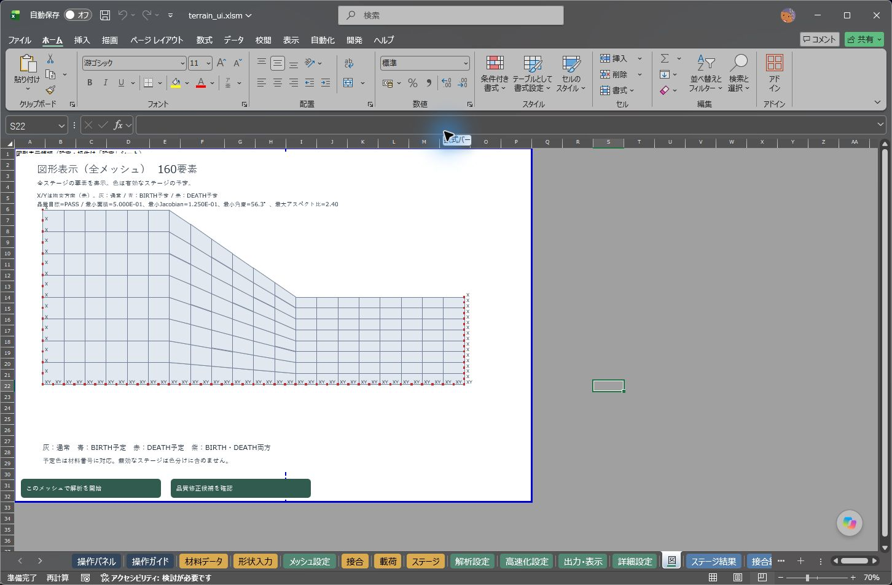
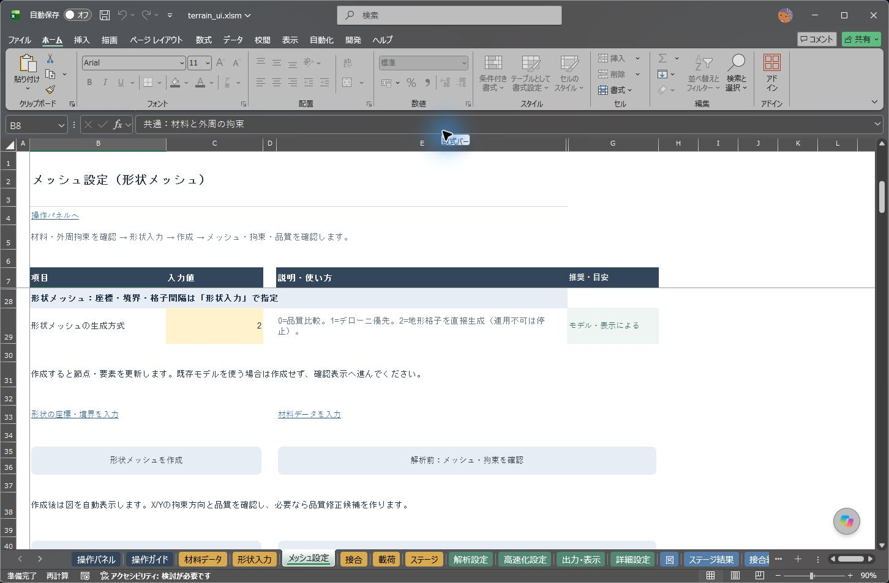
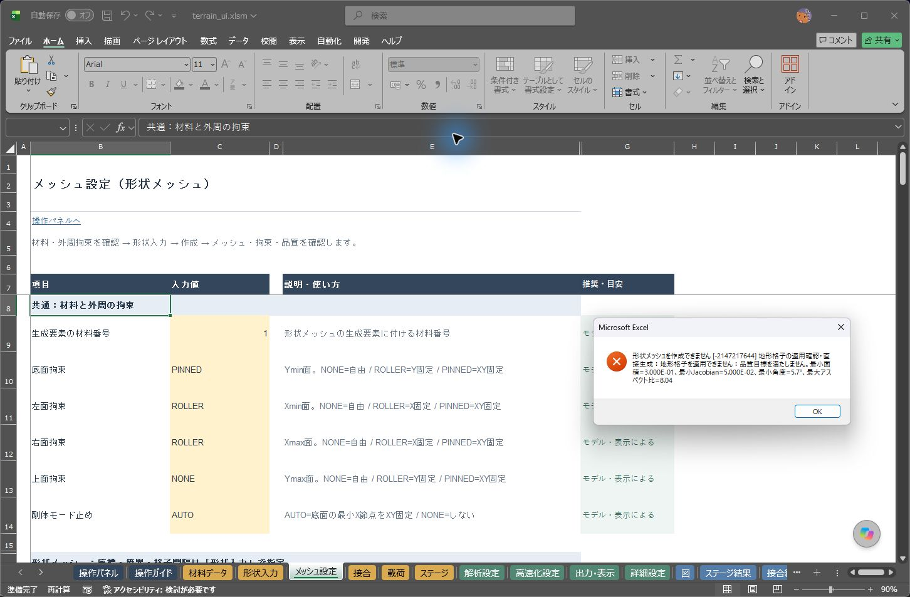
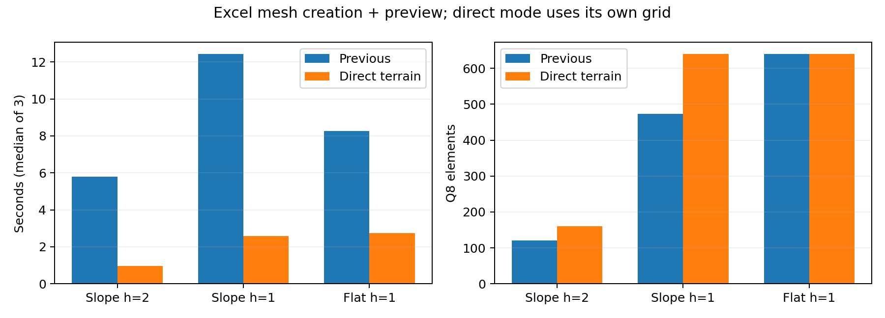

# 地形追従格子の直接生成と軽量化

配布名 `2DSoilFEM_ui_20261023.xlsm` のメッシュ生成を更新しました。計算部の識別はWATER_02、メッシュ更新の識別は `20261022_TERRAIN_DIRECT_01` です。DLLは従来と同じ1個です。Double・材料則・力学の収束条件・SRM探索条件を変更していません。

## 操作と適用条件

「メッシュ設定」C29「形状メッシュの生成方式」で **2** を選び、「形状入力」の点・境界・間隔を設定して「形状メッシュを作成」を押します。地形格子を直接作り、品質・拘束付きの図を表示します。**デローニ生成、角度最適化、33候補の比較は通りません。適用できなければ理由付きエラーで停止し、デローニへ自動変更しません。** 拒否時には元の節点・要素表を保持します。

対象は外周1つ・穴なし・単一材料で、水平な底面、鉛直な左右側面、Xに対して高さが一意な折れ線の地表を持つ形状です。領域全体に正の高さが必要です。複数領域、穴、張り出し、斜めの底面、接合境界、節点番号指定のFORCEや局所FIX/DISPには適用できません。要素・辺番号を指定した水理境界が既にある場合も、旧番号のまま別の辺に作用させないため拒否します。番号依存の条件は生成後に設定してください。

品質目標・節点/要素上限60,000・メモリ上限を満たさないときも停止します。既存メッシュを使う場合は新規生成せず「解析前：メッシュ・拘束を確認」へ進みます。0は品質比較、1はデローニ優先の従来経路として保持しています。初期値1を一括で2へ変更しません。「品質修正候補」は既存メッシュに対する別の操作です。

入力間隔hは従来の三角形→四角形化後のQ8辺の大きさに合わせ、直接格子では水平分割と最大高さ方向の目標をh/2にします。地表の折れ点を必ず列境界に残し、各区間の水平分割数と高さ方向の層数を切り上げます。低い側では縦間隔がさらに小さくなります。中点は各辺の幾何学的中点です。**従来と同じ入力間隔でもメッシュの節点数・要素数・接続は変わります。解析結果の同一性やSRMのメッシュ収束を保証する変更ではありません。**

## 実測

Excel 16.0 build20430、同じPC・形状・入力間隔・方式2で各3回。時間は形状変換、生成、品質検査、確認図の表示までを含む高分解能Stopwatchの中央値です。順次実行であり、他PCの速度を保証しません。

| 形状と入力間隔 | 従来：節点/要素 | 直接生成：節点/要素 | 従来→更新後 | 短縮 |
|---|---:|---:|---:|---:|
| 斜面 h=2 m | 413 / 120 | 537 / 160 | 5.804→0.964秒 | 83.4% |
| 斜面 h=1 m | 1528 / 473 | 2033 / 640 | 12.436→2.578秒 | 79.3% |
| 水平地盤 h=1 m | 2033 / 640 | 2033 / 640 | 8.256→2.735秒 | 66.9% |

直接生成はデローニに必要だった固定上限の大きな作業配列も確保しません。水平地盤は節点座標・拘束・要素接続も同一です（補助欄の空欄/0という表記差を除く）。斜面の新旧は異なるメッシュで、上表では要素数を減らして軽くしたわけではありません。細かい斜面の生成内部は従来約10.5秒から約0.1秒になり、更新後は確認図の表示が時間の多くを占めます。

方式0の同一メッシュ比較では5.745→5.515秒（4.0%短縮）でした。方式1も全節点・要素・品質値が一致しました。候補比較を残す経路には、辺中点の辞書検索の配列化、SMOOTH用作業領域の縮小、構造格子の隣接関係を使った順位評価、境界辺のX範囲索引を反映しています。全候補の構築順と順位規則は保持し、採用する候補に面積・拘束・25点Jacobian等の完全検査を行います。塑性適応の細分化用余裕と検査経路は保持します。

## 検証と保存結果

- Python実験：辞書方式と構造格子の中点番号・座標・Q8接続が一致。境界辺のX範囲による絞り込みは元のOnSegment検査を最後に適用し、許容差を変更しません。
- 最終配布ブックの3形状×3回＋方式0×3回を確認。直接格子を独立Pythonモデルの全座標・全接続と照合し、面積、孤立節点なし、全要素25点の正のJacobian、内角を検算しました。斜面面積116 m²、水平地盤160 m²です。
- 急勾配の品質不足、穴、斜め底面、張り出し、FORCE、JOINT、水理辺番号、過小間隔の8件を理由付きで拒否。全件で既存の節点・要素表が不変でした。時計回り入力でも同一メッシュです。
- 直接生成した537節点・160要素の弾性自重解析を新旧ブックに同一入力し、全1,074変位・全応力・全収束指標が完全一致。自重2,320 kN、鉛直反力2,320.000000000002 kN、相対残差5.28e-14でした。これを旧メッシュとの精度収束試験とは解釈しません。
- 既存の水圧JOINT例も再計算・保存再開。初回の全変位・全応力・指標は受入済みWATER_02と完全一致し、接触28＋水圧20＝48 kN、反力88 kNを独立検算しました。
- 31モジュールを保存前・再読込後にソース照合し、Excel全体コンパイルに合格。元の6入力表は不変です。実Excel画面でメッシュ、方式2の説明、理由付きエラーダイアログを確認しました。

[時間・全メッシュ比較](mesh-evidence/20261022/comparison.json)／[拒否試験](mesh-evidence/20261022/guards.json)／[力学照合](mesh-evidence/20261022/elastic_comparison.json)／[コンパイル・原入力保持](mesh-evidence/20261022/package.json)／[Python実験](mesh-evidence/20261022/python_experiment.json)／[再現入力・全出力・ログ・実行コピー](mesh-evidence/20261022/records.zip)。

再現は `python tests/experiment_mesh_terrain.py`、`tests/run_mesh_benchmark.ps1`（方式2の拒否試験は `-Extended -Direct`）、`tests/check_mesh_benchmark.py --direct`。力学入力は同フォルダーの `elastic_input.json` を `tests/run_groundwater_fixture.ps1` に渡します。既存Excelがある場合、これらの実機ドライバーは新しい検証Excelを開始しません。

今回、JOINT付き斜面のSRM全探索や、塑性適応の全組合せの再実行は追加していません。ソルバー・材料則・DLLは変更していません。前回の[Issue #35対応と初回23版](reviews/groundwater_release23_issue35.md)は履歴として保持しています。
