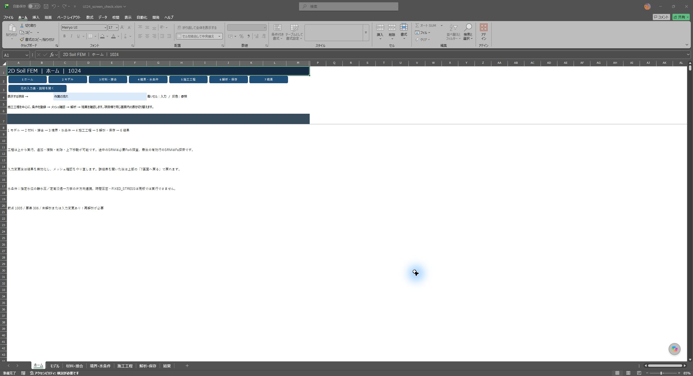
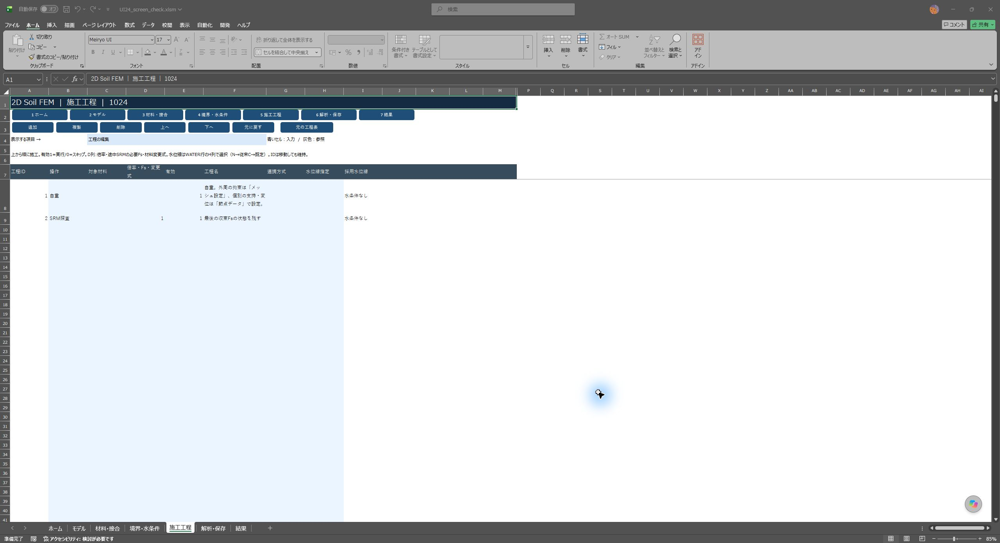

# 1024版：施工工程を中心とした7画面

配布ブックは `2DSoilFEM_ui_20261024.xlsm`。計算に使用する従来の入力表・設定キー・結果表を保持し、普段の入力と結果確認を次の7画面にまとめています。DLLは従来と同じ1個です。

| 画面 | 「表示する項目」で切り替える内容 |
|---|---|
| ホーム | 作業の流れ、節点・要素数、結果の有効状態 |
| モデル | 形状の座標、形状の領域、メッシュ生成・支持条件 |
| 材料・接合 | 材料特性、接合条件、材料の水理特性 |
| 境界・水条件 | 水条件の基本、水位線、水理境界、載荷条件、生成済み節点の支持・変位 |
| 施工工程 | 自重・載荷・除荷・追加・撤去・水位変更・SRM・リセット・材料変更の順序と条件 |
| 解析・保存 | 解析・SRM、保存・再開、高速化、詳細設定 |
| 結果 | 変形・応力図、表示設定、工程別数値、節点・要素・水圧・接合結果、診断 |

画面上部の同じ位置に7画面の移動ボタンがあります。青いセルを編集すると、計算に使用する元の表へその場で反映します。「適用」操作は不要です。灰色のセルは参照用です。項目の切替によって入力値が消えることはありません。

通常表示は7シートです。「詳細データを開く」「元の結果表を開く」等を押した場合だけ従来表を表示します。詳細表右側の「7画面へ戻る」または7画面の移動ボタンで通常表示へ戻せます。従来表と新画面は同じ入力を編集するため、二重の設定はありません。

コピー中に画面を移動しても、セルのコピー内容を保持します。詳細表を別途変更したため表示内容が古くなった場合は編集を止める案内が出ます。Escでコピーを解除し、画面を開き直してから編集します。

## 最初の解析

1. **モデル → 形状の座標／形状の領域**で輪郭点、材料領域・穴、格子間隔を指定します。複数の外側領域では入力順が材料番号になります。円形トンネルは多角形近似、テーパー擁壁は共有辺が一致する四辺形ブロック等で入力します。[適用範囲と入力例](MESH_TERRAIN_COMPLEX.md)。
2. **材料・接合 → 材料特性**で物性を登録します。後から設置する材料は初期状態をOFFにします。SRMで低減する材料を指定し、構造体等の非低減材料と区別します。物性・重量・支持条件には全モデル共通の推奨値を一括適用しません。
3. **モデル → メッシュ生成・支持条件**で生成方式と外周支持を指定し、「形状からメッシュ作成」を押します。生成した図の拘束・材料の施工予定・品質を確認します。生成設定と、生成済み節点の実際の拘束は別です。後者は**境界・水条件 → 節点の支持・変位**で確認できます。
4. **境界・水条件**で載荷と必要な水条件を登録します。水を使う場合は「水圧を確認（指定・定常）」で指定水圧／定常浸透の図を確認します。
5. **施工工程**で操作を上から順に並べます。1行が1解析操作です。同じ施工区分に複数の操作が必要なら複数行を作り、工程名に共通の名称を付けます。
6. **解析・保存**で流れ則、Fs条件、結果の保存範囲等を確認します。「解析前メッシュを確認」を押し、図を確認したら上部の「6 解析・保存」へ戻り、「確認したメッシュで解析」を押します。確認後に入力が変わった場合は再確認へ戻ります。
7. **結果**で数値と図を確認します。最終保存状態の変形・応力図と、工程別の数値表を区別してください。

数式による輪郭座標の作成や大規模な直接編集には元の詳細表を使用します。新画面の直接入力は数値・文字を対象とし、式の参照先を別の表へ暗黙に変換しません。誤入力の取消しや工程の移動・取消しでは、元表にある数式も保持します。節点の支持・変位の新画面は最初の2,000行、数値結果は1ページ200行・最初の13列を表示します。それを超える行・列は元の詳細表で扱えます。

## 施工工程の編集

| 列 | 入力・意味 |
|---|---|
| A 工程ID | 自動管理。実行順とは別。移動しても同じIDを保持 |
| B 操作 | 日本語の一覧から選択。従来のGRAVITY、BIRTH等へ変換 |
| C 対象材料 | 操作対象の材料番号。WATERの水位線はここへ入力しない |
| D 倍率・Fs・変更式 | 操作に応じた値。途中のSRMは必要Fs。材料変更式の書式は従来仕様と同じ |
| E 有効 | 1=実行、0=スキップ |
| F 工程名 | 任意の施工名・説明 |
| G 連携方式 | 空欄／INHERIT／ONE_WAY／FIXED_STRESS。時間連成開始後はINHERITで水圧・履歴を保持する |
| H 水位線指定 | WATER行に水位線のIDを指定 |
| I 採用水位線 | 参照用。実行しない工程、水条件なし、前工程からの継承を区別 |

対象の行を選び、上部の「追加」「複製」「削除」「上へ」「下へ」を使います。追加・複製には新しいIDを付けます。複製は末尾に追加されるため、必要な位置へ移動してください。「元に戻す」は直前の工程編集1回を戻し、工程と対応する水理設定をまとめて復元します。工程上限は1,999行、水理計画は200行です。詳細表に数式を使っていた場合、工程の移動・複製では数式の文字列を保持します。相対参照を自動でずらす操作ではないため、参照先を詳細表で確認してください。

水理設定は工程IDに対応するので、行を移動しても別工程へ付け替わりません。無効にした工程の水理設定は保存し、実行・水理検査ではスキップします。再び有効にすると同じ設定を使います。削除はそのIDの水理設定だけを削除し、水位線・材料の水理特性・水理境界の各表を移動しません。

最後の**有効行**がSRMならFs区間を探索します。途中に置いたSRMはD列の必要Fsの照査です。例えば `自重 → 水位変更 → SRM照査 → 載荷` のSRMは途中照査であり、最終安全率の探索とは扱いが異なります。

既存の水位指定は、水条件の工程別N列 → 従来のステージC列 → 水条件B5の既定値、の順を維持します。新画面ではH列が窓口となり、編集時にC列とN列の競合を解消します。WATER以外へ操作を変更する際は、その行の水位線指定を先に空欄にしてください。IDが既に重複している旧入力は、元の工程表で整理します。

「変位リセット」（RESET_U）は変位だけでなく応力・塑性履歴もリセットします。「応力リセット」（RESET_STRESS）は変形後座標を基準へ移して変位・応力・塑性履歴をリセットします。水条件とRESET／MATSETの組合せ等、既存の未対応範囲は維持しています。

## 水条件と支持・載荷

### 水位変更 → 掘削 → 再設置の操作例

[計算済みブック集](stage-ui-evidence/20261024/calculated_workbooks.zip)の「施工水位変更.xlsm」は、次の5工程を持つ小規模な回帰例です。実務形状の設計例とは区別して、入力・工程・結果のつながりを確認できます。

| 工程ID | 操作 | 対象材料 | 倍率 | 水位線指定 |
|---|---|---|---|---|
| 1 | 自重 | 空欄 | 1 | 空欄 |
| 2 | 水位変更 | 空欄 | 1 | V |
| 3 | 掘削・撤去 | 2 | 1 | 空欄 |
| 4 | 盛土・追加 | 2 | 1 | 空欄 |
| 5 | SRM照査 | 空欄 | 1 | 空欄 |

1. **境界・水条件 → 水位線**で、Wは `(0,3)、(2,3)`、Vは `(0,4)、(2,4)` と登録されています。基本の方式はSTEADY、既定水位線はWです。水理境界と材料の透水係数は同じブックの各項目で確認できます。
2. **施工工程**の工程2のH列がV、G列がONE_WAYになっています。工程2を上下移動してもID2に対応する水位線を保持します。有効=0なら計画を残して実行をスキップします。
3. **解析・保存 → 保存・再開**で結果の残し方ALLを確認します。この例は **解析・SRM → 固定Fsで試験する=1** なので、工程5は探索をせずFs=1の試験です。探索する場合は同じ欄を0に戻します。
4. **結果 → 工程別数値**で工程1～5の状態・反力等を確認します。「最終保存状態の変形・応力図」は工程5の保存状態です。工程3の掘削途中の図を選ぶボタンではありません。水位・水頭図では入力Vと計算全水頭を区別します。

水位線は、同じIDについて左端から右端へX座標と水位標高を登録します。折れ点ごとに1行を使用し、その間は直線補間です。**HYDROSTATIC**は入力した水位から水圧を換算し、浸透は解きません。**STEADY**は透水係数と境界条件から飽和定常浸透を解いて力学へ渡します。未知の自由水面・不飽和流れは解きません。工程別の時間圧密はFIXED_STRESSで指定します。[時間連成の入力・結果・保存再開](FIXED_STRESS_STAGES.md)。

入力水位は橙破線、STEADYで計算した全水頭は紫等値線、Darcy流束は緑矢印という従来の区別を保持します。図の「入力」と「計算結果」の凡例を確認してください。非透水節点の水頭0は未計算値です。水圧と、TOTAL/EFFECTIVEの応力基準・入力重量は別の設定です。[水圧・外水圧・空洞・JOINTの仕様](GROUNDWATER.md)。

メッシュの作り直しでは節点番号や要素・辺番号が変わります。地形格子の直接生成では、番号指定の荷重・水理境界・接合等がある場合に適用を拒否する既存の安全検査を維持しています。表を一括消去して回避せず、元の番号・位置との対応を確認して必要な条件だけを解除・再設定してください。メッシュ品質の修正・再メッシュ候補は、**モデル → メッシュ生成・支持条件 → 詳細データを開く**で従来の操作へ進めます。

## 出力を選ぶ

| 目的 | 解析前の保存設定 | 結果で確認するもの |
|---|---|---|
| 最終状態だけを見る | 結果の残し方=FINAL | 最終保存状態の変形・応力図、最終の節点・要素表 |
| 施工による変化を整理 | 結果の残し方=ALL | 工程IDで工程別数値・節点・要素表を抽出し、変位・応力・反力を比較 |
| せん断帯を調べる | 必要な工程を保存して再解析 | 内容名で塑性状態・累積ひずみ・増分量等を選択。最大せん断ひずみ増分と塑性主ひずみ増分クロスを個別にON/OFF |
| 水条件の妥当性を確認 | 水条件を有効にして水圧確認・解析 | 入力水位、水頭、流束、水圧、外水圧合力、全応力／有効応力、反力 |
| 長時間計算の監視・再開 | ログ・途中状態の保存範囲、再開先を指定 | 診断と出力フォルダーのログ・保存状態。再開前に入力の一致を確認 |

「表示設定」は描画量・変位倍率・色スケール・増分図の設定です。計算結果の保存方法と再開設定は「解析・保存」にまとめています。表示設定の変更だけでは計算結果を無効にしません。材料・形状・工程・水条件・解析条件を変更した場合は、古い図を削除し再解析が必要な状態にします。

現行の変形・応力図は**最終保存状態**を描画します。途中工程の図を選択できるという意味ではありません。工程別数値は「結果」の項目で選び、L4の参照ページを切り替えます。詳細列を含む後処理は元の数値表を使用してください。

## 版と従来資料

1023版のブック・201ページの[PDF説明書](manuals/2DSoilFEM_Manual_20261023_WATER_02.pdf)はそのまま保持しています。理論・材料則・例題の詳細は同PDFを参照し、画面の移動先は本書の7画面対応表で読み替えます。1024版は画面識別 `20261024_STAGE_01`、計算識別 `20261022_WATER_02`。Double・材料則・収束条件・SRM探索条件とDLLのバイナリーを維持しています。無効な水理工程をスキップする入力検査だけを調整しました。

[コンパイル・入力操作・数値回帰・実画面の検証記録](STAGE_UI_20261024_VALIDATION.md)

## 実画面

ホームと施工工程です。全画面で同じ位置の移動ボタンを使えます。

[モデル](stage-ui-evidence/20261024/screens/model.jpg)／[材料・接合](stage-ui-evidence/20261024/screens/materials.jpg)／[境界・水条件](stage-ui-evidence/20261024/screens/water_inputs.jpg)／[解析・保存](stage-ui-evidence/20261024/screens/analysis.jpg)／[結果の表示設定](stage-ui-evidence/20261024/screens/display_options.jpg)
