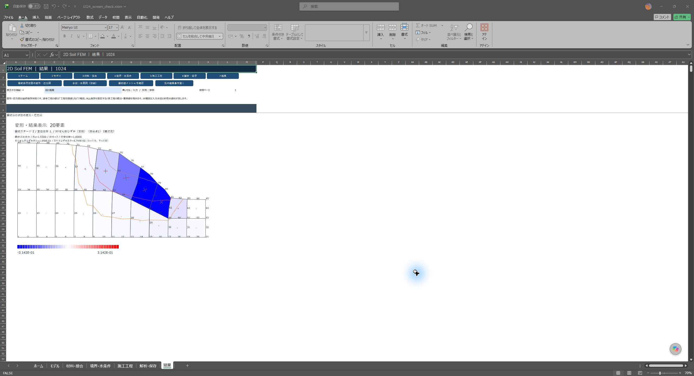

# 1024版の検証

対象は配布する `2DSoilFEM_ui_20261024.xlsm`。1023版を保持し、施工工程を中心とする7画面を追加しました。配布ブックのSHA-256は `16161736280992174173430F9A163FCA72CC4F3D408683CDCE1990461910B560` です。[集計と全ログ・計算済みブック](stage-ui-evidence/20261024/README.md)。

## コンパイルと入力の保持

64bit Excel 16.0 build 20430のVBEで全体コンパイルを実行し、保存前と保存再読込後の35モジュールをリポジトリのソースと照合しました。改行・VBE属性・行末空白だけを正規化しています。配布作成時に元の節点・要素・材料・形状・工程・載荷の6表の値が変わらないことも照合しました。初期水条件はNONE、過去結果は再解析が必要な状態で配布します。

Double・材料則・収束条件・SRM探索条件を維持しました。計算・水理・メッシュの主要17モジュールとDLLはmainの `ecc05e794847601267437f627d7a6249b3290bd0` とバイト一致します。水理検査の `GWValidateStagePlans` は、無効にした工程に対応する計画を保持しながらスキップするよう調整しました。その関数以外の `FEMWater` は一致しています。

## 入力・工程・画面

実際の `Workbook_SheetChange` を使う102項目が合格しました。7画面と全項目の切替、元表への即時反映、施工工程の追加・複製・削除・上下移動・取消し、IDと水理計画の対応、無効化・再有効化、異常入力の復元、表示変更と解析変更の失効の区別、コピー中の移動、古い画面からの上書き防止、保存再読込を含みます。取消し・復元ではDoubleの全桁と既存数式を保持する検査も含めました。

詳細表は必要なときだけ表示し、保護状態を保持して通常の7画面へ戻れることを確認しました。最大せん断ひずみ増分と塑性主ひずみ増分クロスは独立して設定し、A/Bの描き方も元の設定へ反映します。

専用コピーで7画面の実表示を確認しました。形状から再生成したメッシュは1,261節点・392要素、品質判定PASS、生成から新画面のネイティブ図形表示まで5.558秒でした。これは配布時に保持する既存入力メッシュ（1,005節点・306要素）とは別です。メッシュ生成コードは変更していません。

Excelの標準図形で結果を表示します。画面切替と図の再描画ではイベント・再描画の状態をまとめて管理し、処理後に復元することを確認しました。水圧確認の内部更新で入力変更イベントを起こさないようにし、保存済みの有効な結果を無効化しないことも確認しました。検証環境は上記Excelであり、Excel 2016の特定更新版での追加実行はしていません。

## 数値回帰

| 条件 | Fs区間（従来版と一致） | 最大Δ変位 | 最大Δ応力等 | 最終RR | 時間：従来→1024 [s] |
|---|---|---|---|---|---|
| 遮水壁 | 探索なし | 0 | 0 | 3.265788e-13 | 5.891 → 6.636 |
| 空洞・内水位 | 探索なし | 0 | 0 | 6.088909e-15 | 4.493 → 6.202 |
| 水位変更・掘削・再設置 | 探索なし | 0 | 0 | 1.320429e-13 | 6.622 → 7.002 |
| 水位1m斜面 INCONSISTENT | [1.5500, 1.5625] | 0 | 0 | 2.483193e-14 | 137.598 → 144.467 |
| 水位1m斜面 DAVIS | [1.5000, 1.5125] | 0 | 0 | 1.116827e-10 | 21.390 → 22.396 |

遮水壁・空洞内水位と浮力・WATER→掘削→再設置・水位1m斜面SRMを従来の合格記録と同じ入力で実行し、全変位・全要素の応力／ひずみ等・反力と残差・Fs区間を照合しました。SRMの両流れ則は同一メッシュです。時間は各1回の実測で、性能向上を示す比較ではありません。

基礎水圧5ケースの変位とFs値は従来結果と一致。Darcy流、外水圧・幾何、浮力の独立解との検算も合格しています。空洞内水位例は外水圧等の合計 `Fx=0 kN、Fy=85 kN、M=127.5 kN·m`、鉛直反力 `107 kN` と整合します。

新画面から材料・水位を編集して計算した結果は、元表から同じ入力を与えた計算と全変位・全応力／ひずみ・反力／残差／Fsを含む集計値の差0でした。無効な水理工程の計画を保持した場合と、その計画を除いた基準計算も差0です。保存状態からの再開を照合し、FIXED_STRESS、予約欄、存在しない工程、競合水位、孤立・重複計画、未登録水位線の7種類の異常入力を拒否することを確認しました。

## 図・保存再表示

水位1m斜面SRMの保存結果から、最終状態図、Aの増分等値線、Bの増分カラー、増分クロス、両方ON、工程別数値、水圧の確認・結果、保存再読込後の再表示を確認しました。入力変更後は過去結果の描画を拒否し、古い新画面の図を削除します。

[増分A](stage-ui-evidence/20261024/screens/result_a.jpg)／[増分B](stage-ui-evidence/20261024/screens/result_b.jpg)／[水圧結果](stage-ui-evidence/20261024/screens/water_result.jpg)／[工程別数値](stage-ui-evidence/20261024/screens/stage_results.jpg)／[保存再読込](stage-ui-evidence/20261024/screens/result_reopen.jpg)

## 適用範囲

従来の入力・解析機能を7画面から利用する変更です。時間圧密・FIXED_STRESS、未知の自由水面、不飽和流れ、梁要素・軸対称等を新たに実装したものではありません。途中工程は保存した数値を確認でき、変形・応力図のボタンは最終保存状態を描画します。

新画面では数値・文字を入力します。数式を使う座標生成、大きな表の全列編集、メッシュ修正の詳細操作は元の詳細表を使用します。[7画面の手順と行数等の制約](STAGE_UI_20261024.md)。

1023版の201ページPDFと配布ブックは変更していません。PDFのSHA-256は `12a3441a25dc74c4036a42d354039b6b238314be2903b7cdcb9ae4b6c6aa3642` です。
