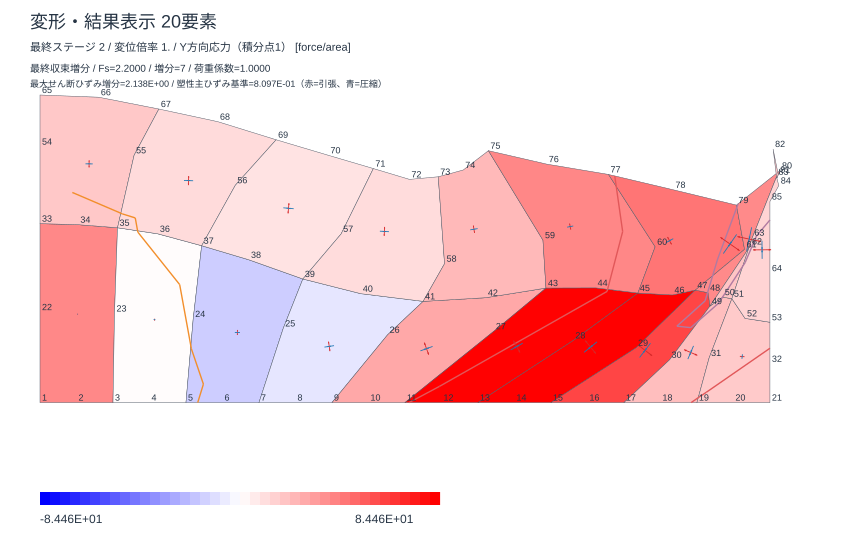
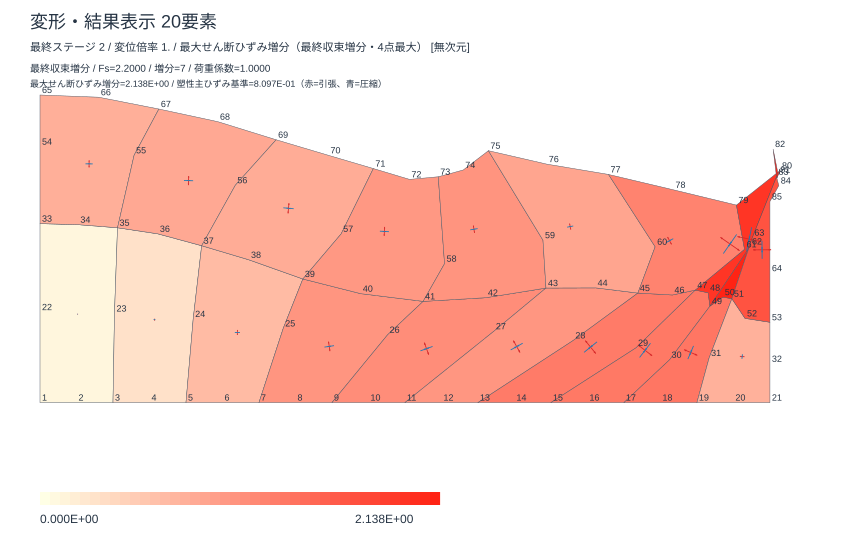

# 内容名による結果選択と増分図（UI_04）

配布名は `2DSoilFEM_ui_20261020.xlsm` のままです。`soilfem_native_x64.dll` 1個を同じフォルダに置きます。DLL・Double・材料則・Newton/GMRES収束条件・SRM探索条件を変更していません。

## 操作

1. メッシュを確認して解析します。
2. 「出力・表示」の「表示する結果」で物理量の**内容名**を選びます。従来の68種類（17量×4積分点）に増分2種類を追加しました。旧番号の内部読み込みも維持しています。
3. 「最大せん断ひずみ増分を追加」と「塑性主ひずみ増分クロスを追加」を、それぞれチェックします。チェックなしを初期値とし、必要な情報だけ追加できます。
4. 初期の **A：選択結果へ等値線を追加** では、選択した応力等の色を残して増分の等値線を重ねます。**B：増分専用カラー** に切り替えると、せん断増分をチェックした場合に最大せん断ひずみ増分の色図に変わります。塑性クロスはどちらでも独立にON/OFFできます。
5. 「変形・応力図を表示」を押します。変更はこのボタンで再描画したとき反映されます。クロス倍率の推奨値は1、許容範囲は0超～10です。

「最大せん断ひずみ増分」「最大塑性せん断ひずみ増分」を内容名から直接選ぶこともできます。図の上に対象Fs・荷重増分番号・荷重係数と凡例を表示します。表示設定を変更しても解析結果は無効になりません。

古い計算結果には増分データがないため、**新しい版で最初から再解析**してください。旧結果の通常の応力・変位図は追加チェックなしで表示できます。保存済みの新しい増分結果は、ブックを開き直しても再解析なしで描画できます。

## 図と数値の意味

対象は**最後に収束した荷重増分**です。累積ひずみ、Newton反復間の差分、SRM試行間の差分ではありません。SRMの最終図は最後に成功したFsの変位・材料状態と同時に保存・復元します。失敗したFsの未収束増分は表示しません。

全ひずみ増分は、収束した変位と増分開始時の確定変位との差から `B × Δu` で求めます。塑性ひずみ増分は、既存材料更新が返した `P2PlasticStrain` の当該荷重増分の値です。材料サブステップでは、その荷重増分内のサブステップ分を合計した既存出力を使用します。計算用配列やDLLの構造体を変更せず、表示用の独立配列に保存します。

工学せん断ひずみ `γxy = 2 εxy` を用い、面内主値は次式です。

`ε± = (εx + εy)/2 ± hypot((εx − εy)/2, γxy/2)`

最大**工学**せん断ひずみ増分は3次元の主値差 `γmax = max(ε+, ε−, εz) − min(ε+, ε−, εz)` です。全ひずみは平面ひずみなので `Δεz = 0`、塑性ひずみは材料更新の `Δεpz` を使用します。「最大テンソルせん断ひずみ」を主値差の半分と定義する資料とは係数2が異なります。

* 色図：各要素の4積分点における最大値を使います。
* Aの等値線：要素の4点最大値を共有する隅節点で平均し、四角形を2三角形に分割して線形補間します。最大値の25・50・75%です。表示用の平滑化であり、積分点の生値や解析メッシュを変えません。
* 塑性クロス：4積分点の面内塑性テンソル成分を先に平均し、その主値・主軸を求めます。赤は引張・外向き、青は圧縮・内向き。両軸・全要素で共通の尺度を使い、長さは主値の絶対値に比例します。共通基準は各要素の最短辺長（正の値）の平均×0.3、半軸12ピクセルを上限として表示倍率を掛けます。1要素の極端に短い辺で全矢印が縮まることを防ぎます。ゼロの主値に矢印を付けません。面外の塑性主軸は描画しません。

「結果増分」シートに要素・積分点別の元成分、主値、角度、最大せん断ひずみ、対象Fs等を保存します。欠落・重複した積分点や異なる増分の混在を検出した場合は、ゼロで補わず再解析を案内します。表示は連続体要素が対象で、接合要素の開口・すべりは「接合結果」を参照してください。

ひずみの集中はせん断帯の位置を読む補助です。メッシュ依存性や構成則の限界があり、図だけで物理的な帯幅・破壊・設計安全率を確定できません。

工学ひずみとテンソルひずみの関係は [Itascaのひずみ定義](https://docs.itascacg.com/itasca950/common/models/ortho/doc/modelortho.html)、最大せん断ひずみ増分の主値差の説明は [Itasca FAQ](https://www.itascainternational.com/software/faqs/what-is-the-zone-maximum-shear-strain-increment-plot-actually-showing-in-itasca-software)も参照してください。

## 実計算の表示例

下図は模式場ではなく、85節点・20要素の同じSRM実計算結果をExcelで描画し、埋め込まれたSVGを取り出したものです。Fs PASS=2.200、FAIL=2.2125。背景の選択結果はY方向応力・積分点1です。





## 検証記録

ユーザー報告の `FEMIncrementCross` 未定義エラーは、関数宣言の引数名 `Scale` がVBAの予約語だったことが原因です。`vectorMultiplier` に変更し、Excelの全体コンパイルと保存・再読込を確認しました。テスト用VBAも実行前に全体コンパイルします。実画面で塑性クロスが小さすぎる問題を発見し、全要素最小辺基準を各要素最短辺の平均基準へ修正しました。長さの比・符号・主軸は維持します。チェックボックスの説明は11ptのセル文字にして読みやすくしました。

検証ログは [strain-increment-evidence/20261020](strain-increment-evidence/20261020) に保存しています。入力813項目、メッシュ操作91項目、増分設定・数式・SVG290項目、実結果の表示34項目を確認しました。既存の保存互換性406項目・表示108項目もPASSです。最終SRM計算後の変更は表示専用2モジュールだけで、計算・増分保存を含む他の20モジュールはバイト単位で同一です。最終ソースの適用と実画面の検査を含む[公開前の照合記録](strain-increment-evidence/20261020/release_validation.json)も参照してください。主値・角度は単軸、正負純せん断、二軸、圧縮、回転、極小値・桁差を検査。等値線は解析解のある線形場で端点を検査しました。実SRMでは全80積分点の元成分からPythonで主値・3D最大せん断・クロスの再構成を独立に検算し、最大絶対差は8.33×10⁻¹⁶です。

| 同条件のSRM全探索 | 既存UI_03 | 増分図版 |
| --- | ---: | ---: |
| Fs PASS / FAIL | 2.2000 / 2.2125 | 完全一致 |
| 全170変位 | 基準 | 最大絶対差0 |
| 最終相対残差 | 6.5595364013624×10⁻¹³ | 完全一致 |
| 全診断CSV | 13,415,684 bytes | SHA-256まで完全一致 |
| 実行時間 | 38.91秒（既存記録1回） | 39.92秒、43.04秒（2回） |

今回は表示用データを増分ごとに保存する機能追加です。時間は測定変動を含む少数回の比較で、速度向上は主張しません。全170変位だけでなく探索の全診断CSVも同一です。

再現例（Excelをすべて閉じ、リポジトリのルートから実行）：

```powershell
pwsh -NoProfile -File tests/build_workbook_ui.ps1 -SourceWorkbook workbook/ui_20261020/2DSoilFEM_ui_20261020.xlsm -OutputDirectory tests/tmp/new_increment_build
pwsh -NoProfile -File tests/test_increment_display.ps1 -Book tests/tmp/new_increment_build/2DSoilFEM_ui_20261020.xlsm
pwsh -NoProfile -File tests/native/run_native_compare.ps1 -Book tests/tmp/new_increment_build/2DSoilFEM_ui_20261020.xlsm -Suite smokesrm -CaseName Case1 -Variants off -Modes AUTO -Precision AUTO -Flow INCONSISTENT -StateCopy 1 -GmresSimd 1 -IoFast 1 -EventFast 1 -AssemblyFast 1 -GmresTuned 1 -GmresPrepared 1 -WarmUi -SaveResultBook -Out tests/results/increment_srm.json
```

`SavedResultBook` に記録されたコピーを `tests/test_increment_results.ps1 -Book ... -OutDirectory ...` に渡して実表示・再読込を検証します。表示専用2モジュールの改善を既存の計算結果に適用する場合は `-UseDisplaySource` を指定できます。適用したソースのSHA-256も記録します。計算エンジンや結果データは変更しません。出力された `increment_rows.json` は `tests/native/check_increment_results.py --rows ... --run ... --out ...` で独立に検算できます。計測後の保存は実行時間に含めません。既存のPDF説明書はUI_01の操作記録なので、今回の結果選択・増分表示は本書を優先してください。
