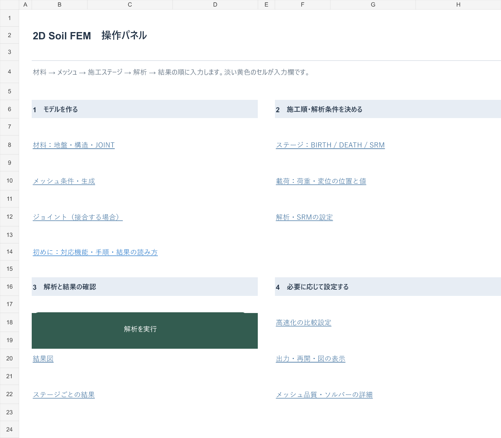
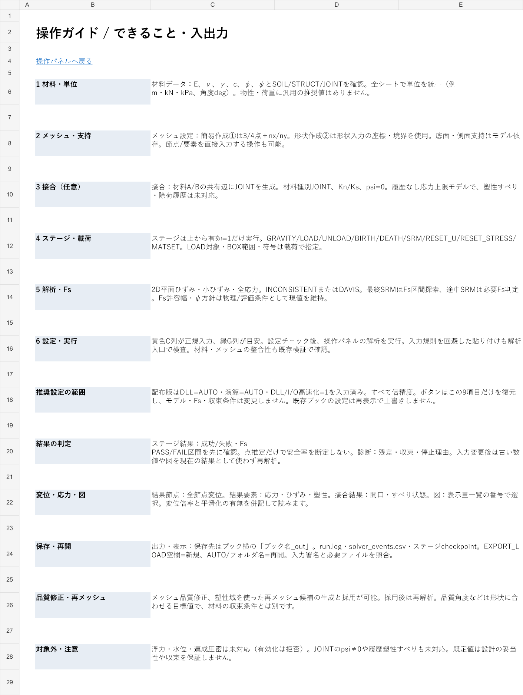

# 入出力を整理したブック（2026-10-20）

計算部分は `20261020_INCO_ELEMENT_01`、入出力画面は `20261020_UI_01` です。
材料則・Double・Newton/GMRESの収束条件・SRM探索条件は変更していません。
DLL 2個も要素行列積高速化版と同一です。

## 最初に使う画面

「操作パネル」から「操作ガイド」を開くと、対応機能、入力順、単位、結果の読み方、制限を確認できます。
入力表のタブは黄土色、設定は緑、出力は青です。
材料 → メッシュ・支持 → 接合（必要時）→ ステージ・載荷 → 解析設定 → 実行 → ステージ結果・診断 → 数値結果・図の順で操作します。
操作パネルには、従来の節点結果に加えて要素の応力・ひずみ・塑性を直接開くボタンを追加しました。

設定画面はC列が正規入力、E列が説明、G列が推奨・目安です。旧「設定」シートは互換用の参照式であり、二重入力しません。
黄色が編集欄、灰色は自動出力です。F列のKEYとG列の説明は保護しています。
メッシュ生成履歴は読み取り専用にしました。

## 推奨値を入力する範囲

通常使うDLL・I/O設定9項目を「高速化設定」の先頭へ集約し、配布版に次の値を入力しています。

| 項目 | 入力済みの推奨値 | 意味 |
| --- | --- | --- |
| NATIVE_DLL | AUTO | 使用可能なDLL経路を選択 |
| NATIVE_PRECISION | AUTO | Doubleを維持しCPU対応命令を選択 |
| NATIVE_STATE_COPY | 1 | 状態配列の一括転送 |
| NATIVE_ASSEMBLY | 1 | 行列組立のDLL経路 |
| NATIVE_GMRES_SIMD | 1 | 対応CPUの拡張命令 |
| NATIVE_GMRES_TUNED | 1 | GMRESの転送・更新処理の最適化 |
| NATIVE_GMRES_PREPARED | 1 | GMRESの作業領域再利用 |
| IO_FAST_PATH | 1 | ログ整形・バッファ処理 |
| EVENT_LOG_FAST | 1 | 診断イベントの整形処理 |

「DLL・I/Oだけ推奨値に戻す」は、この9項目だけを変更します。材料、座標、支持、荷重、Fs、ψ、反復・収束条件は変更しません。
設定を再表示したりブックを開き直したりしても、既存のユーザー設定を推奨値で上書きしません。

AUTO/SSE2/AVX2も倍精度です。STRICTは従来VBA互換演算です。
拡張命令の使用時は加算順序等による微小差を許容する方針を引き継ぎ、収束の判定値は緩めていません。
下段のV方式は比較・詳細設定です。INCONSISTENTでは、DAVIS用の旧LU再利用方式が休止することを説明しています。

材料値、荷重、支持、メッシュ寸法・分割数、Fs上限やψ方針には、全モデルに共通する推奨値を設定していません。
既存の入力を保持し、目安欄には「モデル依存」「現値を維持」等を表示します。
SRM_TOLの配布時入力は元ブックの **0.02**、SRM_PSI_POLICYは **KEEP** のままです。
通常0.025/詳細検証0.0125という説明は参考値であり、自動変更しません。
古い `SETTINGS_REFERENCE.md` の保存例やソースのフォールバック値とは区別してください。

## 対応機能と結果

| 分類 | 対応内容・確認先 |
| --- | --- |
| 解析 | 2D平面ひずみ、小ひずみ、全応力、Q8要素。INCONSISTENT / DAVIS |
| 材料 | SOIL / STRUCT / JOINT。JOINTはpsi=0の履歴なし応力上限モデル |
| ステージ | GRAVITY / LOAD / UNLOAD / BIRTH / DEATH / SRM / RESET_U / RESET_STRESS / MATSET |
| メッシュ | 簡易3/4点、形状・境界入力、品質修正、塑性域に基づく再メッシュ候補と採用 |
| 安全率 | 最終SRMのFs PASS/FAIL区間探索、途中SRMの必要Fs判定。「ステージ結果」で確認 |
| 数値結果 | 「結果節点」の全変位、「結果要素」の応力・ひずみ・塑性、「接合結果」の接触状態 |
| 診断 | 収束残差、停止理由、run.log / solver_events.csv |
| 図 | 表示量一覧、変位倍率、平滑化/要素平均/Gauss点の選択 |
| 再開 | ブック横の `ブック名_out` にcheckpoint保存。EXPORT_LOAD空欄=新規、AUTO/フォルダ名=再開 |

浮力・水位・連成圧密、JOINTのダイレタンシーや塑性すべり・除荷履歴は未対応です。
単位系は自動変換しません。例えばm・kN・kPaと角度degを全入力で統一します。
図や点推定だけで安全率を判断せず、Fs区間と成功/失敗・残差・停止理由を確認してください。
入力変更後は必ず再解析します。配布ブックに残る数値・図は前回計算の例であり、その旨を操作パネルに表示しています。

## 入力検査と保存の仕組み

選択肢、0/1、整数、数値範囲、空欄、角度の大小関係、要素数比の上下関係を検査します。
「解析設定」のチェックボタンは設定の形式・範囲を確認します。
貼り付けでExcelの入力規則を回避した場合も、解析入口で設定を検査し、該当シート・セル・KEYを表示して停止します。
不正な設定は既定値に置き換えず、数値結果を消去する前にINPUT_ERRORとして拒否します。
材料・節点・要素の整合性や形状の検査は、既存の検証経路も維持しています。

VBA・シート参照・マクロを保持するため、XLSMの作成と保存はExcelの既存ビルド手順を使用しています。
Spreadsheet artifact toolは画面確認に使用し、XLSXへの変換保存は行っていません。
元ブックは上書きせず、コピーに新しいUIモジュールを埋め込み、VBAコンパイル、保存前後のソース照合、再読込を行います。

## 再現

Excelをすべて閉じた環境で、リポジトリのルートから実行します。テストはコピーと所有するExcelだけを扱います。

```powershell
pwsh -NoProfile -File tests/build_workbook_ui.ps1 -OutputDirectory C:\work\soilfem_ui
pwsh -NoProfile -File tests/test_workbook_inputs.ps1 -Book C:\work\soilfem_ui\2DSoilFEM_ui_20261020.xlsm
pwsh -NoProfile -File tests/test_workbook_ui_persistence.ps1 -Book C:\work\soilfem_ui\2DSoilFEM_ui_20261020.xlsm -Baseline workbook/inco_element_20261020/2DSoilFEM_inco_element_20261020.xlsm
```

画面の説明・書式は初回表示と明示更新時に整え、通常の解析では設定の連携とシート順だけを確認します。ユーザーの入力値をキャッシュして固定する処理ではありません。
手動計算モードでも設定式を評価してから検査し、前のキャッシュ値が有効でも新しい計算結果が範囲外なら拒否します。

## 最終版の検証結果

配布XLSMのSHA-256は `CD71E11DC7CC0E3E6A92150EFFC30C619A6B9257CCAB076B88B6929FB252DFA1` です。
ExcelによるVBAコンパイル、11モジュールの保存前後・再読込ソース照合、DLL読み込みを確認しました。
入力検査813項目、保存・互換性407項目の計1,220項目がPASSです。XML上の83設定も重複なく旧参照式と一致しています。
元ブックの8入力表（1,005節点・306要素を含む）と83設定の値・型を保持し、推奨値への復帰がDLL・I/Oの9項目に限定されることを確認しました。

85節点・20要素の共通fixtureで、INCONSISTENTのSRM探索1組、INCONSISTENT/DAVISの固定Fs各4組を比較しました。
9組すべてでFs区間、全170変位、最終残差、計算回数、全solver_events.csvのSHA-256が完全一致しました。
大きい元モデル全体の再計算時間は今回の比較対象に含めていません。

| INCONSISTENT SRM探索 | 旧画面 | 新画面 |
| --- | --- | --- |
| Fs PASS / FAIL | 2.200000000000001 / 2.2125000000000012 | 同一 |
| 試行数 | 17 | 17 |
| 最終相対残差 | 6.5595364013624e-13 | 同一 |
| 全170変位の最大差 | — | 0 |
| 経過時間（秒） | 43.3108410 | 41.6344258 |

時間は各1回の参考値であり、速度改善率を保証する測定ではありません。両ブックとも通常のWorkbook_Openに相当する初期表示を計測前に行う `-WarmUi` 条件です。
初回の画面整備を計測内に含めた短い固定Fsケースでは、旧2.466秒に対し新4.738秒（INCONSISTENT）、旧2.484秒に対し新4.721秒（DAVIS）でした。
新画面では初回だけ整備し、同一セッションの2～4回目はINCONSISTENT 1.640～1.698秒、DAVIS 1.636～1.658秒でした。初回整備のコストは残ります。
これは入出力画面の変更であり、DLL自体を高速化した変更ではありません。

[検証記録](ui-evidence/20261020/ui_comparison_final11.json)、[入力813項目](ui-evidence/20261020/ui_inputs_final11.json)、[保存407項目](ui-evidence/20261020/ui_persistence_final11.json)、[コンパイル・ソース照合](ui-evidence/20261020/build11.log)を添付しています。
画面プレビューは同じUIの直前ビルドをartifact toolで描画したもので、最終版との差は詳細設定の説明文「C47=1」を「自動選別=1」に直した1箇所です。配布XLSMはExcelで保存・検証した最終版です。





SRM比較の再現例です。旧・新の各ブックについて別プロセスで実行し、Excel終了を待って次へ進みます。固定Fs4ケースは `-Suite smoke` とし、`-CaseName` と `-WarmUi` を外します。

```powershell
pwsh -NoProfile -File tests/native/run_native_compare.ps1 -Book <比較するブック> -Out <新規JSONパス> -Suite smokesrm -CaseName Case1 -Flow INCONSISTENT -Modes AUTO -Variants off -Precision AUTO -StateCopy 1 -AssemblyFast 1 -GmresSimd 1 -GmresTuned 1 -GmresPrepared 1 -IoFast 1 -EventFast 1 -WarmUi
python tests/native/compare_ui_results.py --pair <旧JSON> <新JSON> --out <比較JSON>
```

