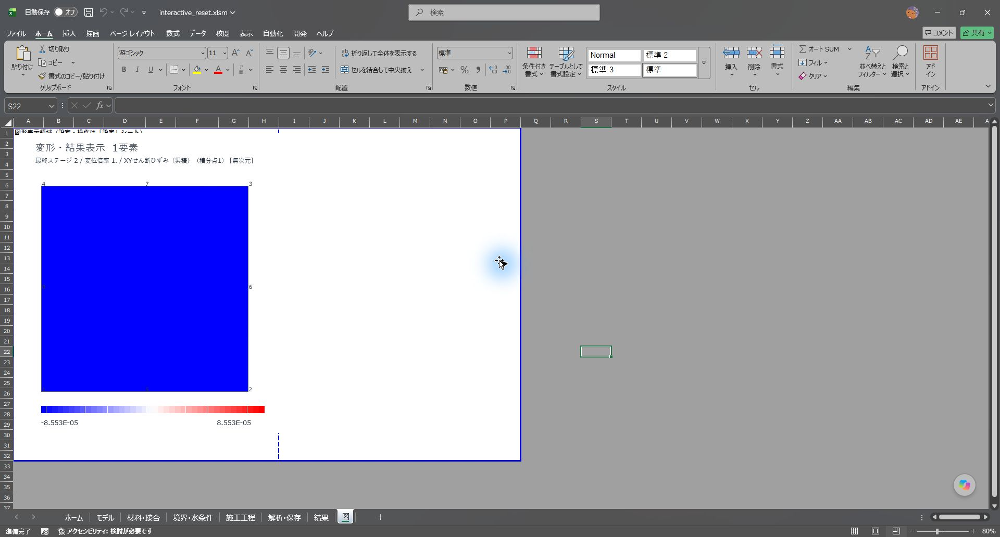
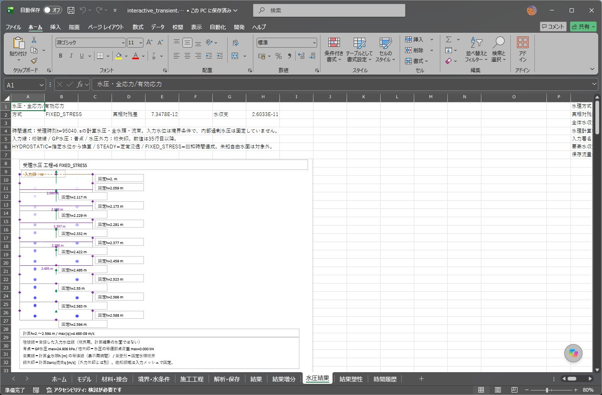

# XLSMの水条件・工程・結果出力の修正

計算識別07の追加修正と最終配布候補の検証は、[Issue #49〜#57の記録](ISSUE49_57_VALIDATION.md)を参照。以下は06で修正した各Issueの再現・比較記録である。

対象は1024版、計算ビルド `20261024_FIXED_STRESS_06`。Double、材料則、収束判定、SRM探索条件は変更しない。DLLは従来の1個をそのまま使用する。

## 修正内容

|関連issue|修正|
|---|---|
|#38|新規解析の開始時に「結果塑性」も消去する。ALL出力で前回の塑性結果・同じ工程の行が残らないようにする。|
|#43|SRMの成功状態に、水圧の目標・現在・受理値、選択水位、節点水頭、流束、境界反力流量、面流量、水圧外力、流束表示判定に使う透水係数、診断値を保存する。機械側の有効要素を戻してから水理接続を再構築し、成功状態の水理場を復元する。|
|#44|片方向の定常浸透で、水理節点を共有する透水要素同士の内部面にHEADを指定すると入力エラーにする。SOIL／PRESCRIBEDのJOINTで水理節点が分離した面は、従来どおり水頭境界を指定できる。内部の注排水源を、外周流量に見せかけて相殺しない。時間連成の専用排水セットは従来どおり別経路で扱う。|
|#45|静水圧の外水位と地盤側水位を、対象面の両端と両折れ線の全折れ点で比較する。面の始点だけが同じ場合や、面の途中だけ食い違う場合、数値による固定水頭も検査する。|
|#46|RESET_STRESSの実行順を、工程IDの大小ではなく成功履歴の行順で判断する。工程IDを並べ替えた結果・最終RESETの結果を描画できるようにする。|

試験中に見つかった関連不具合も修正する。

- RESET直後の出力診断は、解放済みの潜在自重ではなく受理済みの荷重を使う。応力をゼロに戻したときは、受理内力もゼロにする。
- 地下水なしの保存再開でも、保存した応力から内力を復元する。完全再開で追加の求解がない場合も反力・残差を再現する。
- 水圧だけが変わり変位・総荷重が変わらない場合も、材料・内力の評価キャッシュを失効させる。最終水圧と有効主応力の派生値が食い違う状態を防ぐ。出力値だけを上書きする処置ではない。

#26のゼロ局所変位時の増分ガード、#27の数式を含む高速化設定表の移動防止ガードは既存の処理を保持する。旧 `CONSOL_ENABLE` の停止メッセージは、現在の工程別FIXED_STRESSと区別する表現に改める。旧圧密経路やJOINTの非ゼロダイレイタンシーを新たに有効化する変更は含まない。

## 検証方法

専用コピーに入力し、実Excelでコンパイル・計算・保存再開・図表示を試験する。配布ブック自体にはテスト専用マクロを残さない。

入力は[issue再現用JSON](../tests/fixtures/issues_xlsm)、逐次実行は[run_xlsm_issue_regression.ps1](../tests/run_xlsm_issue_regression.ps1)。既にExcelが起動している場合は開始せず、解析を経過時間だけで停止する処理は設けない。

```powershell
pwsh -NoProfile -File tests/run_xlsm_issue_regression.ps1 -Book workbook/ui_20261024/2DSoilFEM_ui_20261024.xlsm -Out <新規出力フォルダー>
pwsh -NoProfile -File tests/run_issue44_joint_regression.ps1 -Book workbook/ui_20261024/2DSoilFEM_ui_20261024.xlsm -Out <JOINT境界の新規出力フォルダー>
pwsh -NoProfile -File tests/run_fixed_stress_regression.ps1 -Book workbook/ui_20261024/2DSoilFEM_ui_20261024.xlsm -Out <時間連成の新規出力フォルダー>
pwsh -NoProfile -File tests/run_groundwater_regression.ps1 -Book workbook/ui_20261024/2DSoilFEM_ui_20261024.xlsm -ReferenceBook <修正前の保存コピー> -Out <従来機能の新規出力フォルダー>
```

水理の独立検算は、幅2 m・高さ1 mの矩形を使う。左水頭3 m、右2 m、上下遮水とし、均一透水係数と2層の透水係数について全節点水頭・全GP水圧・Darcy流束・面流量・水収支を解析解と比較する。静水圧の同値折れ線では、上面の外水圧合力10 kN、原点回りモーメント5 kNmと支持反力30 kNを照合する。

SRMスナップショットの専用試験は、実際の非公開の成功保存・復元ルーチンを検証コピーから呼ぶ。受理後に水位・有効要素を意図的に変え、復元後の全水理値・接続別名・変位・内力・外力をCSV全行で照合する。この操作で作った後続試行を、自然な力学非収束と呼ばない。別に、斜面の自然なFs探索・保存再開も実行する。

自然なSRM探索例では、保存再開の汎用試験が持つ絶対残差 `1e-7` より大きく、既存ソルバーの受理基準 `1e-5` 以下の状態が採用された。この例に限り `checkResumeAgainstSolverTolerance` を指定し、配布ブックの `P3_ENGINEERING_RESIDUAL` を直接読み取って、新規・再開の両方がその基準内であること、残差差が `1e-9` 以下であることを確認する。変位・全応力スロット・反力・Fs区間の一致判定も維持する。他の入力の汎用試験 `1e-7` と、解析側の収束条件は変更しない。最初の汎用試験での停止を数値復元の合格とは数えず、明示した契約で再実行した記録を使う。

JOINT境界の追加試験は、幅2 m・各高さ1 mの上下2層に、水頭 `h=3−0.5y` を与える。SOILは下層地盤と上層構造体で計算対象8水理節点（出力16行中、構造体側の未計算8行は水頭0・流量0）・4地盤積分点・4面、PRESCRIBEDは両側地盤で水理節点を分離したまま16水理節点・8積分点・8面を検算し、保存再開も比較する。通常のCONTINUOUSでは共有後の独立13水理DOF（出力16行では共有面の別名3行にも水頭を展開）と通過流量も解析解に照合する。CONTINUOUSの内部水頭指定と、PRESCRIBEDの指定値衝突は、それぞれ適切な入力エラーになることを確認する。

## 合格記録

検証環境は64bit Excel 16.0 build 20430。最終配布ブックは実VBEコンパイルと全52モジュールの保存前・再オープン後照合に合格し、元入力表8枚と計算設定の保持を確認した。

|試験|結果|
|---|---|
|issue再現17入力|正常13件と想定拒否4件が合格。保存再開も比較|
|RESET履歴・図5種類|ID逆順、複数RESET、最終RESET、RESETなし、FINAL出力が描画・再オープンに合格。入力変更と不正座標の拒否も維持|
|塑性の再解析|旧最大値 `8.7442278296e-4` から新解析は0。128行の工程・要素・GPキーが一意で、新しい強度条件の独立実行と変位・応力・診断値が完全一致|
|同条件の反復工程|先行塑性増分 `4.5427146888e-5` がある入力で、後続の同条件GRAVITY／LOADの各32行は塑性増分0|
|水位を変更した斜面SRM|Fs区間 `[1.55, 1.5625]`。新規／再開の最大変位差 `4.98e-13 m`、残差差 `1.11e-15`。最終B水位の80GPを照合|
|水圧と有効主応力|水位変更後の全GPで独立に主応力を計算。最大差 `2.84e-14 kPa`|
|SRMの水理出力|時間連成の斜面SRMで80GPすべてに流束を出力。親工程との水圧・流束差0|
|JOINT境界15入力|正常・拒否・保存再開に合格。SOIL／PRESCRIBED／CONTINUOUSの解析解との差は水圧 `7.11e-15 kPa` 以下、流束 `1.67e-20 m/s` 以下|
|水理の解析解|全節点・GP・面を照合。圧力差 `1.78e-14 kPa` 以下、水頭差 `2.67e-15 m` 以下、流束差 `9.49e-20 m/s` 以下|
|既存の時間連成17入力|修正前の合格記録と全変位・応力・Fsが完全一致。出力診断値の差は丸め誤差の範囲 `1e-10` 以下|

上表の全回帰は候補6で実施した。最終候補7との差は、水理節点を分離したJOINT面を内部注排水源と誤判定しないためのHEAD検査だけである。最終候補には境界・JOINT15入力の追加回帰、RESETの図表示・保存再開、塑性を含む時間連成SRM・保存再開・水理スナップショット試験に合格した。候補ごとのソース指紋・配布SHA・検証範囲を分けて保存する。候補6の全回帰を最終候補7で再実行した記録とは扱わない。

記録・配布照合値と実画面は以下に掲載する。

- [検証記録](xlsm-issue-evidence/20261024/validation.json)
- [正常・拒否・再開・塑性・表示の集計](xlsm-issue-evidence/20261024/states.json)
- [最終候補のJOINT独立検算](xlsm-issue-evidence/20261024/joint_analytic.json)
- [全時間連成値の比較と所要時間](xlsm-issue-evidence/20261024/fixed_stress_comparison.json)
- [従来の乾燥・水理・SRM比較](xlsm-issue-evidence/20261024/legacy_comparison.json)
- [再現ブック・ログ・CSV](xlsm-issue-evidence/20261024)

旧計算識別05の保存途中データは06へ直接再開せず、元ブックで継続するか、新版で入力から再解析する。入力表の形式は維持している。DLLの変更はない。




