# 2D Soil FEM 利用者向け説明書

## 1. 概要

2D Soil FEMは、Excelで地盤の形状・材料・施工順を入力し、変位や応力を計算するソフトです。自重、載荷、掘削、盛土、材料変更、強度低減法（SRM）を扱います。

数値例は操作練習用です。

解析は平面ひずみ・小ひずみのQ8連続体モデルです。構造材料のSTRUCTも連続体として計算します。梁・トラス・板曲げの専用要素ではありません。接合にはJOINTを使います。水位・浮力・浸透・連成圧密・大変形の解析には対応していません。

初めて使うときは、第3章で起動し、第5章の順に進めてください。入力欄の意味は第6章、計算後の確認は第7章で説明します。

## 2. 必要環境

|項目|必要なもの・確認点|
|---|---|
|実行環境|Windowsのデスクトップ版Excel。VBAマクロを実行できること。Excel for the webでは実行できません。|
|ブック|`2DSoilFEM_ui_20261021.xlsm`。拡張子を`.xlsm`のまま使います。|
|高速計算|同梱の`soilfem_native_x64.dll`。x64 DLLの利用には64ビット版Excelが必要です。|
|保存場所|ブックと外部出力を書き込めるフォルダー。|
|DLLを使わない場合|「高速化設定」で`NATIVE_DLL=OFF`にするとVBAで計算します。|

実行用にPython、Git、VBAソースの取り込みは不要です。Mac版の動作は未確認です。

## 3. インストール

1. リポジトリの[配布ZIP](../../workbook/SoilFEM_UI_20261021.zip)を保存します。
2. ZIPを新しい作業フォルダーへ展開します。
3. `2DSoilFEM_ui_20261021.xlsm`と`soilfem_native_x64.dll`を同じフォルダーに置きます。DLLは同梱の1個を使います。
4. 作業用のブックをコピーします。ケースごとに名前を付けると、入力と出力を整理しやすくなります。
5. Windowsのデスクトップ版Excelでブックを開きます。取得元を確認し、編集とマクロを有効にします。
6. マクロがブロックされた場合はExcelを閉じます。対象ファイルのプロパティで「ブロックの解除」または「許可する」が表示される場合は解除して開き直します。組織の設定で解除できない場合は管理者へ確認します。
7. 「操作パネル」が開くことを確認します。淡い黄色のセルに値を入力します。見出し、設定KEY、シート名は変更しません。

DLLが見つからない場合、`NATIVE_DLL=AUTO`ではVBAへ戻る経路を使います。DLLの利用状態は「診断」で確認します。VBA計算はDLL計算と所要時間が異なります。

## 4. 画面構成

### シートの役割

|シート|役割・開き方|
|---|---|
|「操作パネル」|入力画面への移動、解析前の確認、数値結果と診断を開く入口。|
|「操作ガイド」|入力順、対応機能、結果を見る順序の案内。|
|「材料データ」|地盤・構造・接合の定数と初期状態を入力。|
|「形状入力」|点の座標、外側境界、穴の境界、格子間隔を入力。|
|「メッシュ設定」|生成材料、外周拘束、生成方式を指定。メッシュを作成・確認・修正。|
|「接合」|接合する材料の組合せを入力。|
|「載荷」|対象位置、方向、節点力、強制変位、固定を入力。|
|「ステージ」|自重・掘削・盛土・載荷・SRMなどを実行順に入力。|
|「解析設定」|流れ則、SRMの探索条件などを入力。|
|「高速化設定」|DLLとI/O、高速化候補の設定。|
|「出力・表示」|数値結果・ログ・途中状態の保存と、図の表示条件を設定。|
|「詳細設定」|メッシュ品質目標、品質修正、ソルバーなどを設定。|
|「図」|メッシュと拘束を確認。解析後は変形・応力図を表示。|
|「ステージ結果」|施工段階ごとの成否、変位、反力、Fs区間を確認。|
|「接合結果」|接合の応力、開口、すべり、接触状態を確認。|
|「節点データ」|節点座標と個別拘束。「節点・拘束」から開きます。|
|「要素データ」|節点接続と材料番号。「要素」から開きます。|
|「結果節点」・「結果要素」|変位・反力・応力・ひずみ。「数値結果」から確認します。|
|「診断」|解析状態、残差、失敗位置。「診断」から開きます。|
|「表示量一覧」|結果の内容名と選択番号。「表示項目一覧」から開きます。|
|「仕様」|対応範囲と制約。「仕様・制約」から開きます。|
|「図形定義」・「設定」・「メッシュ引継」|通常操作では直接編集しません。|
|「再メッシュ候補」|品質修正や再メッシュの候補を確認する表。|

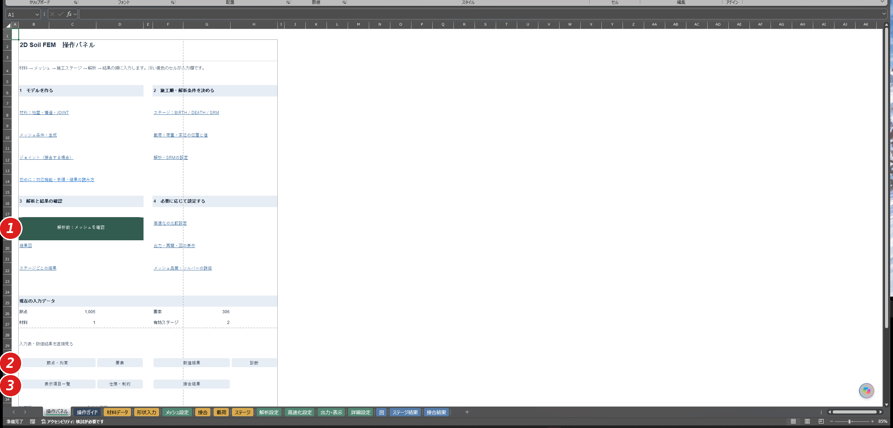

図1 「操作パネル」。①「解析前：メッシュを確認」は確認図を開きます。②「節点・拘束」「要素」「数値結果」「診断」は入力表と数値の確認に使います。③「表示項目一覧」「仕様・制約」「接合結果」は表示内容と接合状態の確認に使います。

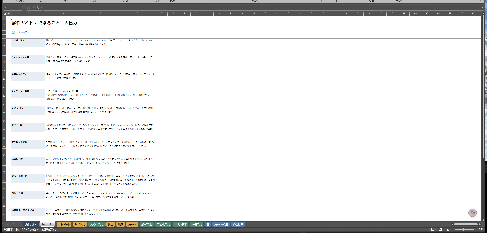

図2 「操作ガイド」。①材料・単位から入力を始めます。②メッシュ、施工順、解析条件へ進みます。③結果判定と保存方法を確認します。

図1と図16の丸数字は画像内の赤丸に対応します。ほかの図の丸数字は、本文で読む順序を示します。

## 5. 解析手順

### 1. 作業用ブックを準備する

- **シート**：「出力・表示」。
- **操作**：作業用コピーを開きます。最初から解析するときはC14を空欄にします。
- **確認点**：前回の入力や施工順を残す場合は内容を確認します。既存メッシュを使う場合は、手順4のメッシュ生成を省略します。

### 2. 材料を入力する

- **シート**：「材料データ」。
- **操作**：材料番号、剛性、重量、強度、初期状態、種別を入力します。
- **確認点**：全シートで単位を統一します。後から盛り立てる材料はJ列をOFFにします。別々に掘削する領域には別の材料番号を使います。

### 3. 輪郭を入力する

- **シート**：「形状入力」。
- **操作**：点の番号と座標を入力します。境界を一周する点番号と、正の格子間隔を入力します。
- **確認点**：点番号の重複・未登録参照・境界の交差がないことを確認します。末尾に始点番号を重ねません。

### 4. メッシュを作成する

- **シート**：「メッシュ設定」。接合が必要なら先に「接合」も入力します。
- **操作**：生成材料番号と外周拘束を設定します。「形状メッシュを作成」を押します。
- **確認点**：生成は「節点データ」「要素データ」を更新します。表示された「図」で形状、拘束、品質を確認します。複数材料の場合は「要素」から領域ごとの材料割当も確認します。

### 5. 接合・載荷・施工順を決める

- **シート**：「接合」「載荷」「ステージ」。
- **操作**：必要な接合と載荷を入力します。「ステージ」に実行順で行を並べます。有効な行のE列に数値の1を入れます。
- **確認点**：自重のみならGRAVITYを有効にします。外力をかけるならLOADも必要です。載荷のDISP=0はゼロ変位の指定です。行を無効にする値ではありません。

### 6. 解析条件と保存条件を確認する

- **シート**：「解析設定」「高速化設定」「出力・表示」。
- **操作**：流れ則、SRM上限・許容幅、保存範囲を指定します。「設定の形式・範囲をチェック」を押します。
- **確認点**：SRMの実行は「ステージ」で指定します。通常のDLL・I/O設定には配布値を使えます。「DLL・I/Oだけ推奨値に戻す」は材料・荷重・支持・Fs条件を変更しません。

### 7. 解析直前のメッシュを確認する

- **シート**：「操作パネル」から「図」へ。
- **操作**：「解析前：メッシュを確認」を押します。
- **確認点**：この操作では計算は始まりません。外形、材料、X/Y拘束、BIRTH/DEATH予定色、品質集計を確認します。必要なら「品質修正候補を確認」を押します。候補は採用するまで元のメッシュを変更しません。採用後は図と個別拘束を確認します。

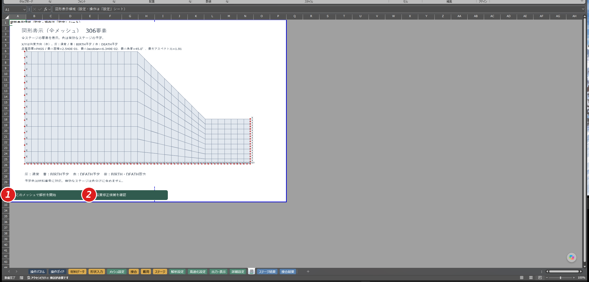

図16 「図」のメッシュ確認。①「このメッシュで解析を開始」で計算を始めます。②「品質修正候補を確認」で修正候補を確認します。

### 8. 解析を開始する

- **シート**：「図」。
- **操作**：「このメッシュで解析を開始」を押します。
- **確認点**：確認後に入力を変えた場合は、再び確認図が表示されます。計算中は進行表示と外部ログを確認します。

### 9. 数値結果を確認する

- **シート**：「ステージ結果」「診断」「結果節点」「結果要素」。接合を使う場合は「接合結果」。
- **操作**：成否とメッセージを読みます。「操作パネル」の「診断」「数値結果」を開きます。
- **確認点**：最後まで実行できたか、残差と釣合い、変位方向、応力集中を確認します。SRMでは中点だけでなく成功・失敗Fsの区間を確認します。

### 10. 図を表示して保存する

- **シート**：「出力・表示」。
- **操作**：表示する結果の内容名と倍率を選びます。「変形・応力図を表示」を押します。確認後、Excelでブックを保存します。
- **確認点**：図の対象Fsと数値表の状態を照合します。外部出力はブック横の`ブック名_out`に保存されます。比較用には次の実行前にブックと出力フォルダーを一緒にコピーします。

## 6. 入力項目の説明

### 共通の単位と入力規則

自動単位換算はありません。Xの正方向は右、Yの正方向は上です。下向きの力と変位には負値を使います。

|量|長さm・力kNを使う場合|
|---|---|
|座標・板厚・変位・開口・すべり|m|
|ヤング率・粘着力・応力|kN/m²（kPa）|
|単位体積重量|kN/m³|
|節点力|kN|
|JOINTのKn・Ks|kN/m³（応力／相対変位）|
|摩擦角・ダイレタンシー角|度|
|ひずみ・Fs|無次元|

材料・節点・要素番号は1からの連番です。重複と欠番を避けます。入力表の不要な古い行も確認してください。

### 「材料データ」

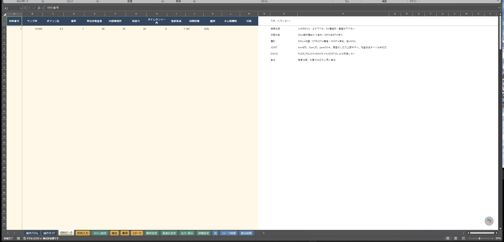

図3 「材料データ」。①A:Hに材料定数を入力します。②I:Kで強度低減、初期状態、種別を指定します。③JOINTではB列をKn、L列をKsとして使います。

|列|項目|意味・入力方法|
|---|---|---|
|A|材料番号|1からの連番。|
|B|ヤング率／Kn|SOIL・STRUCTでは正のヤング率。JOINTでは正の法線剛性Kn。|
|C|ポアソン比|数値を入力。SOIL・STRUCTでは−1より大きく0.5未満。|
|D|板厚|正の値。奥行方向の厚さ。|
|E|単位体積重量|GRAVITYとBIRTHの自重に使用。|
|F|内部摩擦角φ|度で入力。|
|G|粘着力c|応力と同じ単位。|
|H|ダイレタンシー角ψ|塑性流れの体積変化に関係する角度。JOINTでは0。|
|I|強度低減|1／ONはSRM対象。0／OFFは低減しません。|
|J|初期状態|ONは開始時から有効。OFFはBIRTHを待ちます。|
|K|種別|SOIL、STRUCT、JOINTを明示。|
|L|せん断剛性Ks|JOINTでは正の値。空欄または0以下なら内部で0.1×Kn。|
|M|引張|JOINTで1／ONは引張を保持。0／OFFまたは空欄は引張を保持しません。|

A:Hは数値が必要です。I/Jは空欄だとONとして扱われるため、値を明示します。STRUCTという名前だけで塑性評価が無効になるわけではありません。I列の強度低減と、結果の塑性状態を確認します。

JOINTは履歴なしの応力上限モデルです。総すべり×KsをCoulomb強度で制限します。塑性すべりの累積、残留すべり、ダイレタンシーは扱いません。

入力例：材料1を`E=14000、ν=0.3、厚さ=1、γ=20、φ=35、c=20、ψ=0、I=1、J=ON、K=SOIL`とします。

### 「形状入力」

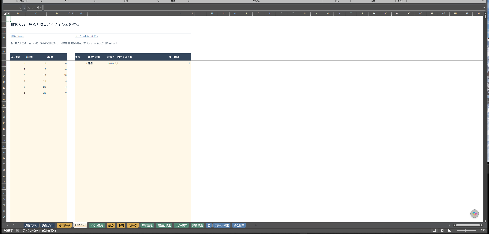

図4 「形状入力」。①左表に点番号とX/Y座標を入力します。②右表に境界の種類と一周する点番号を入力します。③格子間隔でメッシュの細かさを指定します。

|入力欄|内容|確認点|
|---|---|---|
|左表の点番号・X座標・Y座標|輪郭を作る点。8行目から入力。|番号を重複させません。|
|右表の番号|境界の番号。|境界ごとに分けます。|
|境界の種類|外側または穴の境界。|画面の選択肢に従います。|
|境界を一周する節点順|左表の点番号をカンマ区切りで指定。|輪郭を交差させず、末尾に始点を重複させません。|
|格子間隔|正の長さ。|小さくすると一般に要素数が増えます。|

図4の入力例は、点1=(0,0)、2=(0,10)、3=(10,10)、4=(16,4)、5=(20,4)、6=(20,0)です。外側境界を`1,6,5,4,3,2`、格子間隔を1.5としています。

### 「メッシュ設定」

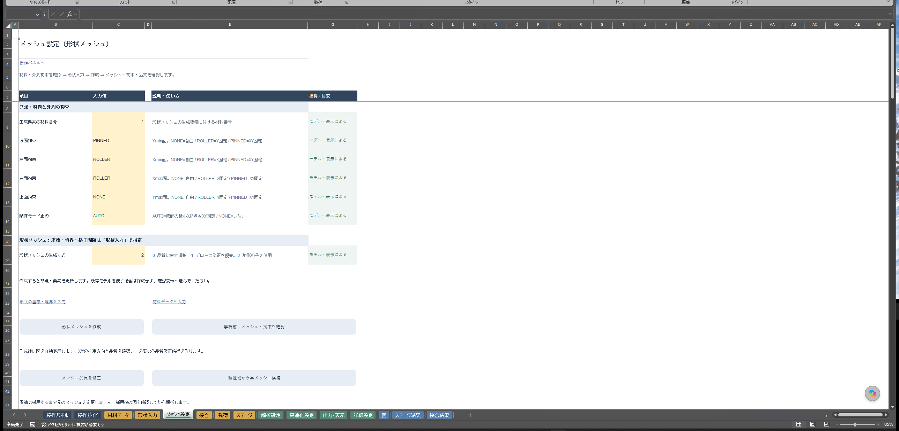

図5 「メッシュ設定」。①C9:C14で生成材料と拘束を指定します。②C29で生成方式を指定します。③「形状メッシュを作成」後に図を確認します。

|セル|項目|入力・意味|
|---|---|---|
|C9|生成要素の材料番号|登録済みの材料番号。|
|C10:C13|底面・左面・右面・上面拘束|NONEは自由。PINNEDはX/Y固定。ROLLERは底面・上面でY固定、左面・右面でX固定。|
|C14|剛体モード止め|AUTOは底面の最小節点をX/Y固定。NONEは追加しません。|
|C29|形状メッシュの生成方式|0は品質比較で選択、1はデローニ修正を優先、2は地形格子を使用。|

外周拘束は座標範囲の端を基準に設定します。斜面全体に支持が自動設定されるとは限りません。「節点・拘束」で個別条件を確認します。

「メッシュ品質を修正」は品質修正候補を作ります。「塑性域から再メッシュ候補」は計算した塑性域を使って候補を作ります。採用後は再解析します。任意の再メッシュへ施工履歴をそのまま移せる機能ではありません。

### 「節点データ」・「要素データ」

|シート・列|入力内容|
|---|---|
|「節点データ」A:C|節点番号、X座標、Y座標。|
|「節点データ」D:E|X/Y拘束。0は自由、通常は1で拘束。|
|「節点データ」F:G|互換用のX/Y強制変位。空欄は0。|
|「節点データ」H:I|互換用のX/Y節点力。空欄は0。|
|「要素データ」A|要素番号。|
|「要素データ」B:I|Q8の8節点番号。4隅を左下・右下・右上・左上の順に指定し、続けて各辺の中点を指定。|
|「要素データ」J|材料番号。独立して施工する領域には別番号を割り当てます。|

通常の新規載荷は「載荷」とLOADを使います。同じ自由度に複数経路で荷重や変位を重ねないようにします。

JOINTは6節点です。「要素データ」B:GにA側の端点1・端点2・中点3、対応するB側の端点4・端点5・中点6を指定します。周回順ではありません。H:Iは有効節点に含みません。

### 「接合」

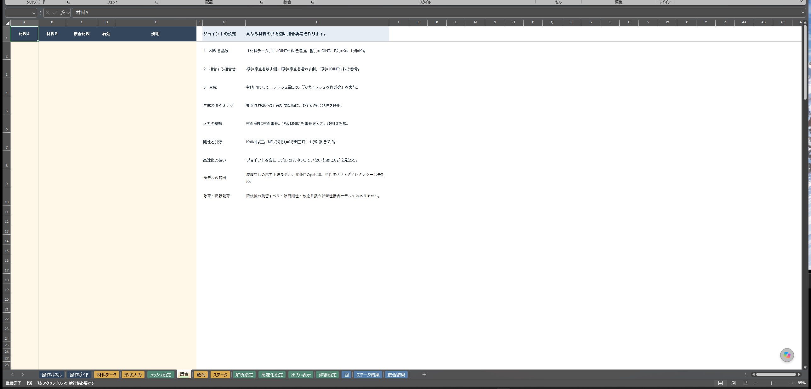

図6 「接合」。①材料Aと材料Bを指定します。②登録済みのJOINT材料番号を指定します。③有効欄を1にして生成します。

|列|項目|意味|
|---|---|---|
|A|材料A|節点を残す側の材料番号。|
|B|材料B|節点を複製する側の材料番号。Aとは別番号。|
|C|接合材料|「材料データ」でK=JOINTにした材料番号。|
|D|有効|1で生成対象。0で無効。|
|E|説明|任意のメモ。|

異なる材料の共有辺に接合要素を作ります。材料A/Bを逆にすると複製する側が変わります。既存の接合要素には再挿入しません。組合せを変更して作り直す場合は、接合生成前のメッシュのコピーから始めます。

### 「載荷」

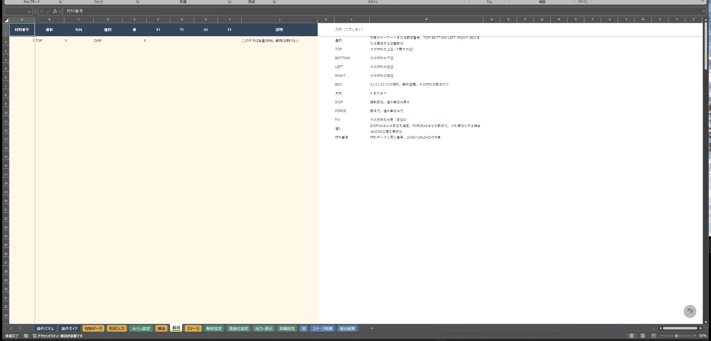

図7 「載荷」。①A:Bで材料と対象位置を選びます。②C:Eで方向、種類、値を指定します。③BOXを使う場合はF:Iに矩形座標を入力します。

|列|項目|意味|
|---|---|---|
|A|材料番号|LOAD/UNLOADの対象材料。|
|B|選択|TOP、BOTTOM、LEFT、RIGHT、BOX、または元の節点番号。|
|C|方向|XまたはY。|
|D|種別|FORCEは節点力、DISPは強制変位、FIXはゼロ変位拘束。|
|E|値|FORCEでは選択した各節点の力。DISPでは目標変位。FIXでは値を使いません。|
|F:I|X1、Y1、X2、Y2|BOXの矩形座標。境界を含みます。|
|J|説明|任意のメモ。|

TOPなどは対象材料の座標範囲の端を選びます。曲面や斜面全体を選ぶ指定ではありません。BOXはその材料に属する節点を矩形で選びます。

FORCEは合力を自動配分しません。例えば5節点に−10を指定すると、合力は−50です。対象節点数を確認してください。

DISPは現在値からの追加量ではなく、目標変位です。自重後のY変位が−0.064405714 mで、さらに0.010 m沈下させる入力例では、目標は−0.074405714 mです。DISP=0も拘束として働きます。不要な載荷は行を削除するか、対応するLOADを無効にします。

### 「ステージ」

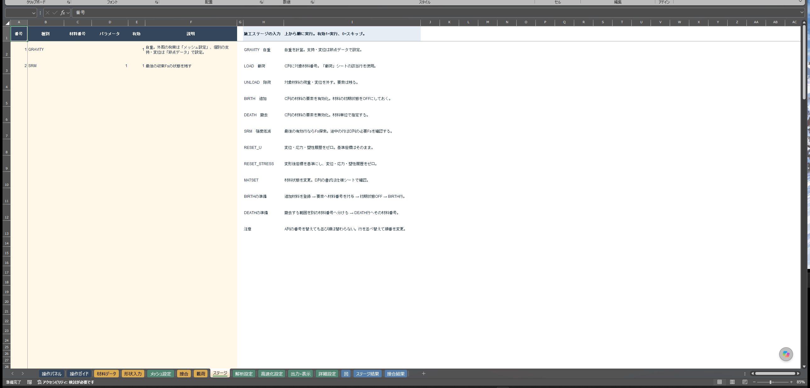

図8 「ステージ」。①上から実行順に行を並べます。②材料番号とパラメータで対象を決めます。③有効欄に数値1を入れます。

|列|項目|意味|
|---|---|---|
|A|番号|管理用番号。番号の書換えだけでは実行順は変わりません。|
|B|種別|下表のキーワード。|
|C|材料番号|BIRTH/DEATH/MATSETでは必須。LOAD/UNLOADでは対象グループ。|
|D|パラメータ|MATSETの変更内容、途中SRMの必要Fsなど。|
|E|有効|数値1で実行、0で無効。文字のONは使いません。|
|F|説明|任意のメモ。|

|キーワード|動作・確認点|
|---|---|
|GRAVITY|自重を計算。支持は「メッシュ設定」や「節点データ」で指定。|
|LOAD|「載荷」の対象材料の行を適用。|
|UNLOAD|対象の荷重・強制変位を外す。要素は残します。|
|BIRTH|対象材料の要素を有効にして自重を計算。J列を初期OFFにして準備。|
|DEATH|対象材料の要素を無効化。同番号の別領域も対象になります。|
|MATSET|対象材料を変更。D列が数値ならその材料をコピー。文字なら`c=20;phi=30`などで指定。|
|RESET_U|変位・応力・塑性履歴をゼロにする。基準座標は維持。|
|RESET_STRESS|変形後座標を基準にし、変位・応力・塑性履歴をゼロにする。|
|SRM|先行工程を再実行しながら強度低減を試す。最終行と途中行では扱いが異なります。|

MATSETの主なキーは`c、phi、psi、E、nu、gamma、kn、ks`です。指定した値だけ更新します。JOINTと連続体の相互コピーはできません。RESET系は除荷とは異なるため、履歴を消す目的を確認して使います。

最後の有効行がSRMなら、Fs探索結果を保存します。後ろに施工が続くSRMでは、D列を必要Fsとして成功側FSSと比較します。未達なら中断します。通過後はFs=1で履歴を再生し、施工を続けます。途中SRMのD列は固定Fs試験の指定ではありません。

入力例：自重とSRMは`GRAVITY → SRM`です。掘削と再盛土は`GRAVITY → DEATH（掘削材料）→ BIRTH（初期OFFの盛土材料）`です。追加する材料を登録し、対象要素にその番号を割り当てておきます。

### 「解析設定」

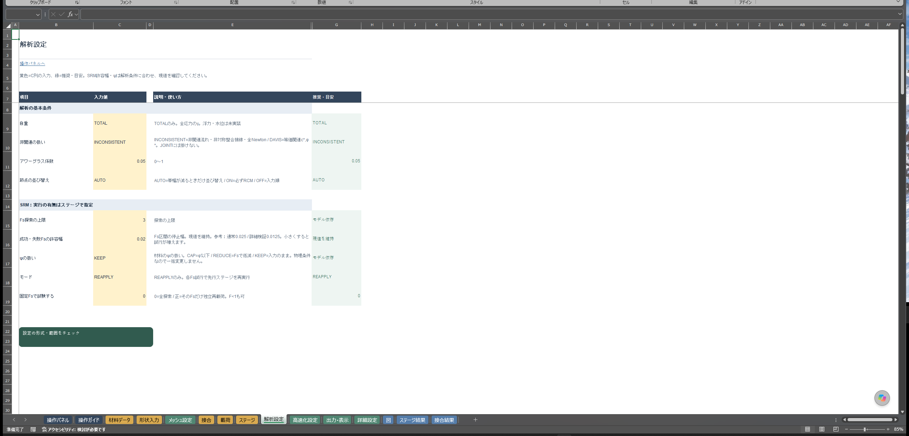

図9 「解析設定」。①基本条件を確認します。②SRM上限、許容幅、ψの扱いを指定します。③「設定の形式・範囲をチェック」で入力形式を確認します。

|セル|項目|意味|
|---|---|---|
|C9|自重|TOTAL。全応力で計算。|
|C10|非関連の扱い|INCONSISTENTは非関連流れ・非対称整合接線のNewton法。DAVISは等価関連材料への変換。JOINTにDAVIS変換は適用しません。|
|C11|アワーグラス係数|Q8の安定化係数。範囲0～1。|
|C12|節点の並び替え|AUTO、ON、OFF。計算順序の設定。|
|C15|Fs探索の上限|探索を打ち切るFs。|
|C16|成功・失敗Fsの許容幅|探索区間の終了幅。小さくすると試行が増えます。|
|C17|ψの扱い|KEEPは入力を保持。CAPは低減後φ以下に制限。REDUCEはFsで低減。|
|C18|モード|REAPPLY。各Fsで先行ステージを再実行。|
|C19|固定Fsで試験する|0は全探索。正の値はそのFsだけを試験。|

SRMは対象材料の`c/Fs`と`tanφ/Fs`を用います。φそのものをFsで割る操作ではありません。ψの方針と流れ則は結果に影響する条件です。速度比較のためだけに変更しません。

### 「高速化設定」

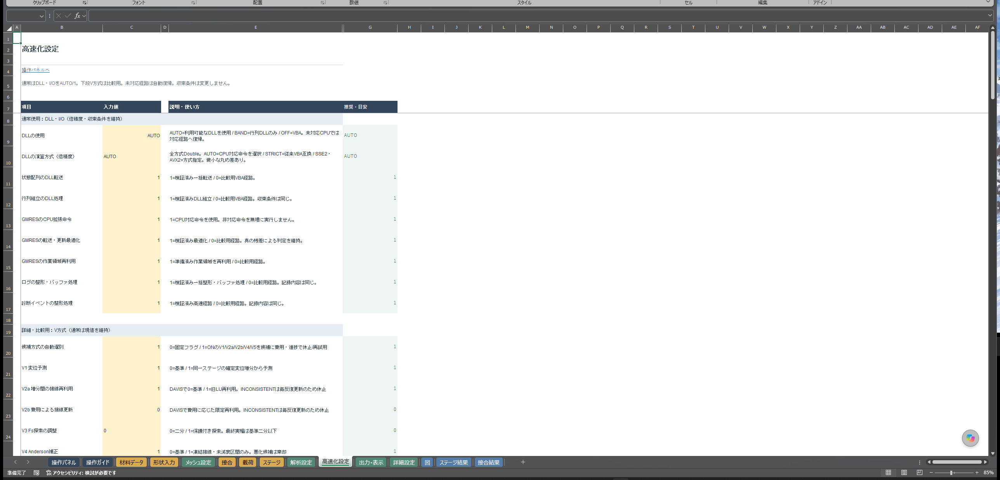

図10 「高速化設定」。①上段はDLL・I/Oの設定です。②下段は比較用の高速化候補です。③通常は配布値を使い、DLL・I/Oだけを戻す場合は「DLL・I/Oだけ推奨値に戻す」を使います。

|セル|項目群|使い方|
|---|---|---|
|C9|DLLの使用|AUTOは利用可能なDLLを使用。BANDは行列DLLのみ。OFFはVBA。|
|C10|DLLの演算方式|AUTO、STRICT、SSE2、AVX2。倍精度を使用。CPU対応命令を自動選択するAUTOが通常の入口。|
|C11:C17|DLL転送・組立・GMRES・I/O|通常は1。収束条件を緩める設定ではありません。|
|C20:C32|候補の選別・V方式・比較用係数|通常は現値を維持。各KEYは付録を参照。|

### 「出力・表示」

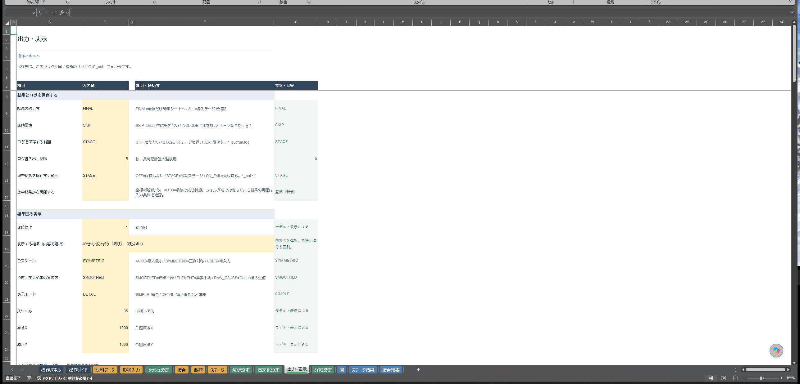

図11 「出力・表示」。①上段で結果と途中状態の保存範囲を選びます。②中央で結果の内容名、変位倍率、色スケールを選びます。③下へスクロールすると増分表示の設定と「変形・応力図を表示」があります。

|セル|項目|意味|
|---|---|---|
|C9|結果の残し方|FINALは最終ステージ。ALLは各ステージの数値結果。|
|C10|無効要素|SKIPは除外。INCLUDEは無効を示す行を残す。|
|C11|ログを保存する範囲|OFFはなし、STAGEはステージ境界、ITERは反復も記録。|
|C12|ログ書き出し間隔|秒単位。|
|C13|途中状態を保存する範囲|OFF、STAGE、ON_FAIL。STAGEは成功ステージ、ON_FAILは失敗時も保存。|
|C14|途中結果から再開する|空欄は最初から。AUTOは最後の成功保存。フォルダー指定も可能。|
|C17|変位倍率|図の変形を拡大する倍率。数値結果は変えません。|
|C18|表示する結果|内容名から選択。累積と増分、積分点を確認。|
|C19|色スケール|AUTOは最小～最大。SYMMETRICは0中心の正負対称。USERは手動配置。|
|C20|色付けする結果の集め方|従来の表示処理用。現行図をこの設定だけで節点平滑図に切り替えることはできません。|
|C21|表示モード|SIMPLEまたはDETAIL。|
|C22:C24|スケール・原点X・原点Y|USERで作図位置と縮尺を調整。色の数値上下限を指定する欄ではありません。|
|C27|増分の表示方法|Aは選択結果に等値線を追加。Bは増分専用カラー。|
|28・29行のチェック|せん断増分・塑性クロス|それぞれ独立して追加。|
|C30|クロスの表示倍率|0より大きく10以下。通常は1。|

再開には成功状態の保存と、計算部・モデル・施工計画の一致が必要です。入力を変えた場合はC14を空欄にして最初から計算します。ブックだけでなく対応する出力フォルダーも保存します。

### 「詳細設定」

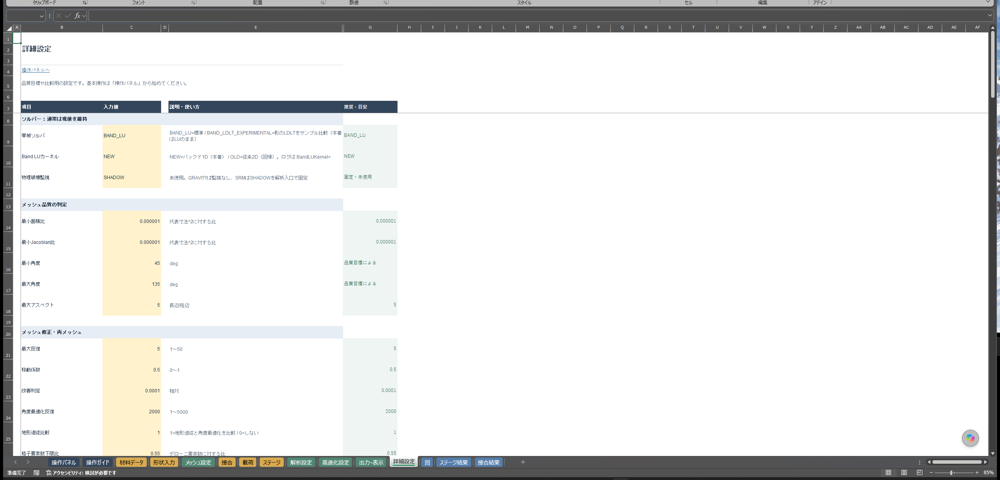

図12 「詳細設定」。①上段はソルバーです。②中央は品質目標です。③下段は修正・再メッシュ条件です。

|セル|項目群|意味・操作|
|---|---|---|
|C9:C11|ソルバーと監視|通常は現値を維持。物理破壊監視だけで計算成否は決まりません。|
|C14:C18|面積・Jacobian・角度・アスペクト|メッシュ品質の目標。角度は度。アスペクトは長辺／短辺。|
|C21:C25|修正反復・移動係数・改善判定|品質修正候補の作成条件。|
|C26:C29|要素数比・細分化割合|生成比較と再メッシュ候補の制限。|
|C32:C33|生成方式と比較結果|自動出力。編集しません。|
|C34:C35|ベンチマーク|比較試験用。通常解析ではC34を0にします。|

## 7. 結果の見方

### メッシュ確認と解析結果を分ける

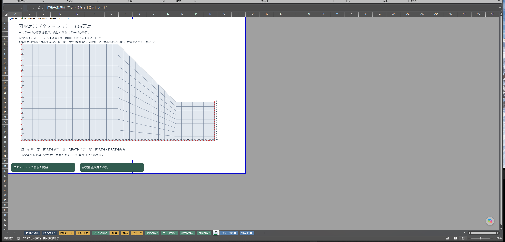

図13 「図」の解析前表示。①外形と要素分割を確認します。②赤いX/Y表示で拘束方向を確認します。③上部の品質集計と下部の予定色凡例を読みます。

この図は入力メッシュです。変形や応力の解析結果ではありません。灰は通常、青はBIRTH予定、赤はDEATH予定、紫は両方です。無効な施工行は予定色に含みません。品質目標への適合は形状の評価であり、収束状態とは別です。

### ステージと診断を先に読む

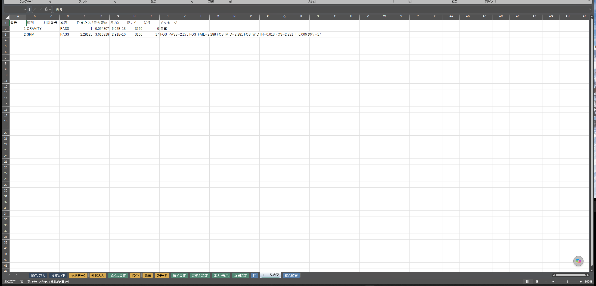

図14 「ステージ結果」。①番号・種別・成否で実行範囲を確認します。②最大変位と反力を確認します。③メッセージでFs区間と停止理由を読みます。

|列|内容|確認すること|
|---|---|---|
|A:C|番号・種別・材料番号|予定した工程が実行されたか。|
|D|成否|PASS/FAILとメッセージを一緒に読む。|
|E|Fsまたは係数|SRMの表示Fsと通常工程の係数を区別。|
|F|最大変位|大きさと施工に伴う変化。|
|G:H|反力X/Y|外力・自重との釣合い。|
|I:J|試行数・メッセージ|探索区間、途中SRMの判定、失敗理由。|

「診断」では`ResultStatus、AnalysisMessage、FailureElement、FailureGaussPoint、RelativeResidualFree、EnergyError`と反力・外力集計を確認します。変位や応力図を見る前に、失敗した工程と理由を特定します。

### SRMのFsを読む

|表示|意味|
|---|---|
|FOS_PASS|数値計算に成功した側のFs。|
|FOS_FAIL|数値計算に成功しなかった側のFs。|
|FOS_MID|区間の中点。中点そのものを計算したとは限りません。|
|FOS_WIDTH|失敗側−成功側の区間幅。|
|NUMERICAL_BRACKET|数値的な収束境界を挟む区間。|
|UNDETERMINED|Fsを確定できなかった状態。停止理由を確認。|

図14の表示例では成功側2.275、失敗側2.2875なので、中点は2.28125、幅は0.0125です。表示の丸めにも注意します。通常の最終数値結果は保持した成功側の状態です。

非収束には入力、拘束、材料、メッシュ、線形解法などの原因があります。FAILや数値区間だけで物理的な破壊を確定できません。上限まで成功した場合も、閉じた成功・失敗区間は得られていません。UNDETERMINEDで表示Fsが0の場合は、Fs=0の計算結果と読みません。

### 節点・要素の数値を見る

|シート|主な列・値|読み方|
|---|---|---|
|「結果節点」|A:Bは工程・節点番号、C:Dは基準座標、E:Fは変位、G:Hは力、I:Jは反力|変形後座標は基準座標＋変位。RESET_STRESS後は基準が変わります。|
|「結果要素」|A:Dは工程・要素・代表座標。E:BTは4積分点×17量|積分点ごとの応力・ひずみ・降伏状態を確認。|

ALLで保存した結果はA列のステージ番号で絞ります。無効要素とJOINTは連続体の節点応力平均に含みません。JOINT行の「接合結果参照」は、専用表で読む案内です。

### 接合結果を見る

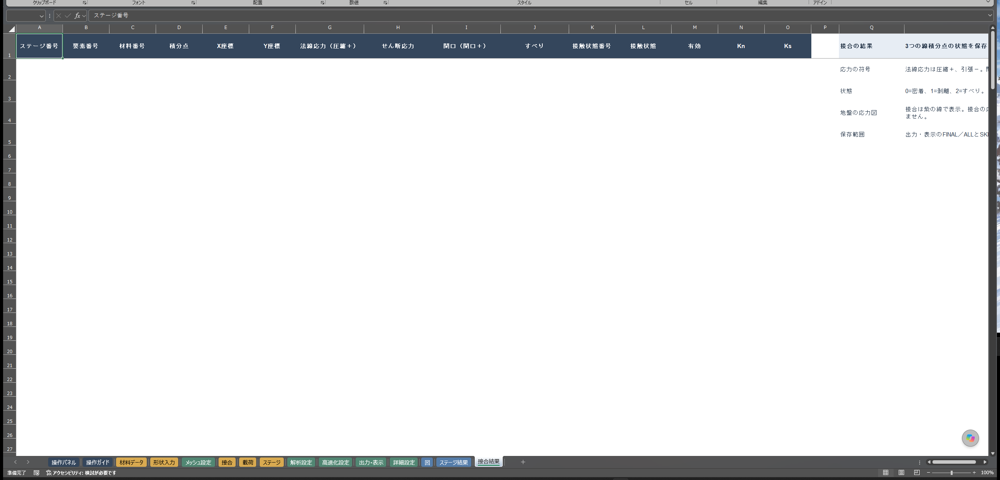

図15 「接合結果」。①工程・要素・積分点で対象を確認します。②応力、開口、すべりを読みます。③接触状態と有効欄を確認します。図の例は結果欄が空です。

|列|内容・符号|
|---|---|
|A:F|ステージ番号、要素番号、材料番号、積分点、X/Y座標。|
|G:H|法線応力は圧縮が正。せん断応力。|
|I:J|開口は開く向きが正。すべり。|
|K:L|接触状態。0=密着、1=剥離、2=すべり。|
|M:O|有効状態、Kn、Ks。|

接合は線上の3積分点で確認します。結果図では紫線で表示され、連続体の応力色範囲から除外されます。

### 変形・応力・増分図を見る

「出力・表示」で内容名を選び、「変形・応力図を表示」を押します。通常の応力・累積ひずみは4積分点から選びます。「表示項目一覧」で内容を確認できます。

変位倍率1は実変位です。拡大図では局所変形が強調されます。倍率を変えても数値は変わりません。色の比較では凡例の上下限も確認します。AUTOで同じ色でも、別ケースで同じ値とは限りません。

増分表示は最後に収束した荷重増分が対象です。SRMでは最後に成功したFsの状態です。累積ひずみや、別のSRM試行との差ではありません。

|表示|読み方|
|---|---|
|最大せん断ひずみ増分|全ひずみの主値差。平面ひずみの面外成分0も含む3次元最大工学せん断ひずみ。要素の4点最大値で表示。|
|最大塑性せん断ひずみ増分|塑性ひずみの主値差。面外塑性成分も含め、4点最大値で表示。|
|Aの等値線|選択結果の色を残す。4点最大値を共有隅節点で平均し、最大値の25・50・75%の線を表示。|
|Bの増分カラー|せん断増分のチェックを入れると増分専用の色図を表示。|
|塑性主ひずみ増分クロス|面内の塑性テンソルを要素内で平均して主軸を表示。青は圧縮・内向き、赤は引張・外向き。長さは共通尺度。|

工学せん断ひずみは`γxy=2εxy`です。最大工学せん断ひずみは最大主値−最小主値です。テンソルせん断ひずみの定義とは係数2が異なります。図の集中域は数値と照合し、メッシュの粗密による違いも確認します。

増分データのない保存結果は最初から再解析します。表示設定だけの変更は、ボタンを押して再描画できます。

### 保存と再表示

ブックを保存するときは対応する`ブック名_out`も保存します。`run.log`は進捗・停止位置、`perf_summary.csv`はFs別の状態と計算量、`increment_summary.csv`は荷重増分の経過、`manifest.csv`は途中保存の記録です。

再実行するとログや同番号の保存フォルダーが更新されます。比較前に出力フォルダー全体をコピーします。材料、形状、拘束、施工順などを変更した場合は再解析してから表示します。

## 8. よくあるエラーと対処

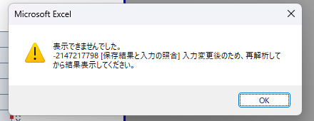

図17 入力変更後の結果表示。①「保存結果と入力の照合」は保存結果と現在入力の不一致を示します。②現在の入力で再解析してから表示します。

|症状・表示|確認と対処|
|---|---|
|ボタンが動かない|デスクトップExcelで開き、拡張子とマクロ許可を確認します。第3章の手順で開き直します。|
|DLLが使われない|同じフォルダーのDLL、Excelの64ビット対応、NATIVE_DLL、「診断」の利用状態を確認します。DLLを使わない場合はOFFにします。|
|セルを編集できない|見出しやKEYではなく黄色の入力欄を選びます。|
|設定エラー|「設定の形式・範囲をチェック」の指示に従い、該当する用途別シートのC列を修正します。|
|点番号・境界エラー|番号の重複、未登録参照、未使用点、末尾の始点重複、格子間隔を確認します。|
|Jacobianが正でない|交差、潰れた要素、節点順、中点位置を確認します。形状と分割を見直して生成します。|
|拘束が想定と違う|図のX/Y表示と「節点データ」D:Eを照合します。外周の座標範囲だけで支持が選ばれていないか確認します。|
|BIRTHが効かない|材料J列がOFFか、要素の材料番号と工程C列が一致するかを確認します。工程E列は数値1にします。|
|DEATHで別領域も消える|同じ材料番号が対象です。施工ごとに材料番号を分けます。|
|載荷されない・位置が違う|LOADの有効欄、材料番号、実行順、載荷の選択・方向・種類を確認します。|
|力が大きすぎる|FORCEは各節点への値です。対象節点数と合力を確認します。|
|DISPで上へ戻る|目標の総変位を入力しているか確認します。追加沈下量だけを指定しないようにします。|
|接合が作られない|異なる材料の共有辺、接合D列の1、接合材料K列のJOINTを確認します。|
|非収束・切戻しが続く|「診断」とログで工程・Fs・要素・理由を確認します。拘束不足、単位、接続、材料値、極端な剛性差、メッシュ品質を調べます。|
|入力変更後に図が出ない|現在入力で再解析します。再開欄C14は空欄にします。|
|結果が選択できない|内容名を選び直します。「表示項目一覧」で対応を確認します。|
|図が画面外に出る|色スケールをAUTOまたはSYMMETRICにして再表示します。USERでは縮尺と原点を確認します。|
|増分図が出ない|増分データを保存できるブックで最初から再解析します。|
|再開が拒否される|成功保存、同じ計算部・モデル・施工計画、必要ファイルを確認します。条件変更時はC14を空欄にして再計算します。|
|ログがない|DEBUG_MODE、EXPORT_MODE、書込権限、ブック横の出力フォルダーを確認します。両方OFFなら外部出力しません。|
|SRMが動かない|「ステージ」の有効欄を確認します。通常解析のBAND_LU_BENCHは0にします。|

問い合わせ時は、ブック名、入力条件、操作、表示メッセージ、停止工程・Fs・要素番号を記録します。対応するブックとログを保管しておくと原因を確認しやすくなります。

## 9. 付録

### 設定一覧

設定は各用途別シートのC列で編集します。以下は場所とKEYの対応です。値の意味は第6章を参照してください。

|シート|セル|KEY|
|---|---|---|
|「メッシュ設定」|C9|MESH_MATERIAL|
|「メッシュ設定」|C10 / C11 / C12 / C13|MESH_BC_BOTTOM / MESH_BC_LEFT / MESH_BC_RIGHT / MESH_BC_TOP|
|「メッシュ設定」|C14 / C29|MESH_BC_PIN_CORNER / MESH_GEN_COMPARE|
|「解析設定」|C9 / C10|WEIGHT_MODE / FLOW_POLICY|
|「解析設定」|C11 / C12|Q8_HOURGLASS_FACTOR / RCM_POLICY|
|「解析設定」|C15 / C16|SRM_FMAX / SRM_TOL|
|「解析設定」|C17 / C18 / C19|SRM_PSI_POLICY / SRM_MODE / SRM_FIXED_FS|
|「高速化設定」|C9 / C10|NATIVE_DLL / NATIVE_PRECISION|
|「高速化設定」|C11 / C12|NATIVE_STATE_COPY / NATIVE_ASSEMBLY|
|「高速化設定」|C13 / C14 / C15|NATIVE_GMRES_SIMD / NATIVE_GMRES_TUNED / NATIVE_GMRES_PREPARED|
|「高速化設定」|C16 / C17|IO_FAST_PATH / EVENT_LOG_FAST|
|「高速化設定」|C20 / C21|ACCEL_ADAPTIVE / ACCEL_V1_PREDICTOR|
|「高速化設定」|C22 / C23|ACCEL_V2A_REUSE / ACCEL_V2B_COST|
|「高速化設定」|C24 / C25 / C26|ACCEL_V3_COST_SEARCH / ACCEL_V4_ANDERSON / ACCEL_V5_GMRES_LU|
|「高速化設定」|C27 / C28 / C29|ACCEL_STEP_RECOVERY / ACCEL_STEP_FRESH_LU / ACCEL_TRACE|
|「高速化設定」|C30 / C31 / C32|ACCEL_PREDICT_BETA / ACCEL_PREDICT_MAX_RATIO / ACCEL_TANGENT_CHANGE|
|「出力・表示」|C9 / C10|OUTPUT_STAGE_MODE / OUTPUT_INACTIVE_ELEMENTS|
|「出力・表示」|C11 / C12|DEBUG_MODE / DEBUG_FLUSH|
|「出力・表示」|C13 / C14|EXPORT_MODE / EXPORT_LOAD|
|「出力・表示」|C17 / C18 / C19|VIEW_DISP_SCALE / VIEW_COLOR_RESULT / VIEW_SCALE_MODE|
|「出力・表示」|C20 / C21|VIEW_RESULT_SOURCE / VIEW_DETAIL_MODE|
|「出力・表示」|C22 / C23 / C24|VIEW_SCALE / VIEW_MIN_X / VIEW_MAX_Y|
|「詳細設定」|C9 / C10 / C11|SOLVER / BAND_LU_KERNEL / PHYSICAL_FAILURE_MODE|
|「詳細設定」|C14 / C15|MESH_QUALITY_MIN_AREA_RATIO / MESH_QUALITY_MIN_JACOBIAN_RATIO|
|「詳細設定」|C16 / C17 / C18|MESH_QUALITY_MIN_ANGLE_DEG / MESH_QUALITY_MAX_ANGLE_DEG / MESH_QUALITY_MAX_ASPECT_RATIO|
|「詳細設定」|C21 / C22|MESH_REPAIR_MAX_ITERATIONS / MESH_REPAIR_DAMPING|
|「詳細設定」|C23 / C24 / C25|MESH_REPAIR_IMPROVEMENT_TOLERANCE / MESH_REPAIR_ANGLE_ITERATIONS / MESH_REPAIR_TERRAIN_COMPARE|
|「詳細設定」|C26 / C27|MESH_TERRAIN_COUNT_MIN / MESH_TERRAIN_COUNT_MAX|
|「詳細設定」|C28 / C29|ADAPT_MAX_ELEMENT_RATIO / ADAPT_MARK_FRACTION|
|「詳細設定」|C32 / C33|MESH_GEN_LAST_METHOD / MESH_GEN_LAST_COMPARE（自動出力）|
|「詳細設定」|C34 / C35|BAND_LU_BENCH / BAND_LU_BENCH_N（比較試験用）|

「出力・表示」の追加表示はC27、28・29行のチェック、C30で設定します。旧簡易メッシュの非表示行は現在の生成には使いません。

|比較用の設定|意味・通常の扱い|
|---|---|
|候補方式の自動選別|ACCEL_ADAPTIVE。候補の適用を費用・進捗で選別。|
|V1|変位予測。|
|V2a・V2b|増分間の接線再利用と費用による更新。INCONSISTENTでは毎反復更新のため休止。|
|V3|Fs探索方式の調整。|
|V4|Anderson補正。|
|V5|旧LUを使うGMRES。|
|増分幅回復・fresh LU|追加の比較用機能。通常は配布値0を維持。|
|詳細ログ・予測係数・接線変化上限|比較調査用。時間比較ではログ条件もそろえます。|

### 用語集

|用語|意味|
|---|---|
|Q8|4隅と4辺中点を持つ8節点四辺形要素。|
|平面ひずみ|面外の全ひずみを0として扱う2次元モデル。|
|SOIL / STRUCT / JOINT|地盤連続体／構造連続体／接合の材料種別。|
|E / ν / γ|ヤング率／ポアソン比／単位体積重量。|
|c / φ / ψ|粘着力／内部摩擦角／ダイレタンシー角。|
|Kn / Ks|接合の法線剛性／せん断剛性。|
|SRM / Fs|強度低減法／強度低減係数。|
|積分点|要素内で応力や材料状態を計算する点。|
|残差|外力と内力の不釣合い。収束状態の確認に使用。|
|反力|拘束された自由度に生じる力。|
|Jacobian|要素の座標変換に関係する量。非正の値は要素の反転や潰れを調べる手掛かり。|
|BIRTH / DEATH|材料番号単位で要素を有効化／無効化する工程。|
|LOAD / UNLOAD|載荷条件を適用／解除する工程。|
|DISP / FORCE / FIX|目標変位／各節点の力／ゼロ変位拘束。|
|チェックポイント|再開用に保存した計算状態。対応する外部ファイルが必要。|
|DLL|Excelから呼び出す高速計算ライブラリ。|
|平均載荷圧力|載荷帯の反力を幅×奥行で割った圧力。極限支持力の自動判定値ではありません。|

STRUCTの応力から壁の断面力を求める場合は、断面に沿う応力の積分が別途必要です。局所の応力ピークをそのまま曲げモーメントと読みません。アンカー相当の節点力は、専用アンカーの引抜き・緊張履歴モデルではありません。
