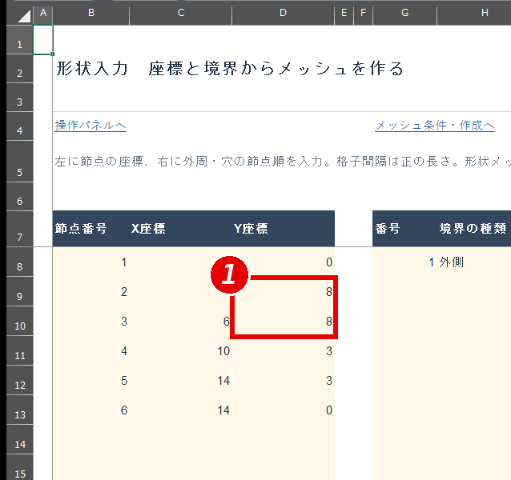
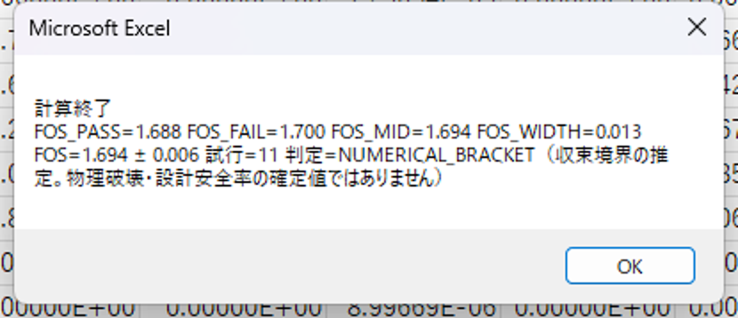
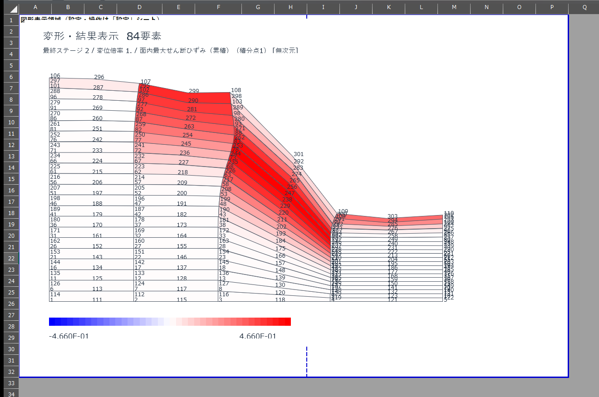
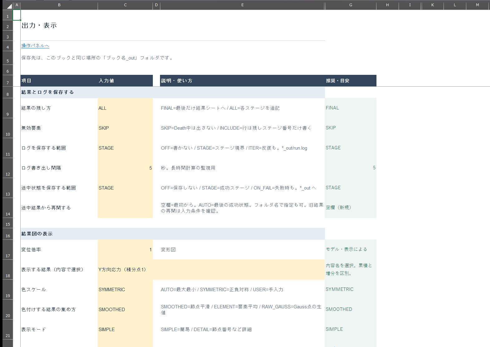

# 2D Soil FEM 操作説明書（画面で追う版）

{{TOC}}

## 1. この説明書について

2D Soil FEMは、Excelで地盤の形状・材料・施工順を入力し、変位・応力と強度低減法（SRM）による安全率Fsを計算するExcelブックです。

この説明書は、画面を見ながら1回の解析を最後まで行う手順書です。どのシートの、どのセルを編集するかを、赤枠と番号で示します。赤枠の番号は本文と表の「番号」に対応します。画像の上端には列記号（A, B, C…）、左端には行番号を残してあります。

- 第4章：例題を1回通す基本操作。
- 第5・6章：材料が複数あるとき、拘束の決め方。
- 第7〜13章：解析例1〜7（材料・形状・支持条件の変更、掘削と盛土、荷重、強制変位、流れ則）。
- 第14〜17章：解析例8〜11（道路拡幅の11工程、L型擁壁と断面力、トンネルの段階掘削、接合JOINT）。
- 解析例はどれも同じ書式で、実際に計算した画面と確認値を載せています。
- 第18〜21章：入力項目、結果の見方、エラーと対処、設定一覧と用語集。

各手順の下にある「解説」には、その操作に関係する考え方と注意点をまとめています。

数値例は操作練習用です。

## 2. 必要なもの

|項目|内容|
|---|---|
|Excel|Windowsのデスクトップ版Excel（64ビット推奨）。Excel for the webでは動きません。|
|ブック|`2DSoilFEM_ui_20261021.xlsm`|
|DLL|`soilfem_native_x64.dll`（高速計算用。ブックと同じフォルダーに置く）|
|入手先|[配布ZIP（SoilFEM_UI_20261021.zip）](https://github.com/tak063495-prog/excel-vba-soil-fem/raw/main/workbook/SoilFEM_UI_20261021.zip) をダウンロードし、新しいフォルダーに展開します。|

DLLがない場合や32ビットExcelの場合は、「高速化設定」C9を`OFF`にするとVBAだけで計算します（時間は長くなります）。

## 3. 画面構成

ブックを開くと「操作パネル」が表示されます。各入力シートへのリンクと、主なボタンがあります。

図1 「操作パネル」。①「解析前：メッシュを確認」。入力したメッシュと拘束を「図」シートに表示します（計算はまだ始まりません）。

|シート|役割|
|---|---|
|「材料データ」|材料の定数（ヤング率、粘着力、内部摩擦角など）|
|「形状入力」|点の座標と境界（外形）、格子間隔|
|「メッシュ設定」|外周の拘束、メッシュ生成のボタン|
|「接合」|接合要素（JOINT）を入れる材料の組合せ|
|「載荷」|荷重・強制変位|
|「ステージ」|自重・掘削・盛土・載荷・SRMの実行順|
|「解析設定」|流れ則、SRMの探索条件|
|「高速化設定」|DLLの使い方（通常は変更不要）|
|「出力・表示」|保存範囲、結果図の表示条件、「変形・応力図を表示」ボタン|
|「詳細設定」|メッシュ品質目標、ソルバー（通常は変更不要）|
|「図」|メッシュ確認図・結果図|
|「ステージ結果」・「接合結果」|工程ごとの結果、接合の結果|
|「節点データ」「要素データ」「結果節点」「結果要素」「診断」|操作パネルのボタンから開く表（通常は直接編集しません）|

**共通のルール**：入力できるのは淡い黄色のセルだけです。見出し行（濃い青の行）、B列の項目名、E列の説明、F列のKEY、G列の推奨値は編集しないでください。

## 4. 解析手順（例題を1回通す）

ここでは小さな例題（6点の斜面、要素72個）で、入力から結果確認までを行います。所要時間は計算を含めて数分です。

**例題の確認値**（同じ入力ならこの値になります）

|項目|値|
|---|---|
|メッシュ|72要素、261節点（地形追従格子）|
|ステージ|1 GRAVITY（自重）→ 2 SRM|
|結果|両ステージ PASS。Fs_PASS=2.625、Fs_FAIL=2.638、区間幅0.012（SRM_TOL=0.02）|
|計算時間|約1分（DLL使用、Rico PCでの実測 1分7秒）|

### 手順1 ブックを開く

1. 展開したフォルダーの`2DSoilFEM_ui_20261021.xlsm`をダブルクリックします。
2. 画面上部に黄色の「セキュリティの警告」バーが出たら「コンテンツの有効化」を押します。赤いバー（「このファイルのソースが信頼されていないため…」）が出た場合は、Excelを閉じ、ファイルを右クリック→「プロパティ」→「全般」タブの「許可する」にチェックして開き直します。
3. 「操作パネル」が表示されれば準備完了です。

図2 開いた直後の画面。この画面のように警告バーが出ない設定のPCもあります。その場合はそのまま進みます。

### 手順2 材料を入力する（「材料データ」）

図3 入力前。①1行目は見出し（編集しない）。②2行目から材料を1行ずつ入力します（A2:M2）。

図4 新しく入力するときは、2行目以降の古い値を消してから入力します。

図5 入力後。①A2:H2に材料定数、②I2:K2に強度低減・初期状態・種別を入力します。

|番号|セル範囲|入力するもの|単位|例（材料1）|
|---|---|---|---|---|
|①|A2|材料番号（1から連番）|－|1|
|①|B2|ヤング率E（JOINTはKn）|kN/m²|20000|
|①|C2|ポアソン比ν|－|0.3|
|①|D2|板厚|m|1|
|①|E2|単位体積重量γ|kN/m³|18|
|①|F2|内部摩擦角φ|度|30|
|①|G2|粘着力c|kN/m²|10|
|①|H2|ダイレタンシー角ψ|度|0|
|②|I2|強度低減（1=SRM対象、0=対象外）|－|1|
|②|J2|初期状態（ON=最初から有効、OFF=BIRTHまで無効）|－|ON|
|②|K2|種別（SOIL／STRUCT／JOINT）|－|SOIL|
|－|L2:M2|JOINTのときだけ：Ks、引張|kN/m³|空欄|

**触らないセル**：1行目（見出し）。材料を増やすときは3行目、4行目…と下に追加します。

### 手順3 形状を入力する（「形状入力」）

図6 入力前。①B8:D13 点の番号と座標。②G8:J8 境界（1行＝1つの境界）。

図7 古い点と境界を消した状態（B8:D20、G8:J8）。

図8 入力後。①点1〜6の座標。②G8=1、H8=外側。③I8=境界を一周する点番号`1,6,5,4,3,2`。④J8=格子間隔2。

|番号|セル範囲|入力するもの|単位|例|
|---|---|---|---|---|
|①|B8:B13|点番号（重複しない）|－|1〜6|
|①|C8:D13|点のX座標・Y座標|m|(0,0)(0,6)(6,6)(10,3)(14,3)(14,0)|
|②|G8|境界の番号|－|1|
|②|H8|境界の種類（外側／穴）|－|外側|
|③|I8|境界を一周する点番号（カンマ区切り。最後に始点を繰り返さない）|－|1,6,5,4,3,2|
|④|J8|格子間隔（小さいほど要素が増える）|m|2|

**触らないセル**：2〜7行目（題名・リンク・見出し）。点を増やすときは14行目以降へ、境界を増やすときは9行目以降へ追加します。

### 手順4 外周の拘束を決めてメッシュを作る（「メッシュ設定」）

図9 ①C9 材料番号の補充値。②C10:C13 底面・左面・右面・上面の拘束。③C14 剛体モード止め。④C29 生成方式。

|番号|セル範囲|入力するもの|単位|例|
|---|---|---|---|---|
|①|C9|材料番号の補充値（どの外側境界にも入らない要素に使う。材料は境界の行順で決まる→第5章）|－|1|
|②|C10:C13|底面・左面・右面・上面の拘束（NONE=自由、ROLLER=面に垂直方向を固定、PINNED=XY固定）|－|PINNED／ROLLER／ROLLER／NONE|
|③|C14|剛体モード止め（AUTO=底面の最小X節点をXY固定、NONE=しない）|－|AUTO|
|④|C29|生成方式（0=品質比較、1=デローニ修正優先、2=地形格子）|－|2|

**触らないセル**：B列（項目）、E列（説明）、F列（KEY）、G列（目安）。C17:C26は旧簡易メッシュ用で、形状メッシュでは使いません。

図10 ①「形状メッシュを作成」を押します。②「解析前：メッシュ・拘束を確認」は作成済みメッシュを表示し直すボタンです。

図11 作成後に表示されるメッセージ。採用した生成方式、要素数、節点数、品質（合格・警告・不合格の数、角度範囲）が表示されます。「OK」で閉じます。不合格が0であることを確認します。

図12 「図」シートに作成したメッシュが表示されます。外形、要素分割、赤いX/Y記号（拘束方向）を確認します。

> **解説　メッシュ品質の判断**
>
> メッセージの「不合格」は、Jacobianが正でない・接続の不整合など、そのままでは計算できない形状です。解析を始めず、点の座標と境界を直します。「警告」は最小角度やアスペクト比（長辺／短辺）が目標（「詳細設定」C14:C18）に届かない要素です。「品質修正候補を確認」で候補を作り、形と領域が変わらないものだけを採用します。許容値を緩めて合格にする方法はとりません。品質が合格でも、計算の精度が保証されるわけではありません。

### 手順5 接合・載荷・施工順を確認する

図13 「接合」。①見出し。②A2:E（必要な行だけ）。今回の例題では使いません。

図14 「載荷」。①見出し。②A2:I2。今回の例題は自重とSRMだけなので、荷重は使いません（この行はLOAD工程がないため適用されません）。

図15 「ステージ」。①A2:E3 実行する工程（上から順に実行）。②H:I列は入力の説明（編集しない）。例題は1行目GRAVITY、2行目SRM、E列はどちらも1です。

|番号|セル範囲|入力するもの|単位|例|
|---|---|---|---|---|
|①|A2:A3|番号（管理用）|－|1、2|
|①|B2:B3|種別（GRAVITY、LOAD、BIRTH、DEATH、SRMなど）|－|GRAVITY、SRM|
|①|C2:C3|対象の材料番号（BIRTH/DEATH/LOADで必要）|－|空欄|
|①|D2:D3|パラメータ（途中SRMの必要Fs、MATSETの内容）|－|空欄、1|
|①|E2:E3|有効（数値1=実行、0=スキップ）|－|1、1|

**触らないセル**：1行目（見出し）、H:I列（説明）。実行順を変えるときは行そのものを並べ替えます（A列の番号を変えても順番は変わりません）。

### 手順6 解析条件を確認する（「解析設定」）

図16 ①C9:C12 基本条件。②C15:C19 SRMの条件。例題は配布時の値のまま使います。

図17 ①「設定の形式・範囲をチェック」を押します。

図18 問題がなければ「設定の形式・範囲は正常です」と表示されます。

|番号|セル範囲|入力するもの|単位|例（配布値）|
|---|---|---|---|---|
|①|C9|自重の扱い|－|TOTAL|
|①|C10|非関連流れの扱い|－|INCONSISTENT|
|①|C11|アワーグラス係数（0〜1）|－|0.05|
|①|C12|節点の並び替え|－|AUTO|
|②|C15|Fs探索の上限|－|3|
|②|C16|成功・失敗Fsの許容幅|－|0.02|
|②|C17|ψの扱い|－|KEEP|
|②|C18|SRMモード|－|REAPPLY|
|②|C19|固定Fs（0=全探索）|－|0|

**触らないセル**：B・E・F・G列。

> **解説　SRM（強度低減法）の仕組み**
>
> SRMは、I列=1の材料の強度を c/Fs、atan(tanφ/Fs) に下げ、Fsを変えながら釣合い計算を繰り返します。成功したFsと失敗したFsの区間が「成功・失敗Fsの許容幅」（C16）より狭くなったら止まります。
>
> 「ステージ」の最後の有効行がSRMならFsを探索します。後ろに施工が続く途中のSRMは、D列の必要Fsを満たすかを判定する関門です。満たせば施工を続け、満たさなければ止まります。
>
> C19（固定Fs）に正の値を入れると、そのFsだけを試します。成功しても限界のFsを求めたことにはなりません。探索するときは0に戻します。

### 手順7 高速化・出力の設定を確認する

図19 「高速化設定」。通常は変更しません。値を変えてしまった場合は①「DLL・I/Oだけ推奨値に戻す」を押します（材料・荷重・支持・Fs条件は変わりません）。

図20 「出力・表示」。①C9:C14 結果・ログの保存範囲。②C17:C24 結果図の表示条件。

図21 ①「変形・応力図を表示」（解析後に使います）。

### 手順8 解析前にメッシュを確認する

「操作パネル」の「解析前：メッシュを確認」（図1の①）を押します。

図22 「図」シートの確認図。灰色＝通常、青＝BIRTH予定、赤＝DEATH予定です。この時点では計算は始まっていません。

### 手順9 解析を開始する

図23 「図」シートの下にあるボタン。①「このメッシュで解析を開始」を押すと計算が始まります。②「品質修正候補を確認」はメッシュ品質に警告があるときに使います。

図24 計算中はExcelの左下（ステータスバー）に進み具合が表示されます（赤枠）。例：「ステージ 2/2 SRM 探索 試行16 Fs=2.70」。計算中はExcelを操作しないでください。

> **解説　増分・反復・残差**
>
> 計算は荷重を少しずつ進めます（増分）。1つの増分の中では、釣合いが取れるまで修正を繰り返します（反復）。収束しないときは増分を小さくしてやり直すため、試行の回数と進んだ増分の数は一致しません。残差は外力と内力の差です。残差が小さくても、拘束・材料・単位が意図どおりとは限りません。収束したかどうかと、結果が力学的に妥当かどうかは分けて確認します。

図25 終了時のメッセージ。「計算終了」とFsの探索結果（FOS_PASS、FOS_FAIL、FOS_MID、FOS_WIDTH）が表示されます。「OK」で閉じます。

図26 続いて計算時間が表示されます。「OK」で閉じます。

図27 計算後の「図」シート。最後に成功したFs（2.625）の状態の結果が色で表示されます。

### 手順10 結果を確認する

図28 「ステージ結果」。①1行目GRAVITY、2行目SRMの成否（PASS）、最大変位、反力、試行数、メッセージを確認します。

図29 「操作パネル」の「数値結果」で開く「結果節点」。節点ごとの座標、変位、力、反力。

図30 「操作パネル」の「要素の応力・ひずみ・塑性」で開く「結果要素」。4つの積分点ごとの応力・ひずみ・降伏状態。

図31 「操作パネル」の「診断」で開く「診断」シート。解析状態、残差、失敗位置を確認します。

### 手順11 変形・応力図を表示する

「出力・表示」の「変形・応力図を表示」（図21の①）を押します。

図32 結果図。表示量＝C18「XYせん断ひずみ（累積）（積分点1）」、対象＝最終ステージ（SRMで最後に成功したFs=2.625の状態）、色スケール＝SYMMETRIC（0を中心に正負対称）、変位倍率＝1。凡例は図の下にあります。

図33 ①C17（変位倍率）を50にします。②C18で表示する結果を選べます（選択肢は「表示項目一覧」で確認）。

図34 変位倍率50で再表示した図。変形が50倍に拡大されます。数値結果は変わりません。

### 手順12 保存する

Excelの「上書き保存」で保存します。外部出力（ログ・途中状態）はブックと同じ場所の`ブック名_out`フォルダーに保存されます。ブックと一緒にこのフォルダーも保管してください。

> **解説　保存した結果の再表示と、途中からの再開は別の操作です**
>
> 再表示：解析後に保存したブックを開き直し、「変形・応力図を表示」を押すと、再解析せずに図が出ます。「ステージ結果」の工程・Fsと図を照らし合わせます。
>
> 途中から再開：「出力・表示」C13（途中状態を保存する範囲）で保存した状態を、C14（途中結果から再開する）にフォルダー名（例 stg03_BIRTH）で指定します。再開したことは`run.log`の記録で確認します。C14=AUTOとしただけでは再開した証拠になりません。新しいケースではC14を空欄にします。
>
> 「USER」の色スケールは縮尺と原点を手入力する設定で、色の上下限を固定する機能ではありません。図を比べるときは凡例の数値を必ず併記します。

## 5. 材料が2つ以上あるときの注意

形状メッシュでは、要素の材料番号は**「形状入力」の外側境界の行順**で決まります。上から1行目の外側境界の中の要素が材料1、2行目の中が材料2です。G列の「番号」を書き換えても材料番号は変わりません。「メッシュ設定」C9は、どの外側境界にも入らなかった要素に付ける補充値です。

図35 「材料データ」。①2行目＝材料1、②3行目＝材料2（剛性の大きい材料の例）。

図36 「形状入力」。①点1〜6。②1行目の外側境界`1,4,3,2`（左の領域）→材料1。③2行目の外側境界`4,6,5,3`（右の領域）→材料2。

図37 作成したメッシュ（336要素）。

図38 「操作パネル」の「要素」で開く「要素データ」。①J列が材料番号です。作成後はJ列をフィルターし、材料2の要素が右の領域にあることを確認します。

## 6. 拘束（支持条件）の決め方

拘束の入力先は、メッシュを作り直すかどうかで変わります。

|場合|操作|
|---|---|
|メッシュを作り直すとき|「メッシュ設定」C10:C14で拘束を選び、「形状メッシュを作成」を押します。作成時に「節点データ」D:E列へ拘束が書き込まれます。節点番号が変わるので、載荷の対象も確認し直します。|
|保存済みのメッシュをそのまま使うとき|「メッシュ設定」C10:C14を変えるだけでは拘束は変わりません。「節点データ」のB:C列（座標）とA列（節点番号）で対象を探し、D列（X拘束）・E列（Y拘束）を0（自由）または1（拘束）に直接書き換えます。|

図39 「操作パネル」の「節点・拘束」で開く「節点データ」。①D:E列が拘束（0=自由、1=拘束）です。変更後は「解析前：メッシュを確認」で赤いX/Y記号を確認します。

外周の拘束は、座標の最小・最大の面（Ymin＝底面、Xmin＝左面など）にある節点にだけ付きます。斜面全体に支持が付くわけではありません。

### 「節点データ」・「要素データ」の列

|シート・列|入力内容|
|---|---|
|「節点データ」A:C|節点番号、X座標、Y座標。|
|「節点データ」D:E|X/Y拘束。0は自由、通常は1で拘束。|
|「節点データ」F:G|互換用のX/Y強制変位。空欄は0。|
|「節点データ」H:I|互換用のX/Y節点力。空欄は0。|
|「要素データ」A|要素番号。|
|「要素データ」B:I|Q8の8節点番号。4隅を左下・右下・右上・左上の順に指定し、続けて各辺の中点を指定。|
|「要素データ」J|材料番号。独立して施工する領域には別番号を割り当てます。|

通常の新規載荷は「載荷」とLOADを使います。同じ自由度に複数経路で荷重や変位を重ねないようにします。

JOINTは6節点です。「要素データ」B:GにA側の端点1・端点2・中点3、対応するB側の端点4・端点5・中点6を指定します。周回順ではありません。H:Iは有効節点に含みません。

## 7. 解析例1 材料の強さを変える（粘着力c）

### 目的

材料の粘着力cだけを変えて、SRMの安全率Fsがどう変わるかを確かめます。第4章の例題（c=10kN/m²）を基準にします。

### 条件

|項目|基準（第4章）|解析例1|
|---|---|---|
|形状・メッシュ|6点の斜面、格子間隔2m、72要素・261節点|同じ|
|材料1|E=20000、ν=0.3、γ=18、φ=30°、c=10、ψ=0|**c=20**（ほかは同じ）|
|ステージ|GRAVITY → SRM|同じ|
|解析設定C15（Fs探索の上限）|3|**5**|

### 手順1 粘着力を変える

図40 「材料データ」。①G2（粘着力c）を10から20に変えます。

|番号|セル範囲|入力するもの|単位|例|
|---|---|---|---|---|
|①|G2|粘着力c|kN/m²|20|

### 手順2 Fs探索の上限を上げる

図41 「解析設定」。①C15（Fs探索の上限）を3から5に変えます。

|番号|セル範囲|入力するもの|単位|例|
|---|---|---|---|---|
|①|C15|Fs探索の上限|－|5|

> **解説　上限のままだとFsは決まりません**
>
> 上限3のまま計算すると、Fs=3.000でも計算が成功し、「FOS_FAIL=NA」「判定=LOWER_BOUND」と表示されました。これは「Fsは3以上」という意味で、Fsの値は決まっていません。上限を上げて計算し直し、成功側と失敗側の区間が閉じることを確認します。

### 手順3 メッシュを作り、解析する

第4章の手順4〜9と同じ操作で、「形状メッシュを作成」→「解析前：メッシュを確認」→「このメッシュで解析を開始」の順に押します。

図42 終了メッセージ。FOS_PASS=3.963、FOS_FAIL=3.975と表示されます。

### 手順4 結果を確認する

図43 「ステージ結果」。①SRM行のFs（3.96875）とメッセージを確認します。

図44 「出力・表示」。①C17（変位倍率）=1。②C18で「最大せん断ひずみ（積分点1）」を選びます。

図45 結果図。表示量＝最大せん断ひずみ（積分点1）、対象＝SRMで最後に成功したFs=3.963の状態、変位倍率＝1。法尻から法肩に向かうせん断ひずみの集中が見えます。

### 確認値

|項目|基準（c=10）|解析例1（c=20）|
|---|---|---|
|要素・節点|72・261|72・261|
|GRAVITYの反力Y|1188 kN|1188 kN|
|Fs区間（成功〜失敗）|2.625〜2.638|3.963〜3.975|

### 注意点

> **解説　c・φ・ψの役割**
>
> cは強度線 τ=c+σn·tanφ の切片、φは傾きです。ψ（ダイレタンシー角）は塑性変形の向き（体積の増え方）を決める値で、強度そのものではありません。SRMでは c/Fs と atan(tanφ/Fs) で強度を下げます。角度φをFsで割るのではありません。ψの扱いは「解析設定」C17で決まります（KEEP=入力のまま、REDUCE=Fsで低減、CAP=低減後のφ以下に制限）。
>
> cを2倍にしてもFsが2倍になるわけではありません。比べるときは、変えた値以外の条件（形状・メッシュ・設定）をそろえます。

## 8. 解析例2 形状を変える（斜面を高くする）

### 目的

斜面の高さを6mから8mに上げ、Fsと変形がどう変わるかを確かめます。

### 条件

|項目|基準（第4章）|解析例2|
|---|---|---|
|点2・点3のY座標|6 m|**8 m**|
|材料・ステージ・設定|第4章と同じ（c=10、C15=3）|同じ|

### 手順1 点の座標を変える

図46 「形状入力」。①D9:D10（点2・点3のY座標）を6から8に変えます。

|番号|セル範囲|入力するもの|単位|例|
|---|---|---|---|---|
|①|D9|点2のY座標|m|8|
|①|D10|点3のY座標|m|8|

### 手順2 メッシュを作り直す

「メッシュ設定」の「形状メッシュを作成」を押します。形状を変えたら必ず作り直します。

図47 作り直したメッシュ（84要素・303節点）。

> **解説　作り直すと節点番号が変わります**
>
> メッシュを作り直すと、節点番号と要素番号が変わります。節点番号で載荷を指定していた場合は、「節点データ」のB:C列（座標）で対象を探し直します。品質の判定は「OK」で閉じるメッセージ（図11）で確認し、不合格の要素がある場合は「品質修正候補を確認」で候補を比べます。許容値を緩めて合格にする方法はとりません。

### 手順3 解析する

第4章の手順8〜9と同じ操作で解析します。

図48 終了メッセージ。FOS_PASS=1.688、FOS_FAIL=1.700です。

### 手順4 結果を確認する

図49 「ステージ結果」。①SRM行のFsは1.69375、最大変位0.663 mです。

図50 結果図。表示量＝最大せん断ひずみ（積分点1）、対象＝最後に成功したFs=1.688の状態、変位倍率＝1。

### 確認値

|項目|基準（高さ6m）|解析例2（高さ8m）|
|---|---|---|
|要素・節点|72・261|84・303|
|GRAVITYの反力Y|1188 kN|1476 kN|
|Fs区間|2.625〜2.638|1.688〜1.700|

自重の反力は断面積×γです。基準は66 m²×18=1188 kN、解析例2は82 m²×18=1476 kNで、表の値と一致します。

### 注意点

> **解説　Fsと変位は別に読みます**
>
> SRMの最大変位（0.663 m）は、強度を下げた最後の成功状態の値です。元の強度（Fs=1）で起きる変位ではありません。小ひずみのモデルなので、大きな変位を実際の移動量として読みません。
>
> Fsは「数値計算が収束した境界」の区間です。メッセージの「NUMERICAL_BRACKET」は、この区間の推定であることを示します。

## 9. 解析例3 支持条件を変える（保存済みメッシュ）

### 目的

メッシュを作り直さずに「節点データ」の拘束を直接変え、支持が足りないとどうなるかを確かめます。

### 条件

|項目|ケースA|ケースB|
|---|---|---|
|形状・材料|第4章と同じ（72要素・261節点）|同じ|
|ステージ|GRAVITYのみ|同じ|
|左面（X=0）の拘束|ROLLER（X固定）|**底面以外のX拘束を外す（D列=0）**|

### 手順1 ステージをGRAVITYだけにする

図51 「ステージ」。①A2:E2にGRAVITYだけを入力し、3行目以降は消します。

|番号|セル範囲|入力するもの|単位|例|
|---|---|---|---|---|
|①|B2|種別|－|GRAVITY|
|①|E2|有効|－|1|

### 手順2 ケースAを解析する

第4章の手順8〜9と同じ操作で解析します。

図52 ケースAの「ステージ結果」。①GRAVITYがPASS、反力Y=1188 kNです。

図53 「出力・表示」。①C17（変位倍率）=100。②C18で「Y応力（積分点1）」を選びます。

図54 結果図。表示量＝Y応力（積分点1）、対象＝GRAVITY、変位倍率＝100。深いほど圧縮応力が大きくなります。

### 手順3 節点データの拘束を直接変える（ケースB）

「操作パネル」の「節点・拘束」を押して「節点データ」を開きます。

図55 「節点データ」。①B:C列（X・Y座標）で対象の節点を探します。②D列（X拘束）・E列（Y拘束）を書き換えます。この例ではX=0かつY>0の8節点のD列を1から0に変えました。

|番号|セル範囲|入力するもの|単位|例|
|---|---|---|---|---|
|①|B:C列|節点の座標（探すために見る列。編集しない）|m|X=0|
|②|D列|X拘束（0=自由、1=拘束）|－|0|
|②|E列|Y拘束（0=自由、1=拘束）|－|そのまま|

「メッシュ設定」C10:C14を変えるだけでは、保存済みの節点の拘束は変わりません（第6章）。

### 手順4 ケースBを解析する

図56 「計算失敗 [NONCONVERGED] 全体反復と回復補正の合計が上限に達しました」と表示されます。

図57 ケースBの「ステージ結果」。①GRAVITYがFAIL、最大変位2.38 m（未収束の値）です。

### 確認値

|項目|ケースA|ケースB|
|---|---|---|
|GRAVITY|PASS|FAIL（NONCONVERGED）|
|最大変位|0.0124 m|2.38 m（未収束）|
|反力Y|1188 kN|893 kN（釣り合っていない）|

### 注意点

> **解説　非収束は原因を調べます**
>
> 左面のX拘束を外すと、斜面全体が横に動けるようになり、自重の段階で釣合いが取れなくなりました。非収束の原因には、拘束不足のほか、単位の誤り、材料値、極端な剛性差、メッシュ品質などがあります。収束条件を緩めて通す方法はとりません。「診断」シートで停止した工程・要素・理由を確認します。
>
> 反力の合計（Y）が自重（1188 kN）と合わないことも、計算が釣り合っていない目安になります。

## 10. 解析例4 掘削と盛土（DEATH・BIRTH）

### 目的

3つの領域を持つ地盤で、左上の領域を掘削（DEATH）し、右上に盛土（BIRTH）する施工段階を計算します。

### 条件

|項目|内容|
|---|---|
|領域|材料1＝下部地盤（0〜14m、高さ0〜4m）、材料2＝左上の掘削する土、材料3＝右上の盛土|
|メッシュ|格子間隔1m、324要素・1053節点|
|材料3|E=15000、γ=19、c=5、φ=30°、**初期状態OFF**|
|ステージ|GRAVITY → DEATH 2 → BIRTH 3|

### 手順1 材料を3つ入力する

図58 「材料データ」。①A2:K4に材料1〜3を入力します。

図59 ①J2:J4（初期状態）。材料1・2はON、後から盛る材料3はOFFにします。

|番号|セル範囲|入力するもの|単位|例|
|---|---|---|---|---|
|①|A2:K2|材料1（下部地盤）|第18章の単位|1, 20000, 0.3, 1, 18, 30, 10, 0, 1, ON, SOIL|
|①|A3:K3|材料2（掘削する土）|同上|2, 20000, 0.3, 1, 18, 30, 10, 0, 1, ON, SOIL|
|①|A4:K4|材料3（盛土）|同上|3, 15000, 0.3, 1, 19, 30, 5, 0, 1, OFF, SOIL|
|②|J4|材料3の初期状態|－|OFF|

### 手順2 3つの外側境界を入力する

図60 「形状入力」。①B8:D16に点1〜9。②G8:J10に3つの外側境界。1行目→材料1、2行目→材料2、3行目→材料3になります（第5章）。

|番号|セル範囲|入力するもの|単位|例|
|---|---|---|---|---|
|①|B8:D16|点番号とX・Y座標|m|1(0,0) 2(14,0) 3(14,4) 4(7,4) 5(0,4) 6(0,6) 7(5,6) 8(9,6) 9(14,6)|
|②|I8|外側境界1（材料1）|－|1,2,3,4,5|
|②|I9|外側境界2（材料2）|－|5,4,7,6|
|②|I10|外側境界3（材料3）|－|4,3,9,8|
|②|J8:J10|格子間隔|m|1|

### 手順3 メッシュを作る

図61 作成したメッシュ（324要素）。領域の境目で節点が共有されていることを確認します。材料の割当ては「要素データ」J列で確認します（図38）。

### 手順4 施工順を入力する

図62 「ステージ」。①A2:F4に3行を入力します。②B:C列が工程の種類と対象の材料番号です。

|番号|セル範囲|入力するもの|単位|例|
|---|---|---|---|---|
|①|A2:F2|1行目：自重|－|1, GRAVITY, （空欄）, （空欄）, 1, 初期地盤の自重|
|②|B3:C3|2行目：掘削|－|2, DEATH, 2, （空欄）, 1|
|②|B4:C4|3行目：盛土|－|3, BIRTH, 3, （空欄）, 1|

各工程の結果を残すため、「出力・表示」C9（結果の残し方）を`ALL`にします。

> **解説　BIRTH・DEATHの準備**
>
> DEATHは材料番号の単位で要素を無効にします。同じ番号の別の場所も一緒に消えるので、掘削する範囲には専用の材料番号を付けます。BIRTHする材料は「材料データ」J列をOFFにしておきます。ONのままだと最初から存在し、BIRTHしても変化しません。
>
> 構造物（支保など）を置く場合は、その範囲の土をDEATHで除き、MATSETで構造材料に変えてからBIRTHします。土と構造物を重ねた要素にはしません。

### 手順5 解析して結果を確認する

図63 「ステージ結果」。①3行ともPASS。反力Yは自重1224 kN → 掘削後1008 kN → 盛土後1236 kNです。

図64 結果図。表示量＝Y応力（積分点1）、対象＝3行目BIRTH後、変位倍率＝50。左上の領域が消え、右上に盛土が加わっています。

### 確認値

|項目|値|
|---|---|
|要素・節点|324・1053|
|反力Y（GRAVITY）|1224 kN＝（材料1 56 m²＋材料2 12 m²）×18|
|反力Y（DEATH 2後）|1008 kN＝56 m²×18|
|反力Y（BIRTH 3後）|1236 kN＝1008＋材料3 12 m²×19|

反力の変化が、取り除いた土・加えた土の重さと一致することを確認します。

### 注意点

> **解説　RESETとUNLOAD**
>
> RESET_Uは変位・応力・塑性履歴をすべて0にします（座標はそのまま）。RESET_STRESSは変形後の位置を新しい基準にしてから0にします。どちらも「沈下の表示だけを0にする」操作ではありません。施工後の変位だけを見たいときは、結果節点の変位から基準となる工程の変位を差し引いて整理します。UNLOADは載荷条件を外す操作で、履歴は消えません。

## 11. 解析例5 荷重を加える（節点力FORCE）

### 目的

上面の一部に下向きの節点力を加え、反力の増え方を確かめます。

### 条件

|項目|内容|
|---|---|
|形状|幅12m・高さ6mの長方形（点1〜4、境界1,2,3,4）、格子間隔1m|
|メッシュ|288要素・937節点|
|載荷|上面のX=4〜8mの節点に、各節点−10 kN（Y方向）|
|ステージ|GRAVITY → LOAD 1|

### 手順1 載荷を入力する

図65 「載荷」。①A2:E2で材料・選択・方向・種類・値。②F2:I2でBOXの範囲。

|番号|セル範囲|入力するもの|単位|例|
|---|---|---|---|---|
|①|A2|対象の材料番号|－|1|
|①|B2|選択（TOP／BOTTOM／LEFT／RIGHT／BOX／節点番号）|－|BOX|
|①|C2|方向|－|Y|
|①|D2|種類（FORCE／DISP／FIX）|－|FORCE|
|①|E2|値（各節点の力）|kN|−10|
|②|F2:I2|BOXの範囲 X1, Y1, X2, Y2（境界を含む）|m|4, 6, 8, 6|

図66 「ステージ」。①A2:F3に GRAVITY と LOAD の2行。②LOAD行のC列＝1は、「載荷」A列と同じ対象の材料番号です。

|番号|セル範囲|入力するもの|単位|例|
|---|---|---|---|---|
|①|A2:F2|1行目：自重|－|1, GRAVITY, , , 1|
|②|B3:C3|2行目：載荷（対象材料1）|－|LOAD, 1|

### 手順2 解析して結果を確認する

図67 「ステージ結果」。①反力Yは自重1296 kN → 載荷後1466 kNです。

図68 結果図。表示量＝Y応力（積分点1）、対象＝LOAD後、変位倍率＝100。載荷した範囲の下で圧縮応力が大きくなります。

### 確認値

|項目|値|
|---|---|
|要素・節点|288・937|
|反力Y（GRAVITY）|1296 kN＝72 m²×18|
|反力Y（LOAD後）|1466 kN（増加170 kN＝17節点×10 kN）|
|最大変位|0.0120 m → 0.0196 m|

### 注意点

> **解説　FORCEは「各節点の力」です**
>
> E列の値は合力ではなく、選ばれた節点1つずつに加える力です。この例ではBOX内に17節点（Q8の中間節点を含む）があり、合計170 kNになりました。メッシュを細かくすると節点が増え、合力も増えます。
>
> 一様な面圧pを加えたいときは、Q8の1辺（長さL、奥行t）ごとに端点：中点：端点＝pLt/6×[1, 4, 1]で節点力を割り振り、隣り合う辺の共有端点は足し合わせます。例：p=10 kN/m²、L=1m、t=1mなら−1.667／−6.667／−1.667 kN（合計−10 kN）。TOPで全節点に同じ値を入れても面圧にはなりません。
>
> 載荷の行が残っていると、DISP=0でもゼロ変位の拘束として働きます。使わない行は消すか、対応するLOAD工程を無効にします。
>
> アンカーの緊張力を表すときは、頭部側と定着側に大きさが等しく向きが反対の節点力を入れ、合力とモーメントが0になることを確認します（専用のアンカー要素ではないため、軸剛性や引抜きは表せません）。

## 12. 解析例6 強制変位で押し込む（支持力）

### 目的

上面の幅2mを強制変位（DISP）で押し込み、地盤の反力を読みます。

### 条件

|項目|内容|
|---|---|
|形状・メッシュ|解析例5と同じ（288要素・937節点）|
|載荷|上面のX=5〜7mの節点を、Y方向の目標変位−0.02 mまで押し込む|
|ステージ|GRAVITY → LOAD 1|

### 手順1 載荷を入力する

図69 「載荷」。①A2:E2（D2=DISP、E2=−0.02）。②F2:I2＝5, 6, 7, 6。

|番号|セル範囲|入力するもの|単位|例|
|---|---|---|---|---|
|①|D2|種類|－|DISP|
|①|E2|目標変位（自重による変位を含む総変位）|m|−0.02|
|②|F2:I2|BOXの範囲|m|5, 6, 7, 6|

> **解説　DISPは「目標の総変位」です**
>
> E列は自重後からの追加量ではなく、最終的な変位です。自重で上面が沈んだ量をuy0とすると、さらにδだけ押し込むには E=uy0−δ と入力します。水平で一様な地盤なら、uy0は手計算で確かめられます：拘束弾性係数 M=E(1−ν)/((1+ν)(1−2ν))、地表沈下 s=γH²/(2M)。
>
> この例（E=20000、ν=0.3、γ=18、H=6m）では M=26923 kN/m²、s=0.0120 mで、GRAVITYの最大変位0.0120 mと一致します。目標−0.02 mは、自重後にさらに約8 mm押し込む量です。
>
> 最初に−0.05 mで計算したところ「荷重増分が収束せず、最小増分に達しました」でFAILしました。押し込み量が大きすぎて地盤が支えきれない場合はFAILになります。

### 手順2 解析して結果を確認する

図70 「ステージ結果」。①LOADがPASS、最大変位0.0196 mです。

図71 結果図。表示量＝最大せん断ひずみ（積分点1）、対象＝LOAD後、変位倍率＝20。押し込んだ範囲の両端からせん断ひずみが広がります。

### 確認値

|項目|値|
|---|---|
|GRAVITYの最大変位|0.0120 m（手計算0.0120 m）|
|LOAD後の最大変位|0.0196 m|
|−0.05 mで計算した場合|FAIL（最小増分に到達）|

### 注意点

> **解説　平均載荷圧力の求め方**
>
> 押し込んだ節点の反力は「結果節点」のI:J列にあります。載荷幅内の節点の反力Yを合計し、幅（2m）×奥行（1m）で割ると平均載荷圧力になります。「ステージ結果」の反力Yは支持点を含む全体の合計なので、そのまま載荷圧力にはなりません。平均載荷圧力は極限支持力を自動で判定した値ではありません。押し込み量を少しずつ増やした計算を並べて、圧力と沈下の関係から判断します。

## 13. 解析例7 流れ則を変える（DAVIS）

### 目的

「解析設定」C10（非関連の扱い）をINCONSISTENTからDAVISに変え、Fsの違いを確かめます。

### 条件

|項目|基準（第4章）|解析例7|
|---|---|---|
|C10（非関連の扱い）|INCONSISTENT|**DAVIS**|
|そのほか|第4章と同じ（φ=30°、ψ=0）|同じ|

### 手順1 流れ則を変える

図72 「解析設定」。①C10をDAVISに変えます。

|番号|セル範囲|入力するもの|単位|例|
|---|---|---|---|---|
|①|C10|非関連の扱い（INCONSISTENT／DAVIS）|－|DAVIS|

### 手順2 解析して結果を確認する

図73 終了メッセージ。FOS_PASS=2.700、FOS_FAIL=2.713です。

図74 「ステージ結果」。①SRM行のFsは2.70625です。

図75 結果図。表示量＝最大せん断ひずみ（積分点1）、対象＝最後に成功したFs=2.700の状態、変位倍率＝1。

### 確認値

|項目|INCONSISTENT（第4章）|DAVIS（解析例7）|
|---|---|---|
|Fs区間|2.625〜2.638|2.700〜2.713|
|試行回数|21|22|

### 注意点

> **解説　INCONSISTENTとDAVISの違い**
>
> INCONSISTENTは、低減後のc・φ・ψをそのまま使い、φ≠ψの非関連流れを扱います。DAVISは、連続体の材料を等価な関連流れ（ψ*=φ*）に置き換える近似です。換算は β=cosψr·cosφr/(1−sinφr·sinψr)、c*=β·cr、φ*=atan(β·tanφr) です。例：φ=28°、c=15、ψ=0なら β=0.883、c*=13.24、φ*=25.15°。初期状態から材料の評価が違うため、Fsも変わります。
>
> 流れ則は計算速度の切替えではなく、材料の扱いの選択です。比べるときは、同じメッシュ・材料・施工順・設定でC10だけを変えます。JOINTにはDAVIS換算はかかりません。I列=0の材料でもDAVIS換算は行われます。

> **解説　文献の例題との比較（Griffiths & Lane 1999、Pruška）**
>
> 均質な斜面の文献例題を、同じ条件で計算した保存記録があります（`workbook/validation/literature_cases_20261009.zip`、DAVIS）。今回、Griffiths & Lane（1999）の粗いメッシュ（661節点・200要素、c=10、φ=20°、ψ=0、γ=20、E=100000）を、現在のブック（`2DSoilFEM_ui_20261021.xlsm`）で再計算しました（Rico、2026-10-21、作業コピー `run6\griffiths\case.xlsm`）。

|ケース|節点・要素|Fs区間（このブック）|文献値|差（中点）|計算時間|
|---|---|---|---|---|---|
|Griffiths φ20 粗（**今回の再計算**）|661・200|1.338〜1.350|1.40|−4.0%|16.3秒|
|Griffiths φ20 粗（保存記録）|661・200|1.350〜1.3625|1.40|−3.1%|1516.8秒|
|Griffiths φ20 細（保存記録）|1441・450|1.3375〜1.350|1.40|−4.0%|4526.5秒|
|Pruška H7 φ10（保存記録）|789・240|1.2375〜1.250|1.21〜1.31|範囲内|1894.1秒|
|Pruška H7 φ20（保存記録）|789・240|1.6875〜1.700|1.64〜1.71|範囲内|2415.4秒|
|Pruška H10.5 φ10（保存記録）|789・240|0.825〜0.83125|0.83〜0.91|範囲内|4565.9秒|

図76 Griffiths & Lane（1999）の例題、DAVISの結果図（保存記録 `visual_checks`）。

図77 Fsと最大変位の関係（保存記録）。Fsが上がると変位が急に増えます。

図78 Pruškaの例題の形状（H=7m、10.5m）。

> 今回の再計算は保存記録より約0.0125低い区間になりました。保存記録は2026年10月9日の旧版ブック（許容幅0.0125）、今回は現在のブック（許容幅0.02）で、SRMの探索幅と計算部の版が違います。計算時間の大きな差は、計算部の版の違いによるもので、同じ条件の速度比較ではありません。文献値は解析法やメッシュによって幅がある値で、この比較は「同程度の値が出る」ことの確認です。設計の安全率を保証するものではありません。

## 14. 解析例8 道路拡幅の11工程（盛土・掘削・MATSET・再盛土）

### 目的

道路の盛土を3回に分けて施工し、中央を掘削して別の材料で埋め戻す11工程を計算します。BIRTH・DEATHに加えて、掘削した領域の材料を入れ替えるMATSETを使います。あわせて、最後の工程の増分図（A：等値線、B：増分カラー）の読み方を確認します。

### 条件

|項目|内容|
|---|---|
|入力ファイル|`tests/manual_cases/road_widening_shape.json`（リポジトリに収録）|
|形状|点18個、外側境界8個、格子間隔2m。328節点・95要素（Q8）|
|材料1〜4（基盤）|E=30000、ν=0.3、γ=20、φ=30°、c=20、初期状態ON|
|材料5〜7（初回盛土）|E=12000、ν=0.3、γ=18、φ=25°、c=8、初期状態OFF|
|材料8（再盛土）|E=20000、ν=0.28、γ=19、φ=32°、c=15、初期状態OFF|
|支持|底面PINNED、左右ROLLER、上面NONE|
|流れ則|INCONSISTENT（SRMなし）|
|作業コピー|`run4\road\case.xlsm`（元のブックは変更しない）|

### 手順1 形状を入力する

図79 「形状入力」。①B8:D25に点1〜18、②G8:J15に外側境界1〜8を入力します。外側境界の行の順番が材料番号1〜8になります（第5章）。

|番号|セル範囲|入力するもの|単位|例|
|---|---|---|---|---|
|①|B8:D25|点番号・X・Y|m|1(0,−6) 2(0,−2) 3(4,−2) … 17(5,4) 18(7,4)|
|②|I8|境界1（基盤下部・残置）|－|1,2,3,4,5,6|
|②|I10|境界3（基盤の掘削・再盛土部）|－|3,9,10,4|
|②|I13|境界6（初回盛土の掘削・再盛土部）|－|9,14,15,10|
|②|I15|境界8（再盛土の上部）|－|14,17,18,15|
|②|J8:J15|格子間隔|m|2|

### 手順2 材料を入力する

図80 「材料データ」。①A2:K9に材料1〜8。②J列で、後から施工する材料5〜8をOFFにします。

|番号|セル範囲|入力するもの|単位|例|
|---|---|---|---|---|
|①|A2:K5|基盤（材料1〜4）|第18章の単位|1, 30000, 0.3, 1, 20, 30, 20, 0, 1, ON, SOIL|
|①|A6:K8|初回盛土（材料5〜7）|同上|5, 12000, 0.3, 1, 18, 25, 8, 0, 1, OFF, SOIL|
|①|A9:K9|再盛土（材料8）|同上|8, 20000, 0.28, 1, 19, 32, 15, 0, 1, OFF, SOIL|
|②|J6:J9|初期状態|－|OFF|

### 手順3 施工順を入力する

図81 「ステージ」。①A2:F12に11行。②B:D列が工程の種類と対象の材料番号です。

|番号|セル範囲|入力するもの|単位|例|
|---|---|---|---|---|
|①|A2:F2|1行目：自重|－|1, GRAVITY, , , 1, 初期基盤の自重|
|①|A3:F5|2〜4行目：初回盛土|－|BIRTH 5 → BIRTH 6 → BIRTH 7|
|①|A6:F7|5〜6行目：掘削|－|DEATH 6（盛土中央）→ DEATH 3（基盤を深さ2mまで）|
|②|B8:D9|7〜8行目：材料の入れ替え|－|MATSET 3 → 8、MATSET 6 → 8（C列＝対象、D列＝新しい材料）|
|①|A10:F12|9〜11行目：再盛土|－|BIRTH 3 → BIRTH 6 → BIRTH 8|

> **解説　MATSETで材料を入れ替える**
>
> MATSETは、C列の材料番号の要素に、D列の材料の物性を割り当て直します。掘削した領域（無効の要素）をMATSETしてからBIRTHすると、元の土ではなく新しい材料で埋め戻したことになります。MATSETの工程では荷重は変わらないので、反力・変位は前の工程と同じ値になります。

### 手順4 解析して結果を確認する

メッシュを作り（第4章 手順4）、解析を開始します。解析時間は約4秒でした。

図82 「ステージ結果」。①11工程すべてPASS。②H列（反力Y）は1440 kN → 1728 kN（盛土完了）→ 1424 kN（掘削完了）→ 1842 kN（再盛土完了）です。

図83 結果図A。表示量＝Y応力（積分点1）、対象＝11工程目、変位倍率＝1。「出力・表示」C27を「A：選択結果へ等値線を追加」にすると、応力の色の上に最大せん断ひずみ増分の等値線（最大値の25・50・75%）と塑性主ひずみ増分のクロスが重なります。

図84 結果図B。C27を「B：増分専用カラー」にした図です。最後に加えた台形上部（材料8）の下で増分が大きくなっています。

図85 「出力・表示」。①C27で図AとBを切り替えます。②J28:J29で「最大せん断ひずみ増分を追加」「塑性主ひずみ増分クロスを追加」をオンにします。

|番号|セル範囲|入力するもの|単位|例|
|---|---|---|---|---|
|①|C27|増分図の種類|－|A：選択結果へ等値線を追加／B：増分専用カラー|
|②|J28:J29|増分の等値線・クロスを追加|－|TRUE|

### 確認値

|項目|値|検算|
|---|---|---|
|節点・要素|328・95|旧版の記録と同じ|
|反力Y（1：自重）|1440 kN|（48＋8＋8＋8）m²×20|
|反力Y（4：盛土完了）|1728 kN|1440＋（4＋8＋4）m²×18|
|反力Y（6：掘削完了）|1424 kN|1728−8×18−8×20|
|反力Y（11：再盛土完了）|1842 kN|1424＋（8＋8＋6）m²×19|
|最大変位（11工程目）|0.0466 m|－|
|解析時間|4.1秒|Rico（Windows・Excel）で実測|

反力Yが、加えた土・取り除いた土の面積×単位体積重量だけ変わることを確認します。

### 注意点

> **解説　増分図が示すもの**
>
> 増分図は「最後に収束した荷重増分」の値です。累積のひずみでも、工程全体の変化量でもありません。最大せん断ひずみ増分は全ひずみの主値差（工学せん断ひずみγ＝2ε）、塑性主ひずみ増分のクロスは青＝圧縮・内向き、赤＝引張・外向きです。古い結果には増分データがないため、新しい版で最初から再解析します。表示設定だけを変えたときは「変形・応力図を表示」を押せば再描画されます。

## 15. 解析例9 L型擁壁と背面盛土・SRM、断面力の整理

### 目的

斜面の途中にL型擁壁（STRUCT材料）を設置し、背面に盛土をしてからSRMでFsを求めます。さらに、工程3（盛土完了・Fs=1）の積分点応力から、縦壁と底版の断面力（N・V・M）を整理します。

### 条件

|項目|内容|
|---|---|
|入力ファイル|`tests/manual_cases/slope_wall_shape.json`|
|形状|点16個、外側境界3個（地盤・擁壁・背面盛土）、格子間隔2.0／0.8／1.2m。1857節点・580要素|
|材料1（地盤）|E=200000、ν=0.3、γ=20、φ=28°、c=15、ON|
|材料2（擁壁）|E=25000000、ν=0.2、γ=24、c=10000000、I列=0（SRMで低減しない）、OFF、STRUCT|
|材料3（背面盛土）|E=100000、ν=0.3、γ=19、φ=30°、c=10、OFF|
|ステージ|GRAVITY → BIRTH 2（擁壁）→ BIRTH 3（盛土）→ SRM|
|流れ則|DAVIS、SRM上限3、許容幅0.02|
|作業コピー|`run4\wall\case.xlsm`|

### 手順1 形状を入力する

図86 「形状入力」。①B8:D23に点1〜16、②G8:J10に外側境界3つ。2行目が擁壁（材料2）、3行目が背面盛土（材料3）です。

|番号|セル範囲|入力するもの|単位|例|
|---|---|---|---|---|
|①|B8:D23|点番号・X・Y|m|7(18.6,0) 13(15,0.4) 14(18.6,0.4) 15(18.6,3.4) 16(19,3.4)|
|②|I9|擁壁の外側境界|－|8,7,6,16,15,14,13|
|②|J9|擁壁の格子間隔|m|0.8|
|②|I10|背面盛土の外側境界|－|10,9,8,13,14,15|

擁壁は底版3.6m×0.4m、縦壁0.4m×3.0mで、断面積は2.8 m²です。

### 手順2 材料を入力する

図87 「材料データ」。①A2:K4に材料1〜3。②K列で擁壁をSTRUCTにします。

|番号|セル範囲|入力するもの|単位|例|
|---|---|---|---|---|
|①|A3:K3|擁壁|第18章の単位|2, 25000000, 0.2, 1, 24, 0, 10000000, 0, 0, OFF, STRUCT|
|②|K3|種別|－|STRUCT（連続体。梁要素ではない）|
|①|I3|SRMでの低減|－|0（擁壁は低減しない）|

### 手順3 施工順を入力する

図88 「ステージ」。①A2:F5に4行。

|番号|セル範囲|入力するもの|単位|例|
|---|---|---|---|---|
|①|A2:F2|自重|－|1, GRAVITY, , , 1|
|①|A3:F3|擁壁の施工|－|2, BIRTH, 2, , 1|
|①|A4:F4|背面盛土|－|3, BIRTH, 3, , 1|
|①|A5:F5|施工後のSRM|－|4, SRM, , , 1|

### 手順4 解析して結果を確認する

図89 「ステージ結果」。①4工程すべてPASS。②SRM行のFsは1.70625（区間1.700〜1.713）です。解析時間は110.7秒でした。

図90 結果図。表示量＝Y応力（積分点1）、対象＝最後に成功したFs=1.700の状態、変位倍率＝1。擁壁の背面と斜面のり尻付近に応力が集中しています。

### 手順5 断面力を整理する（Python）

断面力はExcelのボタンでは出力されません。保存した結果（result.json）の工程3・Fs=1の積分点応力を、付属のPythonスクリプトで断面ごとに積分します。

|番号|項目|入力するもの|例|
|---|---|---|---|
|①|スクリプト|`docs/manuals/construction-evidence/20261021/wall-moment-guide/rebuild_sections.py`|`python rebuild_sections.py --out out`|
|②|対象|工程3（BIRTH 3）、Fs=1、材料2の要素|縦壁 y=0.6〜3.2m、底版 x=15.2〜18.4m|
|③|符号|圧縮正の保存応力を引張正に変換。縦壁は法線+Y、底版は法線+X|N・Vは kN/m、Mは kN·m/m（奥行1m）|

図91 曲げモーメントの分布。今回の計算（粗いメッシュ、580要素）と保存済みの細かいメッシュ（1074要素）を重ねています。

図92 断面力の整理に使ったメッシュ（左：粗い、右：細かい）。

### 確認値

|項目|値|検算|
|---|---|---|
|節点・要素|1857・580|－|
|反力Y（自重）|8300 kN|－|
|反力Y（擁壁施工後）|8367.2 kN|＋擁壁2.8 m²×24＝＋67.2|
|反力Y（盛土後）|8746.82 kN|＋盛土19.98 m²×19＝＋379.62|
|Fs区間（DAVIS）|1.700〜1.713（試行12回）|NUMERICAL_BRACKET|
|底版 x=18.0m の M|−10.420 kN·m/m（粗）／−10.566（細）|保存記録と完全一致|
|縦壁 y=1.8m の M|6.061 kN·m/m（粗）／5.914（細）|－|

今回Rico上で再計算した結果から求めた断面力（sections.csv）は、リポジトリに保存された記録とバイト単位で一致しました。

### 注意点

> **解説　隅角の最大応力と断面力を分ける**
>
> 縦壁と底版の入隅では、要素を細かくするほど最大応力が大きくなります（応力特異点）。この値をそのまま設計値にしません。部材の曲げは、断面に沿って応力を積分した断面力（N・V・M）で見ます。断面位置は物理座標で固定し、粗いメッシュと細かいメッシュで比べます。
>
> 細かいメッシュの x=18.0m で M=−10.566 kN·m/m に対し、片持ち梁の釣合い（背面土圧＋自重）から求めた値は−18.955 kN·m/m で、差が残っています。2つのメッシュの値が近いことだけで「曲げが収束した」とは判断しません。STRUCTは連続体であり、梁・板の曲げ要素ではありません。RCのひび割れ・配筋・耐力照査はこの計算の範囲外です。
>
> 断面力は工程3（盛土完了・Fs=1）の結果から求めます。SRMの最終状態は強度を下げた別の状態なので、通常時の曲げに混ぜません。

> **解説　流れ則と計算時間（細かいメッシュの記録）**
>
> 同じ細かいメッシュ（3383節点・1074要素）で流れ則だけを変えた保存記録では、INCONSISTENT：Fs 1.7125〜1.725、15503.9秒、DAVIS：Fs 1.6625〜1.675、299.9秒でした。今回は再計算していません（INCONSISTENTは60分を大きく超えるため）。各Fsの試行は施工段階を最初から計算し直すので、時間は試行回数と収束の経路に左右されます。

## 16. 解析例10 トンネルの段階掘削（保存メッシュを使う）

### 目的

円形トンネル（直径8m）の上半・下半を順に掘削し、支保（STRUCT）を設置します。O型の保存メッシュ（節点・要素）を読み込んで計算します。形状入力からは作りません。

### 条件

|項目|内容|
|---|---|
|入力ファイル|`tests/manual_cases/tunnel_mesh.json`（節点・要素を直接入力）|
|メッシュ|中心(0,−24)、掘削半径4m、支保厚0.3m。497節点・160要素（Q8、O型）|
|材料1〜5（地山）|E=300000、ν=0.25、γ=22、φ=35°、c=300（材料番号で掘削範囲を分ける）|
|材料6（支保）|E=10000000、ν=0.2、γ=24、I列=0、OFF、STRUCT|
|ステージ|GRAVITY → 上半の掘削・支保（2〜5）→ 下半の掘削・支保（6〜9）→ SRM|
|流れ則|INCONSISTENT、SRM上限3|
|作業コピー|`run4\tunnel\case.xlsm`|

### 手順1 保存メッシュを読み込む

節点データA:I（番号・X・Y・拘束）と要素データA:J（番号・8節点・材料番号）にJSONの値を貼り付けます。「形状メッシュを作成」は押しません（押すと形状入力から作り直され、保存メッシュが消えます）。そのまま「解析前：メッシュを確認」へ進みます。

|番号|セル範囲|入力するもの|単位|例|
|---|---|---|---|---|
|①|節点データ A2:I498|節点番号・X・Y・拘束|m|497行|
|②|要素データ A2:J161|要素番号・8節点・材料番号|－|160行|

### 手順2 材料を入力する

図93 「材料データ」。①A2:K7に材料1〜6。②K7で支保をSTRUCTにします。

|番号|セル範囲|入力するもの|単位|例|
|---|---|---|---|---|
|①|A2:K6|地山（材料1〜5、同じ物性）|第18章の単位|1, 300000, 0.25, 1, 22, 35, 300, 0, 1, ON, SOIL|
|②|A7:K7|支保（材料6）|同上|6, 10000000, 0.2, 1, 24, 0, 10000000, 0, 0, OFF, STRUCT|

材料1〜5は物性が同じですが、掘削する範囲ごとに番号を分けています（4＝上半の空洞、2＝上半の支保の場所、5＝下半の空洞、3＝下半の支保の場所）。

### 手順3 施工順を入力する

図94 「ステージ」。①A2:F11に10行。②B:D列で、支保の場所を掘削→MATSETで支保の物性へ→BIRTHの順にします。

|番号|セル範囲|入力するもの|単位|例|
|---|---|---|---|---|
|①|A2:F2|初期地山の自重|－|1, GRAVITY|
|②|B3:D6|上半|－|DEATH 4 → DEATH 2 → MATSET 2→6 → BIRTH 2|
|②|B7:D10|下半|－|DEATH 5 → DEATH 3 → MATSET 3→6 → BIRTH 3|
|①|A11:F11|施工後のSRM|－|10, SRM|

### 手順4 解析して結果を確認する

図95 「ステージ結果」。①10工程すべてPASS。②SRM行はFs=3（上限）で、LOWER_BOUNDです。解析時間は16.3秒でした。

図96 結果図。表示量＝Y応力（積分点1）、対象＝SRMの最後に成功したFs=3.0の状態、変位倍率＝1。トンネルの周りで応力の流れが曲がっています。

### 確認値

|項目|値|検算|
|---|---|---|
|節点・要素|497・160|－|
|反力Y（自重）|50688 kN|48m×48m×22|
|反力Y（上半空洞の掘削後）|50135.2 kN|−552.8 kN（半円 π×4²/2＝25.1 m² ×22）|
|反力Y（支保施工完了）|49598.1 kN|－|
|最大変位（施工完了）|0.1124 m|－|
|SRM|Fs≧3.0（LOWER_BOUND、試行21回）|上限まで成功|

### 注意点

> **解説　保存メッシュとトンネルのモデル化**
>
> トンネルのような円形のメッシュは形状入力では作れないため、保存した節点・要素を直接入力します。メッシュを変えたいときは、別のツールで節点・要素を作り直し、Jacobian（要素の形）が正であることを確認してから貼り付けます。
>
> この例は2次元の平面ひずみで、切羽の3次元効果（掘削前の応力解放率）は入れていません。支保は連続体（STRUCT）で、梁の曲げ要素ではありません。LOWER_BOUNDは「上限Fs=3まで計算が成功した」という意味で、Fs=3が答えではありません。上限を上げて再計算すると区間が得られることがあります（解析例1）。

## 17. 解析例11 接合（JOINT）で地盤とブロックの境目を表す

### 目的

地盤の上に置いたブロックの底面に接合要素（JOINT）を入れ、接合面の法線応力・せん断応力・接触状態を読みます。

### 条件

|項目|内容|
|---|---|
|形状|地盤 12m×4m（材料1）、ブロック 4m×2m（材料2、x=4〜8m、y=4〜6m）、格子間隔1m。762節点・232要素（接合要素を含む）|
|材料1・2|E=20000、ν=0.3、γ=18（地盤）・20（ブロック）、φ=30°、c=10|
|材料3（JOINT）|Kn=100000、Ks=100000（kN/m³）、φ=20°、c=5、ψ=0、引張許容1|
|接合|材料1と材料2の共有辺に、材料3の接合要素を作る|
|ステージ|GRAVITY（自重）。水平力の工程は「注意点」で試します|
|作業コピー|`examples/ex11_joint/2DSoilFEM_ex11_joint_saved_20261021_*.xlsm`|

### 手順1 材料を入力する

図97 「材料データ」。①A2:M4に材料1〜3。②K4をJOINT、L4にKsを入れます。

|番号|セル範囲|入力するもの|単位|例|
|---|---|---|---|---|
|①|A4:M4|接合の材料|kN/m³、度、kPa|3, 100000, 0.3, 1, 0, 20, 5, 0, 0, ON, JOINT, 100000, 1|
|②|B4|法線剛性Kn（JOINTではEの代わり）|kN/m³|100000|
|②|L4|せん断剛性Ks|kN/m³|100000|

### 手順2 形状と接合を入力する

図98 「形状入力」。①B8:D15に点1〜8。②G8:J9に外側境界2つ（1行目＝地盤、2行目＝ブロック）。

|番号|セル範囲|入力するもの|単位|例|
|---|---|---|---|---|
|①|B8:D15|点番号・X・Y|m|1(0,0) 2(12,0) 3(12,4) 4(8,4) 5(4,4) 6(0,4) 7(4,6) 8(8,6)|
|②|I8|地盤の外側境界|－|1,2,3,4,5,6|
|②|I9|ブロックの外側境界|－|5,4,8,7|

図99 「接合」。①A2:D2に材料A=1、材料B=2、接合の材料=3、有効=1を入力します。②C2が手順1で入れたJOINT材料の番号です。メッシュを作る前に入力します。

|番号|セル範囲|入力するもの|単位|例|
|---|---|---|---|---|
|①|A2:B2|接合する2つの材料|－|1, 2|
|②|C2|接合の材料番号|－|3|
|①|D2|有効（1／0）|－|1|

図100 「形状メッシュを作成」の後。ブロックの底面（x=4〜8m、y=4m）に接合要素ができます。

### 手順3 施工順を入力する

「ステージ」のA2:E2に `1, GRAVITY, , , 1` の1行だけを入力します。

### 手順4 解析して接合結果を確認する

図101 「ステージ結果」。①GRAVITYがPASS。②反力Yは1024 kNです。

図102 結果図。表示量＝Y応力（積分点1）、変位倍率＝100。紫の線が接合要素で、連続体の色の範囲からは除かれます。

図103 「接合結果」（操作パネルの「接合結果」ボタン）。①G:H列＝法線応力（圧縮正）とせん断応力、②L列＝接触状態です。

### 確認値

|項目|値|検算|
|---|---|---|
|節点・要素|762・232（うち接合要素8）|ブロック底面4m÷要素幅0.5m|
|反力Y|1024 kN|地盤48 m²×18＋ブロック8 m²×20|
|法線応力（24積分点の平均）|40.5 kPa（35.9〜76.2）|ブロックの重さ160 kN÷4m＝40 kPa|
|せん断応力の合計|0（±27.2で左右対称）|水平力なし|
|接触状態|24点すべて「密着」|－|
|最大変位|0.0123 m|－|

端部（x=4.06m、7.94m）の積分点で法線応力が76 kPaと大きくなります。平均値は重さと一致します。

### 注意点

> **解説　JOINTの範囲**
>
> JOINTは履歴を持たない応力上限のモデルです。すべりの値が出ても、累積の塑性すべりを再現した証拠にはなりません。法線応力は圧縮が正（内部の fn=Kn×gap は引張正）、開口は開く向きが正です。KnとKsの単位は kN/m³（応力／相対変位）で、連続体のEとは次元が違います。DAVIS換算はJOINTにはかかりません。端部の積分点では応力が大きくなるため、平均値と分布の両方を見ます。

> **解説　水平力を加えると収束しなかった例**
>
> ブロック上面に水平力を加える工程を追加して試しました。「載荷」A2:E2＝2, BOX, X, FORCE, 5（各節点）、F2:I2＝4, 6, 8, 6、「ステージ」2行目＝LOAD, 2 です。

図104 「載荷」。①A2:E2に対象材料2（ブロック）、BOX、X、FORCE、5 kN。②F2:I2にブロック上面の範囲。

図105 「ステージ」。①2行目をLOAD、C列＝2（「載荷」A列と同じ材料番号）にします。

図106 終了メッセージ「計算失敗 [NONCONVERGED] P3荷重増分が収束せず、最小増分に達しました。」

図107 「ステージ結果」。①2行目がFAIL。反力Xは−27.3 kNで止まっています。

> 9節点×5 kN＝45 kNを加える途中、反力Xが約27 kNのところで収束しなくなりました。各節点2 kN（計18 kN）でも同じくFAIL（最大変位0.51 m）でした。底面全体の摩擦で計算したすべり抵抗（c×4m＋160 kN×tan20°≒78 kN）より小さい荷重で止まっており、接合の端部に応力が集中してすべり始めたものと考えられますが、原因は確定していません。この版では、接合面に大きなせん断を加える計算は収束を確かめながら少しずつ進め、FAILの工程の値は結果として使いません。
>
> 「載荷」A列と「ステージ」のLOAD行C列は、どちらも対象の材料番号です。BOXはその材料に属する節点だけを選びます。最初の試行では載荷A列=1（地盤）にしたため、ブロック上面の節点が選ばれず、エラーも出ないまま荷重0で終わりました。荷重を入れた後は、反力が加えた力だけ変わったかを必ず確認します。

## 18. 入力項目の説明

### 共通の単位と入力規則

自動単位換算はありません。Xの正方向は右、Yの正方向は上です。下向きの力と変位には負値を使います。

|量|長さm・力kNを使う場合|
|---|---|
|座標・板厚・変位・開口・すべり|m|
|ヤング率・粘着力・応力|kN/m²（kPa）|
|単位体積重量|kN/m³|
|節点力|kN|
|JOINTのKn・Ks|kN/m³（応力／相対変位）|
|摩擦角・ダイレタンシー角|度|
|ひずみ・Fs|無次元|

材料・節点・要素番号は1からの連番です。重複と欠番を避けます。入力表の不要な古い行も確認してください。

### 「材料データ」

|列|項目|意味・入力方法|
|---|---|---|
|A|材料番号|1からの連番。|
|B|ヤング率／Kn|SOIL・STRUCTでは正のヤング率。JOINTでは正の法線剛性Kn。|
|C|ポアソン比|数値を入力。SOIL・STRUCTでは−1より大きく0.5未満。|
|D|板厚|正の値。奥行方向の厚さ。|
|E|単位体積重量|GRAVITYとBIRTHの自重に使用。|
|F|内部摩擦角φ|度で入力。|
|G|粘着力c|応力と同じ単位。|
|H|ダイレタンシー角ψ|塑性流れの体積変化に関係する角度。JOINTでは0。|
|I|強度低減|1／ONはSRM対象。0／OFFは低減しません。|
|J|初期状態|ONは開始時から有効。OFFはBIRTHを待ちます。|
|K|種別|SOIL、STRUCT、JOINTを明示。|
|L|せん断剛性Ks|JOINTでは正の値。空欄または0以下なら内部で0.1×Kn。|
|M|引張|JOINTで1／ONは引張を保持。0／OFFまたは空欄は引張を保持しません。|

A:Hは数値が必要です。I/Jは空欄だとONとして扱われるため、値を明示します。STRUCTという名前だけで塑性評価が無効になるわけではありません。I列の強度低減と、結果の塑性状態を確認します。

JOINTは履歴なしの応力上限モデルです。総すべり×KsをCoulomb強度で制限します。塑性すべりの累積、残留すべり、ダイレタンシーは扱いません。

### 「接合」

|列|項目|意味|
|---|---|---|
|A|材料A|節点を残す側の材料番号。|
|B|材料B|節点を複製する側の材料番号。Aとは別番号。|
|C|接合材料|「材料データ」でK=JOINTにした材料番号。|
|D|有効|1で生成対象。0で無効。|
|E|説明|任意のメモ。|

異なる材料の共有辺に接合要素を作ります。材料A/Bを逆にすると複製する側が変わります。既存の接合要素には再挿入しません。組合せを変更して作り直す場合は、接合生成前のメッシュのコピーから始めます。

### 「載荷」

|列|項目|意味|
|---|---|---|
|A|材料番号|LOAD/UNLOADの対象材料。|
|B|選択|TOP、BOTTOM、LEFT、RIGHT、BOX、または元の節点番号。|
|C|方向|XまたはY。|
|D|種別|FORCEは節点力、DISPは強制変位、FIXはゼロ変位拘束。|
|E|値|FORCEでは選択した各節点の力。DISPでは目標変位。FIXでは値を使いません。|
|F:I|X1、Y1、X2、Y2|BOXの矩形座標。境界を含みます。|
|J|説明|任意のメモ。|

TOPなどは対象材料の座標範囲の端を選びます。曲面や斜面全体を選ぶ指定ではありません。BOXはその材料に属する節点を矩形で選びます。

FORCEは合力を自動配分しません。例えば5節点に−10を指定すると、合力は−50です。対象節点数を確認してください。

DISPは現在値からの追加量ではなく、目標変位です。自重後のY変位が−0.064405714 mで、さらに0.010 m沈下させる入力例では、目標は−0.074405714 mです。DISP=0も拘束として働きます。不要な載荷は行を削除するか、対応するLOADを無効にします。

### 「ステージ」

|列|項目|意味|
|---|---|---|
|A|番号|管理用番号。番号の書換えだけでは実行順は変わりません。|
|B|種別|下表のキーワード。|
|C|材料番号|BIRTH/DEATH/MATSETでは必須。LOAD/UNLOADでは対象グループ。|
|D|パラメータ|MATSETの変更内容、途中SRMの必要Fsなど。|
|E|有効|数値1で実行、0で無効。文字のONは使いません。|
|F|説明|任意のメモ。|

|キーワード|動作・確認点|
|---|---|
|GRAVITY|自重を計算。支持は「メッシュ設定」や「節点データ」で指定。|
|LOAD|「載荷」の対象材料の行を適用。|
|UNLOAD|対象の荷重・強制変位を外す。要素は残します。|
|BIRTH|対象材料の要素を有効にして自重を計算。J列を初期OFFにして準備。|
|DEATH|対象材料の要素を無効化。同番号の別領域も対象になります。|
|MATSET|対象材料を変更。D列が数値ならその材料をコピー。文字なら`c=20;phi=30`などで指定。|
|RESET_U|変位・応力・塑性履歴をゼロにする。基準座標は維持。|
|RESET_STRESS|変形後座標を基準にし、変位・応力・塑性履歴をゼロにする。|
|SRM|先行工程を再実行しながら強度低減を試す。最終行と途中行では扱いが異なります。|

MATSETの主なキーは`c、phi、psi、E、nu、gamma、kn、ks`です。指定した値だけ更新します。JOINTと連続体の相互コピーはできません。RESET系は除荷とは異なるため、履歴を消す目的を確認して使います。

最後の有効行がSRMなら、Fs探索結果を保存します。後ろに施工が続くSRMでは、D列を必要Fsとして成功側FSSと比較します。未達なら中断します。通過後はFs=1で履歴を再生し、施工を続けます。途中SRMのD列は固定Fs試験の指定ではありません。

入力例：自重とSRMは`GRAVITY → SRM`です。掘削と再盛土は`GRAVITY → DEATH（掘削材料）→ BIRTH（初期OFFの盛土材料）`です。追加する材料を登録し、対象要素にその番号を割り当てておきます。

### 「解析設定」

|セル|項目|意味|
|---|---|---|
|C9|自重|TOTAL。全応力で計算。|
|C10|非関連の扱い|INCONSISTENTは非関連流れ・非対称整合接線のNewton法。DAVISは等価関連材料への変換。JOINTにDAVIS変換は適用しません。|
|C11|アワーグラス係数|Q8の安定化係数。範囲0～1。|
|C12|節点の並び替え|AUTO、ON、OFF。計算順序の設定。|
|C15|Fs探索の上限|探索を打ち切るFs。|
|C16|成功・失敗Fsの許容幅|探索区間の終了幅。小さくすると試行が増えます。|
|C17|ψの扱い|KEEPは入力を保持。CAPは低減後φ以下に制限。REDUCEはFsで低減。|
|C18|モード|REAPPLY。各Fsで先行ステージを再実行。|
|C19|固定Fsで試験する|0は全探索。正の値はそのFsだけを試験。|

SRMは対象材料の`c/Fs`と`tanφ/Fs`を用います。φそのものをFsで割る操作ではありません。ψの方針と流れ則は結果に影響する条件です。速度比較のためだけに変更しません。

### 「高速化設定」

|セル|項目群|使い方|
|---|---|---|
|C9|DLLの使用|AUTOは利用可能なDLLを使用。BANDは行列DLLのみ。OFFはVBA。|
|C10|DLLの演算方式|AUTO、STRICT、SSE2、AVX2。倍精度を使用。CPU対応命令を自動選択するAUTOが通常の入口。|
|C11:C17|DLL転送・組立・GMRES・I/O|通常は1。収束条件を緩める設定ではありません。|
|C20:C32|候補の選別・V方式・比較用係数|通常は現値を維持。各KEYは付録を参照。|

### 「出力・表示」

|セル|項目|意味|
|---|---|---|
|C9|結果の残し方|FINALは最終ステージ。ALLは各ステージの数値結果。|
|C10|無効要素|SKIPは除外。INCLUDEは無効を示す行を残す。|
|C11|ログを保存する範囲|OFFはなし、STAGEはステージ境界、ITERは反復も記録。|
|C12|ログ書き出し間隔|秒単位。|
|C13|途中状態を保存する範囲|OFF、STAGE、ON_FAIL。STAGEは成功ステージ、ON_FAILは失敗時も保存。|
|C14|途中結果から再開する|空欄は最初から。AUTOは最後の成功保存。フォルダー指定も可能。|
|C17|変位倍率|図の変形を拡大する倍率。数値結果は変えません。|
|C18|表示する結果|内容名から選択。累積と増分、積分点を確認。|
|C19|色スケール|AUTOは最小～最大。SYMMETRICは0中心の正負対称。USERは手動配置。|
|C20|色付けする結果の集め方|従来の表示処理用。現行図をこの設定だけで節点平滑図に切り替えることはできません。|
|C21|表示モード|SIMPLEまたはDETAIL。|
|C22:C24|スケール・原点X・原点Y|USERで作図位置と縮尺を調整。色の数値上下限を指定する欄ではありません。|
|C27|増分の表示方法|Aは選択結果に等値線を追加。Bは増分専用カラー。|
|28・29行のチェック|せん断増分・塑性クロス|それぞれ独立して追加。|
|C30|クロスの表示倍率|0より大きく10以下。通常は1。|

再開には成功状態の保存と、計算部・モデル・施工計画の一致が必要です。入力を変えた場合はC14を空欄にして最初から計算します。ブックだけでなく対応する出力フォルダーも保存します。

### 「詳細設定」

|セル|項目群|意味・操作|
|---|---|---|
|C9:C11|ソルバーと監視|通常は現値を維持。物理破壊監視だけで計算成否は決まりません。|
|C14:C18|面積・Jacobian・角度・アスペクト|メッシュ品質の目標。角度は度。アスペクトは長辺／短辺。|
|C21:C25|修正反復・移動係数・改善判定|品質修正候補の作成条件。|
|C26:C29|要素数比・細分化割合|生成比較と再メッシュ候補の制限。|
|C32:C33|生成方式と比較結果|自動出力。編集しません。|
|C34:C35|ベンチマーク|比較試験用。通常解析ではC34を0にします。|

## 19. 結果の見方

### SRMのFsを読む

|表示|意味|
|---|---|
|FOS_PASS|数値計算に成功した側のFs。|
|FOS_FAIL|数値計算に成功しなかった側のFs。|
|FOS_MID|区間の中点。中点そのものを計算したとは限りません。|
|FOS_WIDTH|失敗側−成功側の区間幅。|
|NUMERICAL_BRACKET|数値的な収束境界を挟む区間。|
|UNDETERMINED|Fsを確定できなかった状態。停止理由を確認。|

例題では成功側2.625、失敗側2.638（表示は丸め値）、幅0.012です。通常の最終数値結果は保持した成功側の状態です。

非収束には入力、拘束、材料、メッシュ、線形解法などの原因があります。FAILや数値区間だけで物理的な破壊を確定できません。上限まで成功した場合も、閉じた成功・失敗区間は得られていません。UNDETERMINEDで表示Fsが0の場合は、Fs=0の計算結果と読みません。

> **解説　8ケースの実測（INCONSISTENTのFs区間と計算時間）**
>
> 2026年10月10日の計算部（INCO_24）で、文献の8ケースをINCONSISTENTで計算した保存記録です（`docs/manuals/construction-evidence/20261021/slope-srm-guide/cases.csv`、入力は `docs/inconsistent-evidence24/fixtures.json`）。1ケース1.7〜10時間かかるため、今回は再計算していません（60分を超えるため）。

|ケース|c・φ|節点・要素|Fs区間|最大変位|計算時間|
|---|---|---|---|---|---|
|Griffiths φ20 粗|10・20°|661・200|1.350〜1.3625|12.4 mm|14277秒（4.0時間）|
|Griffiths φ20 細|10・20°|1441・450|1.3375〜1.350|10.5 mm|36423秒（10.1時間）|
|Griffiths φ0 粗|50・0°|641・192|1.4625〜1.475|1046.6 mm|6164秒（1.7時間）|
|Griffiths φ0 細|50・0°|1393・432|1.450〜1.4625|77.5 mm|18484秒（5.1時間）|
|Griffiths 基礎地盤|10・20°|789・240|1.350〜1.3625|27.1 mm|10466秒（2.9時間）|
|Pruška H7 φ10|20・10°|789・240|1.225〜1.2375|780.6 mm|15885秒（4.4時間）|
|Pruška H7 φ20|20・20°|789・240|1.6625〜1.675|1024.1 mm|8512秒（2.4時間）|
|Pruška H10.5 φ10|20・10°|789・240|0.8125〜0.825|949.2 mm|15076秒（4.2時間）|

> 8ケースとも数値的な区間（成功側・失敗側）が得られ、材料の内力と自重の釣合い（相対残差1e−6以下）を別に照合しています。最大変位は最後に成功したFsでの値で、破壊の大きさではありません。φ=0の粗いメッシュのように変位が大きくても、Fsはメッシュの細かさで少し変わります。計算時間は先行施工とSRM探索を含み、Excelの起動・入力・描画は含みません。

### 節点・要素の数値を見る

|シート|主な列・値|読み方|
|---|---|---|
|「結果節点」|A:Bは工程・節点番号、C:Dは基準座標、E:Fは変位、G:Hは力、I:Jは反力|変形後座標は基準座標＋変位。RESET_STRESS後は基準が変わります。|
|「結果要素」|A:Dは工程・要素・代表座標。E:BTは4積分点×17量|積分点ごとの応力・ひずみ・降伏状態を確認。|

ALLで保存した結果はA列のステージ番号で絞ります。無効要素とJOINTは連続体の節点応力平均に含みません。JOINT行の「接合結果参照」は、専用表で読む案内です。

### 接合結果を見る

|列|内容・符号|
|---|---|
|A:F|ステージ番号、要素番号、材料番号、積分点、X/Y座標。|
|G:H|法線応力は圧縮が正。せん断応力。|
|I:J|開口は開く向きが正。すべり。|
|K:L|接触状態。0=密着、1=剥離、2=すべり。|
|M:O|有効状態、Kn、Ks。|

接合は線上の3積分点で確認します。結果図では紫線で表示され、連続体の応力色範囲から除外されます。

### 増分図を読む

|表示|読み方|
|---|---|
|最大せん断ひずみ増分|全ひずみの主値差。平面ひずみの面外成分0も含む3次元最大工学せん断ひずみ。要素の4点最大値で表示。|
|最大塑性せん断ひずみ増分|塑性ひずみの主値差。面外塑性成分も含め、4点最大値で表示。|
|Aの等値線|選択結果の色を残す。4点最大値を共有隅節点で平均し、最大値の25・50・75%の線を表示。|
|Bの増分カラー|せん断増分のチェックを入れると増分専用の色図を表示。|
|塑性主ひずみ増分クロス|面内の塑性テンソルを要素内で平均して主軸を表示。青は圧縮・内向き、赤は引張・外向き。長さは共通尺度。|

工学せん断ひずみは`γxy=2εxy`です。最大工学せん断ひずみは最大主値−最小主値です。テンソルせん断ひずみの定義とは係数2が異なります。図の集中域は数値と照合し、メッシュの粗密による違いも確認します。

増分データのない保存結果は最初から再解析します。表示設定だけの変更は、ボタンを押して再描画できます。

### 保存と再表示

ブックを保存するときは対応する`ブック名_out`も保存します。`run.log`は進捗・停止位置、`perf_summary.csv`はFs別の状態と計算量、`increment_summary.csv`は荷重増分の経過、`manifest.csv`は途中保存の記録です。

再実行するとログや同番号の保存フォルダーが更新されます。比較前に出力フォルダー全体をコピーします。材料、形状、拘束、施工順などを変更した場合は再解析してから表示します。

> **解説　計算の根拠と再現の方法**
>
> この説明書の解析例は、すべて元のブックをコピーした作業用ブックで計算しました。元のブック・VBA・DLLは変更していません。使った入力と作業用ブック、確認値は `docs/manuals/examples/` にまとめています（同じフォルダーのREADMEに、どのファイルがどの解析例かを書いています）。
>
> 大きな例（解析例8〜10、文献例）は、リポジトリのルートでPowerShellから次のように再計算できます。ほかのExcelが起動していると開始しません。出力先には存在しないフォルダーを指定します。
>
> `pwsh -NoProfile -File tests/run_manual_case.ps1 -Fixture tests/manual_cases/road_widening_shape.json -OutDirectory tmp/road -Flow INCONSISTENT`
>
> `-Fixture` を `slope_wall_shape.json`（`-Srm -Flow DAVIS` を追加）、`tunnel_mesh.json`（`-Srm -Flow INCONSISTENT` を追加）に変えると解析例9・10になります。出力の `result.json` には入力表・全工程の結果・診断・設定が入っています。`python tests/check_manual_case.py <出力>/result.json` で、Q8の形（Jacobian）、固定節点の変位、反力と自重の釣合いを別に検算できます。
>
> 結果を報告するときは、ケース名、ブックの版、材料・境界・施工順、流れ則、Fs区間とその解釈（NUMERICAL_BRACKET／LOWER_BOUNDなど）、停止理由、最終残差、反力・変位、図の表示量・倍率・対象の工程を残します。過去の版の記録（例：2026年10月20日のUI_04の計算記録、SHA-256 1E46355C…）と今回の計算を混ぜて比べません。

## 20. よくあるエラーと対処

### 設定値が範囲外

図108 ①「解析設定」C16（成功・失敗Fsの許容幅）に負の値を入れた例。

図109 「設定の形式・範囲をチェック」を押すと、「解析設定C16（SRM_TOL）の値が範囲外または形式不正です」と表示されます。**対処**：示されたセルを正の値（例 0.02）に直します。

### 境界に存在しない点番号がある

図110 ①「形状入力」I8に、左表にない点番号9を入れた例。

図111 「形状メッシュを作成」を押すと「形状入力を確認してください。境界の節点番号が左表にありません: 9」と表示されます。**対処**：I8の番号をB列の点番号と一致させます。

### 入力を変えた後に結果図を表示しようとした

図112 解析後に材料や形状などを変えてから「変形・応力図を表示」を押すと表示されます。**対処**：現在の入力で解析し直してから表示します（「出力・表示」C14は空欄にします）。

### その他

|症状・表示|確認と対処|
|---|---|
|ボタンが動かない|デスクトップExcelで開き、拡張子とマクロ許可を確認します。第4章 手順1で開き直します。|
|DLLが使われない|同じフォルダーのDLL、Excelの64ビット対応、NATIVE_DLL、「診断」の利用状態を確認します。DLLを使わない場合はOFFにします。|
|セルを編集できない|見出しやKEYではなく黄色の入力欄を選びます。|
|設定エラー|「設定の形式・範囲をチェック」の指示に従い、該当する用途別シートのC列を修正します。|
|点番号・境界エラー|番号の重複、未登録参照、未使用点、末尾の始点重複、格子間隔を確認します。|
|Jacobianが正でない|交差、潰れた要素、節点順、中点位置を確認します。形状と分割を見直して生成します。|
|拘束が想定と違う|図のX/Y表示と「節点データ」D:Eを照合します。外周の座標範囲だけで支持が選ばれていないか確認します。|
|BIRTHが効かない|材料J列がOFFか、要素の材料番号と工程C列が一致するかを確認します。工程E列は数値1にします。|
|DEATHで別領域も消える|同じ材料番号が対象です。施工ごとに材料番号を分けます。|
|載荷されない・位置が違う|LOADの有効欄、材料番号、実行順、載荷の選択・方向・種類を確認します。|
|力が大きすぎる|FORCEは各節点への値です。対象節点数と合力を確認します。|
|DISPで上へ戻る|目標の総変位を入力しているか確認します。追加沈下量だけを指定しないようにします。|
|接合が作られない|異なる材料の共有辺、接合D列の1、接合材料K列のJOINTを確認します。|
|非収束・切戻しが続く|「診断」とログで工程・Fs・要素・理由を確認します。拘束不足、単位、接続、材料値、極端な剛性差、メッシュ品質を調べます。|
|入力変更後に図が出ない|現在入力で再解析します。再開欄C14は空欄にします。|
|結果が選択できない|内容名を選び直します。「表示項目一覧」で対応を確認します。|
|図が画面外に出る|色スケールをAUTOまたはSYMMETRICにして再表示します。USERでは縮尺と原点を確認します。|
|増分図が出ない|増分データを保存できるブックで最初から再解析します。|
|再開が拒否される|成功保存、同じ計算部・モデル・施工計画、必要ファイルを確認します。条件変更時はC14を空欄にして再計算します。|
|ログがない|DEBUG_MODE、EXPORT_MODE、書込権限、ブック横の出力フォルダーを確認します。両方OFFなら外部出力しません。|
|SRMが動かない|「ステージ」の有効欄を確認します。通常解析のBAND_LU_BENCHは0にします。|

問い合わせ時は、ブック名、入力条件、操作、表示メッセージ、停止工程・Fs・要素番号を記録します。対応するブックとログを保管しておくと原因を確認しやすくなります。

## 21. 付録

### 設定一覧

設定は各用途別シートのC列で編集します。以下は場所とKEYの対応です。値の意味は第18章を参照してください。

|シート|セル|KEY|
|---|---|---|
|「メッシュ設定」|C9|MESH_MATERIAL|
|「メッシュ設定」|C10 / C11 / C12 / C13|MESH_BC_BOTTOM / MESH_BC_LEFT / MESH_BC_RIGHT / MESH_BC_TOP|
|「メッシュ設定」|C14 / C29|MESH_BC_PIN_CORNER / MESH_GEN_COMPARE|
|「解析設定」|C9 / C10|WEIGHT_MODE / FLOW_POLICY|
|「解析設定」|C11 / C12|Q8_HOURGLASS_FACTOR / RCM_POLICY|
|「解析設定」|C15 / C16|SRM_FMAX / SRM_TOL|
|「解析設定」|C17 / C18 / C19|SRM_PSI_POLICY / SRM_MODE / SRM_FIXED_FS|
|「高速化設定」|C9 / C10|NATIVE_DLL / NATIVE_PRECISION|
|「高速化設定」|C11 / C12|NATIVE_STATE_COPY / NATIVE_ASSEMBLY|
|「高速化設定」|C13 / C14 / C15|NATIVE_GMRES_SIMD / NATIVE_GMRES_TUNED / NATIVE_GMRES_PREPARED|
|「高速化設定」|C16 / C17|IO_FAST_PATH / EVENT_LOG_FAST|
|「高速化設定」|C20 / C21|ACCEL_ADAPTIVE / ACCEL_V1_PREDICTOR|
|「高速化設定」|C22 / C23|ACCEL_V2A_REUSE / ACCEL_V2B_COST|
|「高速化設定」|C24 / C25 / C26|ACCEL_V3_COST_SEARCH / ACCEL_V4_ANDERSON / ACCEL_V5_GMRES_LU|
|「高速化設定」|C27 / C28 / C29|ACCEL_STEP_RECOVERY / ACCEL_STEP_FRESH_LU / ACCEL_TRACE|
|「高速化設定」|C30 / C31 / C32|ACCEL_PREDICT_BETA / ACCEL_PREDICT_MAX_RATIO / ACCEL_TANGENT_CHANGE|
|「出力・表示」|C9 / C10|OUTPUT_STAGE_MODE / OUTPUT_INACTIVE_ELEMENTS|
|「出力・表示」|C11 / C12|DEBUG_MODE / DEBUG_FLUSH|
|「出力・表示」|C13 / C14|EXPORT_MODE / EXPORT_LOAD|
|「出力・表示」|C17 / C18 / C19|VIEW_DISP_SCALE / VIEW_COLOR_RESULT / VIEW_SCALE_MODE|
|「出力・表示」|C20 / C21|VIEW_RESULT_SOURCE / VIEW_DETAIL_MODE|
|「出力・表示」|C22 / C23 / C24|VIEW_SCALE / VIEW_MIN_X / VIEW_MAX_Y|
|「詳細設定」|C9 / C10 / C11|SOLVER / BAND_LU_KERNEL / PHYSICAL_FAILURE_MODE|
|「詳細設定」|C14 / C15|MESH_QUALITY_MIN_AREA_RATIO / MESH_QUALITY_MIN_JACOBIAN_RATIO|
|「詳細設定」|C16 / C17 / C18|MESH_QUALITY_MIN_ANGLE_DEG / MESH_QUALITY_MAX_ANGLE_DEG / MESH_QUALITY_MAX_ASPECT_RATIO|
|「詳細設定」|C21 / C22|MESH_REPAIR_MAX_ITERATIONS / MESH_REPAIR_DAMPING|
|「詳細設定」|C23 / C24 / C25|MESH_REPAIR_IMPROVEMENT_TOLERANCE / MESH_REPAIR_ANGLE_ITERATIONS / MESH_REPAIR_TERRAIN_COMPARE|
|「詳細設定」|C26 / C27|MESH_TERRAIN_COUNT_MIN / MESH_TERRAIN_COUNT_MAX|
|「詳細設定」|C28 / C29|ADAPT_MAX_ELEMENT_RATIO / ADAPT_MARK_FRACTION|
|「詳細設定」|C32 / C33|MESH_GEN_LAST_METHOD / MESH_GEN_LAST_COMPARE（自動出力）|
|「詳細設定」|C34 / C35|BAND_LU_BENCH / BAND_LU_BENCH_N（比較試験用）|

「出力・表示」の追加表示はC27、28・29行のチェック、C30で設定します。旧簡易メッシュの非表示行は現在の生成には使いません。

|比較用の設定|意味・通常の扱い|
|---|---|
|候補方式の自動選別|ACCEL_ADAPTIVE。候補の適用を費用・進捗で選別。|
|V1|変位予測。|
|V2a・V2b|増分間の接線再利用と費用による更新。INCONSISTENTでは毎反復更新のため休止。|
|V3|Fs探索方式の調整。|
|V4|Anderson補正。|
|V5|旧LUを使うGMRES。|
|増分幅回復・fresh LU|追加の比較用機能。通常は配布値0を維持。|
|詳細ログ・予測係数・接線変化上限|比較調査用。時間比較ではログ条件もそろえます。|

### 用語集

|用語|意味|
|---|---|
|Q8|4隅と4辺中点を持つ8節点四辺形要素。|
|平面ひずみ|面外の全ひずみを0として扱う2次元モデル。|
|SOIL / STRUCT / JOINT|地盤連続体／構造連続体／接合の材料種別。|
|E / ν / γ|ヤング率／ポアソン比／単位体積重量。|
|c / φ / ψ|粘着力／内部摩擦角／ダイレタンシー角。|
|Kn / Ks|接合の法線剛性／せん断剛性。|
|SRM / Fs|強度低減法／強度低減係数。|
|積分点|要素内で応力や材料状態を計算する点。|
|残差|外力と内力の不釣合い。収束状態の確認に使用。|
|反力|拘束された自由度に生じる力。|
|Jacobian|要素の座標変換に関係する量。非正の値は要素の反転や潰れを調べる手掛かり。|
|BIRTH / DEATH|材料番号単位で要素を有効化／無効化する工程。|
|LOAD / UNLOAD|載荷条件を適用／解除する工程。|
|DISP / FORCE / FIX|目標変位／各節点の力／ゼロ変位拘束。|
|チェックポイント|再開用に保存した計算状態。対応する外部ファイルが必要。|
|DLL|Excelから呼び出す高速計算ライブラリ。|
|平均載荷圧力|載荷帯の反力を幅×奥行で割った圧力。極限支持力の自動判定値ではありません。|

STRUCTの応力から壁の断面力を求める場合は、断面に沿う応力の積分が別途必要です。局所の応力ピークをそのまま曲げモーメントと読みません。アンカー相当の節点力は、専用アンカーの引抜き・緊張履歴モデルではありません。

