

2D Soil FEM

操作説明書

入力から解析、結果の判断まで。実際のExcel画面・解析例・斜面SRM・出力設定・用語集を一冊にまとめました。

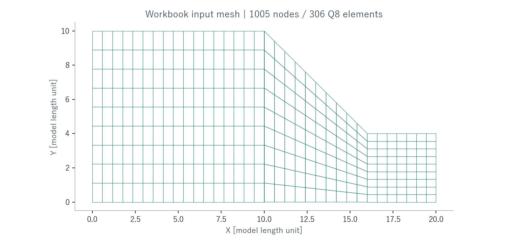

斜面の入力メッシュ（1,005節点・306 Q8要素）。解析後の変形ではなく、ブックの入力形状です。

<table style="margin-top:12mm;font-size:10pt"><tr><th>対象</th><th>内容</th></tr>
<tr><td>実行ブック</td><td>2DSoilFEM_ui_20261021.xlsm</td></tr>
<tr><td>計算部</td><td>20261020_INCO_ELEMENT_01</td></tr>
<tr><td>説明書の改訂</td><td>2026年10月21日</td></tr></table>

# 2D Soil FEM 操作説明書

{{TOC}}

## 1. この説明書について

2D Soil FEMは、Excelで地盤の形状・材料・施工順を入力し、変位・応力と強度低減法（SRM）による安全率Fsを計算するExcelブックです。

この説明書は、画面を見ながら1回の解析を最後まで行う手順書です。どのシートの、どのセルを編集するかを、赤枠と番号で示します。赤枠の番号は本文と表の「番号」に対応します。画像の上端には列記号（A, B, C…）、左端には行番号を残してあります。

- 第4章：例題を1回通す基本操作。
- 第5・6章：材料が複数あるとき、拘束の決め方。
- 第7章：計算の考え方（平面ひずみとQ8要素、Mohr–Coulombと弾完全塑性、関連・非関連流れ、SRMとFsの意味、施工段階、接合要素JOINT）。
- 第8〜14章：解析例1〜7（材料・形状・支持条件の変更、掘削と盛土、荷重、強制変位、流れ則）。
- 第15〜21章：解析例8〜13（道路拡幅の11工程、L型擁壁と断面力、トンネルの段階掘削、接合JOINT、接合面のすべり耐力、アンカー相当力、支持力）。
- 解析例はどれも同じ書式で、「解析対象」（想定・形状・材料・境界と荷重・確かめること）のあとに、実際に計算した画面と確認値を載せています。
- 第22〜25章：入力項目、結果の見方、エラーと対処、設定一覧と用語集。

各手順の下にある「解説」には、その操作に関係する考え方と注意点をまとめています。

> **解説　この説明書で扱う範囲**
>
> 2D Soil FEMは平面ひずみ・小ひずみのQ8連続体の計算です（奥行1m当たり）。SOIL・STRUCT・JOINTの材料、GRAVITY・BIRTH・DEATH・MATSET・LOAD・UNLOAD・RESET・SRMの工程を扱います。STRUCTも連続体で、梁・トラス・板の曲げ要素ではありません。
>
> 次のものは扱いません：専用のアンカー要素・梁要素、トンネル切羽の3次元効果と専用の応力解放率、メッシュを作り直したときの応力・変位履歴の引継ぎ、水位・浸透・圧密（自重はTOTAL＝全応力のみ）、大変形、配筋・ひび割れの照査。

|機能|この説明書での扱い|計算例・制約|
|---|---|---|
|材料・Q8連続体|平面ひずみ、SOIL/STRUCT、単位・符号|擁壁・支保を含む計算例。STRUCTは梁・板ではない|
|施工段階|GRAVITY、BIRTH/DEATH、MATSET|掘削・再盛土（解析例8）、擁壁（解析例9）、トンネル（解析例10）|
|載荷・除荷|FORCE、DISP、FIX、LOAD/UNLOAD|節点力（解析例5）、アンカー相当力（解析例12）。専用アンカー要素ではない|
|SRM・流れ則|Fs区間、ψの扱い、2つの流れ則|同じメッシュで変位・残差・時間を比較。数値区間と物理的破壊を区別|
|支持力の載荷帯|水平地盤・斜面の強制変位と平均圧力|16ケース・粗密比較（解析例13）。極限・許容支持力は自動で決めない|
|JOINT|入力、模式図、接合結果の読み方|履歴を持たない応力上限モデル（解析例11・11-B）|
|RESET系|RESET_U／RESET_STRESSの意味|概要中心（解析例4の注意点）|
|保存・再開|途中状態の保存、EXPORT_LOAD、ログ|版・モデル・施工計画の一致が必要|
|メッシュ・DLL・表示|形状メッシュ、品質、DLLの有無、増分図A/B|現行画面の手順。内部の算法の完全な仕様ではない|

> 全入力列、MATSETのキー、選択規則、再開の照合条件の詳細は、リポジトリの `docs/MODEL_INPUTS.md`（入力シート仕様）と `docs/RESULTS_AND_TROUBLESHOOTING.md`（結果・ログ・再開）にあります。設定一覧に載っていることは、その設定を全ケースで検証したという意味ではありません。

> **解説　結果を読む順序と、言葉の意味**
>
> 結果は、まず「ステージ結果」の成否（PASS／FAIL）、残差（第4章 手順9）、反力と荷重の釣合い（7.5）を読み、そのあとで図を見ます。図だけから判断しません。色の図は、表の数値の分布を見せるためのものです。
>
> 付録の用語集は、このブックとこの説明書で使う言葉の意味をまとめたものです。一般の理論の用語と、ブックの機能の名前とは、同じ範囲を指さないことがあります。

## 2. 必要なもの

|項目|内容|
|---|---|
|Excel|Windowsのデスクトップ版Excel（64ビット推奨）。Excel for the webでは動きません。|
|ブック|`2DSoilFEM_ui_20261021.xlsm`|
|DLL|`soilfem_native_x64.dll`（高速計算用。ブックと同じフォルダーに置く）|
|入手先|[配布ZIP（SoilFEM_UI_20261021.zip）](https://github.com/tak063495-prog/excel-vba-soil-fem/raw/main/workbook/SoilFEM_UI_20261021.zip) をダウンロードし、新しいフォルダーに展開します。|

DLLがない場合や32ビットExcelの場合は、「高速化設定」C9を`OFF`にするとVBAだけで計算します（時間は長くなります）。倍精度と収束条件は同じです。C9がAUTOでDLLが見つからないときもVBAの計算に戻ります。

DLLは`soilfem_native_x64.dll`の1個だけです。古い`soilfem_mat_x64.dll`と2個並べる構成は現在の配布構成ではありません。版の違うDLLを混ぜないでください。

> **解説　マクロを有効にするとき**
>
> マクロは、信頼できる取得元のファイルであることを確かめてから許可します。ブロックされたときは、Windowsのファイルのプロパティ（「許可する」）、Excelの保護ビュー・トラストセンター、組織の管理方針を確認します。マクロの保護をExcel全体で無効にする設定はしません。

## 3. 画面構成

ブックを開くと「操作パネル」が表示されます。各入力シートへのリンクと、主なボタンがあります。

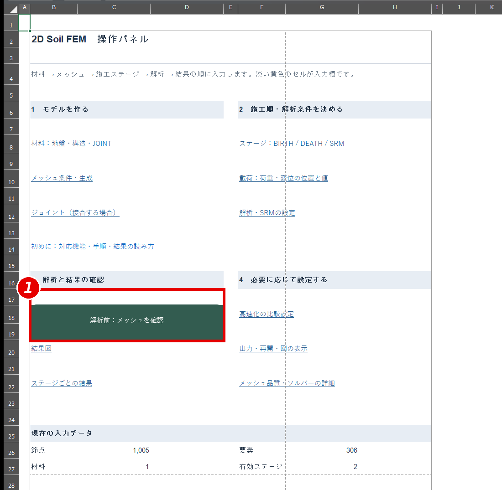

図1 「操作パネル」。①「解析前：メッシュを確認」。入力したメッシュと拘束を「図」シートに表示します（計算はまだ始まりません）。

|シート|役割|
|---|---|
|「材料データ」|材料の定数（ヤング率、粘着力、内部摩擦角など）|
|「形状入力」|点の座標と境界（外形）、格子間隔|
|「メッシュ設定」|外周の拘束、メッシュ生成のボタン|
|「接合」|接合要素（JOINT）を入れる材料の組合せ|
|「載荷」|荷重・強制変位|
|「ステージ」|自重・掘削・盛土・載荷・SRMの実行順|
|「解析設定」|流れ則、SRMの探索条件|
|「高速化設定」|DLLの使い方（通常は変更不要）|
|「出力・表示」|保存範囲、結果図の表示条件、「変形・応力図を表示」ボタン|
|「詳細設定」|メッシュ品質目標、ソルバー（通常は変更不要）|
|「図」|メッシュ確認図・結果図|
|「ステージ結果」・「接合結果」|工程ごとの結果、接合の結果|
|「節点データ」「要素データ」「結果節点」「結果要素」「診断」|操作パネルのボタンから開く表（通常は直接編集しません）|

**共通のルール**：入力できるのは淡い黄色のセルだけです。見出し行（濃い青の行）、B列の項目名、E列の説明、F列のKEY、G列の推奨値は編集しないでください。

|見分け方|意味|扱い|
|---|---|---|
|淡い黄色のセル（設定シートはC列）|入力欄|ここに値を入れる|
|G列（推奨・目安）|目安の値|物性を自動で決める値ではない。編集しない|
|灰色のセル|メッシュ生成の記録などの自動出力|直接変えない|
|黄土色のタブ（材料データ・形状入力・接合・載荷・ステージ）|モデルの入力|案件ごとに入力する|
|緑のタブ（メッシュ設定・解析設定・高速化設定・出力・表示・詳細設定）|設定|目的に応じて確認する|
|青のタブ（図・ステージ結果・接合結果など）|結果|解析後に確認する|

旧版の「設定」シートは互換用の参照で、通常は表示されません（非表示）。用途別シートのC列と二重に入力しないでください。

## 4. 解析手順（例題を1回通す）

ここでは小さな例題（6点の斜面、要素72個）で、入力から結果確認までを行います。所要時間は計算を含めて数分です。

**例題の確認値**（同じ入力ならこの値になります）

|項目|値|
|---|---|
|メッシュ|72要素、261節点（地形追従格子）|
|ステージ|1 GRAVITY（自重）→ 2 SRM|
|結果|両ステージ PASS。Fs_PASS=2.625、Fs_FAIL=2.638、区間幅0.012（SRM_TOL=0.02）|
|計算時間|約1分（DLL使用、Rico PCでの実測 1分7秒）|

### 手順1 ブックを開く

1. 展開したフォルダーの`2DSoilFEM_ui_20261021.xlsm`をダブルクリックします。
2. 画面上部に黄色の「セキュリティの警告」バーが出たら「コンテンツの有効化」を押します。赤いバー（「このファイルのソースが信頼されていないため…」）が出た場合は、Excelを閉じ、ファイルを右クリック→「プロパティ」→「全般」タブの「許可する」にチェックして開き直します。
3. 「操作パネル」が表示されれば準備完了です。

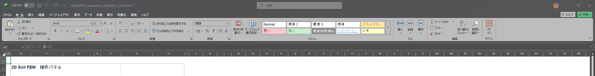

図2 開いた直後の画面。この画面のように警告バーが出ない設定のPCもあります。その場合はそのまま進みます。

### 手順2 材料を入力する（「材料データ」）

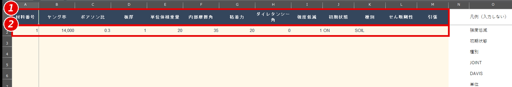

図3 入力前。①1行目は見出し（編集しない）。②2行目から材料を1行ずつ入力します（A2:M2）。

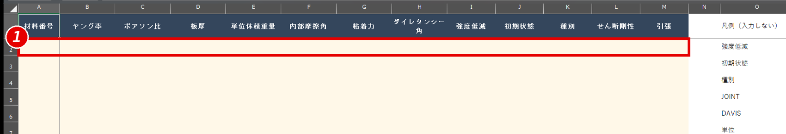

図4 新しく入力するときは、2行目以降の古い値を消してから入力します。

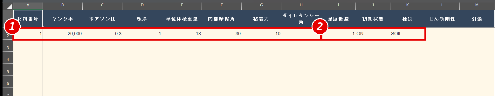

図5 入力後。①A2:H2に材料定数、②I2:K2に強度低減・初期状態・種別を入力します。

|番号|セル範囲|入力するもの|単位|例（材料1）|
|---|---|---|---|---|
|①|A2|材料番号（1から連番）|－|1|
|①|B2|ヤング率E（SOIL・STRUCT）|kN/m²|20000|
|－|B列（JOINTの行）|法線剛性Kn（JOINTではEの代わり）|kN/m³|（解析例11）100000|
|①|C2|ポアソン比ν|－|0.3|
|①|D2|板厚|m|1|
|①|E2|単位体積重量γ|kN/m³|18|
|①|F2|内部摩擦角φ|度|30|
|①|G2|粘着力c|kN/m²|10|
|①|H2|ダイレタンシー角ψ|度|0|
|②|I2|強度低減（1=SRM対象、0=対象外）|－|1|
|②|J2|初期状態（ON=最初から有効、OFF=BIRTHまで無効）|－|ON|
|②|K2|種別（SOIL／STRUCT／JOINT）|－|SOIL|
|－|L2|JOINTのときだけ：せん断剛性Ks|kN/m³|空欄|
|－|M2|JOINTのときだけ：引張許容（1=ON、0=OFF）|－（単位なし）|空欄|

**触らないセル**：1行目（見出し）。材料を増やすときは3行目、4行目…と下に追加します。

> **解説　新しいケースに切り替えるときは古い行を最後まで消す**
>
> 計算済みのブックの先頭に短い表を上書きすると、後ろの古い行が残ります。解析は各表の最後のデータ行まで読むので、古い材料・載荷・工程が新しいケースに混ざります。行やシートを削除せず、データ行を選んで「数式と値のクリア」をします。

|表|消す範囲|注意|
|---|---|---|
|「材料データ」|A2:M（最後の行まで）|見出し・書式・入力規則は残す|
|「載荷」・「接合」|A2:J・A2:E（最後の行まで）|DISP=0の行は「無効」ではなくゼロ変位拘束として働く|
|「ステージ」|A2:F（最後の行まで）|残す行はE列=1の数と順番を照合する|
|「形状入力」（形状から作る場合）|B8:D・G8:J（最後の行まで）|新しい形状を入れてメッシュを作り直す|
|「節点データ」「要素データ」（保存メッシュを使う場合）|A2:I・A2:J（最後の行まで）|「形状メッシュを作成」は押さない|

> 表が2000行より長ければ、その最後の行まで消します。保存先とファイル名を新しくし、「出力・表示」C14（途中結果から再開）は空欄にします。古い`_out`フォルダーを新しいケースの再開元にしません。開始前に、材料数・節点数・要素数・有効な工程の数・各表の最後の行を確認します。

> **解説　単位と符号**
>
> 自動の単位換算はありません。mとmm、NとkN、密度（kg/m³）と単位体積重量（kN/m³）を混ぜると、結果が大きく狂います。長さm・力kNで入力するなら、E・c・応力はkN/m²（kPa）、γはkN/m³、JOINTのKn・KsはkN/m³です（第22章）。
>
> 変位・節点力・反力はXが右、Yが上を正とします。沈下量を下向き正で整理するときは s＝−uy です。変位ノルム√(ux²＋uy²)は常に正の値で、沈下そのものではありません。連続体の応力は**圧縮を正**として保存されます（引張正に直すときは全成分の符号を反転）。ひずみも圧縮正で、XYせん断は工学せん断ひずみγxy＝2εxyです。JOINTの法線応力も圧縮正、開口は開く向きが正です。
>
> 材料定数には、どの地盤にも使える推奨値はありません。ν（C列）はSOIL・STRUCTで−1より大きく0.5未満、JOINTでも数値の入力が必要です。材料を登録しただけでは領域に割り当てたことにならないので、「要素データ」J列の材料番号も確認します（第5章）。

### 手順3 形状を入力する（「形状入力」）

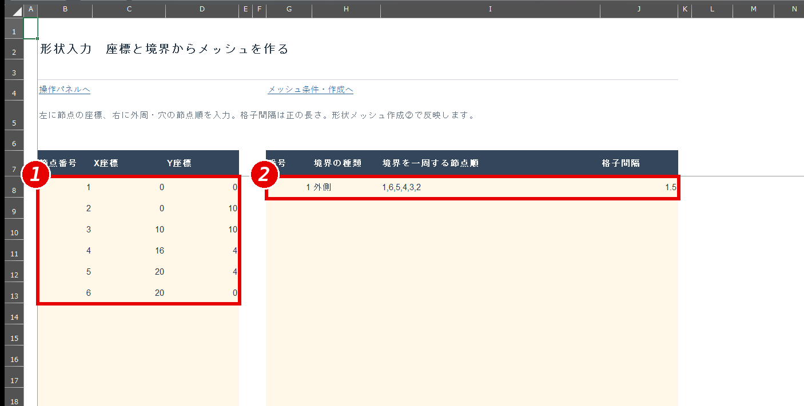

図6 入力前。①B8:D13 点の番号と座標。②G8:J8 境界（1行＝1つの境界）。

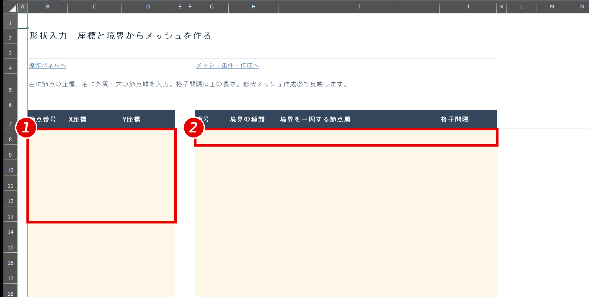

図7 古い点と境界を消した状態（B8:D20、G8:J8）。

図8 入力後。①点1〜6の座標。②G8=1、H8=外側。③I8=境界を一周する点番号`1,6,5,4,3,2`。④J8=格子間隔2。

|番号|セル範囲|入力するもの|単位|例|
|---|---|---|---|---|
|①|B8:B13|点番号（重複しない）|－|1〜6|
|①|C8:D13|点のX座標・Y座標|m|(0,0)(0,6)(6,6)(10,3)(14,3)(14,0)|
|②|G8|境界の番号|－|1|
|②|H8|境界の種類（外側／内側。内側は穴を表す）|－|外側|
|③|I8|境界を一周する点番号（カンマ区切り。最後に始点を繰り返さない）|－|1,6,5,4,3,2|
|④|J8|格子間隔（小さいほど要素が増える）|m|2|

**触らないセル**：2〜7行目（題名・リンク・見出し）。点を増やすときは14行目以降へ、境界を増やすときは9行目以降へ追加します。

### 手順4 外周の拘束を決めてメッシュを作る（「メッシュ設定」）

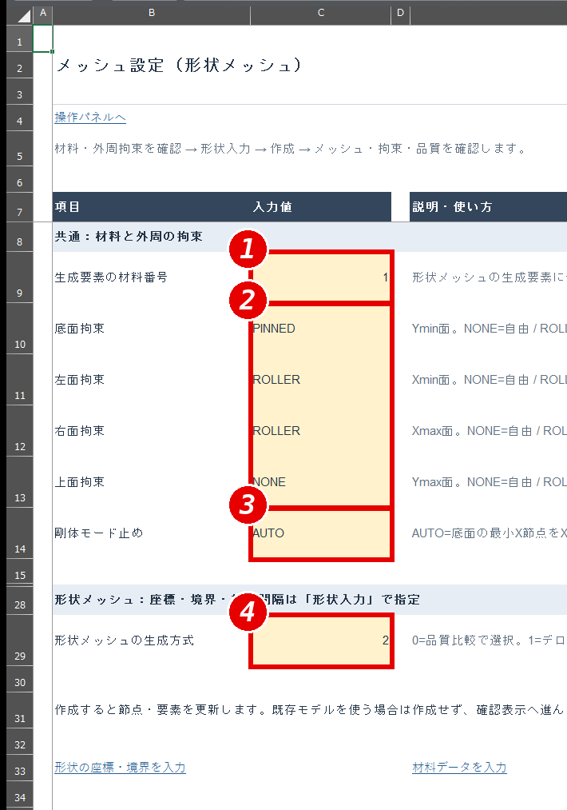

図9 ①C9 材料番号の補充値。②C10:C13 底面・左面・右面・上面の拘束。③C14 剛体モード止め。④C29 生成方式。

|番号|セル範囲|入力するもの|単位|例|
|---|---|---|---|---|
|①|C9|材料番号の補充値（どの外側境界にも入らない要素に使う。材料は境界の行順で決まる→第5章）|－|1|
|②|C10:C13|底面・左面・右面・上面の拘束（NONE=自由、ROLLER=面に垂直方向を固定、PINNED=XY固定）|－|PINNED／ROLLER／ROLLER／NONE|
|③|C14|剛体モード止め（AUTO=底面の最小X節点をXY固定、NONE=しない）|－|AUTO|
|④|C29|生成方式（0=品質比較、1=デローニ修正優先、2=地形格子）|－|2|

**触らないセル**：B列（項目）、E列（説明）、F列（KEY）、G列（目安）。C17:C26は旧簡易メッシュ用で、形状メッシュでは使いません。

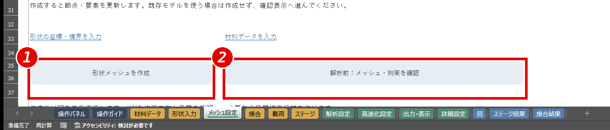

図10 ①「形状メッシュを作成」を押します。②「解析前：メッシュ・拘束を確認」は作成済みメッシュを表示し直すボタンです。

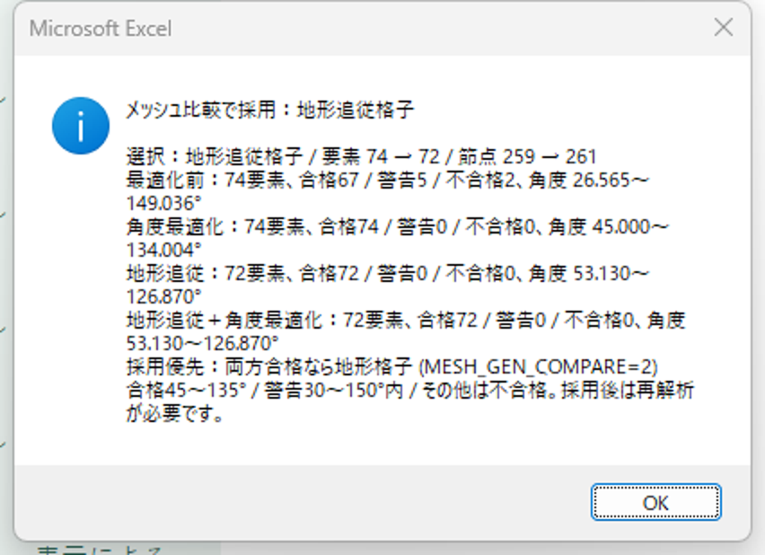

図11 作成後に表示されるメッセージ。採用した生成方式、要素数、節点数、品質（合格・警告・不合格の数、角度範囲）が表示されます。「OK」で閉じます。不合格が0であることを確認します。

図12 「図」シートに作成したメッシュが表示されます。外形、要素分割、赤いX/Y記号（拘束方向）を確認します。

> **解説　メッシュ品質の判断**
>
> 品質に関する表示は3種類あり、判定の対象と意味が違います。メッセージの「不合格」を「Jacobianが負」と同じ意味に読まないでください。

|表示|出る場所|判定の対象|次の操作|
|---|---|---|---|
|作成比較の「合格／警告／不合格」と角度範囲|「形状メッシュを作成」後のメッセージ（図11）、「詳細設定」C33|要素の内角だけ。合格＝45〜135°、警告＝30〜150°の範囲内、それ以外＝不合格|不合格・警告の要素があれば、境界点の配置と格子間隔を見直すか、品質修正候補を作る|
|品質目標（最小面積比・最小Jacobian比・最小／最大角度・最大アスペクト比）|「解析前：メッシュを確認」の品質サマリ|「詳細設定」C14:C18の目標（配布値 1e−06、1e−06、45°、135°、5）|目標未達（WARN）はPASSと扱わない。候補を比べ、同じ形・領域を保つものだけ採用|
|計算できない形状|解析開始時・メッシュ確認時のエラー|Jacobianが正でない要素、接続の不整合・重複・孤立節点|解析を始めない。点の座標・境界の順番・共有辺を直して作り直す|

> 品質修正の操作は、「品質修正候補を確認」（元のメッシュを残して候補を作る）→比較結果・Jacobian・形・領域のつながりを確認→「候補を採用」（節点・要素表を更新）です。採用しない場合は何もしなければ元の入力が残ります（取消）。候補を作った後に入力を変えたら、候補を作り直します。候補の作成には反復回数と作業配列の上限（「詳細設定」C21:C25）があり、必ず修復できるとは限りません。直らないときは形状を見直します。

|気になる点|直し方|
|---|---|
|輪郭・寸法が違う|形状入力の座標と境界の順番を直して作り直す。穴（内側）と後で掘削する領域を混同しない|
|共有辺がつながらない|両側の境界に同じ点（途中の点も）を入れる。片側だけの追加点や近接した別座標の点を残さない|
|基礎や薄い壁が粗い|その領域を分けて格子間隔を小さくする。薄い部材を厚さ方向1要素だけで済ませない|
|細長い・曲がった要素|境界点の配置と間隔の差を見直す。角だけを極端に細かくしない|
|作り直した後|節点番号が変わるので、要素の材料番号・拘束・載荷の対象（番号・BOX）を確認して最初から計算する|

> 許容値を緩めて合格にする方法はとりません。品質が合格でも計算の精度は保証されません。計算後は、収束に加えて変形の妥当性・反力の釣合い・粗密の違いを確認します。

> 節点番号を探すとき：「表示モード」（「出力・表示」C21）をDETAILにしても、節点番号が描かれるのは500節点以下のメッシュだけです（大きなメッシュで番号が出ないのは、未生成という意味ではありません）。「節点データ」のB:C列（座標）をフィルターで絞り、A列の番号を読みます。例：解析例13の水平地盤（粗）では X=1 m、Y=5 m が節点39です。別のメッシュにこの番号を流用しません。

### 手順5 接合・載荷・施工順を確認する

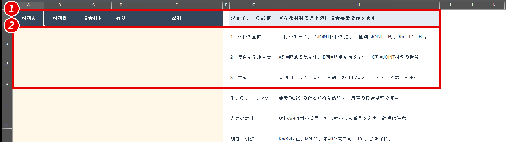

図13 「接合」。①見出し。②A2:E（必要な行だけ）。今回の例題では使いません。

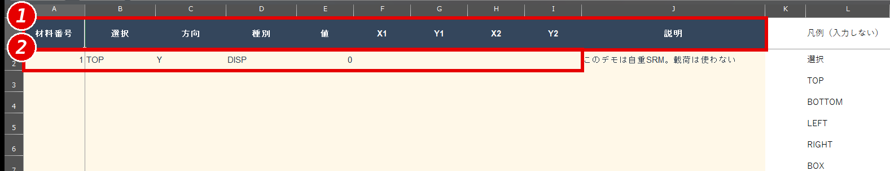

図14 「載荷」。①見出し。②A2:I2。今回の例題は自重とSRMだけなので、荷重は使いません（この行はLOAD工程がないため適用されません）。

「載荷」A2が空欄のままブックの表を整えると、2行目に既定の行「1, TOP, Y, DISP, 0」が補われます（上面のゼロ変位拘束）。LOAD工程を追加する前に、この行が残っていないか必ず確認します。

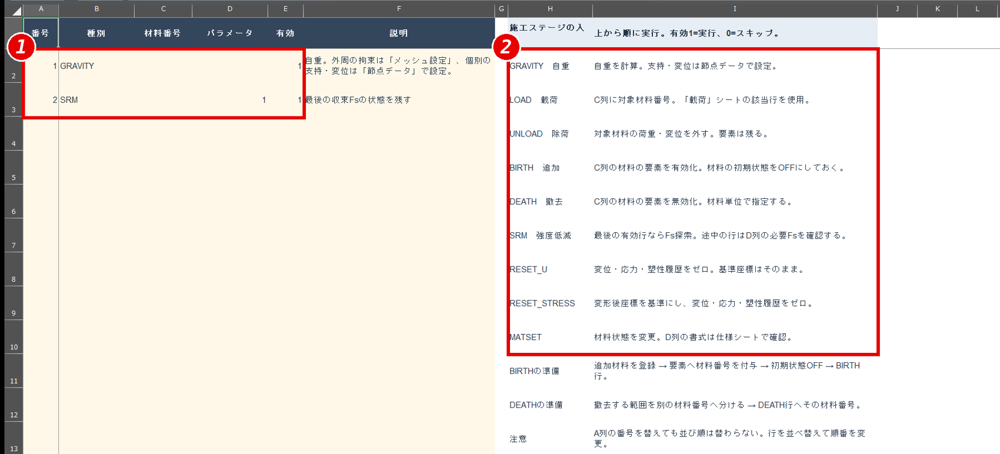

図15 「ステージ」。①A2:E3 実行する工程（上から順に実行）。②H:I列は入力の説明（編集しない）。例題は1行目GRAVITY、2行目SRM、E列はどちらも1です。

|番号|セル範囲|入力するもの|単位|例|
|---|---|---|---|---|
|①|A2:A3|番号（管理用）|－|1、2|
|①|B2:B3|種別（GRAVITY、LOAD、BIRTH、DEATH、SRMなど）|－|GRAVITY、SRM|
|①|C2:C3|対象の材料番号（BIRTH/DEATH/LOADで必要）|－|空欄|
|①|D2:D3|パラメータ（途中SRMの必要Fs、MATSETの内容）|－|空欄、1|
|①|E2:E3|有効（数値1=実行、0=スキップ）|－|1、1|

**触らないセル**：1行目（見出し）、H:I列（説明）。実行順を変えるときは行そのものを並べ替えます（A列の番号を変えても順番は変わりません）。

### 手順6 解析条件を確認する（「解析設定」）

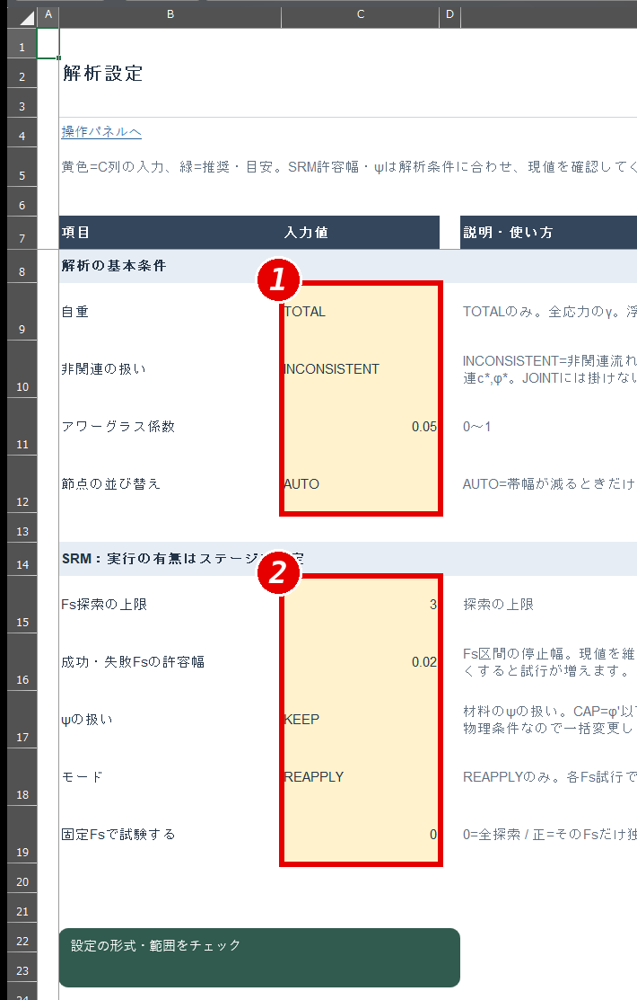

図16 ①C9:C12 基本条件。②C15:C19 SRMの条件。例題は配布時の値のまま使います。

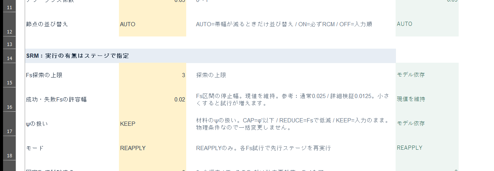

図17 ①「設定の形式・範囲をチェック」を押します。

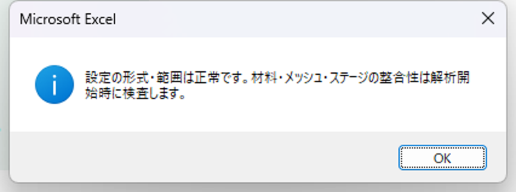

図18 問題がなければ「設定の形式・範囲は正常です」と表示されます。

|番号|セル範囲|入力するもの|単位|例（配布値）|
|---|---|---|---|---|
|①|C9|自重の扱い|－|TOTAL|
|①|C10|非関連流れの扱い|－|INCONSISTENT|
|①|C11|アワーグラス係数（0〜1）|－|0.05|
|①|C12|節点の並び替え|－|AUTO|
|②|C15|Fs探索の上限|－|3|
|②|C16|成功・失敗Fsの許容幅|－|0.02|
|②|C17|ψの扱い|－|KEEP|
|②|C18|SRMモード|－|REAPPLY|
|②|C19|固定Fs（0=全探索）|－|0|

**触らないセル**：B・E・F・G列。

C16の配布値0.02はそのまま使います。画面の説明にある「通常0.025／詳細検証0.0125」は参考値で、変える必要はありません。「設定の形式・範囲をチェック」で見つからなかった誤りも、解析の入口で設定と入力を検査し、不正なら**結果を消す前に**止まります（貼り付けで入力規則を回避した値も検査されます）。エラーに表示されたシート・セル・KEYを直します。検査を通っても、入力が工学的に妥当という保証にはなりません。

|実行前の確認|見るところ|
|---|---|
|単位と材料|E・ν・γ・c・φ・ψ、板厚、SRM対象（I列）、種別（K列）|
|メッシュと支持|節点の連番、接続、要素の材料番号（J列）、拘束の方向、品質|
|載荷・施工|方向・符号・対象節点の数、ステージの有効欄（E列=1）、BIRTHする材料の初期OFF|
|解析・保存|流れ則、ψの扱い、Fs上限・許容幅、新規（C14空欄）か再開か、ログ設定|

> **解説　SRM（強度低減法）の仕組み**
>
> SRMは、I列=1の材料の強度を c/Fs、atan(tanφ/Fs) に下げ、Fsを変えながら釣合い計算を繰り返します。成功したFsと失敗したFsの区間が「成功・失敗Fsの許容幅」（C16）より狭くなったら止まります。
>
> 「ステージ」の最後の有効行がSRMならFsを探索します。後ろに施工が続く途中のSRMは、D列の必要Fsを満たすかを判定する関門です。満たせば施工を続け、満たさなければ止まります。
>
> C19（固定Fs）に正の値を入れると、そのFsだけを試します。成功しても限界のFsを求めたことにはなりません。探索するときは0に戻します。

### 手順7 高速化・出力の設定を確認する

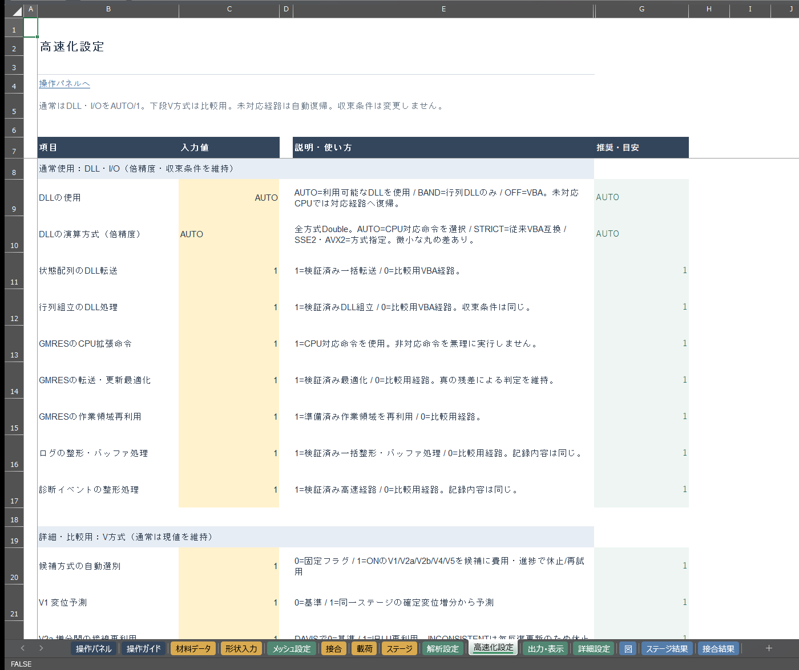

図19 「高速化設定」。通常は変更しません。値を変えてしまった場合は①「DLL・I/Oだけ推奨値に戻す」を押します（材料・荷重・支持・Fs条件は変わりません）。

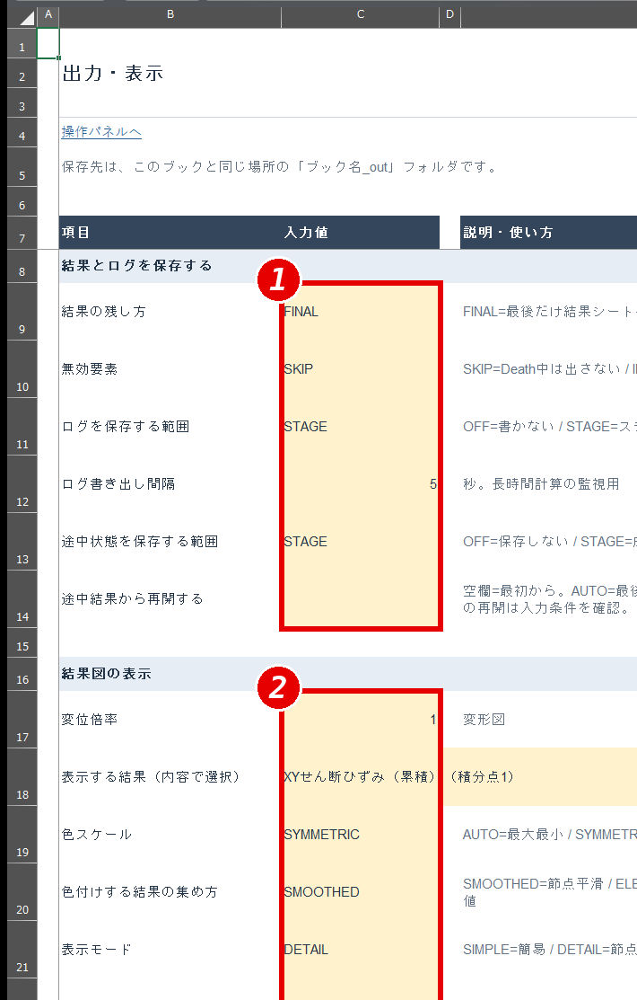

図20 「出力・表示」。①C9:C14 結果・ログの保存範囲。②C17:C24 結果図の表示条件。

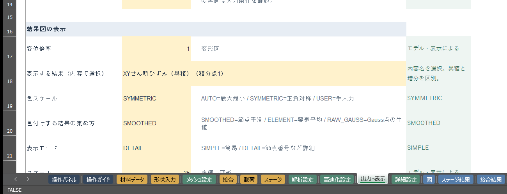

図21 ①「変形・応力図を表示」（解析後に使います）。

### 手順8 解析前にメッシュを確認する

「操作パネル」の「解析前：メッシュを確認」（図1の①）を押します。

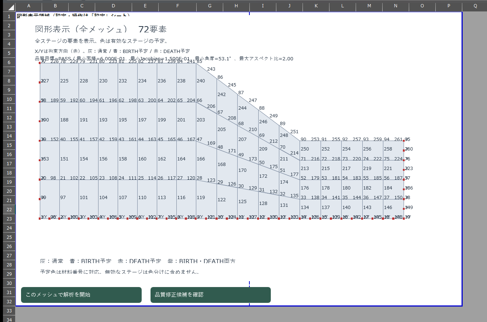

図22 「図」シートの確認図。灰色＝通常、青＝BIRTH予定、赤＝DEATH予定です。この時点では計算は始まっていません。

> **解説　メッシュの品質・収束・精度は別のこと**
>
> メッシュの品質の判定（PASS）、材料の計算の収束、解析の精度は、それぞれ別に確かめます。品質がPASSでも、収束するとは限りません。収束しても、メッシュが粗ければ精度は足りないことがあります。
>
> この説明書の図に使った結果は、さらに、各要素の形を11×11点で調べ、元の形と変形後の形（倍率1）の両方でJacobian（形の写像の行列式）が正であること（要素が裏返っていないこと）を別に確かめています。小ひずみの計算が収束したことと、変形後の形として成り立っていることも、別のことです。
>
> 解析済みのモデルの節点・要素を直したときは、変位・応力の履歴は新しいメッシュへ移されません。初期の入力から計算し直します。

### 手順9 解析を開始する

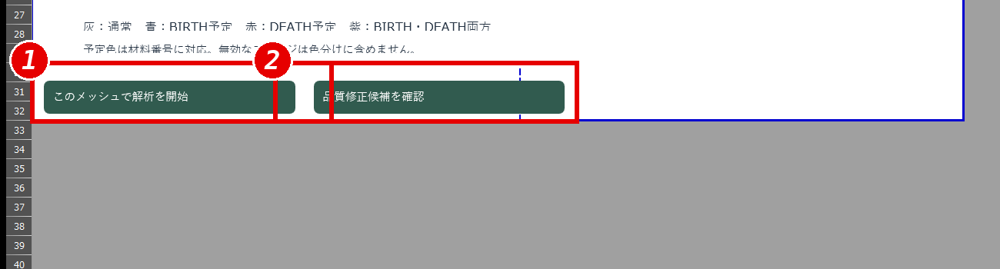

図23 「図」シートの下にあるボタン。①「このメッシュで解析を開始」を押すと計算が始まります。②「品質修正候補を確認」はメッシュ品質に警告があるときに使います。

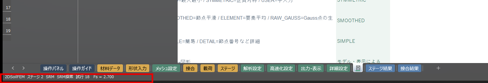

図24 計算中はExcelの左下（ステータスバー）に進み具合が表示されます（赤枠）。例：「ステージ 2/2 SRM 探索 試行16 Fs=2.70」。計算中はExcelを操作しないでください。

画面が止まって見えても、それだけで非収束と判断しません。ステータスバーと`ブック名_out\run.log`の進み具合を確認します。強制終了した場合は、そのときの結果を採用せず、ログと保存済みの成功状態を確認します。

> **解説　増分・反復・残差**
>
> 計算は荷重を少しずつ進めます（増分）。1つの増分の中では、釣合いが取れるまで修正を繰り返します（反復）。収束しないときは増分を小さくしてやり直すため、試行の回数と進んだ増分の数は一致しません。残差は外力と内力の差です。残差が小さくても、拘束・材料・単位が意図どおりとは限りません。収束したかどうかと、結果が力学的に妥当かどうかは分けて確認します。
>
> 「残差」にはいくつか種類があります。線形方程式を解くGMRESの途中の残差、Newton反復の釣合い残差、最後に記録される全体の相対残差（「診断」RelativeResidualFree）は同じ量ではありません。途中の値だけで良否を決めず、最終の判定、全変位、Fs区間と合わせて見ます。
>
> 1つの荷重増分の反復回数には上限があります。INCONSISTENTでは全体反復100回（弾性補正モードでは1000回）、線探索は最大16回、DAVISでは全体反復50回・線探索4回です。上限に達すると増分を小さくしてやり直し、最小の増分でも収まらないと「計算失敗」になります。SRMでは各Fsで先行工程を計算し直すので、総反復数と時間は大きくなることがあります。反復が長いこと自体は停止の理由ではありません。この説明書の計算では、これらの上限や収束条件を変えていません。

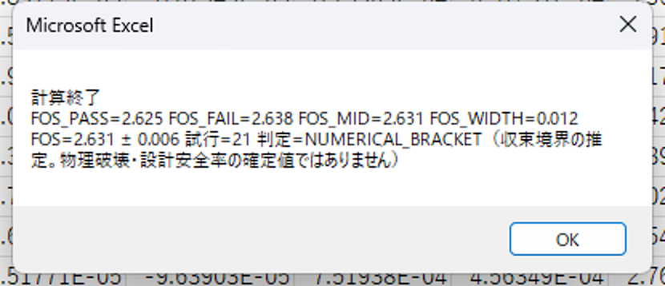

図25 終了時のメッセージ。「計算終了」とFsの探索結果（FOS_PASS、FOS_FAIL、FOS_MID、FOS_WIDTH）が表示されます。「OK」で閉じます。

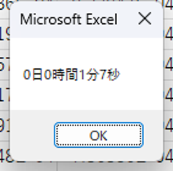

図26 続いて計算時間が表示されます。「OK」で閉じます。

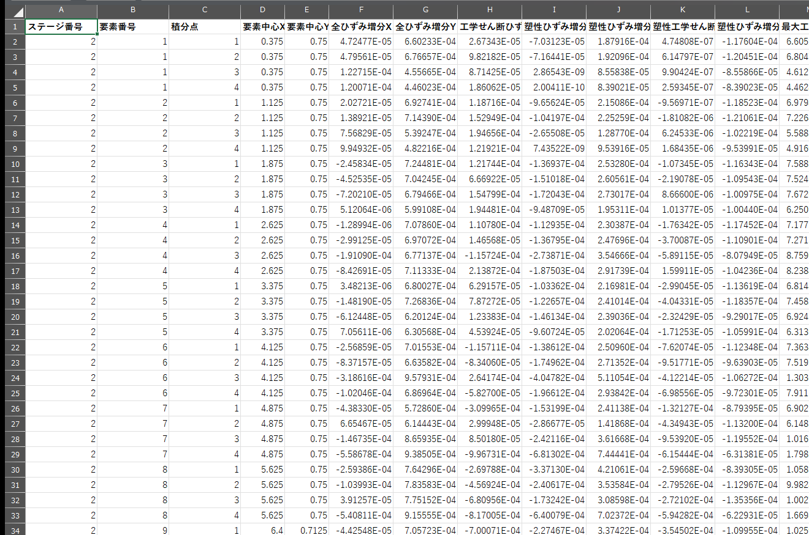

図27 計算が終わった直後に、表示されているシートの例（「結果増分」）。この表は最後に収束した荷重増分のひずみ増分です（列の意味は第23章）。色の結果図は手順11の「変形・応力図を表示」で「図」シートに描きます。続けて手順10で「ステージ結果」を開きます。

### 手順10 結果を確認する

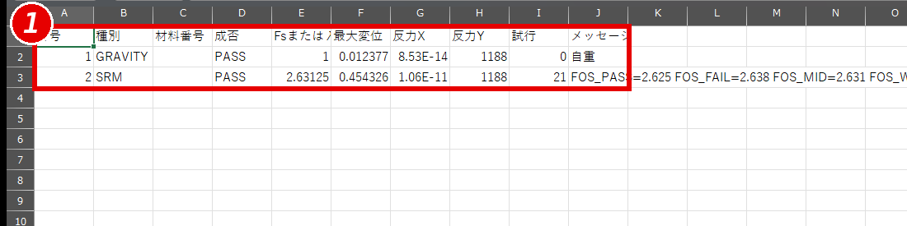

図28 「ステージ結果」。①1行目GRAVITY、2行目SRMの成否（PASS）、最大変位、反力、試行数、メッセージを確認します。

「ステージ結果」F列の「最大変位」は、計算中に試した状態を含めた自由度の変位成分の最大値（試行中の最大値）で、解析開始からその工程までの最大を引き継ぎます（`FEMEngine.bas`のP3MaxTrialDisp）。工程が終わったときの変位ではありません。工程ごとの変位は「結果節点」をA列（工程）で絞り、E:F列から max｜ux｜、max｜uy｜、max√(ux²＋uy²) を求めます（第23章）。

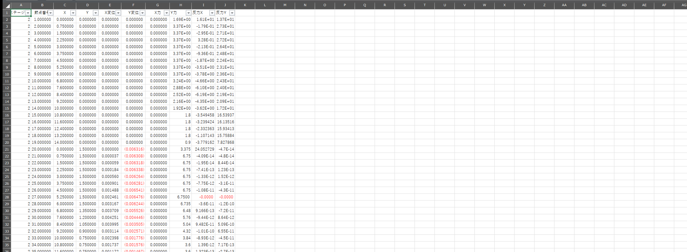

図29 「操作パネル」の「数値結果」で開く「結果節点」。節点ごとの座標、変位、力、反力。

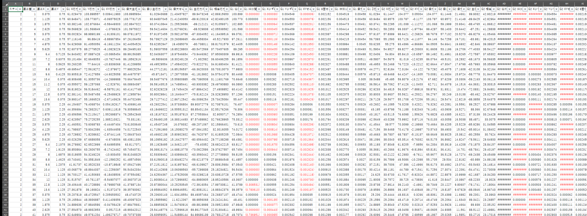

図30 「操作パネル」の「要素の応力・ひずみ・塑性」で開く「結果要素」。4つの積分点ごとの応力・ひずみ・降伏状態。

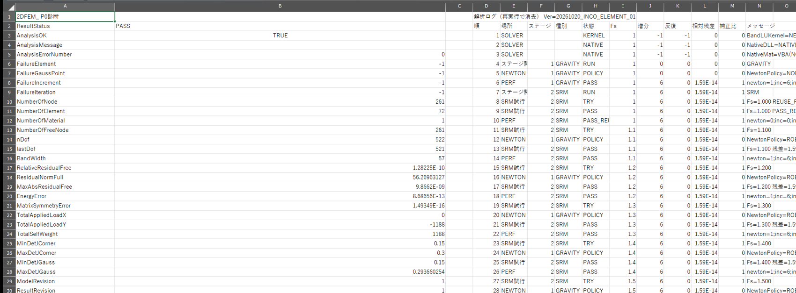

図31 「操作パネル」の「診断」で開く「診断」シート。解析状態、残差、失敗位置を確認します。

### 手順11 変形・応力図を表示する

「出力・表示」の「変形・応力図を表示」（図21の①）を押します。

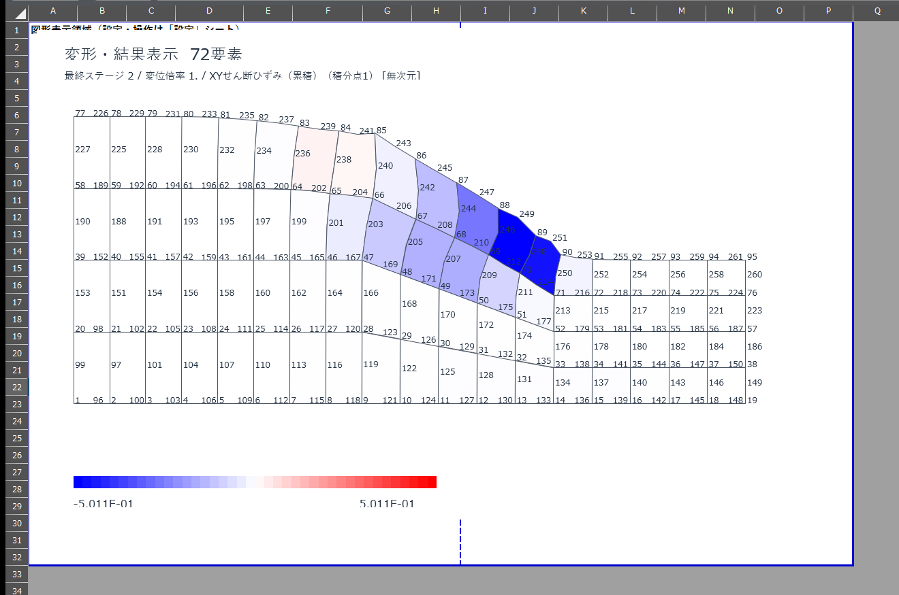

図32 結果図。表示量＝C18「XYせん断ひずみ（累積）（積分点1）」、対象＝最終ステージ（SRMで最後に成功したFs=2.625の状態）、色スケール＝SYMMETRIC（0を中心に正負対称）、変位倍率＝1。凡例は図の下にあります。

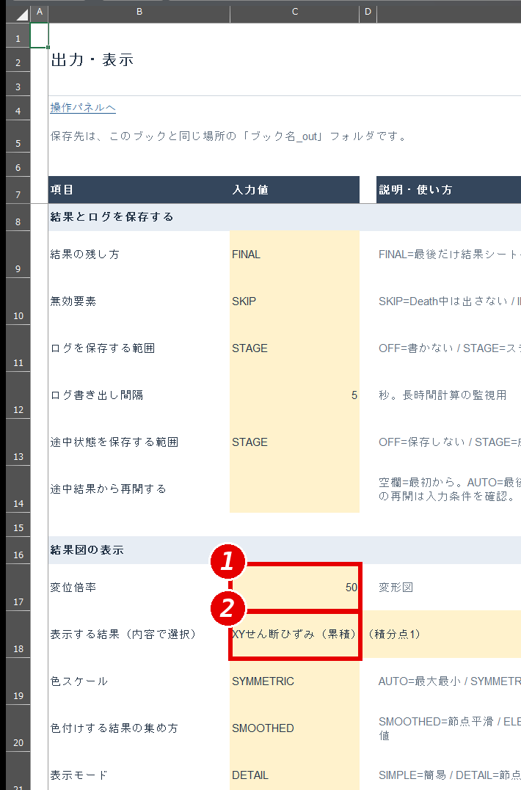

図33 ①C17（変位倍率）を50にします。②C18で表示する結果を選べます（選択肢は「表示項目一覧」で確認）。

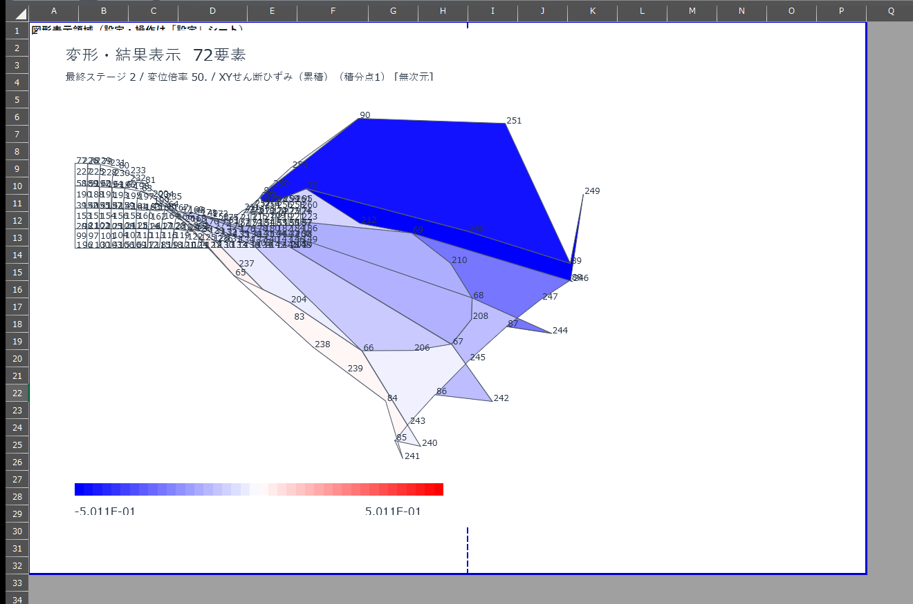

図34 変位倍率50で再表示した図。変形が50倍に拡大されます。数値結果は変わりません。

### 手順12 保存する

Excelの「上書き保存」で保存します。外部出力（ログ・途中状態）はブックと同じ場所の`ブック名_out`フォルダーに保存されます。ブックと一緒にこのフォルダーも保管してください。

> **解説　保存した結果の再表示と、途中からの再開は別の操作です**
>
> 再表示：解析後に保存したブックを開き直し、「変形・応力図を表示」を押すと、再解析せずに図が出ます。「ステージ結果」の工程・Fsと図を照らし合わせます。
>
> 途中から再開：「出力・表示」C13（途中状態を保存する範囲）で保存した状態を、C14（途中結果から再開する）にフォルダー名（例 stg03_BIRTH）で指定します。再開したことは`run.log`の記録で確認します。C14=AUTOとしただけでは再開した証拠になりません。新しいケースではC14を空欄にします。
>
> 「USER」の色スケールは縮尺と原点を手入力する設定で、色の上下限を固定する機能ではありません。図を比べるときは凡例の数値を必ず併記します。
>
> C13（EXPORT_MODE）は途中状態（チェックポイント）を書き出す設定で、Excelブックを自動保存する設定ではありません。結果表をCSVに保存しただけでは、応力・塑性履歴・施工状態を含む再開用の一式の代わりになりません。再開には版・モデル・施工計画の一致が必要で、FAILになった状態からは再開できません。C14=AUTOで対応する成功状態が見つからないと最初から計算することがあるので、run.logで再開を確認します。

## 5. 材料が2つ以上あるときの注意

形状メッシュでは、要素の材料番号は**「形状入力」の外側境界の行順**で決まります。上から1行目の外側境界の中の要素が材料1、2行目の中が材料2です。G列の「番号」を書き換えても材料番号は変わりません。「メッシュ設定」C9は、どの外側境界にも入らなかった要素に付ける補充値です。

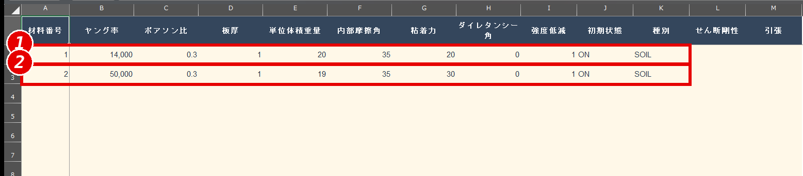

図35 「材料データ」。①2行目＝材料1、②3行目＝材料2（剛性の大きい材料の例）。

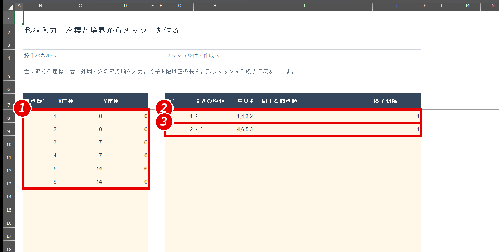

図36 「形状入力」。①点1〜6。②1行目の外側境界`1,4,3,2`（左の領域）→材料1。③2行目の外側境界`4,6,5,3`（右の領域）→材料2。

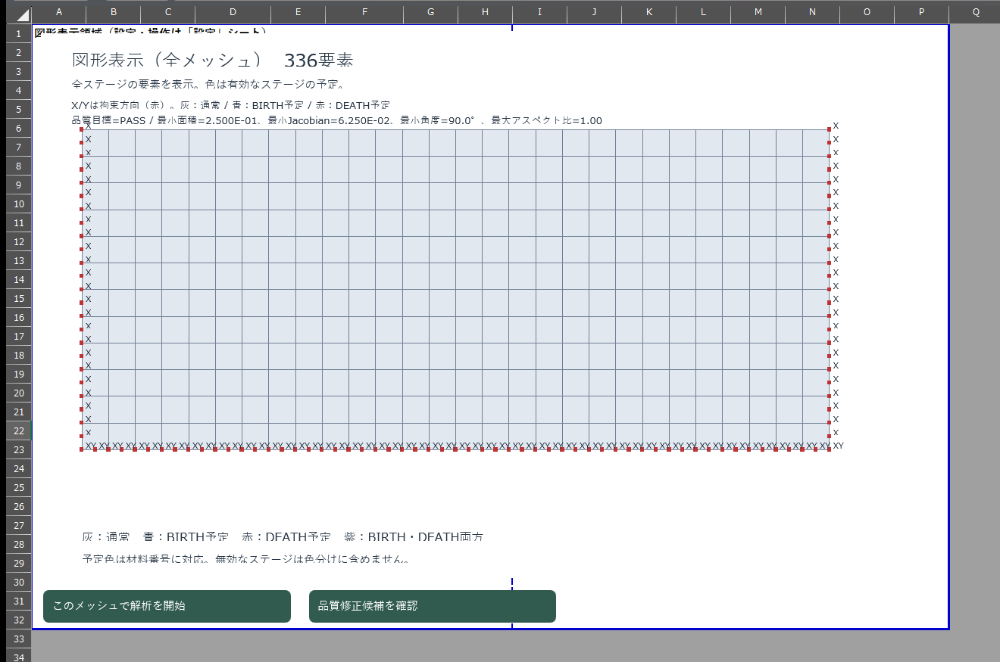

図37 作成したメッシュ（336要素）。

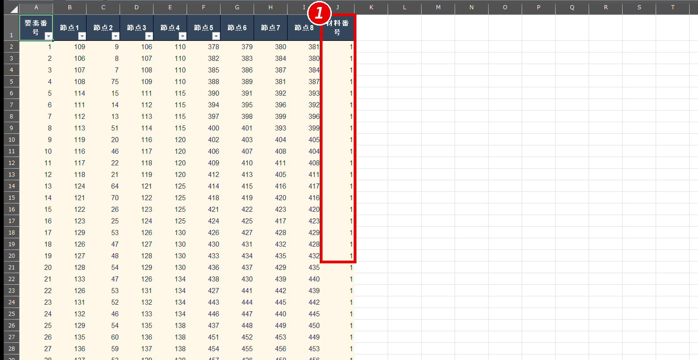

図38 「操作パネル」の「要素」で開く「要素データ」。①J列が材料番号です。作成後はJ列をフィルターし、材料2の要素が右の領域にあることを確認します。

外側境界の行を並べ替えると材料の割当ても変わります。J列を手で直す場合は、対象の要素を座標と接続で確かめ、その行のJ列だけを実在する材料番号に変えます（表の一部の列だけを並べ替えない）。メッシュを作り直すと手で直したJ列は上書きされるので、直す前後のコピーと要素番号の一覧を残し、作り直すたびに確認します。

> **解説　材料の自動割当を確かめる**
>
> メッシュを作ると、要素の中心がどの境界（領域）の中にあるかで材料番号が決まります。「メッシュ設定」C9（MESH_MATERIAL）は、要素の中心がどの外側の領域にも入らないときに使う補いの材料番号です。C9だけで全体の材料を決める設定ではありません。穴の境界は外側の領域とは別に数えます。
>
> 自動の割当を無条件に信用せず、「要素データ」J列を図の材料の色と照らし合わせます。手で直すときは、対象の要素を座標と接続で特定し、その要素の行のJ列だけを実在する材料番号に変えます。

## 6. 拘束（支持条件）の決め方

拘束の入力先は、メッシュを作り直すかどうかで変わります。

|場合|操作|
|---|---|
|メッシュを作り直すとき|「メッシュ設定」C10:C14で拘束を選び、「形状メッシュを作成」を押します。作成時に「節点データ」D:E列へ拘束が書き込まれます。節点番号が変わるので、載荷の対象も確認し直します。|
|保存済みのメッシュをそのまま使うとき|「メッシュ設定」C10:C14を変えるだけでは拘束は変わりません。「節点データ」のB:C列（座標）とA列（節点番号）で対象を探し、D列（X拘束）・E列（Y拘束）を0（自由）または1（拘束）に直接書き換えます。|

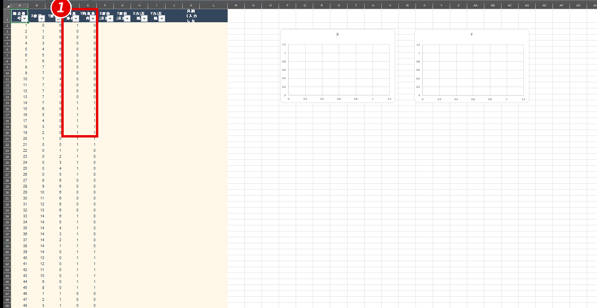

図39 「操作パネル」の「節点・拘束」で開く「節点データ」。①D:E列が拘束（0=自由、1=拘束）です。変更後は「解析前：メッシュを確認」で赤いX/Y記号を確認します。

外周の拘束は、座標の最小・最大の面（Ymin＝底面、Xmin＝左面など）にある節点にだけ付きます。斜面全体に支持が付くわけではありません。

解析が読むのは「節点データ」D:E列の値です。「メッシュ設定」C10:C14はメッシュを作るときの設定で、保存済みの節点を書き換えるボタンではありません。設定を変えてプレビューが無効になっても、拘束が更新された証拠にはなりません。

例：保存メッシュの右側をX方向ローラーにする場合は、「節点データ」B列でXが最大の節点を絞り、その番号の一覧を残してD列を1にします。底面との共有隅点では、E列の既存のY拘束をそのまま残します。D:Eを0にする「拘束の解除」と、F:G列や「載荷」DISPの値を0にする操作は別です（DISP=0はゼロ変位拘束）。変更後は「解析前：メッシュを確認」で記号を照合し、C14を空欄にして最初から解析します。「載荷」のUNLOADは載荷シートの指定を外す操作で、「節点データ」D:Eの固定はそのまま残ります。

> **解説　境界の位置**
>
> この説明書の例の拘束は、入力の例です。実際の検討では、モデルの境界を荷重や掘削から十分に遠くへ置き、地形と荷重の向きに応じて拘束が結果を左右していないかを確かめます。境界を近づけた計算と遠ざけた計算を比べると、境界の影響が分かります。
>
> 旧版の簡易メッシュの点1〜4の座標と分割数nx・nyは、現在のブックでは使いません（表示もされません）。

### 「節点データ」・「要素データ」の列

|シート・列|入力内容|
|---|---|
|「節点データ」A:C|節点番号、X座標、Y座標。|
|「節点データ」D:E|X/Y拘束。0は自由、通常は1で拘束。|
|「節点データ」F:G|互換用のX/Y強制変位。空欄は0。|
|「節点データ」H:I|互換用のX/Y節点力。空欄は0。|
|「要素データ」A|要素番号。|
|「要素データ」B:I|Q8の8節点番号。4隅を左下・右下・右上・左上の順（反時計回り）に指定し、続けて辺1-2、2-3、3-4、4-1の中点を指定（図40）。|
|「要素データ」J|材料番号。独立して施工する領域には別番号を割り当てます。|

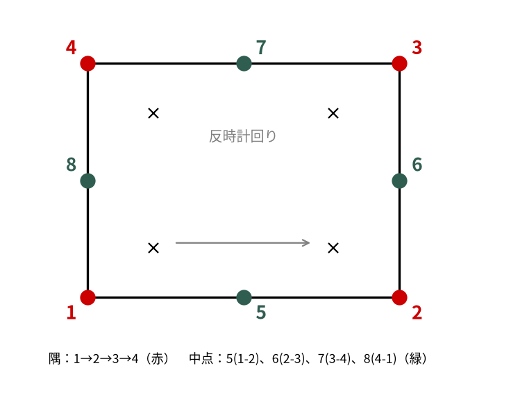

図40 Q8要素の節点の順番（模式図）。隅の4点（1〜4、反時計回り）の後に、辺の中点（5〜8）を続けます。×は積分点（2×2）の概念位置です。

番号は1から始め、重複・欠番を避けます。要素内の節点の重複、存在しない節点、未登録の材料、Jacobianが正でない要素は、入力と接続を見直します。

通常の新規載荷は「載荷」とLOADを使います。同じ自由度に複数経路で荷重や変位を重ねないようにします。

> **解説　JSONの入力例と旧版の例をこのブックへ移す**
>
> リポジトリの入力例は2種類あります。形状入力のJSONは `points` を「形状入力」B:D、`boundaries` をG:J（番号・種類・点の順番・格子間隔）へ入れ、「形状メッシュを作成」で作ります。保存メッシュのJSONは `nodes` を「節点データ」A:I、`elements` を「要素データ」A:Jへ入れ、メッシュは作り直さずに「解析前：メッシュを確認」へ進みます。どちらも `materials` は「材料データ」A:M、`stages` は「ステージ」A:F、`loads` は「載荷」A:Jです。
>
> 旧版（UI_04）の計算済みブックを使って計算し直すときは、現在のブックの別名コピーを作り、古い行を消した後（第4章 手順2の解説）、旧ブックの材料A:M・節点A:I（拘束を含む）・要素A:J・ステージA:F・載荷A:J・接合A:Eのデータ行だけを「値の貼り付け」で移します。設定はセルの位置ではなくF列のKEY名で照合して転記し、C14は空欄にします。シート全体・VBA・旧結果はコピーしません。旧版の結果を新しい計算結果として使いません。

JOINTは6節点です。「要素データ」B:GにA側の端点1・端点2・中点3、対応するB側の端点4・端点5・中点6を指定します。周回順ではありません。H:Iは有効節点に含みません。

## 7. 計算の考え方

この章では、解析例に入る前に、本ソフトが何をどう計算しているかを説明します。式と考え方は、配布ブックのVBA（`FEMEngine.bas`・`FEM.bas`）の処理に合わせています。

### 7.1 解析モデル（平面ひずみ・Q8要素・材料の種類）

本ソフトは、奥行方向に一様な断面を切り出した**平面ひずみ**の2次元解析です。奥行方向のひずみを0とし、奥行1 m（材料データD列の板厚t）当たりの力・反力で結果を出します。要素は8節点の四辺形（Q8、四隅＋各辺の中点）で、変位が小さいとして釣合いを解く**小ひずみ**の計算です（大変形・形状の更新は行いません）。

|材料の種類（材料データK列）|表すもの|計算のしかた|
|---|---|---|
|SOIL|地盤・盛土|Q8連続体。Mohr–Coulombの弾完全塑性（7.2）|
|STRUCT|擁壁・支保などの構造体|**SOILと同じQ8連続体**。梁・トラス・板の要素ではありません。強度を大きくし、I列＝0（SRMで低減しない）にして弾性に近い挙動にします|
|JOINT|材料の境目（すべり・開口）|厚さ0の接合要素（7.6）。KnとKsのばねとCoulomb則|

> **解説　梁・トラス・アンカーの専用要素はありません**
>
> 本ソフトには、梁（曲げ部材）・トラス（軸力部材）・アンカー・ロックボルトの専用要素はありません。擁壁や支保はSTRUCT材料の連続体として厚さ方向に要素を並べてモデル化し、断面力（N・V・M）は積分点の応力を断面で積分して求めます（解析例9）。アンカーは、頭部と定着部に等大・反対向きの節点力を与える「アンカー相当力」で近似します（解析例12）。アンカー体の軸剛性・引抜き・緊張力の経時変化は表せません。

### 7.2 Mohr–Coulombの強度と弾完全塑性

地盤の強度はMohr–Coulombの強度線 τf＝c＋σn·tanφ で表します（σnは圧縮を正とした法線応力）。積分点の応力がこの線（降伏面 f＝0）に達するまでは弾性（E・ν）で、達すると塑性ひずみが生じ、応力は降伏面上にとどまります。本ソフトは硬化・軟化のない**弾完全塑性**で、降伏後に強度が上がったり下がったりはしません。

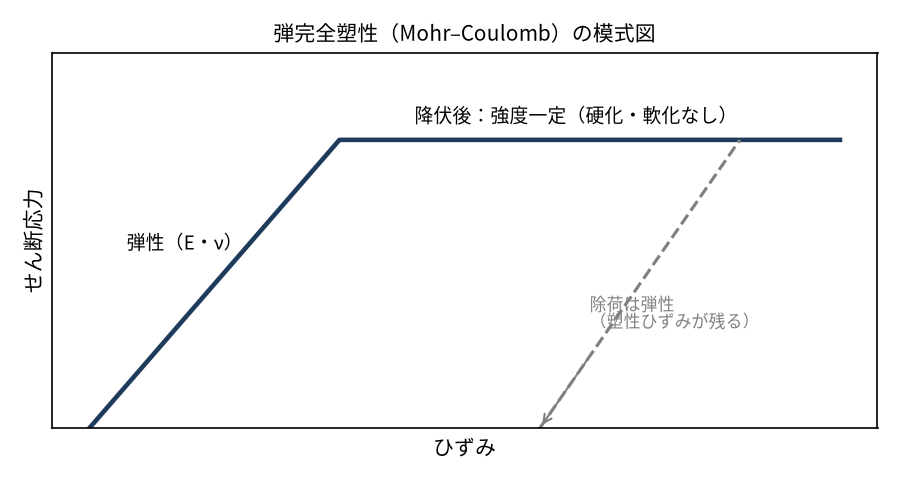

図41 弾完全塑性の模式図。降伏後は強度一定。除荷は弾性で、塑性ひずみが残ります。

|記号|入力列|意味|
|---|---|---|
|c|G列（粘着力、kN/m²）|強度線の切片。σn＝0でのせん断強度|
|φ|F列（内部摩擦角、°）|強度線の傾き。拘束圧が大きいほど強くなる割合|
|ψ|H列（ダイレタンシー角、°）|塑性変形の向き（体積の増え方）。強度ではありません（7.3）|

> **解説　「降伏した積分点」の数え方**
>
> 結果要素の降伏関数 f は、応力が降伏面上にあるとき0、内側にあるとき負です。塑性修正した点は計算の丸めで f が約−10⁻¹⁵ kPaになるため、本書では f ≥ −10⁻⁹ kPa の点を「降伏した積分点」と数えます（解析例11・11-B）。

### 7.3 関連流れ・非関連流れとダイレイタンシー

塑性ひずみの**向き**は、強度を決める降伏面 f とは別の関数（塑性ポテンシャル g）で決まります。g を f と同じにする（Mohr–Coulombでは ψ＝φ）のが**関連流れ**、変えるのが**非関連流れ**です。ψは、せん断したときに体積がどれだけ膨らむか（ダイレイタンシー）を表します。ψ＝φの関連流れは実際の土より体積膨張を大きく見積もるため、地盤ではψをφより小さく（本書の例ではψ＝0）とする非関連流れがよく使われます。

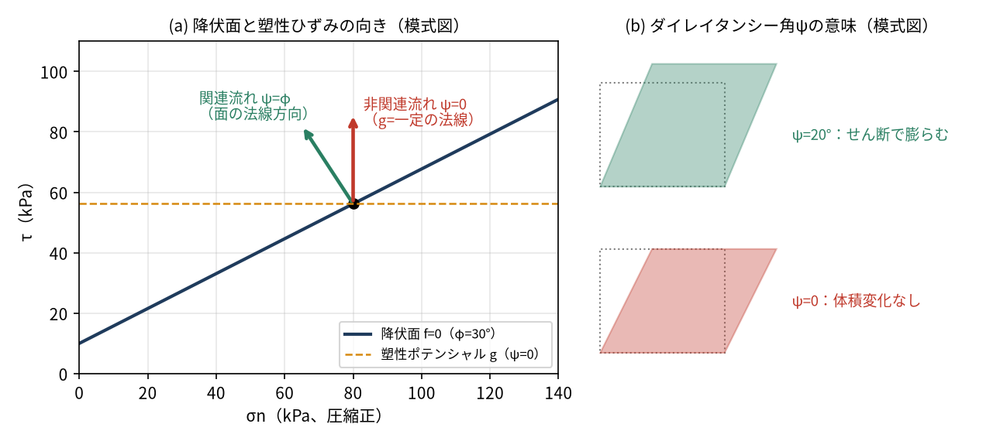

図42 (a) 降伏面と塑性ひずみの向き。関連流れ（ψ＝φ）は降伏面の法線方向、ψ＝0では法線応力方向の成分がなくせん断方向だけになります。(b) ψ＞0ではせん断で体積が増え、ψ＝0では体積が変わりません。どちらも模式図で、矢印の長さは塑性ひずみの量を表しません。

本ソフトは「解析設定」C10（非関連の扱い、FLOW_POLICY）で、非関連流れの扱い方を次の2つから選びます。

|C10|処理（`FEMEngine.bas`）|特徴|
|---|---|---|
|INCONSISTENT（配布値）|低減後の c・φ・ψ をそのまま材料計算に渡し、φ≠ψの非関連流れを直接解きます|剛性行列が非対称になり、Fsの限界近くで反復が長くなることがあります|
|DAVIS|JOINT以外の連続体に**Davis換算**をかけ、等価な関連流れ（ψ*＝φ*）として解きます|対称で収束しやすい一方、強度そのものが換算後の値に下がります。INCONSISTENTと同じ構成則ではありません|

Davis換算は、β＝cosψ·cosφ／(1−sinφ·sinψ)、c*＝β·c、φ*＝atan(β·tanφ)、ψ*＝φ*です（φ＝ψのときは換算しません）。例：φ＝28°、c＝15 kPa、ψ＝0°では β＝0.8829、c*＝13.24 kPa、φ*＝ψ*＝25.15°となり、**Fs＝1の状態から**INCONSISTENTより弱い材料で計算します。I列＝0の材料（SRMで低減しない）にもDavis換算はかかります。JOINTにはかかりません。

> **解説　どちらを使うか**
>
> 2つの流れ則でFs・変位・反復回数・計算時間が違っても、それだけで計算の誤りとは言えません。解析例7（第4章の斜面）では、INCONSISTENTが2.625〜2.638、DAVISが2.700〜2.713でした。比べるときは、流れ則以外の条件（メッシュ・材料・ψの扱い・収束設定）をそろえます。収束しやすくするために残差の許容値や反復上限を緩めて、Fsを合わせることはしません。

> **解説　流れ則はモデルの選択**
>
> - 流れ則は、土のモデルとして何を仮定するかの選択です。計算時間だけを理由に入れ替えません。入れ替えるときは、強度の低減とψの扱いがどう変わるかを確かめます。
> - φ＝ψ＝0の材料（非排水の全応力解析で、cを非排水せん断強度cuとして入れる場合）では、関連流れと非関連流れの差はなくなります。DAVISでも換算は起きません（β＝1）。
> - 「材料データ」I列＝0（SRMで低減しない材料）でも、DAVISではJOINT以外の連続体にDavis換算がかかります。I列はSRMの低減の対象を決める列で、換算の対象を決める列ではありません。
> - DAVISは入力のc・φをそのままにψだけを関連に切り替えた計算ではありません。強度も換算されます。
> - 計算時間を比べるときは、節点・要素、材料、施工の順序、支持、荷重、出力、DLL、収束・SRMの条件をすべて同じにして、C10（FLOW_POLICY）だけを変えます。同じFsでの全変位と残差、最終のFs区間と停止の理由を並べて記録します。メッシュの違う計算の時間から、流れ則の速さを判断しません。

### 7.4 強度低減法（SRM）と安全率Fsの意味

SRMは、強度低減係数Fsで材料の強度を割り、その弱い材料でも釣合い計算が収束するかを試す方法です。I列＝1の材料に、次の低減をかけます。

|量|低減後の値|注意|
|---|---|---|
|粘着力|c_r＝c／Fs|—|
|摩擦角|φ_r＝atan(tanφ／Fs)|角度φそのものをFsで割るのではなく、**tanφ**を割ります|
|ダイレタンシー角|「解析設定」C17（ψの扱い）による|KEEP（配布値）＝入力のまま。CAP＝ψがφ_rを超えたらφ_rに制限（INCONSISTENTのとき）。REDUCE＝tanψもFsで割る。C17が空欄・未知の値のときの既定はCAPです|

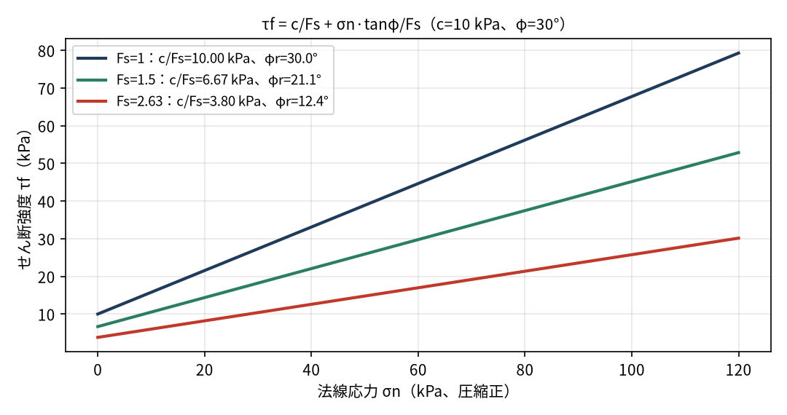

図43 第4章の地盤（c＝10 kPa、φ＝30°）の強度線。Fsが大きいほど切片と傾きが下がります。Fs＝2.63は第4章の例の区間付近の値です。

Fsの探索は次の順に進みます（`P3RunStrengthReduction`）。

|段階|処理|
|---|---|
|①|Fs＝1から0.1刻みで上げ、各Fsで施工の先行工程を計算し直します（SRM_MODE＝REAPPLY）。SRMより前に有効な RESET_U・RESET_STRESS・MATSET があるときは、そのうち**最後の工程の直後に保存した状態**（起点）に戻し、起点より後の工程だけを低減した強度で計算し直します（`P3LastOriginIndex`）。起点の工程そのものと、それより前の施工は計算し直しません（下の解説と7.5の表）|
|②|最初に収束しなかったFsと、その直前に収束したFsで区間をつくり、中点を試す二分法で区間を狭めます|
|③|区間の幅が「解析設定」の許容幅（SRM_TOL）以下になったら終了。最後に収束したFsの状態を結果として残します|
|④|上限（SRM_FMAX、C15）まで収束したときは、それ以上は探しません（LOWER_BOUND：Fs≧上限）|

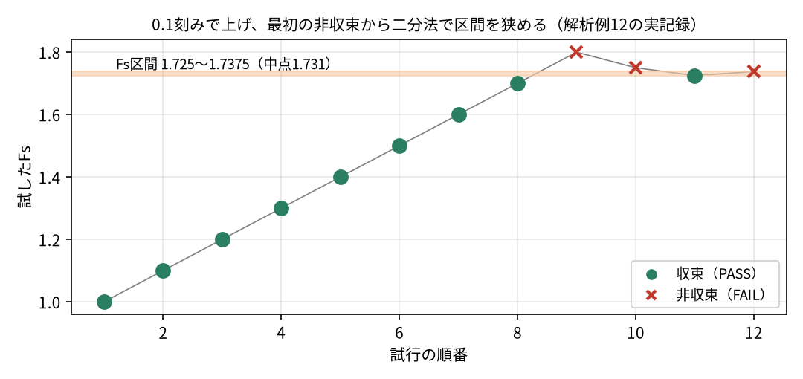

図44 解析例12の実記録（`examples/ex12_anchor_srm_logs_20261021/case_out/run.log`）。Fs＝1.0〜1.7は収束、1.8で非収束、その後1.75（非収束）・1.725（収束）・1.7375（非収束）と区間を狭め、12回の試行で1.725〜1.7375になりました。

> **解説　SRMで計算し直す範囲（起点）**
>
> SRMの各Fsの試行では、施工を最初から計算し直すとは限りません。SRMより前の有効な工程に RESET_U・RESET_STRESS・MATSET があると、最後のものが「起点」になります（`P3LastOriginIndex`）。MATSETの工程は物性を入れ替えた直後の状態を保存し（`P3CaptureReplayOrigin`）、各試行はこの状態に戻ってから（`P3RestoreReplayOrigin`）、起点より後のGRAVITY・BIRTH・DEATH・LOAD等だけを低減した強度で計算します。起点より前の施工（たとえば掘削の段階）は、元の強度で計算した結果がそのまま使われます。
>
> 例：解析例10（トンネル）は工程8がMATSETなので、Fsの各試行で計算し直すのは工程9（BIRTH）だけです。保存記録のrun.logでも、各試行（Fs＝1.0、1.1、1.2…）の中で動いているのは工程9だけです（`construction-evidence/20261020/tunnel10/run.log.gz`）。解析例8（SRMなし）のようにMATSETで材料を入れ替える施工のあとにSRMを追加すると、材料を入れ替える前の施工は低減した強度では計算し直されません。「全施工を低減した強度で計算したFs」とは意味が違うので、起点の位置を確認して読みます。

終了メッセージの読み方は次のとおりです（`P3PublishFos`）。

|表示|意味|
|---|---|
|NUMERICAL_BRACKET|収束したFs（FOS_PASS）と収束しなかったFs（FOS_FAIL）の区間が求まった。FOS_MIDはその中点|
|LOWER_BOUND|上限まで収束した。FsはFOS_PASS以上としか言えない|
|FIXED_FS_VERIFIED|C19（固定Fs）に正の値を入れ、そのFsだけを試して収束した。崩壊するFsを求めたわけではありません|

> **解説　Fsは「収束しなくなる境界」です**
>
> SRMのFsは、強度を下げていったとき**数値計算が収束しなくなる境界**として定義されます。非収束は、すべり面がつながって釣合いが取れなくなったことの表れと考えますが、反復上限やメッシュ・境界条件の影響も受けます。そのため、Fsは区間（成功〜失敗）で読み、すべり面の位置はせん断ひずみの図（最後に収束したFsの状態）で確かめます。SRMの最大変位は強度を下げた状態の値で、元の強度での変位ではありません。

> **解説　極限平衡法（分割法）との比較**
>
> 分割法（Fellenius・Bishopなど）も、安全率を「すべり面に沿ったせん断強度を何分の1にすると釣り合うか」で定義します。c／Fs、tanφ／Fsという低減の形はSRMと同じです。違いは、分割法がすべり面の形（円弧など）を仮定して力やモーメントの釣合いを取るのに対し、SRMはすべり面を仮定せず、応力とひずみの計算の結果として破壊領域が現れることです。均質な斜面では両者の値は近くなることが多く、解析例7の文献比較（Griffiths–Lane、Pruška）はこの関係を確かめたものです。ただし、メッシュ・流れ則・区間の幅で数％の差は出ます。

> **解説　途中のSRM（ゲート）**
>
> SRMの行が最後の有効工程でないときは、Fsを求めたあと、ステージD列の値（空欄・0以下なら1）以上かどうかを判定します。満たせば強度をFs＝1に戻して先行工程を計算し直し、次の工程へ進みます。満たさなければ「途中SRM：Fs＜必要」で止まります。D列は固定Fsの指定ではありません。

> **解説　Fs区間と変位の読み方の補足**
>
> - Fs区間は、反復の上限や刻みの制約も含んだ「数値計算の収束の境界」です。厳密な力学の上界・下界や、設計の安全率を保証するものではありません。保存される結果は成功した側（下端）のFsの状態で、失敗した側の途中の変位ではありません。
> - Fsが1より小さく出たときは、元の強度のままでは釣合いが成り立たないことを示します。「元の強度で安定」という意味にはなりません。
> - 粗いメッシュと細かいメッシュでFsが近くても、下端の状態の変位は大きく違うことがあります（φ＝0の斜面では、粗いメッシュの最大変位が細かいメッシュの10倍以上になった例があります）。Fsが一致したことから、変位やひずみの集中も一致すると判断しません。変位は、ひずみの集中・最後のFs・メッシュ・反復の経路と一緒に確かめます。
> - SRMの変位は強度を下げた状態の値です。小ひずみのモデルなので、大きな局所ひずみが出た例から実物の移動量を予測できるとは扱いません。
> - 強度線 τ＝c＋σ tanφ の図（図43）は、入力の値を式に入れた説明の図で、荷重−変位の曲線ではありません。c やφを増やせば、どの問題でも同じ割合でFsが上がる、という換算には使いません。

### 7.5 施工段階（ステージ）の考え方

施工段階の計算では、各工程の結果（変位・応力・塑性の履歴）を次の工程に引き継ぎます。同じ形状でも、施工の順番が違えば結果は変わります。

|種類（ステージB列）|考え方|
|---|---|
|GRAVITY|有効な要素の自重で初期の応力をつくります。自重だけで鉛直に支える条件では、鉛直反力の合計は Σ(断面積×γ×板厚)＝Σ(体積×γ) に一致します（m²×kN/m³×m＝kN。コードは積分点ごとに 面積×板厚＝体積 を求め、γを掛けて合計します）|
|BIRTH|材料をONにして追加します（盛土・擁壁・支保の施工）。追加した要素は応力・塑性履歴0の状態から計算を始め、自重を受け持ちます|
|DEATH|材料をOFFにして取り除きます（掘削）。取り除いた要素が負担していた力が、残る地盤に解放されます|
|MATSET|材料の物性を別の材料番号の値に入れ替えます。OFFの要素に使うと、履歴のない状態で埋め戻し材に変えられます（解析例8）。入れ替えた直後の状態は、後のSRMの起点として保存されます（下の表）|
|RESET_U|変位・応力・塑性履歴を0にします（座標はそのまま）。強度もFs＝1に戻します。この直後の状態は、後のSRMの起点として保存されます|
|RESET_STRESS|変形後の座標を新しい基準にしてから、変位・応力・塑性履歴を0にします。この直後の状態も、後のSRMの起点になります|
|LOAD・APPLY／UNLOAD|載荷表の荷重・強制変位を加える／外す|
|SRM|それまでの工程を前提にFsを求めます（7.4）。各Fsの試行で、起点（最後のRESET_U・RESET_STRESS・MATSET。なければ最初）より後の工程を、低減した強度で計算し直します|

> **解説　結果をそのまま積み重ねる**
>
> 「節点の変位」は最初の工程（GRAVITY）からの累積です（例外：RESET_U・RESET_STRESSを使うと、その工程で変位が0になり、以後はその状態からの累積になります。7.8「RESETの後の全ひずみと増分」）。工程ごとの増分は「結果増分」で、施工による沈下は「ux−ux0、uy−uy0」のように差を取って読みます。自重による変位を0にしたいときも、応力の履歴を消すRESET_U・RESET_STRESSを使う必要はありません。差を取れば済みます。

**SRMで計算し直す工程（起点）のまとめ**（`FEMEngine.bas` の `P3LastOriginIndex`・`P3CaptureReplayOrigin`・`P3RestoreReplayOrigin`）

|SRMより前の工程|SRMの各Fsの試行で計算し直す工程|計算し直さない工程|
|---|---|---|
|RESET_U・RESET_STRESS・MATSETがない|最初の工程からSRMの直前までのすべての工程（GRAVITY・BIRTH・DEATH・LOAD等）|－|
|ある（複数あれば最後のもの＝起点）|起点より後の GRAVITY・BIRTH・DEATH・LOAD・UNLOAD 等|起点とそれより前の工程（元の強度で計算した結果を使う）。起点より後にある別のSRMも再実行しない|

各試行は、起点の工程の直後に保存した状態（変位・応力・塑性履歴・材料）に戻ってから計算を始めます。起点の状態がないと「SRM replay originがありません」の誤りで止まります。例：解析例10（工程8がMATSET）では、各試行で計算し直すのは工程9だけです。解析例4・8のようにRESETやMATSETを使う施工のあとにSRMを追加するときも、起点の位置を確かめて「どの工程までが元の強度か」を記録します。

### 7.6 接合要素（JOINT）

接合要素は、材料の境目（ブロックの底面、擁壁と地盤の間など）に置く**厚さ0の6節点要素**で、境目のすべりと開口を表します。「接合」シートで材料Aと材料Bの共有辺を指定すると、B側の節点を複製して要素を作ります。

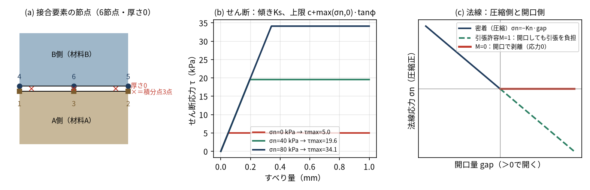

図45 (a) 節点の並び（A側：端点1・端点2・中点3、B側：端点4・端点5・中点6）。応力は辺に沿った3つの積分点で計算します。(b) せん断応力はすべり量×Ksで、上限 τmax＝c＋max(σn,0)·tanφ で頭打ちになります。(c) 法線応力は σn＝−Kn×gap（圧縮正）。M＝0のときは開口すると剥離して応力0になります。値は模式例（c＝5 kPa、φ＝20°）。

|入力（材料データ）|意味|単位|
|---|---|---|
|B列（Kn）|法線方向のばね剛性（法線応力／開口量）|kN/m³|
|L列（Ks）|せん断方向のばね剛性（せん断応力／すべり量）|kN/m³|
|F列（φ）・G列（c）|接合面のCoulomb摩擦の摩擦角と粘着力|°・kN/m²|
|H列（ψ）|0にします|°|
|M列（引張許容）|1＝開口しても剥離に切り替えず引張を負担、0＝開口したら剥離|－|

計算の手順（`FEMEngine.bas` の接合要素ルーチン）は次のとおりです。

|手順|式・判定|
|---|---|
|①|A側とB側の相対変位から、開口量 gap（法線方向、＞0で開く）とすべり量（接線方向）を求めます|
|②|内部の法線力 fn＝Kn×gap（引張正）。表示する法線応力は σn＝−fn（圧縮正）|
|③|M＝0で gap＞0 なら**剥離**（接触状態1）。法線・せん断とも応力0、剛性0|
|④|それ以外は τmax＝c＋max(σn,0)·tanφ。|Ks×すべり量|＞τmax なら**すべり**（状態2、せん断応力＝±τmax、せん断剛性0）、以内なら**密着**（状態0）|

> **解説　接合要素を使うとき・剛性の決め方**
>
> 境目に沿ったすべりや浮き上がりが結果を左右する問題（ブロックの滑動、擁壁底面のすべり、構造物と地盤の剥離）に使います。境目が一体として動く場合は、共有節点でつなぐだけで十分です（解析例9の擁壁は接合なし）。
>
> KnとKsは「応力／相対変位」の単位（kN/m³）で、連続体のEとは次元が違います。小さすぎると密着していても境目が大きく変形し、大きすぎると剛性行列の条件が悪くなり収束しにくくなります。隣接する要素の E／要素寸法 と同じ桁を目安に置き、結果（反力・すべりの範囲）が剛性を変えてもあまり変わらないことを確かめます。解析例11は Kn＝Ks＝100000 kN/m³（地盤 E＝20000 kN/m²、要素寸法1 m）です。
>
> この接合は**履歴を持たない応力上限モデル**です。すべり量は全相対変位で、塑性すべりを累積しません。荷重を戻したときの残留すべりなど、履歴の効く問題には使えません。また、摩擦は圧縮側（σn＞0）だけが受け持ち、引張の点（M＝1で開口した点）は c だけで抵抗します。

### 7.7 荷重増分・反復・収束

1つの工程の荷重（自重・載荷・掘削の解放力）は、一度にかけずに荷重係数λを0から1まで少しずつ増やしてかけます。λを進める1回分が**増分**、その増分の中で釣合い（外力と内力の差＝残差）が許容値以下になるまで剛性を更新して解き直すのが**反復**（Newton法）です。反復の上限内に収束しなければ、その増分は不採用になり、幅を縮めて試し直します（カットバック）。幅が最小値まで縮んでも収束しなければ、その工程は非収束（NONCONVERGED）です。

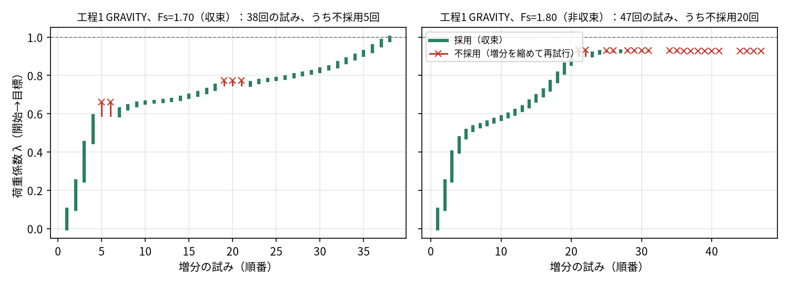

図46 解析例12のSRM記録（`examples/ex12_anchor_srm_logs_20261021/case_out/increment_summary.csv`）の工程1（GRAVITY、強度を低減した状態での再計算）。Fs＝1.70では途中で5回不採用になったあとλ＝1まで進みました。Fs＝1.80ではλ≒0.929で反復上限（100回）と線探索の失敗を繰り返し、増分が最小幅まで縮んで非収束になりました。この非収束がFs区間の「失敗」側です。

> **解説　残差が小さいことと、結果が正しいことは別です**
>
> 残差は外力と内力の不釣合いの大きさで、収束したかどうかの判定に使います。残差が小さくても、拘束・材料・単位・荷重の入れ方が意図どおりとは限りません。逆に、変位が大きいだけで計算失敗とは決められません。収束の判定（PASS／FAIL）と、反力の合計・変位の向き・せん断ひずみの分布といった力学的な確認は、分けて行います。

### 7.8 せん断帯の見方

SRMや載荷の結果図では、せん断ひずみが帯のように集まる部分（せん断帯）が見えます。せん断帯は「どこから壊れ始め、どの範囲が一緒に動こうとしているか」（破壊の形）を読むための図です。この節では、増分図の色と塑性主ひずみ増分のクロスの読み方、全ひずみ図との違い、メッシュの影響、極限平衡法のすべり面との比べ方をまとめます。

#### 色が表すもの

増分図（第23章「増分図を読む」）の色は次の量です。

|項目|内容|
|---|---|
|量|最大工学せん断ひずみ増分（3次元、平面ひずみの面外成分0を含む主値の最大−最小）|
|いつの増分か|**最後に収束した荷重増分1回分**。収束しなかった試行（SRMで非収束になったFs）の値ではありません|
|累積か|累積ではありません。その増分の開始時から収束時までの変位の差ΔuからB×Δuで求めた量です|
|要素の値|要素の4積分点の最大値（4GP最大）。等値線（A）は4点最大値を共有する隅節点で平均し、線形に補間して描きます|
|SRMの場合|最後に成功したFsの最終増分。表の「Fs」（R列）、「荷重増分番号」（S列）、「荷重係数」（T列）で、どの状態の図かを確かめます|

「結果増分」シートのM列が最大工学せん断ひずみ増分、N列が最大塑性工学せん断ひずみ増分、O・P列が面内塑性主ひずみ増分の最大・最小、Q列が最大主軸の角度です（列の一覧は第23章）。

これに対して「最大せん断ひずみ」（累積）の図は、保存された全変位から計算した量です（結果を書き出すときに、各要素で 全変位×B（`CalcStrain`、`TDisp`）を計算します）。自重による変形や施工の履歴を含むので、破壊の形よりも「それまでにどれだけ変形したか」を表します。せん断帯を読むときは、まず増分図を見て、全ひずみ図は補助に使います。

#### RESETの後の全ひずみと増分

全ひずみ（累積）が「最初の工程から」にならない例外が、RESET_U・RESET_STRESSです（`FEMEngine.bas` の `P3ResetKinematicState`・`P3ZeroTrialKinematics`）。

|項目|RESET_U・RESET_STRESSの後|
|---|---|
|全変位・全ひずみ（累積）|RESETの工程で全変位を0にするので、以後の累積の変位とひずみはRESETの状態から数えます。RESETより前の変形は含みません。RESET_STRESSでは、さらに変形後の座標が新しい基準の形になります（B行列も作り直します）|
|応力・塑性履歴|0になります（強度もFs＝1に戻ります）|
|増分（「結果増分」）|RESETの工程で増分のデータを消します。RESETの後の工程を計算すると、その工程の最後に収束した増分が新しく記録されます。RESETが最後の工程のとき（または工程ごとの出力でRESETの工程の行）は増分がなく、「結果増分」は「増分結果なし」になり、増分図は描けません|
|SRM|RESETの直後の状態が起点になります（7.5）|

施工の全体の変形を見たいときにRESETを使うと、RESETより前の変形が全ひずみ図から消えます。施工の途中から差を取りたいだけなら、RESETではなく変位の差（ux−ux0）を使います（7.5の解説）。

#### 等値線と塑性主ひずみ増分のクロス

|表示|読み方|
|---|---|
|色・等値線（A）|ひずみ増分が集まる場所と、その連なり（帯の向き）。等値線は最大値の25・50・75%で描くので、帯の「芯」と広がりが分かります|
|クロス（塑性主ひずみ増分）|**要素ごとに1つ**で、積分点ごとではありません。要素の4積分点の塑性ひずみ増分（εx・εy・γxy）を平均した値の主軸を、要素の中心（4隅の平均の位置）に描きます（`FEMIncrementRead`・`FEMIncrementCross`）。青が圧縮（縮む向き）、赤が引張（伸びる向き）で、長さは図全体の最大値に対する割合です。4点のうち一部だけが降伏した要素では、平均するので短く出ます。4点とも塑性増分が0の要素では長さ0で見えません|
|両者の関係|色が大きく、しかもクロスが並んでいる部分が、その増分で降伏しながら変形している帯です。色が大きくクロスがない部分は、弾性のままひずみが大きい部分です|

クロスの軸の傾きは、180°回しても同じ向きを表します。引張か圧縮かは色で読みます。帯の方向は、圧縮と引張の主軸のおおむね間の向きです。関連流れ（ψ＝φ）と非関連流れ（ψ＜φ）では、同じ帯でもクロスの比率（体積が増えるか）が変わります（7.3）。

#### 剛体のような動きとせん断ひずみの集中を分ける

ひずみは変位の「場所による違い」（変位の勾配）から求めます（ひずみ＝B×変位）。土塊がまとまって平行に動く（剛体の移動）ときは、変位が大きくてもひずみはほぼ0です（小ひずみの計算なので、回転が小さい範囲で成り立ちます）。

|図|分かること|
|---|---|
|変形図・変位（「結果節点」、変位倍率）|どこが、どの向きに、どれだけ動いたか。すべる土塊は全体が大きく動いて見えます|
|ひずみの色・等値線（全ひずみ・増分）|どこで変位が急に変わるか。すべる土塊と動かない地盤の**境目**（せん断帯）に集まり、土塊の内側は小さく出ます|

たとえば斜面のすべりでは、変形図では土塊全体が大きく動き、ひずみ図では土塊の下の境目だけが帯になります。変位が大きい場所をそのまま「せん断帯」とは読みません。逆に、ひずみが大きくても変位が小さい場所（基礎の角の直下など）もあります。破壊の形は「大きく動く範囲（変形図）」と「その境目のひずみの帯（ひずみ図）」の両方で読みます。

#### 最終収束Fsの帯を破壊の形として読む

SRMでは、Fsを上げるにつれて変形が一つの帯に集まり、収束しなくなったところで計算が止まります。最後に成功したFsの最終増分の図が、破壊の直前の形に最も近い状態です。

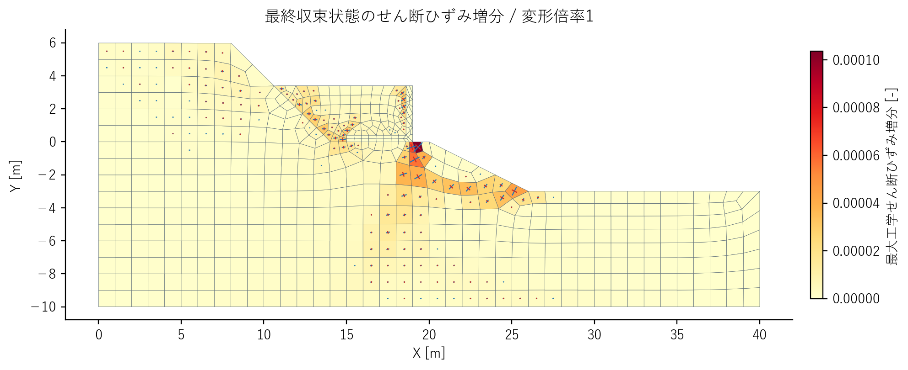

図47 解析例9（擁壁、DAVIS）の最後に成功したFs＝1.7000の最終増分（荷重増分120、荷重係数1）。色は最大工学せん断ひずみ増分、クロスは塑性主ひずみ増分、変形倍率は1です（保存記録 `construction-evidence/20261020/wall_davis08/`）。

図47では、擁壁のつま先（X≒19 m、Y≒0 m）から前面の斜面を通って法尻（X≒26 m、Y≒−3 m）に抜ける帯と、背面の盛土側（X≒12〜18 m、Y≒0〜3 m）に向かう帯がつながっています。さらに擁壁の下の地盤（X≒17〜20 m、Y≒−4〜−8 m）にも増分が分布しています。帯は**擁壁の近くだけでなく、前面の斜面と基礎の地盤の中を通っています**。擁壁の安定を読むときは、壁の周りの色だけでなく、帯が地盤のどこを通って地表に抜けるかを読みます。

読むときは、帯の図だけで判断せず、次の量と一緒に確かめます。

|一緒に読む量|確かめること|
|---|---|
|擁壁の変位（「結果節点」）|帯の向きと、擁壁が前へ出る・回転する・沈む向きが合っているか。最終増分の変位の向きと全変位の向きを比べます|
|反力（「ステージ結果」「結果節点」）|全体の反力が荷重と釣り合っているか（7.5）。帯が拘束の近くに当たっていないか|
|Fs区間と収束（「ステージ結果」）|帯の図が「最後に成功したFs」の状態か。区間の幅が粗すぎないか（7.4）|
|塑性点（「結果要素」の降伏状態）|帯に沿って降伏点がつながっているか。帯から離れて孤立した降伏点は、局所の応力集中のことがあります|

#### メッシュの影響

せん断帯の幅は、要素の大きさに左右されます。弾完全塑性のモデルには長さの尺度がないため、帯は数値計算上、要素の大きさ程度の幅に集まりやすくなります。

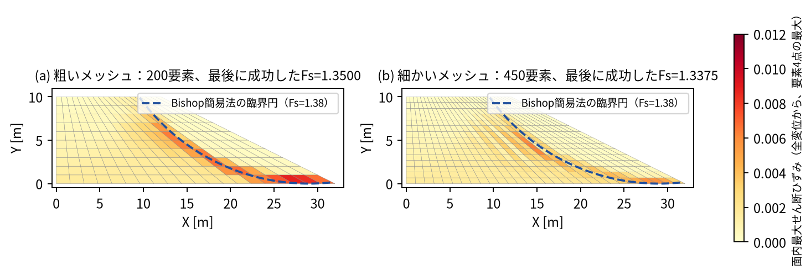

図48 保存済みの斜面SRM（Griffiths φ＝20°、c＝10 kPa、γ＝20 kN/m³、高さ10 m・勾配1:2）の最後に成功したFsの状態。色は全変位から求めた面内最大せん断ひずみ（増分ではありません）、要素の4点の最大値です。(a) 200要素、Fs＝1.3500、(b) 450要素、Fs＝1.3375。破線は同じ条件でBishop簡易法により探した臨界円（Fs＝1.38、下端が下の固定面に接する円）です（作図 `images/theory/make_band_figs.py`、データ `docs/inconsistent-evidence24/`）。

図48の(a)と(b)では、帯の通る位置はほぼ同じですが、細かいメッシュの方が帯は細く、ひずみの値も変わります。Fsも1.3500と1.3375で少し違います。このため、

- 帯の**位置と形**（どこから入りどこへ抜けるか）は、メッシュを変えても安定しているかを確かめてから読みます。
- 帯の**幅**とひずみの**値**は、メッシュで変わります。帯の幅を土の性質（せん断帯の厚さ）として読むことはできません。
- 帯が要素のつぶれた部分や縦横比の大きい部分を通るときは、メッシュの形の影響を疑います（第9章のNG例）。

#### 極限平衡法のすべり面と比べる

図48の破線のように、極限平衡法の臨界すべり面とSRMの帯は、通る位置もFsも近くなることが多いです（この例ではFs 1.34〜1.35に対し1.38）。比べるときは次に注意します。

- 極限平衡法はすべり面の形（円弧など）を先に仮定し、Fsが最小になる面を探します。SRMはすべり面を仮定せず、変形が集まった結果として帯が現れます。形が円弧から外れる（擁壁や硬い層に沿って折れる）ときは、SRMの帯の方が実際の条件を反映していることがあります。
- 帯は幅を持つので、すべり面の「線」とは帯の芯（等値線の75%付近）を比べます。
- Fsの値は定義も計算方法も違うので、完全には一致しません。違いが大きいときは、材料定数・水の扱い・流れ則（7.3）・Fs区間の幅（7.4）・メッシュを確かめます。

#### 支持力の例

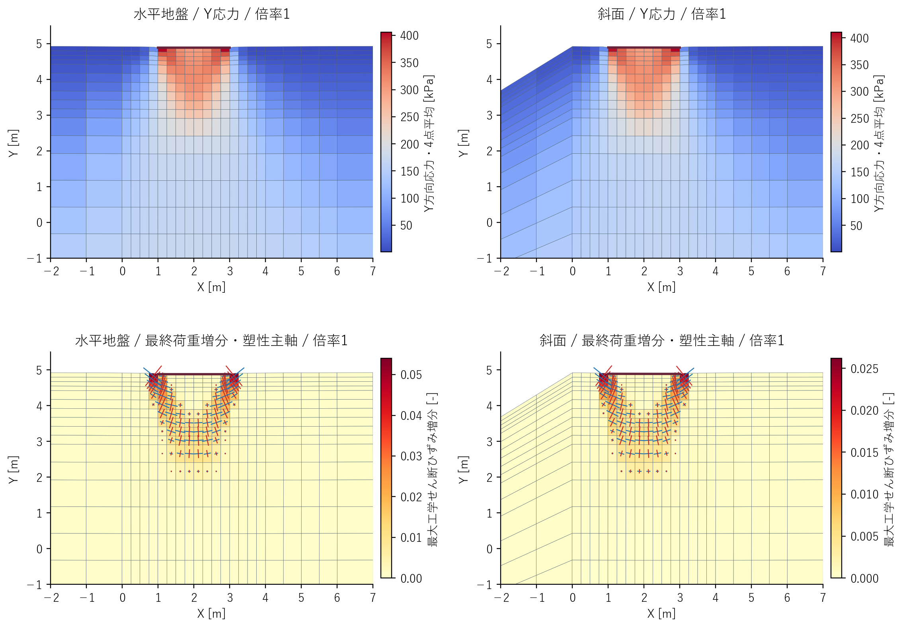

図49 解析例13の水平地盤（左）と斜面（右）に、細かいメッシュで追加沈下50 mmを与えた最終荷重増分。上段はY方向応力（4点平均）、下段は最大工学せん断ひずみ増分と塑性主ひずみ増分のクロス（保存記録 `construction-evidence/20261021/bearing_*_fine_s050000_workbook.zip`）。

図49の下段では、基礎の両端（X≒1 m、3 m）から下に向かってくさび状に帯が延び、基礎の下で閉じています。基礎の下の土が押し込まれる形です。斜面側（右）でも、この沈下量では帯は基礎の直下に閉じていて、斜面の法面まで抜けていません。帯が地表まで抜ける（全体破壊の形）か、基礎の下で閉じる（局所の押し込み）かは、沈下量と地盤の条件で変わります。載荷の途中の形であることを、荷重−沈下の関係と一緒に読みます（第21章）。

#### せん断帯の図だけで決めないこと

> **解説　帯の図から決めてはいけないもの**
>
> - **帯の幅**：メッシュで変わる数値上の幅です。土の性質ではありません。
> - **部材の破壊**：帯が擁壁やアンカーの近くを通っても、部材が壊れることを示すものではありません。部材の照査は、断面力（第16章）を別の方法で行います。この説明書の例では擁壁を線形弾性として扱っています。
> - **設計の安全率**：Fsは、収束した境界の区間です（7.4）。帯の形がもっともらしくても、Fsの値の妥当性は、材料定数・メッシュ・区間の幅・荷重の条件を確かめて判断します。
> - **非収束の状態**：非収束の試行の状態は、結果図にも「結果増分」にも使われません。図はつねに「最後に収束した状態」です。

## 8. 解析例1 材料の強さを変える（粘着力c）

### 目的

材料の粘着力cだけを変えて、SRMの安全率Fsがどう変わるかを確かめます。第4章の例題（c=10kN/m²）を基準にします。

### 解析対象

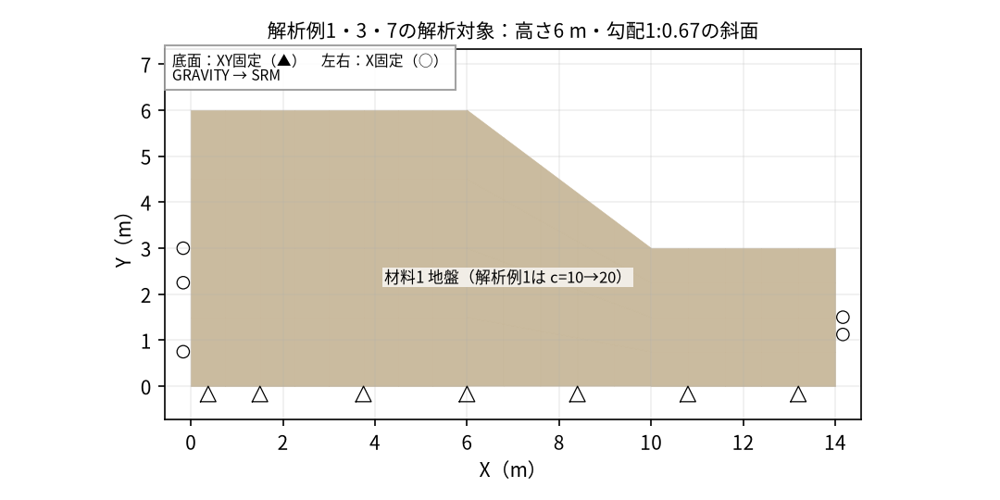

図50 解析例1の解析対象（第4章と同じ斜面）。保存した節点・要素から描いた模式図（色＝材料番号、斜線＝初期OFF、▲＝XY固定、○＝X固定、赤矢印＝荷重）。

|項目|内容|
|---|---|
|想定|天端の高さ6 m・天端幅6 mの均質な斜面（法面は点3(6,6)→点4(10,3)、法尻から先は高さ3 mの平場）。粘着力cの違いが安全率にどう効くかを見ます|
|形状|6点（(0,0)・(0,6)・(6,6)・(10,3)・(14,3)・(14,0)）の外側境界1つ|
|地盤|材料1：E＝20000 kN/m²、ν＝0.3、γ＝18 kN/m³、φ＝30°、c＝10→**20** kN/m²、ψ＝0|
|境界・荷重|底面XY固定、左右X固定、上面自由。荷重は自重だけ|
|確かめること|cを2倍にしたときのFsの変化と、すべり面の位置（せん断ひずみの図）。cは強度線の切片なので、浅いすべりほど効き方が大きくなります|

### 条件

|項目|基準（第4章）|解析例1|
|---|---|---|
|形状・メッシュ|6点の斜面、格子間隔2m、72要素・261節点|同じ|
|材料1|E=20000、ν=0.3、γ=18、φ=30°、c=10、ψ=0|**c=20**（ほかは同じ）|
|ステージ|GRAVITY → SRM|同じ|
|解析設定C15（Fs探索の上限）|3|**5**|

### 手順1 粘着力を変える

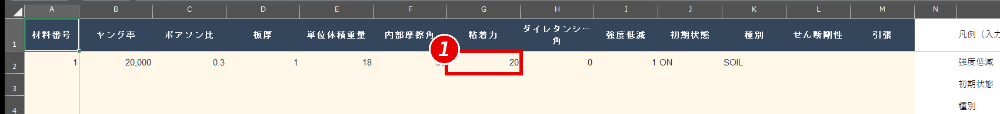

図51 「材料データ」。①G2（粘着力c）を10から20に変えます。

|番号|セル範囲|入力するもの|単位|例|
|---|---|---|---|---|
|①|G2|粘着力c|kN/m²|20|

### 手順2 Fs探索の上限を上げる

図52 「解析設定」。①C15（Fs探索の上限）を3から5に変えます。

|番号|セル範囲|入力するもの|単位|例|
|---|---|---|---|---|
|①|C15|Fs探索の上限|－|5|

> **解説　上限のままだとFsは決まりません**
>
> 上限3のまま計算すると、Fs=3.000でも計算が成功し、「FOS_FAIL=NA」「判定=LOWER_BOUND」と表示されました。これは「Fsは3以上」という意味で、Fsの値は決まっていません。上限を上げて計算し直し、成功側と失敗側の区間が閉じることを確認します。

### 手順3 メッシュを作り、解析する

第4章の手順4〜9と同じ操作で、「形状メッシュを作成」→「解析前：メッシュを確認」→「このメッシュで解析を開始」の順に押します。

図53 終了メッセージ。FOS_PASS=3.963、FOS_FAIL=3.975と表示されます。

### 手順4 結果を確認する

図54 「ステージ結果」。①SRM行のFs（3.96875）とメッセージを確認します。

図55 「出力・表示」。①C17（変位倍率）=1。②C18で「最大せん断ひずみ（積分点1）」を選びます。

図56 結果図。表示量＝最大せん断ひずみ（積分点1）、対象＝SRMで最後に成功したFs=3.963の状態、変位倍率＝1。法尻から法肩に向かうせん断ひずみの集中が見えます。

### 確認値

|項目|基準（c=10）|解析例1（c=20）|
|---|---|---|
|要素・節点|72・261|72・261|
|GRAVITYの反力Y|1188 kN|1188 kN|
|Fs区間（成功〜失敗）|2.625〜2.638|3.963〜3.975|

### 注意点

> **解説　c・φ・ψの役割**
>
> cは強度線 τ=c+σn·tanφ の切片、φは傾きです。ψ（ダイレタンシー角）は塑性変形の向き（体積の増え方）を決める値で、強度そのものではありません。SRMでは c/Fs と atan(tanφ/Fs) で強度を下げます。角度φをFsで割るのではありません。ψの扱いは「解析設定」C17で決まります（KEEP=入力のまま、REDUCE=Fsで低減、CAP=低減後のφ以下に制限）。
>
> cを2倍にしてもFsが2倍になるわけではありません。比べるときは、変えた値以外の条件（形状・メッシュ・設定）をそろえます。

## 9. 解析例2 形状を変える（斜面を高くする）

### 目的

斜面の高さを6mから8mに上げ、Fsと変形がどう変わるかを確かめます。

### 解析対象

図57 解析例2の解析対象（斜面を8 mに高くする）。保存した節点・要素から描いた模式図（色＝材料番号、斜線＝初期OFF、▲＝XY固定、○＝X固定、赤矢印＝荷重）。

|項目|内容|
|---|---|
|想定|同じ地盤で、斜面の天端だけを2 m高くした場合。形状の変更はメッシュの作り直しを伴います|
|形状|点2・点3のY座標を6→8 m。法面は(6,8)→(10,3)になり、急で長くなります|
|地盤・境界|第4章と同じ（材料1、底面XY固定・左右X固定、自重のみ）|
|確かめること|高さが増えたときのFsの低下と自重反力の増加（断面積×γ）。形状を変えたときに**要素がつぶれていないか**（メッシュ品質）も確かめます|

### 条件

|項目|基準（第4章）|解析例2|
|---|---|---|
|点2・点3のY座標|6 m|**8 m**|
|格子間隔（形状入力J8）|2 m|**1 m**（理由は手順2の解説）|
|材料・ステージ・設定|第4章と同じ（c=10、C15=3）|同じ|

### 手順1 点の座標と格子間隔を変える

図58 「形状入力」。①D9:D10（点2・点3のY座標）を6から8に、②J8（格子間隔）を2から1に変えます。

|番号|セル範囲|入力するもの|単位|例|
|---|---|---|---|---|
|①|D9|点2のY座標|m|8|
|①|D10|点3のY座標|m|8|
|②|J8|境界1の格子間隔|m|1|

### 手順2 メッシュを作り直し、品質を確かめる

「メッシュ設定」の「形状メッシュを作成」を押します。形状を変えたら必ず作り直します。作成後のメッセージ（図11と同じ形式）では、候補ごとの要素数・角度の範囲が表示されます。今回は「地形追従格子」の330要素・1065節点が採用され、良312・警告18・不良0（角度38.7〜141.3°）でした（2026-10-22、Rico）。

図59 作り直したメッシュ（330要素・1065節点）。図の上の行に「最小角度＝38.7°、最大アスペクト比＝5.34」と表示されます。

> **解説　NG例：格子間隔2 mのままだと要素がつぶれます**
>
> 格子間隔を2 mのまま高さだけ8 mにすると、84要素・303節点のメッシュができます（図60の左）。法面に沿った分割数に合わせて左右の領域の行数も増えるため、高さ3 mの法尻側に薄い要素が何層も重なり、**全84要素の縦横比が5を超え、最大44.8**になります（つぶれた要素）。このような要素は剛性と応力の分布を正しく表せず、Fsも変形も信用できません。実際、このNG例のメッシュではFs＝1.688〜1.700、試行中の最大変位0.663 mとなり、修正後（1.5125〜1.525、0.0316 m）と大きく違いました。
>
> **直し方**：格子間隔を小さくし（ここでは1 m）、メッシュを作り直して、メッセージと図の上の行で最小角度と最大アスペクト比を確かめます。許容値を緩めて合格にすることはしません。

図60 左：**NG例**（格子間隔2 m、84要素、最大縦横比44.8、5を超える要素84）。右：修正後（格子間隔1 m、330要素、最大縦横比5.3、5を超える要素2）。色は要素の縦横比（最長辺／最短辺）。

図61 **NG例**：格子間隔2 mのまま作成した画面（84要素）。右側の法尻で要素が薄く重なっています。この画面のメッシュでは解析しません。

> **解説　作り直すと節点番号が変わります**
>
> メッシュを作り直すと、節点番号と要素番号が変わります。節点番号で載荷を指定していた場合は、「節点データ」のB:C列（座標）で対象を探し直します。不良の要素がある場合は「品質修正候補を確認」で候補を比べます。

### 手順3 解析する

第4章の手順8〜9と同じ操作で解析します。2026-10-22にRicoで計算し、SRMの探索に1321秒（試行10回）かかりました。終了メッセージには FOS_PASS=1.513、FOS_FAIL=1.525 が表示されます。

### 手順4 結果を確認する

図62 「ステージ結果」。①SRM行のE列（Fs）は1.51875（区間の中点）、F列（試行中の最大変位）は0.0316 mです。J列のメッセージは FOS_PASS=1.513、FOS_FAIL=1.525、NUMERICAL_BRACKET です。保存された最後の成功状態（Fs＝1.5125）の結果節点では max｜ux｜=0.0192 m、max√(ux²＋uy²)=0.0322 mです。

図63 結果図。表示量＝面内最大せん断ひずみ（累積、積分点1）、対象＝最後に成功したFs=1.5125の状態、変位倍率＝1。法尻から天端に向かう帯状のせん断ひずみ（すべり面）が見えます。

> **解説　この図のせん断帯（7.8）**
>
> 図63は累積の全ひずみの図です。法尻から天端へ抜ける帯が、この斜面の破壊の形（すべり面の位置）を示します。最後に収束した増分だけの帯を見るときは、「出力・表示」C27をAまたはBにして増分図を描きます。帯の幅は格子間隔1 mのメッシュでの値で、メッシュを変えると変わります（7.8「メッシュの影響」）。

### 確認値

|項目|基準（第4章、高さ6 m）|解析例2（高さ8 m、格子間隔1 m）|（参考）NG例（格子間隔2 m）|
|---|---|---|---|
|要素・節点|72・261|330・1065|84・303|
|最大の縦横比|2.0|5.3|44.8|
|GRAVITYの反力Y|1188 kN|1476 kN|1476 kN|
|Fs区間|2.625〜2.638|**1.5125〜1.525**|1.688〜1.700（採用しない）|

自重の反力は断面積×γ×板厚tです（この説明書の例はすべて t=1 m）。基準は66 m²×18 kN/m³×1 m=1188 kN、解析例2は82 m²×18×1=1476 kNで、表の値と一致します。反力はメッシュによらず同じですが、Fsはメッシュの品質で大きく変わります。材料データD列の板厚を変えたときは、その倍率も掛けます。

### 注意点

> **解説　Fsと変位は別に読みます**
>
> SRMの最大変位（F列0.0316 m）は、強度を下げた計算の中で記録された値です。元の強度（Fs=1）で起きる変位ではありません（自重の工程の最大変位は0.0222 m）。
>
> Fsは「数値計算が収束した境界」の区間です（7.4）。メッセージの「NUMERICAL_BRACKET」は、この区間の推定であることを示します。
>
> **解説　高さの影響とメッシュの違いを分ける**
>
> 基準（高さ6 m、格子間隔2 m、72要素）と解析例2（高さ8 m、格子間隔1 m、330要素）は、高さと要素分割の両方が違います。Fsの差（2.625〜2.638 → 1.5125〜1.525）には、高さの影響だけでなく、要素分割（離散化）の違いの影響も含まれ得ます。また、つぶれた要素を直したこと（品質の改善）と、メッシュを細かくしても結果が変わらないこと（メッシュ収束）を確かめたことは別です。この例ではメッシュ収束は確かめていません。
>
> 高さや勾配の影響を量で比べたいときは、各形状を同じ程度の格子間隔で作って比べます。さらに、それぞれの形状を細かくした計算も行い、Fs区間・変位・せん断帯（7.8）がどれだけ変わるかを確かめます。

## 10. 解析例3 支持条件を変える（保存済みメッシュ）

### 目的

メッシュを作り直さずに「節点データ」の拘束を直接変え、支持が足りないとどうなるかを確かめます。

### 解析対象

図64 解析例3の解析対象（左面の拘束を外す）。保存した節点・要素から描いた模式図（色＝材料番号、斜線＝初期OFF、▲＝XY固定、○＝X固定、赤矢印＝荷重）。

|項目|内容|
|---|---|
|想定|モデルの側面（解析領域の切断面）の拘束が足りないと、自重だけでも計算が成り立たないことを確かめます|
|形状・地盤|第4章と同じ保存メッシュ（72要素・261節点）|
|境界|ケースA：左面X固定（正しい設定）。ケースB：左面のX拘束を外す（底面の節点は残す）|
|確かめること|ケースBでは自重の計算が収束せず（NONCONVERGED）、反力も釣り合わないこと。側面は「土が続いている」ことを表す境界なので、X方向を固定するのが基本です|

### 条件

|項目|ケースA|ケースB|
|---|---|---|
|形状・材料|第4章と同じ（72要素・261節点）|同じ|
|ステージ|GRAVITYのみ|同じ|
|左面（X=0）の拘束|ROLLER（X固定）|**底面以外のX拘束を外す（D列=0）**|

### 手順1 ステージをGRAVITYだけにする

図65 「ステージ」。①A2:E2にGRAVITYだけを入力し、3行目以降は消します。

|番号|セル範囲|入力するもの|単位|例|
|---|---|---|---|---|
|①|B2|種別|－|GRAVITY|
|①|E2|有効|－|1|

### 手順2 ケースAを解析する

第4章の手順8〜9と同じ操作で解析します。

図66 ケースAの「ステージ結果」。①GRAVITYがPASS、反力Y=1188 kNです。

図67 「出力・表示」。①C17（変位倍率）=100。②C18で「Y応力（積分点1）」を選びます。

図68 結果図。表示量＝Y応力（積分点1）、対象＝GRAVITY、変位倍率＝100。深いほど圧縮応力が大きくなります。

### 手順3 節点データの拘束を直接変える（ケースB）

「操作パネル」の「節点・拘束」を押して「節点データ」を開きます。

図69 「節点データ」の全体（列の位置の確認用）。①B:C列が座標、②D列がX拘束、E列がY拘束です。この図の赤枠は列の位置を示すもので、変更する節点は図70で選びます。

図70 B列（X）を0で絞り込んだ「節点データ」（保存ex03、変更後）。①B:C列＝座標、②D列＝X拘束。Y>0の8節点（20、39、58、77、99、153、190、227）のD列を1から0にしました。Y=0の節点1（隅点）はD=1・E=1のまま、E列はどの節点も変えません。

|番号|セル範囲|入力するもの|単位|例|
|---|---|---|---|---|
|①|B:C列|節点の座標（探すために見る列。編集しない）。B列のフィルターでX=0に絞る|m|X=0、Y>0|
|②|D列（上の8節点の行だけ）|X拘束（0=自由、1=拘束）|－|1→0|
|－|E列|Y拘束。**変更しない**（左面の8節点はもともと0）|－|そのまま|
|－|節点1（X=0、Y=0）と底面の節点|底面の拘束。**変更しない**|－|D=1、E=1のまま|

変更が終わったらフィルターを解除し、8行以外が変わっていないことを確認します。

「メッシュ設定」C10:C14を変えるだけでは、保存済みの節点の拘束は変わりません（第6章）。

### 手順4 ケースBを解析する

図71 「計算失敗 [NONCONVERGED] 全体反復と回復補正の合計が上限に達しました」と表示されます。

図72 ケースBの「ステージ結果」。①GRAVITYがFAIL、F列（試行中の最大変位）2.38 m（未収束の値）です。

### 確認値

|項目|ケースA|ケースB|
|---|---|---|
|GRAVITY|PASS|FAIL（NONCONVERGED）|
|F列 最大変位（試行中の最大）|0.0124 m|2.38 m（未収束。採用しない）|
|反力Y|1188 kN|893 kN（釣り合っていない）|

### 注意点

> **解説　非収束は原因を調べます**
>
> 確認できるのは「左面のX拘束を外したら、自重の工程が反復上限で止まった（NONCONVERGED）」ことです。斜面が横に動けるようになり釣合いが取れなくなった、というのは拘束の変更から考えた推定で、FAIL時の変位図から機構を断定するものではありません。非収束の原因には、拘束不足のほか、単位の誤り、材料値、極端な剛性差、メッシュ品質などがあります。収束条件を緩めて通す方法はとりません。「診断」シートで停止した工程・要素・理由を確認します。
>
> 反力の合計（Y）が自重（1188 kN）と合わないことも、計算が釣り合っていない目安になります。

> **解説　保存した計算例を開いて図を見直すとき**
>
> `docs/manuals/examples/` の ex01〜ex07 は、保存時の表示量が「出力・表示」C18＝XYせん断ひずみ（累積）（積分点1）、C17（変位倍率）＝1になっています。本文の図と同じ見え方にするには、各図のキャプションにある表示量・倍率をC18・C17で選び直してから「変形・応力図を表示」を押します。ex03は**ケースBを計算した後（FAILの状態）**で保存しています。ケースAの図を見るには、図70の8節点のD列を1に戻し、C14を空欄にして計算し直します。

## 11. 解析例4 掘削と盛土（DEATH・BIRTH）

### 目的

3つの領域を持つ地盤で、左上の領域を掘削（DEATH）し、右上に盛土（BIRTH）する施工段階を計算します。

### 解析対象

図73 解析例4の解析対象（掘削と盛土）。保存した節点・要素から描いた模式図（色＝材料番号、斜線＝初期OFF、▲＝XY固定、○＝X固定、赤矢印＝荷重）。

|項目|内容|
|---|---|
|想定|高さ4 mの地盤の左上（材料2）を掘削し、右上（材料3）に盛土する施工順の計算|
|形状|3つの外側境界（材料1：下部地盤、材料2：掘削する土、材料3：盛土）。共有辺の点は両方の境界に入れます|
|材料|材料1・2：地盤（ON）。材料3：盛土（E＝15000、γ＝19、c＝5、φ＝30°、**初期状態OFF**）|
|境界・荷重|底面XY固定、左右X固定。自重のみ|
|確かめること|DEATHで掘削した土の重さの分だけ反力が減り、BIRTHで盛土の重さの分だけ増えること。工程ごとに反力と変位の変化を読み分けます|

### 条件

|項目|内容|
|---|---|
|領域|材料1＝下部地盤（0〜14m、高さ0〜4m）、材料2＝左上の掘削する土、材料3＝右上の盛土|
|メッシュ|格子間隔1m、324要素・1053節点|
|材料3|E=15000、γ=19、c=5、φ=30°、**初期状態OFF**|
|ステージ|GRAVITY → DEATH 2 → BIRTH 3|

### 手順1 材料を3つ入力する

図74 「材料データ」。①A2:K4に材料1〜3を入力します。

図75 ①J2:J4（初期状態）。材料1・2はON、後から盛る材料3はOFFにします。

|番号|セル範囲|入力するもの|単位|例|
|---|---|---|---|---|
|①|A2:K2|材料1（下部地盤）|第22章の単位|1, 20000, 0.3, 1, 18, 30, 10, 0, 1, ON, SOIL|
|①|A3:K3|材料2（掘削する土）|同上|2, 20000, 0.3, 1, 18, 30, 10, 0, 1, ON, SOIL|
|①|A4:K4|材料3（盛土）|同上|3, 15000, 0.3, 1, 19, 30, 5, 0, 1, OFF, SOIL|
|②|J4|材料3の初期状態|－|OFF|

### 手順2 3つの外側境界を入力する

図76 「形状入力」。①B8:D16に点1〜9。②G8:J10に3つの外側境界。1行目→材料1、2行目→材料2、3行目→材料3になります（第5章）。

|番号|セル範囲|入力するもの|単位|例|
|---|---|---|---|---|
|①|B8:D16|点番号とX・Y座標|m|1(0,0) 2(14,0) 3(14,4) 4(7,4) 5(0,4) 6(0,6) 7(5,6) 8(9,6) 9(14,6)|
|②|I8|外側境界1（材料1）|－|1,2,3,4,5|
|②|I9|外側境界2（材料2）|－|5,4,7,6|
|②|I10|外側境界3（材料3）|－|4,3,9,8|
|②|J8:J10|格子間隔|m|1|

### 手順3 メッシュを作る

図77 作成したメッシュ（324要素）。領域の境目で節点が共有されていることを確認します。材料の割当ては「要素データ」J列で確認します（図38）。

### 手順4 施工順を入力する

図78 「ステージ」。①A2:F4に3行を入力します。②B:C列が工程の種類と対象の材料番号です。

各行はA:Fの6列をすべて入力します（A＝番号、B＝種別、C＝材料番号、D＝パラメータ、E＝有効、F＝説明）。工程はA列の最後の行まで読まれ、E列が空欄または0の行は実行されません（`FEMEngine.bas` P3LoadStagePlan）。

|番号|セル範囲|入力するもの（A, B, C, D, E, F）|単位|例|
|---|---|---|---|---|
|①|A2:F2|1行目：自重|－|1, GRAVITY, （空欄）, （空欄）, 1, 初期地盤の自重|
|②|A3:F3|2行目：掘削（材料2を除く）|－|2, DEATH, 2, （空欄）, 1, 左上を掘削|
|②|A4:F4|3行目：盛土（材料3を加える）|－|3, BIRTH, 3, （空欄）, 1, 右上に盛土|
|－|A5:F5以降|使わない行|－|すべて空欄（古い行を残さない）|

各工程の結果を残すため、「出力・表示」C9（結果の残し方）を`ALL`にします。

> **解説　BIRTH・DEATHの準備**
>
> DEATHは材料番号の単位で要素を無効にします。同じ番号の別の場所も一緒に消えるので、掘削する範囲には専用の材料番号を付けます。BIRTHする材料は「材料データ」J列をOFFにしておきます。ONのままだと最初から存在し、BIRTHしても変化しません。
>
> 構造物（支保など）を置く場合は、その範囲の土をDEATHで除き、MATSETで構造材料に変えてからBIRTHします。土と構造物を重ねた要素にはしません。

### 手順5 解析して結果を確認する

図79 「ステージ結果」。①3行ともPASS。反力Yは自重1224 kN → 掘削後1008 kN → 盛土後1236 kNです。

図80 結果図。表示量＝Y応力（積分点1）、対象＝3行目BIRTH後、変位倍率＝50。左上の領域が消え、右上に盛土が加わっています。

### 確認値

|項目|値|
|---|---|
|要素・節点|324・1053|
|反力Y（GRAVITY）|1224 kN＝（材料1 56 m²＋材料2 12 m²）×18|
|反力Y（DEATH 2後）|1008 kN＝56 m²×18|
|反力Y（BIRTH 3後）|1236 kN＝1008＋材料3 12 m²×19|

反力の変化が、取り除いた土・加えた土の重さと一致することを確認します。

### 注意点

> **解説　RESETとUNLOAD**
>
> RESET_Uは変位・応力・塑性履歴をすべて0にします（座標はそのまま）。RESET_STRESSは変形後の位置を新しい基準にしてから0にします。どちらも「沈下の表示だけを0にする」操作ではありません。また、RESET_U・RESET_STRESSは後のSRMの起点になります。この後にSRMを置くと、各Fsの試行で計算し直すのはRESETより後の工程だけです（7.5「SRMで計算し直す工程（起点）のまとめ」）。施工後の変位だけを見たいときは、結果節点の変位から基準となる工程の変位を差し引いて整理します。UNLOADは載荷条件を外す操作で、履歴は消えません。

## 12. 解析例5 荷重を加える（節点力FORCE）

### 目的

上面の一部に下向きの節点力を加え、反力の増え方を確かめます。

### 解析対象

図81 解析例5・6の解析対象（上面の載荷）。保存した節点・要素から描いた模式図（色＝材料番号、斜線＝初期OFF、▲＝XY固定、○＝X固定、赤矢印＝荷重）。

|項目|内容|
|---|---|
|想定|水平な地盤の上面に、基礎や構造物の荷重が加わる場合|
|形状|幅12 m・高さ6 mの長方形、格子間隔1 m（288要素・937節点）|
|地盤・境界|第4章と同じ材料1。底面XY固定、左右X固定|
|荷重|自重のあと、上面X＝4〜8 mの節点に各−10 kN（鉛直下向き）|
|確かめること|反力の増分が加えた荷重の合計に一致すること（釣合いの確認）と、荷重直下の変位|

### 条件

|項目|内容|
|---|---|
|形状|幅12m・高さ6mの長方形（点1〜4、境界1,2,3,4）、格子間隔1m|
|メッシュ|288要素・937節点|
|材料|材料1のみ：E=20000、ν=0.3、t=1、γ=18、φ=30°、c=10、ψ=0（第4章と同じ値）|
|載荷|上面のX=4〜8mの節点に、各節点−10 kN（Y方向）|
|ステージ|GRAVITY → LOAD 1|

### 手順0 モデルを準備する

完成したモデルを再現するだけなら、`docs/manuals/examples/ex05_load_20261021.xlsm` の別名コピーを開き、手順2へ進みます（載荷・ステージ・メッシュが入力済み）。前の例のブックから作る場合は、次の順番で長方形のモデルに作り替えます。解析例6もこのモデルを使います。

1. 第4章 手順2の解説の表に従い、「材料データ」「形状入力」「載荷」「ステージ」の古いデータ行を消します（シートや行は削除しない）。
2. 「材料データ」A2:M2に材料1を入れます（図82）。
3. 「形状入力」に4点と外側境界1つを入れます（図83）。
4. 「メッシュ設定」C9（生成要素の材料番号）＝1、C10:C13（底面PINNED・左面ROLLER・右面ROLLER・上面NONE）、C14（剛体モード止め）＝AUTOを確認し、「形状メッシュを作成」を押します（図84・図85）。
5. 「ステージ」に1行目（GRAVITY）だけを残します（図86）。2行目は手順1の後に入れます。

図82 「材料データ」。①A2:M2に材料1。②E2が単位体積重量γ（kN/m³）です（F列は内部摩擦角φ）。

|番号|セル範囲|入力するもの|単位|例|
|---|---|---|---|---|
|①|A2:K2|材料1（番号, E, ν, 板厚, γ, φ, c, ψ, SRM対象, 初期状態, 種別）|第22章の単位|1, 20000, 0.3, 1, 18, 30, 10, 0, 1, ON, SOIL|
|－|A3:M3以降|使わない行|－|空欄|

図83 「形状入力」。①B8:D11に4点、②G8:J8に外側境界1つ。

|番号|セル範囲|入力するもの|単位|例|
|---|---|---|---|---|
|①|B8:D11|点番号とX・Y座標|m|1(0,0) 2(12,0) 3(12,6) 4(0,6)|
|②|G8:J8|境界番号, 種類, 点の順番, 格子間隔|－, －, －, m|1, 外側, 1,2,3,4, 1|
|－|B12:D・G9:J以降|使わない行|－|空欄|

図84 「メッシュ設定」。①C9（生成要素の材料番号）＝1、②C10:C13（底面・左面・右面・上面の拘束）＝PINNED, ROLLER, ROLLER, NONE、③C14（剛体モード止め）＝AUTO。格子間隔は「形状入力」J8で指定します。

図85 作成したメッシュ（288要素・937節点）。

図86 準備後の「ステージ」。①A2:F2＝1, GRAVITY, （空欄）, （空欄）, 1。②A3:F3は手順1で入力します。

### 手順1 載荷を入力する

図87 「載荷」。①A2:E2で材料・選択・方向・種類・値。②F2:I2でBOXの範囲。

|番号|セル範囲|入力するもの|単位|例|
|---|---|---|---|---|
|①|A2|対象の材料番号|－|1|
|①|B2|選択（TOP／BOTTOM／LEFT／RIGHT／BOX／節点番号）|－|BOX|
|①|C2|方向|－|Y|
|①|D2|種類（FORCE／DISP／FIX）|－|FORCE|
|①|E2|値（各節点の力）|kN|−10|
|②|F2:I2|BOXの範囲 X1, Y1, X2, Y2（境界を含む）|m|4, 6, 8, 6|

図88 「ステージ」。①A2:F3に GRAVITY と LOAD の2行。②LOAD行のC列＝1は、「載荷」A列と同じ対象の材料番号です。

|番号|セル範囲|入力するもの（A, B, C, D, E, F）|単位|例|
|---|---|---|---|---|
|①|A2:F2|1行目：自重|－|1, GRAVITY, （空欄）, （空欄）, 1, 自重|
|②|A3:F3|2行目：載荷（「載荷」A列＝1の行を適用）|－|2, LOAD, 1, （空欄）, 1, 上面中央に節点力|
|－|A4:F4以降|使わない行|－|空欄|

E列（有効）が空欄だとLOAD工程は実行されず、荷重は加わりません。

### 手順2 解析して結果を確認する

図89 「ステージ結果」。①反力Yは自重1296 kN → 載荷後1466 kNです。

図90 結果図。表示量＝Y応力（積分点1）、対象＝LOAD後、変位倍率＝100。載荷した範囲の下で圧縮応力が大きくなります。

### 確認値

|項目|値|
|---|---|
|要素・節点|288・937|
|反力Y（GRAVITY）|1296 kN＝72 m²×18|
|反力Y（LOAD後）|1466 kN（増加170 kN＝17節点×10 kN）|
|F列 最大変位（試行中の最大）|0.0120 m → 0.0196 m|
|LOAD後の変位（結果節点、工程2の全937節点）|max｜uy｜＝max√(ux²＋uy²)＝0.0196 m、max｜ux｜＝0.0012 m|

### 注意点

> **解説　FORCEは「各節点の力」です**
>
> E列の値は合力ではなく、選ばれた節点1つずつに加える力です。この例ではBOX内に17節点（Q8の中間節点を含む）があり、合計170 kNになりました。メッシュを細かくすると節点が増え、合力も増えます。
>
> 一様な面圧pを加えたいときは、Q8の1辺（長さL、奥行t）ごとに端点：中点：端点＝pLt/6×[1, 4, 1]で節点力を割り振り、隣り合う辺の共有端点は足し合わせます。例：p=10 kN/m²、L=1m、t=1mなら−1.667／−6.667／−1.667 kN（合計−10 kN）。TOPで全節点に同じ値を入れても面圧にはなりません。
>
> 載荷の行が残っていると、DISP=0でもゼロ変位の拘束として働きます。使わない行は消すか、対応するLOAD工程を無効にします。
>
> アンカーの緊張力を表すときは、頭部側と定着側に大きさが等しく向きが反対の節点力を入れ、合力とモーメントが0になることを確認します（専用のアンカー要素ではないため、軸剛性や引抜きは表せません）。

## 13. 解析例6 強制変位で押し込む（支持力）

### 目的

上面の幅2mを強制変位（DISP）で押し込み、地盤の反力を読みます。

### 解析対象

図91 解析例6の解析対象（強制変位で押し込む）。保存した節点・要素から描いた模式図（色＝材料番号、斜線＝初期OFF、▲＝XY固定、○＝X固定、赤矢印＝荷重）。

|項目|内容|
|---|---|
|想定|剛な基礎を一定の量だけ押し込んだときの地盤の抵抗（反力）を求める場合|
|形状・地盤・境界|解析例5と同じ|
|荷重|自重のあと、上面X＝5〜7 mの節点を目標変位−0.02 mまで押し込む（DISP）|
|確かめること|押し込んだ節点の反力の合計（地盤の抵抗）。DISPの値は「その工程の増分」ではなく**目標の総変位**であることに注意します|

### 条件

|項目|内容|
|---|---|
|形状・メッシュ|解析例5と同じ（288要素・937節点）|
|載荷|上面のX=5〜7mの節点を、Y方向の目標変位−0.02 mまで押し込む|
|ステージ|GRAVITY → LOAD 1|

### 手順1 載荷を入力する

図92 「載荷」。①A2:E2（D2=DISP、E2=−0.02）。②F2:I2＝5, 6, 7, 6。

|番号|セル範囲|入力するもの|単位|例|
|---|---|---|---|---|
|①|D2|種類|－|DISP|
|①|E2|目標変位（自重による変位を含む総変位）|m|−0.02|
|②|F2:I2|BOXの範囲|m|5, 6, 7, 6|

> **解説　DISPは「目標の総変位」です**
>
> E列は自重後からの追加量ではなく、最終的な変位です。自重で上面が沈んだ量をuy0とすると、さらにδだけ押し込むには E=uy0−δ と入力します。水平で一様な地盤なら、uy0は手計算で確かめられます：拘束弾性係数 M=E(1−ν)/((1+ν)(1−2ν))、地表沈下 s=γH²/(2M)。
>
> この例（E=20000、ν=0.3、γ=18、H=6m）では M=26923 kN/m²、s=0.0120 mで、GRAVITYの最大変位0.0120 mと一致します。目標−0.02 mは、自重後にさらに約8 mm押し込む量です。
>
> 最初に−0.05 mで計算したところ「荷重増分が収束せず、最小増分に達しました」でFAILしました。押し込み量が大きすぎて地盤が支えきれない場合はFAILになります。

### 手順2 解析して結果を確認する

図93 「ステージ結果」。①LOADがPASS、F列（試行中の最大変位）0.0196 mです。

図94 結果図。表示量＝最大せん断ひずみ（積分点1）、対象＝LOAD後、変位倍率＝20。押し込んだ範囲の両端からせん断ひずみが広がります。

### 確認値

|項目|値|
|---|---|
|GRAVITYの地表沈下（F列）|0.0120 m（手計算0.0120 m）|
|LOAD後のF列（試行中の最大）|0.0196 m|
|LOAD後の変位（結果節点、工程2の全937節点）|max｜uy｜＝0.0200 m（目標変位）、max√(ux²＋uy²)＝0.0200 m|
|平均載荷圧力（工程2、載荷幅の9節点）|ΣRy＝−142.07 kN → q＝−ΣRy／(2 m×1 m)＝71.04 kPa（圧縮正）|
|−0.05 mで計算した場合|FAIL（最小増分に到達）|

### 注意点

> **解説　平均載荷圧力の求め方**
>
> 押し込んだ節点の反力は「結果節点」のI:J列にあります。LOAD後の工程（A列＝2）で、載荷幅（X=5〜7m、Y=6m）に入る9節点（隅5点＋Q8の中間4点：311〜315、911、913、915、917）の反力Y（J列）を合計します。保存例ではΣRy＝−142.0729 kNです。圧縮を正とする平均圧力は q＝−ΣRy／(載荷幅2 m×板厚1 m)＝71.04 kPa です。「ステージ結果」の反力Yは支持点を含む全体の合計なので、そのまま載荷圧力にはなりません。平均載荷圧力は極限支持力を自動で判定した値ではありません。押し込み量を少しずつ増やした計算を並べて、圧力と沈下の関係から判断します。

## 14. 解析例7 流れ則を変える（DAVIS）

### 目的

「解析設定」C10（非関連の扱い）をINCONSISTENTからDAVISに変え、Fsの違いを確かめます。

### 解析対象

図95 解析例7の解析対象（流れ則の比較）。保存した節点・要素から描いた模式図（色＝材料番号、斜線＝初期OFF、▲＝XY固定、○＝X固定、赤矢印＝荷重）。

|項目|内容|
|---|---|
|想定|第4章の斜面（φ＝30°、ψ＝0）を、非関連流れの2つの扱い方で計算し比べる|
|形状・地盤・境界|第4章と同じ|
|確かめること|INCONSISTENTとDAVISでFsがどれだけ違うか（7.3）。DAVISはFs＝1の状態から換算後の弱い強度で計算します。あわせて、文献の斜面（Griffiths–Lane、Pruška）と区間を比べます|

### 条件

|項目|基準（第4章）|解析例7|
|---|---|---|
|C10（非関連の扱い）|INCONSISTENT|**DAVIS**|
|そのほか|第4章と同じ（φ=30°、ψ=0）|同じ|

### 手順1 流れ則を変える

図96 「解析設定」。①C10をDAVISに変えます。

|番号|セル範囲|入力するもの|単位|例|
|---|---|---|---|---|
|①|C10|非関連の扱い（INCONSISTENT／DAVIS）|－|DAVIS|

### 手順2 解析して結果を確認する

図97 終了メッセージ。FOS_PASS=2.700、FOS_FAIL=2.713です。

図98 「ステージ結果」。①SRM行のFsは2.70625です。

図99 結果図。表示量＝最大せん断ひずみ（積分点1）、対象＝最後に成功したFs=2.700の状態、変位倍率＝1。

### 確認値

|項目|INCONSISTENT（第4章）|DAVIS（解析例7）|
|---|---|---|
|Fs区間|2.625〜2.638|2.700〜2.713|
|試行回数|21|22|

### 注意点

> **解説　INCONSISTENTとDAVISの違い**
>
> INCONSISTENTは、低減後のc・φ・ψをそのまま使い、φ≠ψの非関連流れを扱います。DAVISは、連続体の材料を等価な関連流れ（ψ*=φ*）に置き換える近似です。換算は β=cosψr·cosφr/(1−sinφr·sinψr)、c*=β·cr、φ*=atan(β·tanφr) です。例：φ=28°、c=15、ψ=0なら β=0.883、c*=13.24、φ*=25.15°。初期状態から材料の評価が違うため、Fsも変わります。
>
> 流れ則は計算速度の切替えではなく、材料の扱いの選択です。比べるときは、同じメッシュ・材料・施工順・設定でC10だけを変えます。JOINTにはDAVIS換算はかかりません。I列=0の材料でもDAVIS換算は行われます。

> **解説　文献の例題との比較（Griffiths & Lane 1999、Pruška）**
>
> 均質な斜面の文献例題を、同じ条件で計算した保存記録があります（`workbook/validation/literature_cases_20261009.zip`、DAVIS）。今回、Griffiths & Lane（1999）の粗いメッシュ（661節点・200要素、c=10、φ=20°、ψ=0、γ=20、E=100000）を、現在のブック（`2DSoilFEM_ui_20261021.xlsm`）で再計算しました（Rico、2026-10-21、作業コピー `run6\griffiths\case.xlsm`）。

|ケース|節点・要素|Fs区間（このブック）|文献値|文献値との関係（中点＝区間の中央）|計算時間|
|---|---|---|---|---|---|
|Griffiths φ20 粗（**今回の再計算**）|661・200|1.338〜1.350|1.40|−4.0%|16.3秒|
|Griffiths φ20 粗（保存記録）|661・200|1.350〜1.3625|1.40|−3.1%|1516.8秒|
|Griffiths φ20 細（保存記録）|1441・450|1.3375〜1.350|1.40|−4.0%|4526.5秒|
|Pruška H7 φ10（保存記録）|789・240|1.2375〜1.250|1.21〜1.31|中点1.244が文献の範囲内|1894.1秒|
|Pruška H7 φ20（保存記録）|789・240|1.6875〜1.700|1.64〜1.71|中点1.694が文献の範囲内|2415.4秒|
|Pruška H10.5 φ10（保存記録）|789・240|0.825〜0.83125|0.83〜0.91|中点0.828は文献の下限0.83未満。Fs区間の上側（0.83〜0.83125）だけが文献の範囲と重なる|4565.9秒|

図100 Griffiths & Lane（1999）の例題、DAVISの結果図（保存記録 `visual_checks`）。

図101 強度低減係数と変位の関係（保存記録）。横軸はDAVIS換算後の強度低減係数（Fsの試行値）、縦軸は最大変位を基準の値で割った正規化変位で、対数目盛です。係数が上がると変位が急に増えます。

図102 Pruškaの例題の形状（H=7m、10.5m）。

> 今回の再計算は保存記録より約0.0125低い区間になりました。保存記録は2026年10月9日の旧版ブック（許容幅0.0125）、今回は現在のブック（許容幅0.02）で、SRMの探索幅と計算部の版が違います。計算時間の大きな差は、計算部の版の違いによるもので、同じ条件の速度比較ではありません。文献値は解析法やメッシュによって幅がある値で、この比較は「同程度の値が出る」ことの確認です。
>
> 文献の形状はこのブックで独立に作り直したもので、文献ソフトのK0による初期応力の作り方は再現していません。Griffithsの粗・細（保存記録）のFsの差は、区間の中点どうしで約0.92%ですが、2つのメッシュだけで精度が収束したとは判断しません。出典：Griffiths, D.V. & Lane, P.A. (1999) Slope stability analysis by finite elements, Géotechnique 49(3), 387–403／Pruška, J. Comparison of geotechnic softwares – Geo FEM, Plaxis, Z-Soil。

## 15. 解析例8 道路拡幅の11工程（盛土・掘削・MATSET・再盛土）

### 目的

道路の盛土を3回に分けて施工し、中央を掘削して別の材料で埋め戻す11工程を計算します。BIRTH・DEATHに加えて、掘削した領域の材料を入れ替えるMATSETを使います。あわせて、最後の工程の増分図（A：等値線、B：増分カラー）の読み方を確認します。

### 解析対象

図103 解析例8の解析対象（道路拡幅の11工程）。保存した節点・要素から描いた模式図（色＝材料番号、斜線＝初期OFF、▲＝XY固定、○＝X固定、赤矢印＝荷重）。

|項目|内容|
|---|---|
|想定|既設道路の小規模盛土を拡幅・かさ上げする。中央の盛土を取り除き、直下の基盤を掘削して置き換え、別の材料で埋め戻して台形の上部盛土を追加する|
|形状|18点・8つの外側境界。全領域を1つの共有メッシュとして先に作り、工程ごとに材料のON・OFFを切り替えます（斜線＝初期OFF）|
|材料|1〜4：基盤（ON）。5〜7：初回盛土（OFF）。8：再盛土（OFF）。3・6は掘削のあと、MATSETで再盛土の物性に入れ替えます|
|境界・荷重|底面XY固定、左右X固定。自重のみ（SRMなし）|
|確かめること|工程ごとの反力が「有効な領域の重さ」に一致すること、施工完了時の変位（工程11、結果節点）、最後の工程の増分図|

### 条件

|項目|内容|
|---|---|
|入力ファイル|`tests/manual_cases/road_widening_shape.json`（リポジトリに収録）|
|形状|点18個、外側境界8個、格子間隔2m。328節点・95要素（Q8）|
|材料1〜4（基盤）|E=30000、ν=0.3、γ=20、φ=30°、c=20、初期状態ON|
|材料5〜7（初回盛土）|E=12000、ν=0.3、γ=18、φ=25°、c=8、初期状態OFF|
|材料8（再盛土）|E=20000、ν=0.28、γ=19、φ=32°、c=15、初期状態OFF|
|支持|底面PINNED、左右ROLLER、上面NONE|
|流れ則|INCONSISTENT（SRMなし）|
|作業コピー|`run4\road\case.xlsm`（元のブックは変更しない）|

### 手順1 形状を入力する

図104 「形状入力」。①B8:D25に点1〜18、②G8:J15に外側境界1〜8を入力します。外側境界の行の順番が材料番号1〜8になります（第5章）。

|番号|セル範囲|入力するもの|単位|例|
|---|---|---|---|---|
|①|B8:D25|点番号・X・Y|m|1(0,−6) 2(0,−2) 3(4,−2) … 17(5,4) 18(7,4)|
|②|I8|境界1（基盤下部・残置）|－|1,2,3,4,5,6|
|②|I10|境界3（基盤の掘削・再盛土部）|－|3,9,10,4|
|②|I13|境界6（初回盛土の掘削・再盛土部）|－|9,14,15,10|
|②|I15|境界8（再盛土の上部）|－|14,17,18,15|
|②|J8:J15|格子間隔|m|2|

### 手順2 材料を入力する

図105 「材料データ」。①A2:K9に材料1〜8。②J列で、後から施工する材料5〜8をOFFにします。

|番号|セル範囲|入力するもの|単位|例|
|---|---|---|---|---|
|①|A2:K5|基盤（材料1〜4）|第22章の単位|1, 30000, 0.3, 1, 20, 30, 20, 0, 1, ON, SOIL|
|①|A6:K8|初回盛土（材料5〜7）|同上|5, 12000, 0.3, 1, 18, 25, 8, 0, 1, OFF, SOIL|
|①|A9:K9|再盛土（材料8）|同上|8, 20000, 0.28, 1, 19, 32, 15, 0, 1, OFF, SOIL|
|②|J6:J9|初期状態|－|OFF|

### 手順3 施工順を入力する

図106 「ステージ」。①A2:F12に11行。②B:D列が工程の種類と対象の材料番号です。

|番号|セル範囲|入力するもの|単位|例|
|---|---|---|---|---|
|①|A2:F2|1行目：自重|－|1, GRAVITY, , , 1, 初期基盤の自重|
|①|A3:F5|2〜4行目：初回盛土|－|BIRTH 5 → BIRTH 6 → BIRTH 7|
|①|A6:F7|5〜6行目：掘削|－|DEATH 6（盛土中央）→ DEATH 3（基盤を深さ2mまで）|
|②|B8:D9|7〜8行目：材料の入れ替え|－|MATSET 3 → 8、MATSET 6 → 8（C列＝対象、D列＝新しい材料）|
|①|A10:F12|9〜11行目：再盛土|－|BIRTH 3 → BIRTH 6 → BIRTH 8|

> **解説　MATSETで材料を入れ替える**
>
> MATSETは、C列の材料番号の要素に、D列の材料の物性を割り当て直します。掘削した領域（無効の要素）をMATSETしてからBIRTHすると、元の土ではなく新しい材料で埋め戻したことになります。MATSETの工程では荷重は変わらないので、反力・変位は前の工程と同じ値になります。
>
> D列（パラメータ）にはコピー元の材料番号（この例は8）を入れます。「材料データ」に入力した材料8の値がそのままコピーされるので、要素の材料番号を付け替える必要はありません。D列に `c=20;phi=30` のように強度だけを書く使い方もあります。MATSETによる変更は計算中のデータだけで、「材料データ」の表へ書き戻されません（`FEMEngine.bas` の P3ApplyMatSet）。表の値を見て結果を判断しないでください。
>
> この掘削・埋戻しの例では、MATSETを掘削（DEATH）の後、再BIRTHの前に置きます。無効の領域の物性を入れ替えるので、MATSET直後の反力・変位は変わりません。MATSETは有効な要素にも使え、その場合は履歴を残したまま物性だけが変わります（P3ApplyMatSet）。物性を変えるために有効な領域をDEATH→BIRTHすると、その領域の応力・塑性の履歴が失われます。BIRTHした要素は応力・塑性の履歴が0から始まります（P3SetMaterialElementsActive）。残した領域の履歴と、共通の節点の累積変位はそのまま続きます。

### 手順4 解析して結果を確認する

メッシュを作り（第4章 手順4）、解析を開始します。解析時間は約4秒でした。

図107 「ステージ結果」。①11工程すべてPASS。②H列（反力Y）は1440 kN → 1728 kN（盛土完了）→ 1424 kN（掘削完了）→ 1842 kN（再盛土完了）です。

図108 結果図A。表示量＝Y応力（積分点1）、対象＝11工程目、変位倍率＝1。「出力・表示」C27を「A：選択結果へ等値線を追加」にすると、応力の色の上に最大せん断ひずみ増分の等値線（最大値の25・50・75%）と塑性主ひずみ増分のクロスが重なります。

> **解説　この図のせん断帯（7.8）**
>
> 道路拡幅はSRMを含まないので、等値線とクロスは「11工程目で最後に収束した荷重増分」で動いた場所です。破壊の形ではなく、最後に加えた盛土（材料8）の荷重を地盤のどこが受けて変形したかを読みます。帯が盛土の下から旧盛土の法面に沿って続くかを、11工程目の沈下（ux−ux0、uy−uy0）と一緒に確かめます。

図109 結果図B。C27を「B：増分専用カラー」にした図です。最後に加えた台形上部（材料8）の下で増分が大きくなっています。

図110 「出力・表示」の16〜30行（保存ex08）。①C27（増分の表示方法）のセルで図AとBを切り替えます。②28・29行のチェックボックス「最大せん断ひずみ増分を追加」「塑性主ひずみ増分クロスを追加」をオンにします。チェックボックスはJ28:J29のセル（リンクセル）とつながっていて、オンにするとTRUEになります。J列は幅が狭く画面には見えないので、操作はチェックボックスで行います。③C30はクロスの表示倍率です。

|番号|セル範囲・部品|入力するもの|単位|例|
|---|---|---|---|---|
|①|C27|増分図の種類|－|A：選択結果へ等値線を追加／B：増分専用カラー|
|②|28・29行のチェックボックス（リンクセルJ28:J29）|最大せん断ひずみ増分の等値線・塑性主ひずみ増分クロスを追加|－|チェックあり（J28:J29＝TRUE）|
|③|C30|クロスの表示倍率|－|1|

### 確認値

|項目|値|検算|
|---|---|---|
|節点・要素|328・95|旧版の記録と同じ|
|反力Y（1：自重）|1440 kN|（48＋8＋8＋8）m²×20|
|反力Y（4：盛土完了）|1728 kN|1440＋（4＋8＋4）m²×18|
|反力Y（6：掘削完了）|1424 kN|1728−8×18−8×20|
|反力Y（11：再盛土完了）|1842 kN|1424＋（8＋8＋6）m²×19|
|解析時間|4.1秒|Rico（Windows・Excel）で実測|

変位は、試行中の統計と、施工完了時（工程11の収束状態）の変位を分けて読みます。どちらも解析開始（GRAVITY前）からの累積です。

|項目|ステージ結果F列（試行中の最大）|施工完了時の変位（結果節点、工程11、全328節点）|
|---|---|---|
|定義|計算中に試した状態を含む自由度の変位成分の最大。工程6以降は前の工程の最大を引き継ぐ|工程11が収束した後の各節点の変位|
|値|0.0466 m（工程6で記録、工程11まで同じ値）|max｜uy｜＝0.02199 m（節点20、X=6、Y=0）、max｜ux｜＝0.00706 m、max√(ux²＋uy²)＝0.02199 m|
|使い方|計算の経過の目安。沈下量としては使わない|施工完了の沈下はこちらを使う（自重だけの工程1は max｜uy｜＝0.00891 m）|

反力Yが、加えた土・取り除いた土の面積×単位体積重量×板厚（t=1 m）だけ変わることを確認します。

> **解説　「診断」で確かめるKEY**
>
> 「診断」シートのA列（KEY）で ResultStatus（PASS/FAIL）、AnalysisMessage（停止理由）、RelativeResidualFree（自由節点の相対残差）、FOS_INTERPRETATION（Fsの解釈。SRMのときだけ意味を持つ）を探して記録します。道路例はFs=1の施工解析で、SRMの安全率は求めていません。

### 注意点

> **解説　増分図が示すもの**
>
> 増分図は「最後に収束した荷重増分」の値です。累積のひずみでも、工程全体の変化量でもありません。最大せん断ひずみ増分は全ひずみの主値差（工学せん断ひずみγ＝2ε）、塑性主ひずみ増分のクロスは青＝圧縮・内向き、赤＝引張・外向きです。古い結果には増分データがないため、新しい版で最初から再解析します。表示設定だけを変えたときは「変形・応力図を表示」を押せば再描画されます。

> **解説　工程ごとの図と、読む場所**
>
> 工程ごとの図では、色はその工程での材料（MATSETで入れ替えた後の材料）を表します。MATSETした元の材料3・6も、入れ替えた後は再盛土の材料8と同じ色で示されます。白い部分は、その工程で無効（掘削中）の領域です。
>
> |読む場所|確かめること|
> |---|---|
> |掘削の底と元の地盤の境|応力の再配分、増分の集中、共有節点で変位がつながっているか。局所の値はメッシュの影響も確かめる|
> |MATSET→BIRTHの領域|材料3・6の物性が材料8になり、有効になっているか。MATSETだけでは再盛土されない|
> |残した地盤・盛土|掘削で除いた領域だけでなく、残った領域の変位・応力も工程ごとに比べる|
>
> γを変えた確認では、工程11の支持反力Yの増え方が「再盛土の面積×奥行×γの差」と一致するかを確かめます（例：面積22 m²、γ 19→20 kN/m³で 1842＋22×1×(20−19)＝1864 kN）。

### 応用1 再盛土の単位体積重量を19→20 kN/m³に変える

材料8（再盛土）のγだけを変え、反力の変化を確かめます。`ex08_road_result_20261021.xlsm` の別名コピーで、メッシュ・施工順はそのままです（Rico、2026-10-21、`examples/ex08_road_gamma20_20261021.xlsm`）。

図111 「材料データ」。①A9:K9が材料8（再盛土）。②E9（単位体積重量γ）を19から20に変えます。F9（内部摩擦角φ＝32°）は変えません。

|番号|セル範囲|入力するもの|単位|例|
|---|---|---|---|---|
|②|E9|材料8の単位体積重量γ|kN/m³|19→20|

図112 「ステージ結果」。①11工程すべてPASS。②H12（工程11の反力Y）＝1864 kNです。

|工程|元（γ8=19）|γ8=20|差と検算|
|---|---|---|---|
|1〜8|1440〜1424 kN|同じ|材料8はまだ使っていない|
|9：BIRTH 3（MATSETで材料8の物性）|1576 kN|1584 kN|＋8 m²×1 kN/m³＝＋8|
|10：BIRTH 6（同上）|1728 kN|1744 kN|＋（8＋8）m²×1＝＋16|
|11：BIRTH 8|1842 kN|**1864 kN**|＋22 m²×1＝＋22（旧版の記録1864 kNと一致）|
|施工完了時の変位（工程11、全328節点）|max｜uy｜＝0.02199 m|max｜uy｜＝0.02264 m（節点20）|F列（試行中の最大）はどちらも0.0466 m|

MATSETで材料3・6に材料8の物性を割り当てているので、γ8の変更は工程9・10の反力にも効きます。

### 応用2 再盛土の天端を1 m高くする（形状の変更）

点17・18のYを4 mから5 mに変えてメッシュを作り直します。`ex08_road_input_20261021.xlsm` の別名コピーを使います（Rico、2026-10-21、`examples/ex08_road_taller_20261021.xlsm`）。

図113 「形状入力」。①B24:D25が点17・18。②D24:D25（Y座標）を4→5にします。

|番号|セル範囲|入力するもの|単位|例|
|---|---|---|---|---|
|②|D24:D25|点17・18のY座標|m|4→5|

図114 「形状メッシュを作成」の後。352節点・103要素になりました（元は328・95）。節点番号が変わるので、番号で指定した載荷・拘束があれば探し直します。

図115 「ステージ結果」。①11工程すべてPASS。②H12＝1899 kNです。

|項目|元|天端+1 m|検算|
|---|---|---|---|
|節点・要素|328・95|352・103|旧版の記録（352・103）と一致|
|反力Y（工程11）|1842 kN|**1899 kN**|＋材料8の面積の増加3 m²×19＝＋57（旧版の記録と一致）|
|施工完了時の変位（工程11）|max｜uy｜＝0.02199 m|max｜uy｜＝0.02369 m（節点20）|F列は0.0463 m（試行中の最大）|

形を変えたときは、メッシュの品質（第4章 手順4の表）を確認します。旧版の記録では、この形で角度の比較が「警告」の要素が4つ残りました。今回の自動操作では作成比較のメッセージが表示できなかったため、品質の再確認は「解析前：メッシュを確認」で行ってください。反力が面積×γだけ変わることは、形の変更が正しく入った確認であり、精度やSRMの検証ではありません。

## 16. 解析例9 L型擁壁と背面盛土・SRM、断面力の整理

### 目的

斜面の途中にL型擁壁（STRUCT材料）を設置し、背面に盛土をしてからSRMでFsを求めます。さらに、工程3（盛土完了・Fs=1）の積分点応力から、縦壁と底版の断面力（N・V・M）を整理します。

### 解析対象

図116 解析例9の解析対象（L型擁壁と背面盛土）。保存した節点・要素から描いた模式図（色＝材料番号、斜線＝初期OFF、▲＝XY固定、○＝X固定、赤矢印＝荷重）。

|項目|内容|
|---|---|
|想定|斜面の途中の作業段にL型擁壁を設置し、その背面を盛土して道路をつくる|
|形状|地盤（境界1）、L型擁壁（境界2、縦壁厚0.4 m・底版厚0.4 m）、背面盛土（境界3）。擁壁と地盤・盛土は共有節点でつなぎます（接合要素なし）|
|材料|1：地盤、2：擁壁（STRUCT、I列＝0でSRMの低減対象外、初期OFF）、3：背面盛土（初期OFF）|
|境界・荷重|底面XY固定、左右X固定。自重のみ|
|確かめること|施工完了（工程3）の変位、擁壁の断面力（縦壁・底版のN・V・M）、施工後のSRMによるFs|

### 条件

|項目|内容|
|---|---|
|入力ファイル|`tests/manual_cases/slope_wall_shape.json`|
|形状|点16個、外側境界3個（地盤・擁壁・背面盛土）、格子間隔2.0／0.8／1.2m。1857節点・580要素|
|材料1（地盤）|E=200000、ν=0.3、γ=20、φ=28°、c=15、ON|
|材料2（擁壁）|E=25000000、ν=0.2、γ=24、c=10000000、I列=0（SRMで低減しない）、OFF、STRUCT|
|材料3（背面盛土）|E=100000、ν=0.3、γ=19、φ=30°、c=10、OFF|
|ステージ|GRAVITY → BIRTH 2（擁壁）→ BIRTH 3（盛土）→ SRM|
|流れ則|DAVIS、SRM上限3、許容幅0.02|
|作業コピー|`run4\wall\case.xlsm`|

### 手順1 形状を入力する

図117 「形状入力」。①B8:D23に点1〜16、②G8:J10に外側境界3つ。2行目が擁壁（材料2）、3行目が背面盛土（材料3）です。

|番号|セル範囲|入力するもの|単位|例|
|---|---|---|---|---|
|①|B8:D23|点番号・X・Y|m|7(18.6,0) 13(15,0.4) 14(18.6,0.4) 15(18.6,3.4) 16(19,3.4)|
|②|I9|擁壁の外側境界|－|8,7,6,16,15,14,13|
|②|J9|擁壁の格子間隔|m|0.8|
|②|I10|背面盛土の外側境界|－|10,9,8,13,14,15|

擁壁の底版は全幅4.0 m（X=15.0〜19.0 m）、厚さ0.4 m。このうち縦壁より左の張出し部が3.6 m（X=15.0〜18.6 m）です。縦壁は幅0.4 m、底版の上の高さ3.0 m（Y=0.4〜3.4 m）です。断面積は 4.0×0.4＋0.4×3.0＝2.8 m² で、自重の増加 2.8 m²×24 kN/m³×1 m＝67.2 kN と一致します（張出し3.6 mで計算すると2.64 m²になり、合いません）。

### 手順2 材料を入力する

図118 「材料データ」。①A2:K4に材料1〜3。②K列で擁壁をSTRUCTにします。

|番号|セル範囲|入力するもの|単位|例|
|---|---|---|---|---|
|①|A3:K3|擁壁|第22章の単位|2, 25000000, 0.2, 1, 24, 0, 10000000, 0, 0, OFF, STRUCT|
|②|K3|種別|－|STRUCT（連続体。梁要素ではない）|
|①|I3|SRMでの低減|－|0（擁壁は低減しない）|

### 手順3 施工順を入力する

図119 「ステージ」。①A2:F5に4行。

|番号|セル範囲|入力するもの|単位|例|
|---|---|---|---|---|
|①|A2:F2|自重|－|1, GRAVITY, , , 1|
|①|A3:F3|擁壁の施工|－|2, BIRTH, 2, , 1|
|①|A4:F4|背面盛土|－|3, BIRTH, 3, , 1|
|①|A5:F5|施工後のSRM|－|4, SRM, , , 1|

### 手順4 解析して結果を確認する

図120 「ステージ結果」。①4工程すべてPASS。②SRM行のFsは1.70625（区間1.700〜1.713）です。解析時間は110.7秒でした。

図121 結果図。表示量＝Y応力（積分点1）、対象＝最後に成功したFs=1.700の状態、変位倍率＝1。擁壁の背面と斜面のり尻付近に応力が集中しています。

> **解説　この例のせん断帯（7.8）**
>
> この例の最後に成功したFs＝1.700の増分図が図47です。帯は擁壁のつま先から前面の斜面を通って法尻へ抜け、背面の盛土側と擁壁の下の地盤にも広がります。Fsは擁壁の周りだけでなく、この帯の全体が決めていると読みます。擁壁の前への変位・回転と反力（「ステージ結果」）を合わせて確かめます。帯が擁壁の近くを通っても、擁壁という部材が壊れることを示すものではありません（擁壁は線形弾性として扱っています。断面力は手順5）。

### 手順5 断面力を整理する（Python）

断面力はExcelのボタンでは出力されません。保存した結果（result.json.gz）の工程3・Fs=1の積分点応力を、Pythonスクリプトで断面ごとに積分します。スクリプトは2つあり、用途が違います。

|スクリプト|用途|読む結果|
|---|---|---|
|`docs/manuals/construction-evidence/20261021/wall-moment-guide/rebuild_sections.py --out 出力先`|**保存済みの比較図（図122）を作り直す専用**|常に `construction-evidence/20261020/wall_davis08` と `wall_davis12` の result.json.gz（引数で変えられない）。新しい計算には使わない|
|`docs/manuals/construction-evidence/20261021/wall-moment-fbd/sections_from_result.py --result 結果 --stage 3 --material 2 --out 出力先`|**自分で計算した新しい結果**の断面力と自由体の確認|`--result` で指定したresult.json.gz。読んだファイルのパス・SHA-256・工程の行（種別・成否）を最初に表示する|

新しい結果を処理するときは、表示された工程の行が「3, BIRTH, 3, PASS」であること、ファイルの日時とパスが今回の出力（`ブック名_out`）であることを確認します。出力先は結果のフォルダーとは別にします。断面の位置と擁壁の範囲はこの例の形状に合わせてスクリプトの先頭（STEM・BASE）に書いてあるので、形状を変えたときはそこを直します。

> **解説　別の形状に使うときに書き換える箇所**
>
> `sections_from_result.py` の次の3か所は固定値です。①20〜21行の STEM／BASE（縦壁のx0・x1・天端ytop、底版のx0・y0・y1と断面位置stations）、②22行の GAMMA（擁壁の単位体積重量、この例24 kN/m³）、③58行の自由体検査位置 `fbd(els,'stem',1.8)`・`fbd(els,'base',18.0)`。STEM／BASEだけを変えても③は連動しません。実行後に、検査断面が新しい形状の中にあること、表示された工程の行・材料番号・要素の範囲、`source`（読んだ結果のパス）とsha256が今回の結果であることを確認します。

|番号|項目|入力するもの|例|
|---|---|---|---|
|①|スクリプト（新しい結果）|`sections_from_result.py`|`python docs/manuals/construction-evidence/20261021/wall-moment-fbd/sections_from_result.py --result docs/manuals/examples/ex09_wall_result_20261021.json.gz --stage 3 --out tmp/ex09_sections`|
|②|対象|工程3（BIRTH 3）、Fs=1、材料2の要素|縦壁 y=0.6〜3.2m、底版 x=15.2〜18.4m|
|③|符号|圧縮正の保存応力を引張正に変換。縦壁は法線+Y、底版は法線+X|N・Vは kN/m、Mは kN·m/m（奥行1m）|

> **解説　断面力の式と積分点の列**
>
> 切断面の単位法線をn、保存応力（圧縮正）をCとすると、縦壁（n=+Y、x=18.6〜19.0、中心xc=18.8）は N=−∫Cyy dx、V=−∫Cxy dx、M=−∫(x−xc)Cyy dx。底版（n=+X、y=0〜0.4、yc=0.2）は N=−∫Cxx dy、V=−∫Cxy dy、M=+∫(y−yc)Cxx dy です。N・Vは kN/m、Mは kN·m/m（奥行1 m当たり）。
>
> 応力は「結果要素」から読みます。A列＝工程、B列＝要素番号。積分点1のσx・σy・τxyはE・F・G列、積分点2はV・W・X列、積分点3はAM・AN・AO列、積分点4はBD・BE・BF列です（1積分点17列）。

|別の案件で置き換えるもの|この例の値|
|---|---|
|読む結果と工程|ex09の result.json.gz、材料2（擁壁）、工程3（BIRTH 3、Fs=1）|
|断面・厚さ・奥行|縦壁 x=18.6〜19.0 m、底版 y=0〜0.4 m、奥行1 m|
|自重と切り出す範囲|γ=24 kN/m³、縦壁の上部・底版の左部。材料・範囲を変えたら局所の釣合いも確かめ直す|

図122 曲げモーメントの分布。今回の計算（粗いメッシュ、580要素）と保存済みの細かいメッシュ（1074要素）を重ねています。

図123 断面力の整理に使ったメッシュ（左：粗い、右：細かい）。

### 確認値

|項目|値|検算|
|---|---|---|
|節点・要素|1857・580|－|
|反力Y（自重）|8300 kN|－|
|反力Y（擁壁施工後）|8367.2 kN|＋擁壁2.8 m²×24＝＋67.2|
|反力Y（盛土後）|8746.82 kN|＋盛土19.98 m²×19＝＋379.62|
|Fs区間（DAVIS）|1.700〜1.713（試行12回）|NUMERICAL_BRACKET|
|底版 x=18.0m の断面M（切断面の応力を積分）|−10.420 kN·m/m（粗）／−10.566（細）|保存記録と完全一致。粗細の差1.4%|
|縦壁 y=1.8m の断面M（同上）|6.061 kN·m/m（粗）／5.914（細）|粗細の差2.5%|
|底版 x=18.4m の断面M（壁脚の近く）|−11.617 kN·m/m（粗）／−13.165（細、保存記録）|粗細の差13.3%。壁脚に近いほどメッシュの影響が大きい|
|細メッシュのN・V（保存記録）|縦壁 y=1.8：N＝−32.452 kN/m、V＝＋3.428 kN/m／底版 x=18.0：N＝＋9.188、V＝＋13.685|－|

今回Rico上で再計算した結果から求めた断面力（sections.csv）は、リポジトリに保存された記録とバイト単位で一致しました。

断面Mの粗細の比較と、自由体の釣合いの確認は別の検査です。自由体の確認では、断面で切り出した壁の部分（縦壁：Y=1.8〜3.4 m、底版：X=15.0〜18.0 m）について、**切断面以外の3辺**の復元応力と自重から、切断面に必要なモーメントを求めます。切断面の積分値と一致すれば、復元した応力場が釣り合っていることになります。

|断面|①切断面の応力の積分（断面M）|②切断面以外の3辺＋自重から求めたM|③モーメントの不釣合い残差 ＝ s×(①−②)（s＝−1：縦壁、＋1：底版。後処理の切断面法線の符号）|③の大きさ／各辺のモーメントの絶対値の和|
|---|---|---|---|---|
|縦壁 y=1.8 m（粗）|6.061|9.659|3.598|23%|
|縦壁 y=1.8 m（細）|5.914|6.559|0.645|4.8%|
|底版 x=18.0 m（粗）|−10.420|10.962|−21.382|3.5%|
|底版 x=18.0 m（細）|−10.566|8.389|−18.955|3.1%|

（単位 kN·m/m、奥行1 m、反時計回り正。sは `sections_from_result.py` の csign（縦壁−1、底版＋1）。例：縦壁・粗 (−1)×(6.061−9.659)＝＋3.598、底版・粗 (＋1)×(−10.420−10.962)＝−21.382。`construction-evidence/20261021/wall-moment-fbd/` の ex09_coarse／davis12_fine の fbd.json）

②も同じ復元応力（特に底版の下面の接地圧）を使っているので、独立した理論値ではありません。底版では下面の接地圧によるモーメントが約290 kN·m/mと大きく、その数%の誤差で②の符号まで変わります。したがって①と②のどちらも、そのまま設計用の曲げモーメントとはしません。

### 注意点

> **解説　隅角の最大応力と断面力を分ける**
>
> 縦壁と底版の入隅では、要素を細かくするほど最大応力が大きくなります（応力特異点）。この値をそのまま設計値にしません。部材の曲げは、断面に沿って応力を積分した断面力（N・V・M）で見ます。断面位置は物理座標で固定し、粗いメッシュと細かいメッシュで比べます。
>
> −18.955 kN·m/m（細かいメッシュの底版）は理論の曲げモーメントではなく、閉じた領域の4辺の復元応力と自重を合計したときの**モーメントの不釣合い残差**です（上の表③、後処理の出力名 `moment_closure_kNm_per_m`）。断面Mと別の欄で扱います。粗細の断面Mが1.4%で一致しても、残差が大きいので「曲げが収束した」とは判断しません。STRUCTは連続体であり、梁・板の曲げ要素ではありません。RCのひび割れ・配筋・耐力照査はこの計算の範囲外です。
>
> 断面力は工程3（盛土完了・Fs=1）の結果から求めます。SRMの最終状態は強度を下げた別の状態なので、通常時の曲げに混ぜません。

> **解説　流れ則と計算時間（細かいメッシュの記録）**
>
> 同じ細かいメッシュ（3383節点・1074要素）で流れ則だけを変えた保存記録では、INCONSISTENT：Fs 1.7125〜1.725、15503.9秒、DAVIS：Fs 1.6625〜1.675、299.9秒でした。今回は再計算していません（INCONSISTENTは60分を大きく超えるため）。各Fsの試行は施工段階を最初から計算し直すので、時間は試行回数と収束の経路に左右されます。
>
> 同じ記録で、全3383節点・6766変位成分を節点番号ごとに照合した結果：施工完了（Fs=1）の最大変位ノルムは INCONSISTENT 9.656020×10⁻³ m／DAVIS 9.690657×10⁻³ m、全成分の最大の差は2.13×10⁻⁴ m。SRMの最終保存状態は1.803×10⁻¹／1.267×10⁻² mで、各方式の最後に成功したFsが違うため、流れ則と強度低減量の両方の差を含みます（保存記録）。

> **解説　この例の擁壁モデルの範囲**
>
> - 擁壁の大きな粘着力は、擁壁を線形弾性として扱うための仮の値です。コンクリートの設計強度として使いません。
> - 地盤と擁壁は節点を共有してつながっていて、この例にはJOINTを入れていません。擁壁の底面のすべりや開口の検討の代わりにはなりません（解析例11）。接触・剥離・鉄筋・ひび割れを表す部材もありません。
> - 施工の履歴と接続の条件を含んだ結果です。自由な片持ち梁に三角形の土圧をかけた解と同じものとして扱いません。
> - 応力図の平滑化・色の範囲・変位倍率は、断面力の計算の入力ではありません。図の色や最大主応力から曲げモーメントを逆算しません。
> - 断面力の曲線は、計算した断面の間を結んだものです。計算していない位置の最大値（極値）を保証しません。
> - 断面の釣合いの診断は、ソルバーの節点内力の残差とは別のものです。計算が収束したことと、後処理した部材の曲げの精度とは分けて判断します。設計に使うには、厚さ方向を含めた段階的な細分化、同じ座標での断面の比較、応力の復元法や節点内力・境界の反力との照合を加え、隅角の最大応力は採用せず、RC断面の照査は別に行います。

## 17. 解析例10 トンネルの段階掘削（保存メッシュを使う）

### 目的

円形トンネル（直径8m）の上半・下半を順に掘削し、支保（STRUCT）を設置します。O型の保存メッシュ（節点・要素）を読み込んで計算します。形状入力からは作りません。

### 解析対象

図124 解析例10の解析対象（トンネルの段階掘削）。保存した節点・要素から描いた模式図（色＝材料番号、斜線＝初期OFF、▲＝XY固定、○＝X固定、赤矢印＝荷重）。

|項目|内容|
|---|---|
|想定|土かぶりのある地山に、内空径8 mの円形トンネルを上半・下半の順に掘削し、支保を施工する|
|形状|保存メッシュ（O型、中心(0,−24)、内空半径4.0 m、支保厚0.3 m）。掘削範囲を材料1〜5の番号で分けます|
|材料|地山1〜5：E＝300000、γ＝22、φ＝35°、c＝300。支保6：STRUCT、I列＝0、初期OFF|
|境界・荷重|底面XY固定、左右X固定。自重のみ|
|確かめること|掘削と支保の順番による変位（工程9＝施工完了）と、施工後のSRMのFs。平面ひずみなので、切羽の3次元効果や応力解放率は表しません|

### 条件

|項目|内容|
|---|---|
|入力ファイル|`tests/manual_cases/tunnel_mesh.json`（節点・要素を直接入力）|
|メッシュ|中心(0,−24)、内空半径4.0 m（内空径8.0 m）、支保厚0.3 mで外周半径4.3 m（掘削する領域の外径8.6 m）。497節点・160要素（Q8、O型）|
|材料1〜5（地山）|E=300000、ν=0.25、γ=22、φ=35°、c=300（材料番号で掘削範囲を分ける）|
|材料6（支保）|E=10000000、ν=0.2、γ=24、I列=0、OFF、STRUCT|
|ステージ|GRAVITY → 上半の掘削・支保（2〜5）→ 下半の掘削・支保（6〜9）→ SRM|
|流れ則|INCONSISTENT、SRM上限3|
|作業コピー|`run4\tunnel\case.xlsm`|

### 手順1 保存メッシュを読み込む

節点データA:I（番号・X・Y・拘束）と要素データA:J（番号・8節点・材料番号）にJSONの値を貼り付けます。「形状メッシュを作成」は押しません（押すと形状入力から作り直され、保存メッシュが消えます）。そのまま「解析前：メッシュを確認」へ進みます。

|番号|セル範囲|入力するもの|単位|例|
|---|---|---|---|---|
|①|節点データ A2:I498|節点番号・X・Y・拘束|m|497行|
|②|要素データ A2:J161|要素番号・8節点・材料番号|－|160行|

### 手順2 材料を入力する

図125 「材料データ」。①A2:K7に材料1〜6。②K7で支保をSTRUCTにします。

|番号|セル範囲|入力するもの|単位|例|
|---|---|---|---|---|
|①|A2:K6|地山（材料1〜5、同じ物性）|第22章の単位|1, 300000, 0.25, 1, 22, 35, 300, 0, 1, ON, SOIL|
|②|A7:K7|支保（材料6）|同上|6, 10000000, 0.2, 1, 24, 0, 10000000, 0, 0, OFF, STRUCT|

材料1〜5は物性が同じですが、掘削する範囲ごとに番号を分けています（4＝上半の空洞、2＝上半の支保の場所、5＝下半の空洞、3＝下半の支保の場所）。

### 手順3 施工順を入力する

図126 「ステージ」。①A2:F11に10行。②B:D列で、支保の場所を掘削→MATSETで支保の物性へ→BIRTHの順にします。

|番号|セル範囲|入力するもの|単位|例|
|---|---|---|---|---|
|①|A2:F2|初期地山の自重|－|1, GRAVITY|
|②|B3:D6|上半|－|DEATH 4 → DEATH 2 → MATSET 2→6 → BIRTH 2|
|②|B7:D10|下半|－|DEATH 5 → DEATH 3 → MATSET 3→6 → BIRTH 3|
|①|A11:F11|施工後のSRM|－|10, SRM|

### 手順4 解析して結果を確認する

図127 「ステージ結果」。①10工程すべてPASS。②SRM行はFs=3（上限）で、LOWER_BOUNDです。解析時間は16.3秒でした。

図128 結果図。色＝Y応力（積分点1）、対象＝SRMの最後に成功したFs=3.0の状態、変位倍率＝1。重なっている曲線は最大せん断ひずみ増分の等値線（最大値の25・50・75%、C27＝A）で、応力の流れ（応力線）ではありません。色の応力と曲線のひずみ増分は別の量として読みます。

> **解説　この例のせん断帯（7.8）**
>
> この例はFsの上限（3.0）まで収束したので、増分の等値線は「破壊の直前の形」ではなく、Fs＝3.0の最後の増分で動いた場所です。破壊の形としては読みません。また、この例のSRMは工程9だけを低減した強度で計算し直しています（7.4の解説「SRMで計算し直す範囲」）。

### 確認値

|項目|値|検算|
|---|---|---|
|節点・要素|497・160|－|
|反力Y（自重）|50688 kN|48m×48m×22|
|反力Y（上半空洞の掘削後）|50135.2 kN|−552.8 kN（半円 π×4²/2＝25.1 m² ×22）|
|反力Y（支保施工完了）|49598.1 kN|－|
|釣合い（施工完了・工程9）|反力Y 49598.0564 kNと自重の差は約10⁻¹¹ kN|保存結果（ex10）で再集計|
|釣合い（工程10・SRMの最終成功状態Fs≧3.0、保存記録）|最終反力と自重の差 −0.00512 kN（自重比1.03×10⁻⁷）|自由節点の残差合計＋0.00512 kNを加えると誤差3.4×10⁻⁹ kN|
|SRM|Fs≧3.0（LOWER_BOUND、試行21回）|上限まで成功|

|項目|ステージ結果F列（試行中の最大）|施工完了時の変位（結果節点、工程9、全497節点）|
|---|---|---|
|定義|計算中に試した状態を含む自由度の変位成分の最大（工程6で記録し、以後引き継ぐ）|工程9（下半の支保BIRTH）が収束した後の各節点の変位。解析開始からの累積|
|値|0.1124 m|max｜uy｜＝max√(ux²＋uy²)＝0.07609 m（節点351、X=0、Y=0＝地表の中央）、max｜ux｜＝0.00288 m|
|使い方|計算の経過の目安。施工完了の変位としては使わない|自重だけ（工程1）は0.07040 m。掘削・支保による地表の追加沈下は 0.07609−0.07040＝0.0057 m|

|施工による変化（工程9−工程1、保存記録）|値|
|---|---|
|内空高さの減少（天端と下端、半径4.0 mの対向節点間）|23.7871 mm|
|内空幅の減少（左右）|−1.6918 mm（負は拡大）|
|地表中央(0, 0)の追加沈下|5.6898 mm|

### 注意点

> **解説　保存メッシュとトンネルのモデル化**
>
> トンネルのような円形のメッシュは形状入力では作れないため、保存した節点・要素を直接入力します。メッシュを変えたいときは、別のツールで節点・要素を作り直し、Jacobian（要素の形）が正であることを確認してから貼り付けます。
>
> この例は2次元の平面ひずみで、切羽の3次元効果（掘削前の応力解放率）は入れていません。支保は連続体（STRUCT）で、梁の曲げ要素ではありません。LOWER_BOUNDは「上限Fs=3まで計算が成功した」という意味で、Fs=3が答えではありません。上限を上げて再計算すると区間が得られることがあります（解析例1）。
>
> この例のSRM（工程10）の起点は最後のMATSET（工程8）です。各Fsの試行で低減した強度で計算し直すのは工程9（下半支保のBIRTH）だけで、工程1〜8（上半の掘削・支保と下半の掘削）は元の強度で計算した結果を使います（7.4の解説「SRMで計算し直す範囲」）。Fs＝3（上限）までの成功は、この範囲での結果です。
>
> 支保のない掘削段階が収束しないとき、収束条件を緩めて通過させることはしません。支保を入れる時期・応力解放の扱いを見直します。

> **解説　変位の基準をそろえて読む**
>
> 施工による変化は、同じ節点の工程9と工程1の変位の差で読みます。どちらもFs＝1の結果で、SRMの後の変位とは区別します。内空の高さ・幅の減少は、半径4.0 mの天端と下端、左右の向かい合う節点の間の距離の変化で、負の値は広がったことを意味します。支保の外周（半径4.3 m）の変位を半径方向に整理するときは、内向きを正とします。
>
> 自重による沈下、掘削による増分、支保を施工した後からの変形は、基準が違います。支保はBIRTHのときに履歴が初期化されるので、最初の自重からの全変位の勾配をそのまま支保の弾性ひずみとして読み替えません。

## 18. 解析例11 接合（JOINT）で地盤とブロックの境目を表す

### 目的

地盤の上に置いたブロックの底面に接合要素（JOINT）を入れ、接合面の法線応力・せん断応力・接触状態を読みます。

### 解析対象

図129 解析例11・11-Bの解析対象（地盤上のブロックと接合面）。保存した節点・要素から描いた模式図（色＝材料番号、斜線＝初期OFF、▲＝XY固定、○＝X固定、赤矢印＝荷重）。

|項目|内容|
|---|---|
|想定|地盤の上に置いたブロックの底面が、すべったり浮き上がったりする境目を接合要素（JOINT、7.6）で表す|
|形状|地盤12 m×4 m（材料1）、ブロック4 m×2 m（材料2）。底面の共有辺に接合要素（材料3、赤線）|
|材料|接合：Kn＝Ks＝100000 kN/m³、φ＝20°、c＝5、引張許容1|
|境界・荷重|底面XY固定、左右X固定。解析例11は自重のみ。解析例11-Bはブロックに水平力を加えます|
|確かめること|接合面の法線応力・せん断応力・接触状態（密着・すべり・剥離）。11-Bでは、すべり耐力の手計算（78.2 kN）と、計算が止まる荷重を比べます|

### 条件

|項目|内容|
|---|---|
|形状|地盤 12m×4m（材料1）、ブロック 4m×2m（材料2、x=4〜8m、y=4〜6m）、格子間隔1m。762節点・232要素（接合要素を含む）|
|材料1・2|E=20000、ν=0.3、γ=18（地盤）・20（ブロック）、φ=30°、c=10|
|材料3（JOINT）|Kn=100000、Ks=100000（kN/m³）、φ=20°、c=5、ψ=0、引張許容1|
|接合|材料1と材料2の共有辺に、材料3の接合要素を作る|
|ステージ|GRAVITY（自重）。水平力の工程は「注意点」で試します|
|作業コピー|`examples/ex11_joint/2DSoilFEM_ex11_joint_saved_20261021_*.xlsm`|

### 手順1 材料を入力する

図130 「材料データ」。①A2:M4に材料1〜3。②K4をJOINT、L4にKsを入れます。

|番号|セル範囲|入力するもの|単位|例|
|---|---|---|---|---|
|①|A4:M4|接合の材料|kN/m³、度、kPa|3, 100000, 0.3, 1, 0, 20, 5, 0, 0, ON, JOINT, 100000, 1|
|②|B4|法線剛性Kn（JOINTではEの代わり）|kN/m³|100000|
|②|L4|せん断剛性Ks|kN/m³|100000|

### 手順2 形状と接合を入力する

図131 「形状入力」。①B8:D15に点1〜8。②G8:J9に外側境界2つ（1行目＝地盤、2行目＝ブロック）。

|番号|セル範囲|入力するもの|単位|例|
|---|---|---|---|---|
|①|B8:D15|点番号・X・Y|m|1(0,0) 2(12,0) 3(12,4) 4(8,4) 5(4,4) 6(0,4) 7(4,6) 8(8,6)|
|②|I8|地盤の外側境界|－|1,2,3,4,5,6|
|②|I9|ブロックの外側境界|－|5,4,8,7|

図132 「接合」。①A2:D2に材料A=1、材料B=2、接合の材料=3、有効=1を入力します。②C2が手順1で入れたJOINT材料の番号です。メッシュを作る前に入力します。

|番号|セル範囲|入力するもの|単位|例|
|---|---|---|---|---|
|①|A2:B2|接合する2つの材料|－|1, 2|
|②|C2|接合の材料番号|－|3|
|①|D2|有効（1／0）|－|1|

図133 「形状メッシュを作成」の後。ブロックの底面（x=4〜8m、y=4m）に接合要素ができます。

### 手順3 施工順を入力する

「ステージ」のA2:F2に `1, GRAVITY, （空欄）, （空欄）, 1, 自重` の1行だけを入力し、A3:F3以降は空欄にします。

### 手順4 解析して接合結果を確認する

図134 「ステージ結果」。①GRAVITYがPASS。②反力Yは1024 kNです。

図135 結果図。表示量＝Y応力（積分点1）、変位倍率＝100。紫の線が接合要素で、連続体の色の範囲からは除かれます。

図136 「接合結果」（操作パネルの「接合結果」ボタン）。①G:H列＝法線応力（圧縮正）とせん断応力、②L列＝接触状態です。

### 確認値

|項目|値|検算|
|---|---|---|
|節点・要素|762・232（うち接合要素8）|ブロック底面4m÷要素幅0.5m|
|反力Y|1024 kN|地盤48 m²×18＋ブロック8 m²×20|
|法線応力（24積分点の単純平均）|40.5 kPa（35.9〜76.2）|積分点の値をそのまま平均した値。端部の点が多めに効く|
|法線応力（積分平均＝法線合力÷4m）|40.0 kPa|3点Gauss重みで積分した法線合力160 kN÷（4 m×1 m）。ブロックの重さ160 kNと一致|
|せん断応力の合計|0（±27.2で左右対称）|水平力なし|
|接触状態|24点すべて「密着」|－|
|F列 最大変位（試行中の最大）|0.0123 m|－|

端部（x=4.06m、7.94m）の積分点で法線応力が76 kPaと大きくなります。重さと比べるのは、積分点の単純平均（40.5 kPa）ではなく、Gauss重み×要素長さ×板厚で積分した合力（160 kN、面平均40.0 kPa）です。

### 注意点

> **解説　JOINTの範囲**
>
> JOINTは履歴を持たない応力上限のモデルです。すべりの値が出ても、累積の塑性すべりを再現した証拠にはなりません。法線応力は圧縮が正（内部の fn=Kn×gap は引張正）、開口は開く向きが正です。
>
> せん断の上限は、圧縮正の法線応力σnを使って **|τ|の上限＝c＋max(σn, 0)×tanφ** です（`FEMEngine.bas`、JOINTの応力計算）。圧縮側（σn＞0）だけが摩擦に寄与し、引張側（σn＜0）では摩擦の項は0で、粘着力cは残ります。|τ|が上限を超える点は上限の値に戻され「すべり」（接触状態番号2）、そのせん断の接線剛性は0になります。せん断応力τの符号は向きを表し、上限と比べるのは絶対値です。
>
> 引張許容（材料データM列）：M=1では、開口量gap＞0でも「剥離」に切り替わらず、法線の引張応力（内部 fn＝＋Kn×gap、表示 σn＝−Kn×gap）と上のせん断抵抗を持ち続けます。M=0では、gap＞0の点は「剥離」（接触状態番号1）になり、法線応力・せん断応力とも0になります。開口量（「接合結果」I列）と接触状態（L列）は別の量です。KnとKsの単位は kN/m³（応力／相対変位）で、連続体のEとは次元が違います。DAVIS換算はJOINTにはかかりません。端部の積分点では応力が大きくなるため、平均値と分布の両方を見ます。

> **解説　ブロック上面に水平力を加えると約28 kNで止まる（観測と推定）**
>
> ブロック上面に水平力を加える工程を追加しました。「載荷」A2:I2＝2, BOX, X, FORCE, 5（各節点）, 4, 6, 8, 6、「ステージ」A3:F3＝2, LOAD, 2, （空欄）, 1, 水平力 です。BOXで選ばれるのはブロック上面の17節点（Q8の中間節点を含む）なので、目標の合計は17×5＝85 kNです。

図137 「載荷」。①A2:E2に対象材料2（ブロック）、BOX、X、FORCE、5 kN。②F2:I2にブロック上面の範囲。

図138 「ステージ」。①2行目をLOAD、C列＝2（「載荷」A列と同じ材料番号）、E列＝1にします。

図139 終了メッセージ「計算失敗 [NONCONVERGED] P3荷重増分が収束せず、最小増分に達しました。」

図140 「ステージ結果」。①2行目がFAIL。最後に収束した荷重段階の反力Xは−27.3 kNです（目標85 kNには達していません）。

**観測した事実（保存記録とログ）**

|項目|値|根拠|
|---|---|---|
|目標荷重 各節点5 kN（計85 kN）|FAIL、最後に収束した反力X 27.3 kN|ステージ結果・終了メッセージ（最小増分に到達）|
|目標荷重 各節点2 kN（計34 kN）|FAIL、最後に収束した反力X 28.8 kN|同上|
|各節点1.5 kN（計25.5 kN）の追加計算|PASS。降伏した積分点22点、**すべて材料2（ブロック）**。接合24点は密着23・すべり1|Rico 2026-10-21、`examples/ex11_limit_runs_20261021/jw_p15_*`|
|各節点1.6 kN（計27.2 kN）の追加計算|PASS。降伏した積分点34点、**すべて材料2**（ブロックの4段すべてに分布し、最上段（要素中心Y=5.75 m）が18点）。接合24点は密着23・すべり1。法線合力160 kN、局所上限の積分78.2 kNに対しせん断合力27.2 kN|同上 `jw_p16_*`|

「降伏した積分点」は、工程2の「結果要素」の各積分点の降伏関数（G1〜G4の降伏関数列）が f ≥ −10⁻⁹ kPa の点です。塑性修正した点は f が約−10⁻¹⁵ kPaの丸め誤差になるため、厳密に f ≥ 0 で数えると約半数（25.5 kN：11点、27.2 kN：16点）しか数えられません。許容値を10⁻¹²〜10⁻⁶ kPaのどれにしても個数は同じです（`ex11_limit_runs_20261021/*_elems.tsv` で集計）。

**推定（上の事実から考えられる機構）**

> 止まる直前（27.2 kN、PASS）では、降伏した積分点はすべてブロックの中にあり、地盤（材料1）には0点、接合面はほぼ全点が密着で、せん断合力は接合面の上限の積分の約35%です。このことから、約27〜29 kNで止まるのは接合面のすべりではなく、ブロック自体（c=10 kPa、φ=30°）のせん断降伏が広がったためと**推定**します。参考の目安は c·cosφ×幅＝10×cos30°×4 m≈35 kN です。止まった荷重の段階（FAIL）の塑性点・接合状態は保存されていないので、FAILの瞬間の機構を確定したものではありません。塑性点の「個数」だけでは位置は決まらないので、材料番号・要素番号で確かめています（解析例11-BのケースBでも32点が降伏していますが、すべて材料1の地盤で、ブロックは0点です）。
>
> 接合面のすべりを確かめたいときは、ブロックを強い材料（例：粘着力を大きくする）にします。手順と確認値は次章の解析例11-Bにあります。
>
>
> 「載荷」A列と「ステージ」のLOAD行C列は、どちらも対象の材料番号です。BOXはその材料に属する節点だけを選びます。載荷A列を1（地盤）にすると、ブロック上面の節点が選ばれず、エラーも出ないまま荷重0で終わります。荷重を入れた後は、反力が加えた力だけ変わったかを必ず確認します。

## 19. 解析例11-B 接合面のすべり耐力を確かめる（強いブロック）

### 目的

解析例11のブロックを強い材料に替え、水平力を接合面のすべり耐力の参考値（全域圧縮を仮定した手計算 78.2 kN）付近まで増やします。計算が止まった荷重・理由と、PASSした状態の接合結果（法線応力・開口・密着／すべりの分布）を読み分けます。

### 条件

|項目|内容|
|---|---|
|形状・接合・材料1・材料3|解析例11と同じ（762節点・232要素、接合要素8）|
|材料2（ブロック）|粘着力c＝**1000**（解析例11は10）。そのほかは同じ（E=20000、ν=0.3、γ=20、φ=30°）|
|載荷|材料2、BOX（4, 6, 8, 6）、X、FORCE。**ケースA：各節点6 kN（17節点で計102 kN）**、ケースB：各節点4.4 kN（計74.8 kN）|
|ステージ|A2:F2＝1, GRAVITY, （空欄）, （空欄）, 1, 自重／A3:F3＝2, LOAD, 2, （空欄）, 1, 水平力|
|手計算（参考値）|c×B＋W×tanφ＝5×4＋160×tan20°＝**78.2 kN**（W＝4×2×20＝160 kN）。接合面の全域が圧縮で、法線応力が一様な場合の値。引張の点がある本モデル（M4=1）の上限とは前提が違う|
|転倒の目安|つま先回りの抵抗モーメント 160×2＝320 kN·m ÷ 高さ2 m ＝ 160 kN（すべりより十分大きい）|
|作業コピー|`examples/ex11b_joint_strongblock_20261021_1958.xlsm`（ケースA）、`examples/ex11b_joint_strongblock75_20261021_2009.xlsm`（ケースB）|

### 手順1 材料を入力する

図141 「材料データ」。①A2:M4に材料1〜3。材料2の粘着力（G3）を1000にします。②K4:L4はJOINTとKs（解析例11と同じ）。

|番号|セル範囲|入力するもの|単位|例|
|---|---|---|---|---|
|①|G3|ブロックの粘着力c|kPa（kN/m²）|1000|
|①|A2:M2、A4:M4|材料1・材料3|－|解析例11と同じ|
|②|K4:L4|JOINT、Ks|－、kN/m³|JOINT, 100000|

形状・接合・メッシュは解析例11の手順2と同じです。

### 手順2 水平力と施工順を入力する

図142 「載荷」。①A2:E2に 2, BOX, X, FORCE, 6。②F2:I2にブロック上面の範囲 4, 6, 8, 6。

|番号|セル範囲|入力するもの|単位|例|
|---|---|---|---|---|
|①|A2|対象の材料番号（ブロック）|－|2|
|①|B2:D2|選択・方向・種類|－|BOX, X, FORCE|
|①|E2|各節点の力|kN|6（ケースA）、4.4（ケースB）|
|②|F2:I2|X1, Y1, X2, Y2|m|4, 6, 8, 6|

図143 「ステージ」。①A2:F3に2行：「1, GRAVITY, （空欄）, （空欄）, 1, 自重」「2, LOAD, 2, （空欄）, 1, 水平力」。E列（有効）＝1がないとLOADは実行されません。

### 手順3 解析する

第4章の手順8〜9と同じ操作で「形状メッシュを作成」→「このメッシュで解析を開始」を押します。どちらも数分で終わります。

### 結果　ケースA（102 kN）：約80 kNで計算が止まる

図144 終了メッセージ「計算失敗 [NONCONVERGED] P3全体反復が上限回数に達しました。」。ログ（solver_events.csv）には、帯行列のLU解が残差の検査で棄却された記録（NONSYM_BAND_REJECT、reason=RESIDUAL）が532件あります。これは「解の残差が大きいので採用しなかった」という記録で、行列が特異であることの検出ではありません。

図145 「ステージ結果」。①2行目がFAIL。最後に収束した荷重段階の反力Xは−80.25 kN（荷重係数0.7869×目標102 kN）です。目標の102 kNには達していません。F列（試行中の最大変位）は0.023 mです。

### 結果　ケースB（74.8 kN）：すべり直前の接合面

図146 「ステージ結果」。①2行目がPASS。反力X＝−74.8 kN（加えた力と一致）、反力Y＝1024 kNです。

図147 結果図。表示量＝Y方向応力（積分点1）、変位倍率＝100。水平力でブロックが傾き、左端（かかと）が浮き上がる向き、右端（つま先）が押し込まれる向きに変形しています。紫の線が接合要素です。

図148 「接合結果」。①G列＝法線応力（圧縮正）、H列＝せん断応力、L列＝接触状態。24積分点のうち17点が「すべり」、7点が「密着」です。I列（開口、開く向きが正）は左端の2点（x=4.25 m、4.06 m）で正です。

### 確認値

|項目|値|検算・意味|
|---|---|---|
|ケースA 最後に収束した荷重段階の反力X|**80.25 kN**（λ=0.7869、目標102 kN）|FAIL。この値はモデルの耐力を確定した値ではない（下の観測と推定）|
|ケースA 停止の理由（ログで確認）|全体反復100回の上限（GLOBAL_ITERATION_LIMIT、最後の相対残差1.00332×10⁻⁵）|帯行列LU解の棄却532件はすべてreason=RESIDUAL|
|ケースA F列（試行中の最大変位）|0.023 m|FAILの工程の値。採用しない|
|ケースB 反力X・Y|−74.8 kN・1024 kN|加えた力・重さと一致|
|ケースB 接触状態|すべり17点、密着7点|すべりは左（かかと）側の要素と右端の1点|
|ケースB 法線応力|単純平均40.5 kPa（−29.3〜185.0）。積分した法線合力160 kN（面平均40.0 kPa）|水平力のモーメントで右端に集中し、左端の2点は引張（σn＜0）|
|ケースB 開口（I列）|左端2点で正（+2.21×10⁻⁵ m、+2.93×10⁻⁴ m）、他の22点は負（閉じる向き）|開口しても状態は「すべり」のまま（剥離にならない）|
|ケースB せん断応力|すべり17点で｜τ｜＝c＋max(σn,0)×tan20°（差1×10⁻¹³ kPa以下）|引張の2点では上限＝c＝5 kPa、τ＝−5 kPa。単純な式 c＋σn×tan20° では−5.66 kPaになり合わない|
|ケースB 積分した合力（3点Gauss）|せん断合力−74.80 kN、局所上限の積分79.89 kN|上限の積分は、ケースBの応力分布での値。ケースAの耐力や新しい解析結果ではない|

### 限界付近の追加計算（観測と推定を分ける）

ケースAで止まった荷重（約80.25 kN）の直前の状態を確かめるため、ケースBのブックの別名コピーで各節点の力だけを変えて計算し直し、全24接合点の状態と、材料番号付きの塑性点を保存しました（Rico、2026-10-21、`docs/manuals/examples/ex11_limit_runs_20261021/`）。

|計算|結果|全24接合点の状態|積分した合力（3点Gauss）|降伏した積分点|
|---|---|---|---|---|
|ケースB 各節点4.4 kN（74.8 kN、保存）|PASS|すべり17・密着7。開口が正の点2|法線160 kN、せん断−74.80 kN、上限の積分79.89 kN|32点、すべて材料1（地盤）|
|各節点4.68 kN（79.56 kN）|PASS|すべり23・密着1。開口が正の点2（左端）|法線160 kN、せん断−79.56 kN、上限の積分80.20 kN|38点、すべて材料1|
|各節点4.72 kN（80.24 kN）|PASS|**すべり24（全点）**。開口が正の点2（左端）|法線160 kN、せん断−80.24 kN、上限の積分80.24 kN（**一致**）|40点、すべて材料1（ブロックは0点）|
|ケースA 各節点6 kN（目標102 kN、保存）|FAIL（全体反復100回の上限）|FAILのため保存されていない|最後に収束した段階の反力X 80.25 kN|保存されていない|

「降伏した積分点」は工程2で降伏関数 f ≥ −10⁻⁹ kPa の点です（解析例11と同じ数え方。厳密に f ≥ 0 とすると4.68 kNで16点、4.72 kNで20点）。

**確認できた事実**：80.24 kN（PASS）では24点すべてが「すべり」で、せん断合力が上限の積分と一致しています。この法線応力の分布のままなら、全点が局所の上限に達しています。法線応力が再分配されると上限の積分も変わるため、系全体の限界荷重をこの1状態だけで確定したものではありません。すべりの点ではせん断の接線剛性が0になることは実装で確認できます（`FEMEngine.bas`）。ケースAの停止の理由は、全体反復の上限（相対残差1.00332×10⁻⁵）と、残差の検査による帯行列LU解の棄却（532件、reason=RESIDUAL）です（`examples/ex11b_logs_20261021/run9_strongblock102_20261021_1958.tar.gz` の solver_events.csv）。

**推定**：ケースAが80.25 kNで止まったのは、接合面の全点がすべりの上限に達し、水平方向の抵抗の増分がなくなったため、と推定します。FAILの段階の接合状態・行列の診断（ピボット等）は保存されておらず、「行列が特異になった」ことは確認していません。荷重の刻みや収束条件を変えたときの止まる荷重の感度も調べていません。

> **解説　78.2 kNとの比べ方（同じ接触・引張の条件で比べる）**
>
> 78.2 kN（c×B＋W×tanφ）は、接合面の全域が圧縮で、法線応力が一様と仮定した参考値です。本モデルは引張許容ON（M4=1）で、ケースBでは左端の2点が引張になっています。実装の上限式 c＋max(σn,0)×tanφ では、引張の点は摩擦の項が0になるので、同じ合計の重さでも上限の合計は分布によって変わります。
>
> 同じ条件で比べるには、保存されたケースBの24点の値を、各接合要素（長さ0.5 m）の3点Gauss重み（5/9、8/9、5/9）×半長0.25 m×板厚1 mで積分します。

|量|ケースBの保存値から積分した値|意味|
|---|---|---|
|法線合力 Σ(w·σn)|160.00 kN|ブロックの重さと一致（面平均40.0 kPa）|
|せん断合力 Σ(w·τ)|−74.80 kN|加えた水平力74.8 kNと釣り合う|
|局所上限の積分 Σ(w·(c＋max(σn,0)·tan20°))|79.89 kN|ケースBの応力分布のもとでの上限の合計|
|参考：全域圧縮・一様の式 c×B＋W×tanφ|78.24 kN|前提が違う参考値|

> 79.89 kNは「ケースBの応力分布のままで、すべての点が上限に達したら」という値で、ケースAの耐力の厳密な値でも、新しく解析した結果でもありません。ケースAが止まった80.25 kNと78.2 kNの差（＋2.6%）は、前提の違う参考値との差であり、同じモデルの厳密解に対する誤差とは呼びません。

### 注意点

> **解説　ブロックが壊れるか、接合面がすべるか**
>
> 解析例11（ブロック c=10）は約28 kN、解析例11-B（c=1000）は約80 kNで計算が止まりました。止まった荷重とログの理由は観測した事実ですが、「どこが壊れたか」は止まった荷重や塑性点の個数だけでは決まりません。材料番号・要素番号付きの塑性点の位置、全接合点の状態、荷重の刻みや収束条件を変えたときの止まる荷重を合わせて判断します（解析例11-Bの「限界付近の追加計算」の表を参照）。

> **解説　計算が止まる＝耐力ではない場合**
>
> 数値計算が収束しなかったことは、物理的な耐力や破壊位置が確定したことと同じではありません。止まった荷重は「この刻み・この収束条件で、ここより先に進めなかった」荷重です。FAILの工程の変位や応力は結果として使わず、ケースBのように少し小さい荷重でPASSした結果を読みます。JOINTは履歴を持たない応力上限のモデルなので、すべり出した後の変位量や、荷重を戻したときの残留すべりは再現しません。

> **解説　左端の引張と開口**
>
> ケースBの左端2点は、正の開口量（I列 +2.21×10⁻⁵ m、+2.93×10⁻⁴ m）が生じています。引張許容（材料データM4＝1）のため、この2点は「剥離」には切り替わらず、法線の引張応力（表示の法線応力 σn＝−Kn×開口＝−2.2 kPa、−29.3 kPa。圧縮正の表示。内部の fn＝＋Kn×gap は引張正で、符号だけが逆）と、粘着力cによるせん断抵抗（5 kPa）を持ち続けます。開口量と接触状態は別の量で、「引張許容ON＝開口しない」ではありません。
>
> M4＝0にすると、開口量が正の点は「剥離」になり、法線応力・せん断応力とも0になります。そのときに止まる荷重がどれだけ変わるかは、M4＝0で別に計算して確かめます（この説明書では計算していません）。

## 20. 解析例12 アンカー相当力を加える（等大・反対向きの節点力）

### 目的

解析例9のL型擁壁モデルに、アンカーの緊張力を「頭部と定着部へ等大・反対向きに配った節点力」として加え、施工完了（工程3）との変形の違いと、SRMのFsを確かめます。本ソフトには専用のアンカー要素がないため、緊張力の影響だけを表す近似です。アンカー体の軸剛性・引抜き破壊・緊張力の経時変化は計算しません。

### 解析対象

図149 解析例12の解析対象（アンカー相当力）。保存した節点・要素から描いた模式図（色＝材料番号、斜線＝初期OFF、▲＝XY固定、○＝X固定、赤矢印＝荷重）。

|項目|内容|
|---|---|
|想定|解析例9の擁壁を、背面の地盤に定着したアンカーで引き留める。専用のアンカー要素はないため、緊張力を頭部（縦壁）と定着部（地盤）に等大・反対向きの節点力として与えます（図の赤矢印）|
|形状・材料|解析例9と同じ保存メッシュ・材料|
|荷重|T＝100 kN／本、奥行の間隔2 m → 奥行1 m当たり50 kN。水平から15.961°|
|確かめること|アンカー相当力による擁壁の変形の変化と、SRMのFs（解析例9のDAVISとは流れ則が違うので、同じ条件の比較ではありません）|

### 条件

|項目|内容|
|---|---|
|モデル|解析例9と同じL型擁壁・背面盛土（保存メッシュ `tests/manual_cases/slope_wall_mesh.json`、1857節点・580要素）。材料1〜3も解析例9と同じ|
|アンカー|T＝100 kN/本、奥行方向の間隔2 m → 奥行1 m当たり50 kN。頭部の重心(18.6, 2.4)と定着部の重心(7.398, −0.804)を結ぶ向き（水平から15.961°）|
|頭部（材料2、縦壁の面 x＝18.6 m）|節点64, 1677, 1621の3点。各点 Fx＝−16.0241、Fy＝−4.58315 kN（合力 −48.072, −13.749 kN）|
|定着部（材料1、x≈6.0〜8.5 m、y≈−1.5〜0 m）|13節点。各点 Fx＝＋3.69787、Fy＝＋1.05765 kN（合力 ＋48.072, ＋13.749 kN）|
|ステージ|1 GRAVITY → 2 BIRTH 2（擁壁）→ 3 BIRTH 3（盛土）→ 4 LOAD（C列空欄＝全載荷行）→ 5 SRM|
|流れ則|INCONSISTENT（DAVISでは工程4で非収束。注意点を参照）|
|作業コピー|`examples/ex12_anchor_20261021.xlsm`（工程1〜4、INCONSISTENT）、`examples/ex12_anchor_srm_20261021.xlsm`（工程1〜5を計算済み）。ログは `examples/ex12_anchor_logs_20261021/`、`examples/ex12_anchor_srm_logs_20261021/`。自分で作るときは ex12_anchor_20261021.xlsm を別名保存し、「ステージ」A6:F6に工程5を追加します|

### 手順0 モデルを準備する

解析例9の手順1〜3でL型擁壁モデル（材料・メッシュ）を作るか、保存メッシュのブックを開きます。「解析設定」C10（非関連の扱い）でINCONSISTENTを選びます（配布ブックは選択済み）。

### 手順1 アンカー相当力を入力する

図150 「載荷」。①見出しA1:J1。②A列に材料番号（頭部は2、定着部は1）。③B列に節点番号（数値で1点ずつ）、C列にXまたはY、D列にFORCE。④E列に各点の力。1つの節点にX行とY行の2行を使います（頭部3点で6行、定着部13点で26行、計32行）。

|番号|セル範囲|入力するもの|単位|例|
|---|---|---|---|---|
|②|A2:A7|頭部の材料番号|－|2|
|③|B2:D7|頭部の節点番号・方向・種類|－|64/1677/1621、X・Y、FORCE|
|④|E2:E7|頭部の各点の力|kN|X行 −16.0241、Y行 −4.58315|
|②〜④|A8:E33|定着部（材料1）の13節点×X・Y|kN|X行 ＋3.69787、Y行 ＋1.05765|

> **解説　力の決め方と確かめ方**
>
> 奥行1 m当たりの力は T÷間隔＝100÷2＝50 kN。向きは頭部重心から定着部重心へ：角度＝atan(3.204/11.202)＝15.961°、Fx＝−50 cos15.961°＝−48.072 kN、Fy＝−50 sin15.961°＝−13.749 kN（頭部側、地盤へ引き込む向き）。これを頭部3点へ等分（÷3）、定着部13点へ等分（÷13、符号反対）します。入力後、「載荷」E列のX行の合計とY行の合計がどちらも0になることを確かめます。保存結果でも工程3と工程4の全体反力Yは8746.82 kNで同じです（外力の合計が0のため）。
>
> 節点番号はこの保存メッシュ専用です。形状を変えてメッシュを作り直したら、座標から頭部・定着部の節点を選び直し、合力を再集計します。BOXで範囲内の全節点へ同じ力を入れると、合力が節点数倍になります。

### 手順2 施工順を入力する

図151 「ステージ」（工程1〜4の計算時）。①A2:F5に4行。②工程4はB5＝LOAD、C5は空欄（全ての載荷行を同時に作用）。SRMまで計算するときは6行目に工程5を加えます。

|番号|セル範囲|入力するもの|単位|例|
|---|---|---|---|---|
|①|A2:F2|工程1|－|1, GRAVITY, （空欄）, （空欄）, 1, 斜面と既設作業段の自重|
|①|A3:F3|工程2|－|2, BIRTH, 2, （空欄）, 1, L型擁壁を施工|
|①|A4:F4|工程3|－|3, BIRTH, 3, （空欄）, 1, 道路の背面盛土を施工|
|②|A5:F5|工程4|－|4, LOAD, （空欄）, （空欄）, 1, アンカー相当力を同時に載荷|
|－|A6:F6|工程5（SRMまで計算するとき）|－|5, SRM, （空欄）, （空欄）, 1, 施工後の強度低減|

### 手順3 解析する

「このメッシュで解析を開始」を押します。Ricoで工程1〜4は約8秒、工程5（SRM）まで含めると3819秒（約64分）でした。

### 結果

図152 「ステージ結果」。①工程1〜4がすべてPASS。②工程4（APPLY）の反力Yは8746.82 kNで、工程3と同じです。

図153 結果図。表示量＝Y方向応力（積分点1）、対象＝工程4、変位倍率＝1。等値線は工程4で最後に収束した荷重増分の最大せん断ひずみ増分で、擁壁の周りに出ます。

> **解説　この例のせん断帯（7.8）**
>
> 等値線は工程4の最後の荷重増分で動いた場所です。アンカー相当力を加えた工程の図なので、帯の形はアンカーの効果そのものではなく、その工程の荷重による変形の集まりです。擁壁の周りだけでなく、斜面や基礎の地盤の中にも等値線が続いていないかを確かめ、擁壁の変位と反力の表と合わせて読みます。

### 確認値

|項目|値|
|---|---|
|工程1〜4|すべてPASS（INCONSISTENT）。工程4の相対残差 3.36×10⁻¹¹|
|頭部・定着部の合力|頭部 (−48.072, −13.749) kN、定着部 (＋48.072, ＋13.749) kN、合計0|
|全体の反力Y|工程3・工程4とも 8746.82 kN（自重の合計と一致）|
|頭部節点64の変位（結果節点、ux, uy）|工程3：(＋0.00025, −0.00176) m → 工程4：(−0.00044, −0.00173) m。縦壁の頭部側がX負の向き（背面盛土側）へ約0.7 mm動く|
|施工完了の変位（結果節点、全節点のmax√(ux²＋uy²)）|工程3：0.009656 m、工程4：0.009661 m|
|工程5 SRM|2026-10-21の再計算（Rico、22:02〜23:06、3819秒、試行12回）：Fs＝1.600・1.700・1.725で成功、1.800・1.750・1.7375で失敗（LINE_SEARCHの非収束）。**Fs区間 1.725〜1.7375**（中点1.731、NUMERICAL_BRACKET）。最後の成功Fs＝1.725の相対残差4.657×10⁻⁸、最大変位ノルム0.0235 m（結果節点、工程5）、鉛直反力8746.82 kN。旧版の説明書の記録値（1.725〜1.7375、残差4.656802×10⁻⁸、0.0235237 m）と一致|
|DAVISで同じ入力|工程4がFAIL（ResultStatus＝NONCONVERGED、「荷重増分が収束せず、最小増分に達しました」、荷重増分19で切り下げが続いて停止。2026-10-21再計算、約6秒）。SRMへ進まない。旧版の記録ではLINE_SEARCHの非収束として記録|

### 注意点

> **解説　図の工程と表の工程を区別する**
>
> 図153と変位の比較はFs＝1の工程3・4の結果です。SRMの安全率は工程5の結果で、図のFs＝1の状態とは別物です。

> **解説　流れ則で結果が変わる**
>
> 同じ入力をDAVISで計算すると工程4で収束せず、SRMまで進みません。旧版の記録でも工程4で止まっており（LINE_SEARCH非収束）、DLLを使わないVBA計算でも再現したと記録されています（今回はDLLありで再計算）。本例はINCONSISTENTの結果を採用し、DAVISの失敗記録も例題フォルダへ残しています。流れ則の違いは解析例7を参照してください。

> **解説　この例でわからないこと**
>
> 等価節点力は「緊張力がかかった状態」を表すだけです。アンカー体の伸び（EA）、定着部の引抜き抵抗、緊張力の減少、頭部の支圧破壊は計算されません。

## 21. 解析例13 水平地盤と斜面上の支持力（保存メッシュ・追加沈下）

### 目的

幅B＝2 mの載荷帯を、自重のあとさらに1〜50 mm沈めたときの平均載荷圧力qを、水平地盤と斜面上（法肩から1 m）で比べます。解析例6の「DISPは目標の総変位」という考え方を、節点ごとに自重後の沈下が違う斜面へ広げます。

### 解析対象

図154 解析例13の解析対象（水平地盤と斜面上の載荷帯）。保存した節点・要素から描いた模式図（色＝材料番号、斜線＝初期OFF、▲＝XY固定、○＝X固定、赤矢印＝荷重）。

|項目|内容|
|---|---|
|想定|幅B＝2 mの帯基礎を、水平地盤の上と、斜面の法肩から1 mの位置に置いた場合で、同じ沈下での地盤の抵抗を比べる|
|形状|幅28 m・底面y＝−12 m。斜面ケースは高さ5 mの法面を持ちます（図は斜面ケース。水平ケースは地表が一様にy＝5 m）|
|地盤|粘性土：E＝30000、γ＝18、c＝100 kPa、φ＝ψ＝0（非排水の全応力を想定）|
|境界・荷重|底面XY固定、左右X固定。自重のあと、載荷帯の節点に鉛直の追加沈下sを与えます|
|確かめること|沈下s＝1〜50 mmでの平均載荷圧力q。自重後の沈下の手計算との一致と、水平地盤と斜面上でのqの違い|

### 条件

|項目|内容|
|---|---|
|地盤|平面ひずみ、奥行1 m。E＝30000 kPa、ν＝0.30、γ＝18 kN/m³、c＝100 kPa、φ＝ψ＝0°（粘着性地盤の例）|
|領域・拘束|幅28 m、底面y＝−12 m。底面XY固定、左右X固定、上面自由。地表y＝5 m|
|斜面（斜面ケースのみ）|高さ5 m、法面は(−8, 0)〜(0, 5)。法肩から載荷帯左端まで1 m|
|載荷帯|x＝1〜3 m、y＝5 m（B＝2 m）。表面節点へ鉛直の強制変位（DISP）。基礎部材・接触・浮上りは含まない|
|メッシュ（保存メッシュ）|粗：688節点・209要素（載荷幅を4要素、9節点）／細：2629節点・836要素（8要素、17節点）。`bearing_flat_mesh.json`、`bearing_slope_mesh.json`、`*_fine_mesh.json`。形状生成では作らない|
|ステージ|1 GRAVITY → 2 LOAD（材料1）。流れ則INCONSISTENT|
|追加沈下s|粗：1, 5, 10, 20, 50 mm／細：10, 20, 50 mm。各ケースを自重から独立に計算（全16ケース）|
|作業コピー|`examples/ex13_bearing_flat_s010_20261021.xlsm`、`examples/ex13_bearing_slope_s010_20261021.xlsm`（s＝10 mm）。全16ケースの集計とログは `examples/ex13_bearing_logs_20261021/`（2026-10-21 21:21〜21:30 JST 計算）|

### 手順0 モデルを準備する

保存メッシュを使うので「形状入力」「メッシュ設定」は使いません。第10章（解析例3）の手順で保存メッシュのブックを開き、「材料データ」A2:K2に 1, 30000, 0.3, 1, 18, 0, 100, 0, 1, ON, SOIL を入力します（E列＝γ、F列＝φ）。

### 手順1 自重だけを計算して基準の沈下uy0を読む

「ステージ」のLOAD行（3行目）のE列（有効）を0にして解析し、「結果節点」をA列＝1で絞って、載荷帯の各節点のF列（Y変位）uy0を控えます。

|地形|載荷帯のuy0（工程1）|手計算|
|---|---|---|
|水平|9節点とも−0.064405714 m|M＝E(1−ν)/((1+ν)(1−2ν))＝40384.615 kPa、s＝γH²/(2M)＝18×17²/(2×40384.615)＝0.064405714 m（H＝5−(−12)＝17 m）|
|斜面|x＝1 mで−0.059618 m 〜 x＝3 mで−0.062028 m（節点ごとに異なる）|一様断面の式は使えない|

### 手順2 目標変位を入力する

図155 「載荷」（水平・粗メッシュ、s＝10 mm）。①見出しA1:J1。②A2:A10に材料番号1。③B2:B10に載荷帯の節点番号（39, 44, 46, 49, 51, 54, 56, 59, 61）、C列Y、D列DISP。④E2:E10に目標の総変位 uy0−s＝−0.074405714。F:I列は空欄です。

|番号|セル範囲|入力するもの|単位|例（水平・s＝10 mm）|
|---|---|---|---|---|
|②|A2:A10|材料番号|－|1|
|③|B2:B10|節点番号（BOXではなく番号で1点ずつ）|－|39, 44, 46, 49, 51, 54, 56, 59, 61|
|③|C2:D10|方向・種類|－|Y, DISP|
|④|E2:E10|目標の総変位 uy0−s|m|−0.074405714|

図156 「載荷」（斜面・粗メッシュ、s＝10 mm）。節点番号は水平と同じ9点ですが、④E列は節点ごとに違います（例：節点39（x＝1）−0.069618、節点59（x＝3）−0.072028）。

> **解説　E列に「−0.010」だけを入れない**
>
> DISPのE列は解析開始からの総変位です（解析例6）。各節点のuy0から、正の追加沈下量sを引いた値 E＝uy0−s を入れます。例：uy0＝−0.064405714 m、s＝＋0.010 mなら E＝−0.074405714 m。−0.010だけを入れると、自重で−0.0644 m沈んでいる節点を上へ押し戻す荷重になります。斜面では節点ごとにuy0が違うので、1行ずつ uy0−s を計算します。材料・拘束・寸法を変えたら手順1からやり直します。

図157 「ステージ」。①A2:F3に2行：「1, GRAVITY, （空欄）, （空欄）, 1, 自重」「2, LOAD, 1, （空欄）, 1, 追加沈下」。手順1で0にしたE3を1へ戻します。

|番号|セル範囲|入力するもの|単位|例|
|---|---|---|---|---|
|①|A2:F2|工程1|－|1, GRAVITY, （空欄）, （空欄）, 1, 自重|
|①|A3:F3|工程2|－|2, LOAD, 1, （空欄）, 1, 追加沈下|

### 手順3 解析する

「このメッシュで解析を開始」を押します。粗メッシュは1ケース約2〜3秒、細メッシュは4〜12秒でした（Rico）。沈下量ごとに、載荷表のE列を書き換えて最初から計算し直します。

### 結果

図158 「ステージ結果」（水平）。①2行ともPASS。反力Y（H列）8568 kNは支持点を含む全体の合計で、載荷圧力ではありません。

図159 「ステージ結果」（斜面）。①2行ともPASS。全体の反力Yは7668 kN（自重と一致）。

図160 結果図（水平）。表示量＝Y方向応力（積分点1）、対象＝工程2、変位倍率＝1。等値線は最後に収束した荷重増分の最大せん断ひずみ増分で、載荷帯の両端から下へ広がります。

> **解説　この例のせん断帯（7.8）**
>
> 追加沈下10 mmでは、増分は載荷帯の両端から下へ広がる段階です。沈下を50 mmまで与えた細かいメッシュの結果（図49）では、両端から基礎の下に閉じるくさび状の帯になります。帯の形は沈下量で変わるので、荷重−沈下の関係（確認値の表）と一緒に読みます。

図161 結果図（斜面）。表示は図160と同じ。左側に法面があり、色の層が法面に沿って傾きます。水平地盤と同じ色範囲ではないので、色の濃さで両者の値を比べず、確認値の表で比べます。

### 確認値

平均載荷圧力 q＝−Σ（載荷帯節点の反力Y、「結果節点」J列、工程2）／（B 2 m×奥行1 m）、単位kPa、圧縮正。2026-10-21の再計算（全16ケースPASS）の値です。旧版の記録値と小数第4位まで一致しました。

|s（mm）|水平・粗|水平・細|斜面・粗|斜面・細|
|---|---|---|---|---|
|1|8.8538|－|8.8231|－|
|5|44.2692|－|44.1157|－|
|10|88.5383|88.1388|88.2314|87.8353|
|20|177.0766|175.8850|176.4628|175.2913|
|50|376.7926|364.9484|378.1452|366.2651|

|項目|値|
|---|---|
|自重後の地表沈下（水平）|0.064405714 m（手計算と一致）|
|s＝10 mm、水平・粗のΣRy|−177.08 kN（9節点）→ q＝88.54 kPa|
|細−粗の差（10/20/50 mm）|最大−3.143%（水平・50 mm）、斜面・50 mm −3.142%、10・20 mmは−0.45〜−0.67%。2段階の比較で、メッシュ収束を確かめたものではない|
|1〜20 mm|qはsにほぼ比例（線形域）。50 mmで比例より小さく、非線形化が始まる|

### 注意点

> **解説　この表は極限支持力ではありません**
>
> qは各沈下量で得られた平均圧力です。荷重–沈下曲線が水平になる点や破壊機構を確かめた極限支持力、許容支持力ではありません。極限を読むには、さらに大きなsまで計算点を増やし、曲線の頭打ちと、ひずみ増分の帯の形を合わせて見ます。

> **解説　水平と斜面の差をそのまま優劣に読まない**
>
> 同じsでのqの差は小さく、初期応力（uy0の違い）・境界・メッシュの影響を含みます。斜面近くの基礎では、局所の支持力に加えて斜面全体の安定（SRM）も別に確かめます。このFs＝1の載荷計算からSRMの安全率は得られません。

> **解説　面圧で載せるとき（FORCE）**
>
> 変位でなく面圧pを与えるときは、Q8の1辺（長さL、奥行t）に両端−pLt/6、中間−2pLt/3の節点力を入れ、隣の辺と共有する端点は足し合わせます。合計が−p×B×tになることを確かめます。BOXで全節点へ同じ値を入れると一様な面圧にはなりません（解析例5）。

> **解説　自重の基準沈下 uy0 は案件ごとに取り直す**
>
> この例の uy0（自重の後の沈下、水平・粗メッシュで約−0.064405714 m）と目標の変位は、この入力でだけ使える値です。材料・支持・寸法を変えたら、LOAD工程を無効（E列＝0）にして自重だけを計算し直し、uy0を取り直してから目標を入れ、LOAD工程を有効に戻します。斜面や細かいメッシュでは、対象の節点番号もuy0も変わります。水平地盤の番号や目標値をコピーしません。斜面に、一様な断面を仮定した式（水平地盤の支持力式など）をそのまま当てはめません。

## 22. 入力項目の説明

### 共通の単位と入力規則

自動単位換算はありません。Xの正方向は右、Yの正方向は上です。下向きの力と変位には負値を使います。

|量|長さm・力kNを使う場合|
|---|---|
|座標・板厚・変位・開口・すべり|m|
|ヤング率・粘着力・応力|kN/m²（kPa）|
|単位体積重量|kN/m³|
|節点力|kN|
|JOINTのKn・Ks|kN/m³（応力／相対変位）|
|摩擦角・ダイレタンシー角|度|
|ひずみ・Fs|無次元|

材料・節点・要素番号は1からの連番です。重複と欠番を避けます。入力表の不要な古い行も確認してください。

### 「材料データ」

|列|項目|意味・入力方法|
|---|---|---|
|A|材料番号|1からの連番。|
|B|ヤング率／Kn|SOIL・STRUCTでは正のヤング率。JOINTでは正の法線剛性Kn。|
|C|ポアソン比|数値を入力。SOIL・STRUCTでは−1より大きく0.5未満。|
|D|板厚|正の値。奥行方向の厚さ。|
|E|単位体積重量|GRAVITYとBIRTHの自重に使用。|
|F|内部摩擦角φ|度で入力。|
|G|粘着力c|応力と同じ単位。|
|H|ダイレタンシー角ψ|塑性流れの体積変化に関係する角度。JOINTでは0。|
|I|強度低減|1／ONはSRM対象。0／OFFは低減しません。|
|J|初期状態|ONは開始時から有効。OFFはBIRTHを待ちます。|
|K|種別|SOIL、STRUCT、JOINTを明示。|
|L|せん断剛性Ks|JOINTでは正の値。空欄または0以下なら内部で0.1×Kn。|
|M|引張|JOINTで1／ONは引張を保持。0／OFFまたは空欄は引張を保持しません。|

A:Hは数値が必要です。I/Jは空欄だとONとして扱われるため、値を明示します。STRUCTという名前だけで塑性評価が無効になるわけではありません。I列の強度低減と、結果の塑性状態を確認します。

JOINTは履歴なしの応力上限モデルです。総すべり×KsをCoulomb強度で制限します。塑性すべりの累積、残留すべり、ダイレタンシーは扱いません。

### 「接合」

|列|項目|意味|
|---|---|---|
|A|材料A|節点を残す側の材料番号。|
|B|材料B|節点を複製する側の材料番号。Aとは別番号。|
|C|接合材料|「材料データ」でK=JOINTにした材料番号。|
|D|有効|1で生成対象。0で無効。|
|E|説明|任意のメモ。|

異なる材料の共有辺に接合要素を作ります。材料A/Bを逆にすると複製する側が変わります。既存の接合要素には再挿入しません。組合せを変更して作り直す場合は、接合生成前のメッシュのコピーから始めます。

### 「載荷」

|列|項目|意味|
|---|---|---|
|A|材料番号|LOAD/UNLOADの対象材料。|
|B|選択|TOP、BOTTOM、LEFT、RIGHT、BOX、または元の節点番号。|
|C|方向|XまたはY。|
|D|種別|FORCEは節点力、DISPは強制変位、FIXはゼロ変位拘束。|
|E|値|FORCEでは選択した各節点の力。DISPでは目標変位。FIXでは値を使いません。|
|F:I|X1、Y1、X2、Y2|BOXの矩形座標。境界を含みます。|
|J|説明|任意のメモ。|

TOPなどは対象材料の座標範囲の端を選びます。曲面や斜面全体を選ぶ指定ではありません。BOXはその材料に属する節点を矩形で選びます。

FORCEは合力を自動配分しません。例えば5節点に−10を指定すると、合力は−50です。対象節点数を確認してください。

DISPは現在値からの追加量ではなく、目標変位です。自重後のY変位が−0.064405714 mで、さらに0.010 m沈下させる入力例では、目標は−0.074405714 mです。DISP=0も拘束として働きます。不要な載荷は行を削除するか、対応するLOADを無効にします。

> **解説　載荷表の既定値と、節点力の配り方**
>
> - 「載荷」が空のままLOADを置くと、既定の行「材料1・TOP・Y・DISP・0」が補われます。DISP＝0は「変位0」の拘束として働きます。LOADを追加する前に、載荷表を確かめます。載荷しない行は、A列を「(」で始めて説明の行にするか、その LOAD 工程を無効（E列＝0）にします。
> - FORCEのE列は合力ではなく、選んだ**各節点**に加える力です。TOPで上面の全節点を選んで同じ値を入れると、面圧（等分布荷重）にはなりません。
> - 面圧pを2次要素（Q8）の直線の辺に加えるときの等価な節点力は、辺の長さL、奥行tとして、端点・中点・端点に p×L×t/6 ×[1, 4, 1] です。隣り合う辺の共有の端点は、両方の辺の値を足します。例：p＝10 kPa、L＝1 m、t＝1 mなら −1.666667、−6.666667、−1.666667 kN（合計−10 kN）。合計が「−p×載荷幅×奥行」になることを確かめます。
> - メッシュを細かくして節点の数が変わったときは、面圧・合力が同じになるように節点力を配り直します。前のメッシュの節点番号や、以前のチェックポイントをそのまま使いません。

### 「ステージ」

|列|項目|意味|
|---|---|---|
|A|番号|管理用番号。番号の書換えだけでは実行順は変わりません。|
|B|種別|下表のキーワード。|
|C|材料番号|BIRTH/DEATH/MATSETでは必須。LOAD/UNLOADでは対象グループ。|
|D|パラメータ|MATSETの変更内容、途中SRMの必要Fsなど。|
|E|有効|数値1で実行、0で無効。文字のONは使いません。|
|F|説明|任意のメモ。|

|キーワード|動作・確認点|
|---|---|
|GRAVITY|自重を計算。支持は「メッシュ設定」や「節点データ」で指定。|
|LOAD|「載荷」の対象材料の行を適用。|
|UNLOAD|対象の荷重・強制変位を外す。要素は残します。|
|BIRTH|対象材料の要素を有効にして自重を計算。J列を初期OFFにして準備。|
|DEATH|対象材料の要素を無効化。同番号の別領域も対象になります。|
|MATSET|対象材料を変更。D列が数値ならその材料をコピー。文字なら`c=20;phi=30`などで指定。|
|RESET_U|変位・応力・塑性履歴をゼロにする。基準座標は維持。|
|RESET_STRESS|変形後座標を基準にし、変位・応力・塑性履歴をゼロにする。|
|SRM|先行工程を再実行しながら強度低減を試す。最終行と途中行では扱いが異なります。|

MATSETの主なキーは`c、phi、psi、E、nu、gamma、kn、ks`です。指定した値だけ更新します。JOINTと連続体の相互コピーはできません。RESET系は除荷とは異なるため、履歴を消す目的を確認して使います。

最後の有効行がSRMなら、Fs探索結果を保存します。後ろに施工が続くSRMでは、D列を必要Fsとして成功側FSSと比較します。未達なら中断します。通過後はFs=1で履歴を再生し、施工を続けます。途中SRMのD列は固定Fs試験の指定ではありません。

入力例：自重とSRMは`GRAVITY → SRM`です。掘削と再盛土は`GRAVITY → DEATH（掘削材料）→ BIRTH（初期OFFの盛土材料）`です。追加する材料を登録し、対象要素にその番号を割り当てておきます。

> **解説　工程の順序と再盛土**
>
> - 再盛土は DEATH（掘削）→ MATSET（物性を入れ替える）→ BIRTH（有効にする）の順に置きます。MATSETは物性を入れ替えるだけで、要素を有効にはしません（解析例8）。
> - 施工の順序を変えると、最後の断面が同じでも応力の履歴が変わり、結果も変わります。前の結果を使い回さず、最初から計算し直します。

### 「解析設定」

|セル|項目|意味|
|---|---|---|
|C9|自重|TOTAL。全応力で計算。|
|C10|非関連の扱い|INCONSISTENTは非関連流れ・非対称整合接線のNewton法。DAVISは等価関連材料への変換。JOINTにDAVIS変換は適用しません。|
|C11|アワーグラス係数|Q8の安定化係数。範囲0～1。|
|C12|節点の並び替え|AUTO、ON、OFF。計算順序の設定。|
|C15|Fs探索の上限|探索を打ち切るFs。|
|C16|成功・失敗Fsの許容幅|探索区間の終了幅。小さくすると試行が増えます。|
|C17|ψの扱い|KEEPは入力を保持。CAPは低減後φ以下に制限。REDUCEはFsで低減。|
|C18|モード|REAPPLY。各Fsで先行ステージを再実行。|
|C19|固定Fsで試験する|0は全探索。正の値はそのFsだけを試験。|

SRMは対象材料の`c/Fs`と`tanφ/Fs`を用います。φそのものをFsで割る操作ではありません。ψの方針と流れ則は結果に影響する条件です。速度比較のためだけに変更しません。

### 「高速化設定」

|セル|項目群|使い方|
|---|---|---|
|C9|DLLの使用|AUTOは利用可能なDLLを使用。BANDは行列DLLのみ。OFFはVBA。|
|C10|DLLの演算方式|AUTO、STRICT、SSE2、AVX2。倍精度を使用。CPU対応命令を自動選択するAUTOが通常の入口。|
|C11:C17|DLL転送・組立・GMRES・I/O|通常は1。収束条件を緩める設定ではありません。|
|C20:C32|候補の選別・V方式・比較用係数|通常は現値を維持。各KEYは付録を参照。|

> **解説　推奨ボタンと設定の移行**
>
> 「推奨」ボタンが変えるのは、DLLの使用と入出力に関する9項目だけです。流れ則や収束・SRMの条件は変えません。旧版のV方式は比較用の経路で、流れ則と適応選別の状態によっては使われません。
>
> 高速化設定のセルの位置を変えたり、セルに数式を入れたりしたブックでは、設定の参照を正しく移せないとき、ブックは変更の前に処理を止めます。元のブックを保存し、設定の項目の位置と参照を確かめてから直します。元の数式を一律に値に置き換えることはしません。

### 「出力・表示」

|セル|項目|意味|
|---|---|---|
|C9|結果の残し方|FINALは最終ステージ。ALLは各ステージの数値結果。|
|C10|無効要素|SKIPは除外。INCLUDEは無効を示す行を残す。|
|C11|ログを保存する範囲|OFFはなし、STAGEはステージ境界、ITERは反復も記録。|
|C12|ログ書き出し間隔|秒単位。|
|C13|途中状態を保存する範囲|OFF、STAGE、ON_FAIL。STAGEは成功ステージ、ON_FAILは失敗時も保存。|
|C14|途中結果から再開する|空欄は最初から。AUTOは最後の成功保存。フォルダー指定も可能。|
|C17|変位倍率|図の変形を拡大する倍率。数値結果は変えません。|
|C18|表示する結果|内容名から選択。累積と増分、積分点を確認。|
|C19|色スケール|AUTOは最小～最大。SYMMETRICは0中心の正負対称。USERは手動配置。|
|C20|色付けする結果の集め方|従来の表示処理用。現行図をこの設定だけで節点平滑図に切り替えることはできません。|
|C21|表示モード|SIMPLEまたはDETAIL。|
|C22:C24|スケール・原点X・原点Y|USERで作図位置と縮尺を調整。色の数値上下限を指定する欄ではありません。|
|C27|増分の表示方法|Aは選択結果に等値線を追加。Bは増分専用カラー。|
|28・29行のチェック|せん断増分・塑性クロス|それぞれ独立して追加。|
|C30|クロスの表示倍率|0より大きく10以下。通常は1。|

再開には成功状態の保存と、計算部・モデル・施工計画の一致が必要です。入力を変えた場合はC14を空欄にして最初から計算します。ブックだけでなく対応する出力フォルダーも保存します。

> **解説　表示の設定と解析結果の関係**
>
> - 変位倍率（C17）は、図の上で変位を拡大して見せるだけです。保存された応力・ひずみの値を倍率で割ったり掛けたりしません。倍率1が実際の変位です。
> - 色の範囲（C19）：ケースを比べるときは同じ色範囲にして凡例を並べます。AUTOでは図ごとに色の範囲が変わるので、色が同じでも値が同じとは限りません。USERは縮尺・原点の指定で、色の上下限の指定ではありません。
> - C20のSMOOTHEDなどは旧版の表示（P1）用の設定です。現在の結果図を節点で平滑化した図に切り替えるものではありません。
> - 表示の設定（C18〜C24、C27〜C30）を変えても、解析結果は無効になりません。ボタンで描き直すと反映されます。材料・形状・施工の入力を変えたときは、解析し直す必要があります。
> - C9・C10はブックの中の結果表、C11は外部のログ（run.log など）、C13は計算を再開するための状態の保存です。互いの代わりにはなりません。結果表をCSVで保存しただけでは、計算を再開できません。
> - 旧版の表示量の番号は互換のため読み込めますが、通常は内容の名前で選びます。

### 「詳細設定」

|セル|項目群|意味・操作|
|---|---|---|
|C9:C11|ソルバーと監視|C9 SOLVER＝BAND_LU（標準）／BAND_LDLT_EXPERIMENTAL（試験用。比較だけに使い、本番はBAND_LU）。通常は現値を維持。物理破壊監視だけで計算成否は決まりません。|
|C14:C18|面積・Jacobian・角度・アスペクト|メッシュ品質の目標。角度は度。アスペクトは長辺／短辺。|
|C21:C25|修正反復・移動係数・改善判定|品質修正候補の作成条件。|
|C26:C29|要素数比・細分化割合|生成比較と再メッシュ候補の制限。|
|C32:C33|生成方式と比較結果|自動出力。編集しません。|
|C34:C35|ベンチマーク|比較試験用。通常解析ではC34を0にします。|

## 23. 結果の見方

### SRMのFsを読む

|表示|意味|
|---|---|
|FOS_PASS|数値計算に成功した側のFs。|
|FOS_FAIL|数値計算に成功しなかった側のFs。|
|FOS_MID|区間の中点。中点そのものを計算したとは限りません。|
|FOS_WIDTH|失敗側−成功側の区間幅。|
|NUMERICAL_BRACKET|数値的な収束境界を挟む区間。|
|UNDETERMINED|Fsを確定できなかった状態。停止理由を確認。|

例題では成功側2.625、失敗側2.638（表示は丸め値）、幅0.012です。通常の最終数値結果は保持した成功側の状態です。

非収束には入力、拘束、材料、メッシュ、線形解法などの原因があります。FAILや数値区間だけで物理的な破壊を確定できません。上限まで成功した場合も、閉じた成功・失敗区間は得られていません。UNDETERMINEDで表示Fsが0の場合は、Fs=0の計算結果と読みません。

> **解説　8ケースの実測（INCONSISTENTのFs区間と計算時間）**
>
> 2026年10月10日の計算部（INCO_24）で、文献の8ケースをINCONSISTENTで計算した保存記録です（`docs/manuals/construction-evidence/20261021/slope-srm-guide/cases.csv`、入力は `docs/inconsistent-evidence24/fixtures.json`）。1ケース1.7〜10時間かかるため、今回は再計算していません（60分を超えるため）。

|ケース|c・φ|節点・要素|Fs区間|最大変位|計算時間|
|---|---|---|---|---|---|
|Griffiths φ20 粗|10・20°|661・200|1.350〜1.3625|12.4 mm|14277秒（4.0時間）|
|Griffiths φ20 細|10・20°|1441・450|1.3375〜1.350|10.5 mm|36423秒（10.1時間）|
|Griffiths φ0 粗|50・0°|641・192|1.4625〜1.475|1046.6 mm|6164秒（1.7時間）|
|Griffiths φ0 細|50・0°|1393・432|1.450〜1.4625|77.5 mm|18484秒（5.1時間）|
|Griffiths 基礎地盤|10・20°|789・240|1.350〜1.3625|27.1 mm|10466秒（2.9時間）|
|Pruška H7 φ10|20・10°|789・240|1.225〜1.2375|780.6 mm|15885秒（4.4時間）|
|Pruška H7 φ20|20・20°|789・240|1.6625〜1.675|1024.1 mm|8512秒（2.4時間）|
|Pruška H10.5 φ10|20・10°|789・240|0.8125〜0.825|949.2 mm|15076秒（4.2時間）|

> 8ケースとも数値的な区間（成功側・失敗側）が得られました。材料の内力と自重の釣合いの相対残差（cases.csvのmaterial_residual）は、7ケースが1×10⁻⁶以下、Griffiths φ20 細が1.47×10⁻⁶（8ケースの最大）でした。保存記録にはこの照合の合否の閾値は記録されていないので、ここでは実測の最大値だけを示します。最大変位は最後に成功したFsでの値で、破壊の大きさではありません。φ=0の粗いメッシュのように変位が大きくても、Fsはメッシュの細かさで少し変わります。計算時間は先行施工とSRM探索を含み、Excelの起動・入力・描画は含みません。

### 節点・要素の数値を見る

|シート|主な列・値|読み方|
|---|---|---|
|「結果節点」|A:Bは工程・節点番号、C:Dは基準座標、E:Fは変位、G:Hは力、I:Jは反力|変形後座標は基準座標＋変位。RESET_STRESS後は基準が変わります。|
|「ステージ結果」|F列「最大変位」|計算中に試した状態を含む自由度の変位成分の最大（試行中の最大）。解析開始から引き継ぐので、工程が終わったときの変位ではない|
|「結果要素」|A:Dは工程・要素・代表座標。E:BTは4積分点×17量|積分点ごとの応力・ひずみ・降伏状態を確認。|

工程が終わったとき（収束状態）の変位は「結果節点」で求めます。A列で工程を絞り、E列からmax｜ux｜、F列からmax｜uy｜、E:F列からmax√(ux²＋uy²)を計算し、どれを使ったかを書き添えます。値は解析開始（GRAVITY前）からの累積なので、施工による変位は基準の工程の値を差し引きます（解析例8・10の確認値）。

ALLで保存した結果はA列のステージ番号で絞ります。無効要素とJOINTは連続体の節点応力平均に含みません。JOINT行の「接合結果参照」は、専用表で読む案内です。

> **解説　工程ごとの図・反力・釣合いの確かめ方**
>
> - **途中の工程の図**：結果図は最後の有効な工程を表示します。途中の工程の図を比べるときは、入力が同じブックのコピーを工程の数だけ作り、それぞれ比べたい工程より後の行のE列を0にして、最初から計算します（解析例8）。各コピーで同じ表示量・変位倍率・色の範囲を選んで描きます。
> - **支持反力の合計**：「結果節点」のA列（工程）で工程を絞り、支持された自由度について反力（J列＝Y方向、I列＝X方向）を合計します。G・H列は外力です。合計を自重（Σ面積×奥行×γ）や外力と比べます。無効な要素の節点の変位は、地盤の変形の代表値にしません。
> - **全体の釣合い**：「支持反力＋自由節点の残差−自重」で鉛直の釣合いの誤差を求めます。例：解析例10では、反力と自重の差は−0.00512 kN（自重の1.0×10⁻⁷）で、自由節点の残差の合計＋0.00512 kNを加えると、釣合いの誤差は3.4×10⁻⁹ kNでした。
> - **PASSの意味**：PASSは数値計算が終わったことを示すだけです。単位・拘束・変形の形・モデルの範囲が正しいかは、別に確かめます。
> - **最大変位のグラフ**：工程ごとの最大変位（ノルム）は、モデル全体の最大値です。特定の計測点の沈下曲線ではありません。

### 接合結果を見る

|列|内容・符号|
|---|---|
|A:F|ステージ番号、要素番号、材料番号、積分点、X/Y座標。|
|G:H|法線応力は圧縮が正。せん断応力。|
|I:J|開口は開く向きが正。すべり。|
|K:L|接触状態。0=密着、1=剥離、2=すべり。|
|M:O|有効状態、Kn、Ks。|

接合は線上の3積分点で確認します。結果図では紫線で表示され、連続体の応力色範囲から除外されます。

### 増分図を読む

|表示|読み方|
|---|---|
|最大せん断ひずみ増分|全ひずみの主値差。平面ひずみの面外成分0も含む3次元最大工学せん断ひずみ。要素の4点最大値で表示。|
|最大塑性せん断ひずみ増分|塑性ひずみの主値差。面外塑性成分も含め、4点最大値で表示。|
|Aの等値線|選択結果の色を残す。4点最大値を共有隅節点で平均し、最大値の25・50・75%の線を表示。|
|Bの増分カラー|せん断増分のチェックを入れると増分専用の色図を表示。|
|塑性主ひずみ増分クロス|面内の塑性テンソルを要素内で平均して主軸を表示。青は圧縮・内向き、赤は引張・外向き。長さは共通尺度。|

増分は「最後に収束した荷重増分」1回分です。全ひずみ増分は、収束時の変位とその増分の開始時の変位の差ΔuからB×Δuで計算します。塑性ひずみ増分はその増分内の塑性成分で、Newton反復の間やSRMの試行の間の差ではありません。クロスは見やすさのための共通尺度と表示倍率で描くので、図上の長さ（cm）を実際の変位に読み替えません。主軸は180°反転しても同じ軸です。

工学せん断ひずみは`γxy=2εxy`です。最大工学せん断ひずみは最大主値−最小主値です。テンソルせん断ひずみの定義とは係数2が異なります。図の集中域は数値と照合し、メッシュの粗密による違いも確認します。

増分データのない保存結果は最初から再解析します。表示設定だけの変更は、ボタンを押して再描画できます。

|結果の表|内容|
|---|---|
|「ステージ結果」|工程ごとの成否・Fs・試行中の最大変位・全体反力|
|「結果節点」|工程ごとの節点変位・外力・反力|
|「結果要素」|工程ごとの積分点の応力・ひずみ・降伏状態|
|「結果増分」|最後に収束した荷重増分のひずみ増分（増分図の元データ）|
|「接合結果」|JOINTの法線応力・せん断応力・開口・接触状態|
|「診断」|ResultStatus・残差・停止理由・失敗位置|

> **解説　増分が0の積分点**
>
> 最後の荷重増分で局所の変位増分が0だった積分点では、塑性ひずみ増分は0として保存されます。旧版（UI_04）で計算した結果の増分図には、前の値が残っていることがあります。増分のデータがない古い結果は、現在のブックで最初から計算し直します。
>
> 増分の対象は、最後に収束した荷重増分です。施工の全期間の累積値や、隣り合うSRMの試行の間の差ではありません。

### 保存と再表示

ブックを保存するときは対応する`ブック名_out`も保存します。`run.log`は進捗・停止位置、`perf_summary.csv`はFs別の状態と計算量、`increment_summary.csv`は荷重増分の経過、`manifest.csv`は途中保存の記録です。

`perf_summary.csv` の umax は自由度の変位成分の最大絶対値（ノルムではない）です。結果節点から求める√(ux²＋uy²)とは別の量なので、同じ列に並べません。

再実行するとログや同番号の保存フォルダーが更新されます。比較前に出力フォルダー全体をコピーします。材料、形状、拘束、施工順などを変更した場合は再解析してから表示します。

> **解説　計算の根拠と再現の方法**
>
> この説明書の解析例は、すべて元のブックをコピーした作業用ブックで計算しました。元のブック・VBA・DLLは変更していません。使った入力と作業用ブック、確認値は `docs/manuals/examples/` にまとめています（同じフォルダーのREADMEに、どのファイルがどの解析例かを書いています）。
>
> 大きな例（解析例8〜10、文献例）は、リポジトリのルートでPowerShellから次のように再計算できます。ほかのExcelが起動していると開始しません。出力先には存在しないフォルダーを指定します。
>
> `pwsh -NoProfile -File tests/run_manual_case.ps1 -Fixture tests/manual_cases/road_widening_shape.json -OutDirectory tmp/road -Flow INCONSISTENT`
>
> `-Fixture` を `slope_wall_shape.json`（`-Srm -Flow DAVIS` を追加）、`tunnel_mesh.json`（`-Srm -Flow INCONSISTENT` を追加）に変えると解析例9・10になります。出力の `result.json` には入力表・全工程の結果・診断・設定が入っています。`python tests/check_manual_case.py <出力>/result.json` で、Q8の形（Jacobian）、固定節点の変位、反力と自重の釣合いを別に検算できます。
>
> 結果を報告するときは、ケース名、ブックの版、材料・境界・施工順、流れ則、Fs区間とその解釈（NUMERICAL_BRACKET／LOWER_BOUNDなど）、停止理由、最終残差、反力・変位、図の表示量・倍率・対象の工程を残します。過去の版の記録（例：2026年10月20日のUI_04の計算記録、SHA-256 1E46355C…）と今回の計算を混ぜて比べません。

> **解説　結果を残すときの記録**
>
> |時期|記録するもの|
> |---|---|
> |解析の前|ブックの名前、材料・単位・境界・荷重、ステージ、流れ則、ψ、Fsの上限・許容幅、DLL・精度の設定|
> |解析の後|成功・失敗と停止の理由、Fs区間と試行の数、全変位、最大変位の位置、最後の残差、反力・外力|
> |図|表示量と積分点、工程、変位倍率、単位、色の範囲、元の形の表示の有無|
> |速度の比較|同じ入力・条件・出力、ほかのExcelの負荷を避ける、複数回の中央値、初回の画面準備の扱い|
> |保管|入力のブック、DLL、_outフォルダー全体、比較の記録、図を、再現できる組で保存|
>
> SRMの記録を整理するときは、perf_summary.csv（fs、numerical_status、umax、relres、elapsed_s）で施工の行（Fs＝1）とSRMの試行を分け、increment_summary.csv で SRM の工程の trial_id と fs ごとに、accepted／outcome で採用・不採用を区別します。
>
> VBAとDLL、CPUの違う計算を比べると、途中のGMRESの値が違っても最終の結果は同じことがあります。比べる量（Fs区間・全変位・最後の残差・停止の理由）と許容差を前もって決めます。ログは「ブック名_out」に保存され、再実行で更新されるので、ケースの名前を分けて_outフォルダーごと保存します。

## 24. よくあるエラーと対処

### 設定値が範囲外

図162 ①「解析設定」C16（成功・失敗Fsの許容幅）に負の値を入れた例。

図163 「設定の形式・範囲をチェック」を押すと、「解析設定C16（SRM_TOL）の値が範囲外または形式不正です」と表示されます。**対処**：示されたセルを正の値（例 0.02）に直します。

### 境界に存在しない点番号がある

図164 ①「形状入力」I8に、左表にない点番号9を入れた例。

図165 「形状メッシュを作成」を押すと「形状入力を確認してください。境界の節点番号が左表にありません: 9」と表示されます。**対処**：I8の番号をB列の点番号と一致させます。

### 入力を変えた後に結果図を表示しようとした

図166 解析後に材料や形状などを変えてから「変形・応力図を表示」を押すと表示されます。**対処**：現在の入力で解析し直してから表示します（「出力・表示」C14は空欄にします）。

### その他

|症状・表示|確認と対処|
|---|---|
|ボタンが動かない|デスクトップExcelで開き、拡張子とマクロ許可を確認します。第4章 手順1で開き直します。|
|DLLが使われない|同じフォルダーのDLL、Excelの64ビット対応、NATIVE_DLL、「診断」の利用状態を確認します。DLLを使わない場合はOFFにします。|
|セルを編集できない|見出しやKEYではなく黄色の入力欄を選びます。|
|設定エラー|「設定の形式・範囲をチェック」の指示に従い、該当する用途別シートのC列を修正します。|
|点番号・境界エラー|番号の重複、未登録参照、未使用点、末尾の始点重複、格子間隔を確認します。|
|Jacobianが正でない|交差、潰れた要素、節点順、中点位置を確認します。形状と分割を見直して生成します。|
|拘束が想定と違う|図のX/Y表示と「節点データ」D:Eを照合します。外周の座標範囲だけで支持が選ばれていないか確認します。|
|BIRTHが効かない|材料J列がOFFか、要素の材料番号と工程C列が一致するかを確認します。工程E列は数値1にします。|
|DEATHで別領域も消える|同じ材料番号が対象です。施工ごとに材料番号を分けます。|
|載荷されない・位置が違う|LOADの有効欄、材料番号、実行順、載荷の選択・方向・種類を確認します。|
|力が大きすぎる|FORCEは各節点への値です。対象節点数と合力を確認します。|
|DISPで上へ戻る|目標の総変位を入力しているか確認します。追加沈下量だけを指定しないようにします。|
|接合が作られない|異なる材料の共有辺、接合D列の1、接合材料K列のJOINTを確認します。|
|非収束・切戻しが続く|「診断」とログで工程・Fs・要素・理由を確認します。拘束不足、単位、接続、材料値、極端な剛性差、メッシュ品質を調べます。|
|入力変更後に図が出ない|現在入力で再解析します。再開欄C14は空欄にします。|
|結果が選択できない|内容名を選び直します。「表示項目一覧」で対応を確認します。|
|図が画面外に出る|色スケールをAUTOまたはSYMMETRICにして再表示します。USERでは縮尺と原点を確認します。|
|増分図が出ない|増分データを保存できるブックで最初から再解析します。|
|再開が拒否される|成功保存、同じ計算部・モデル・施工計画、必要ファイルを確認します。条件変更時はC14を空欄にして再計算します。|
|ログがない|DEBUG_MODE、EXPORT_MODE、書込権限、ブック横の出力フォルダーを確認します。両方OFFなら外部出力しません。|
|SRMが動かない|「ステージ」の有効欄を確認します。通常解析のBAND_LU_BENCHは0にします。|

問い合わせ時は、ブック名、入力条件、操作、表示メッセージ、停止工程・Fs・要素番号を記録します。対応するブックとログを保管しておくと原因を確認しやすくなります。

> **解説　よくある問題の切り分け**
>
> |症状|先に確かめること|
> |---|---|
> |ボタンが動かない|マクロが有効か、デスクトップ版のExcelか、取得元・ブロックの状態（第2章）|
> |INPUT_ERROR|表示されたシート・セル・項目名。空欄、選択肢、整数、範囲、材料・節点の参照|
> |解析が進まない|run.logの工程・Fs・増分・残差。初回の画面準備、ログの量、モデルの大きさ|
> |DLLが使われない|「高速化設定」のDLLの設定、DLLの置き場所、64ビット版か、診断の利用状態|
> |Fsが決まらない|UNDETERMINEDか、上限に達したか、数値の障害か。停止の理由|
> |図が前のまま|入力を変えた後に解析し直したか、結果の有効状態、最後の有効な工程と図の見出しの工程、表示量、倍率|
> |再開を拒否される|ブックの名前と_out、版、モデル、計画の一致。モデルを変えたときは新しく解析|
>
> 不具合を報告するときは、入力のブックのコピー、DLLの有無と版、実行の条件、診断、run.log、solver_events.csv、再現の手順を添えます。収束の許容値を緩める前に、入力と停止の原因を切り分けます。

## 25. 付録

### 設定一覧

設定は各用途別シートのC列で編集します。以下は場所とKEYの対応です。値の意味は第22章を参照してください。

|シート|セル|KEY|
|---|---|---|
|「メッシュ設定」|C9|MESH_MATERIAL|
|「メッシュ設定」|C10 / C11 / C12 / C13|MESH_BC_BOTTOM / MESH_BC_LEFT / MESH_BC_RIGHT / MESH_BC_TOP|
|「メッシュ設定」|C14 / C29|MESH_BC_PIN_CORNER / MESH_GEN_COMPARE|
|「解析設定」|C9 / C10|WEIGHT_MODE / FLOW_POLICY|
|「解析設定」|C11 / C12|Q8_HOURGLASS_FACTOR / RCM_POLICY|
|「解析設定」|C15 / C16|SRM_FMAX / SRM_TOL|
|「解析設定」|C17 / C18 / C19|SRM_PSI_POLICY / SRM_MODE / SRM_FIXED_FS|
|「高速化設定」|C9 / C10|NATIVE_DLL / NATIVE_PRECISION|
|「高速化設定」|C11 / C12|NATIVE_STATE_COPY / NATIVE_ASSEMBLY|
|「高速化設定」|C13 / C14 / C15|NATIVE_GMRES_SIMD / NATIVE_GMRES_TUNED / NATIVE_GMRES_PREPARED|
|「高速化設定」|C16 / C17|IO_FAST_PATH / EVENT_LOG_FAST|
|「高速化設定」|C20 / C21|ACCEL_ADAPTIVE / ACCEL_V1_PREDICTOR|
|「高速化設定」|C22 / C23|ACCEL_V2A_REUSE / ACCEL_V2B_COST|
|「高速化設定」|C24 / C25 / C26|ACCEL_V3_COST_SEARCH / ACCEL_V4_ANDERSON / ACCEL_V5_GMRES_LU|
|「高速化設定」|C27 / C28 / C29|ACCEL_STEP_RECOVERY / ACCEL_STEP_FRESH_LU / ACCEL_TRACE|
|「高速化設定」|C30 / C31 / C32|ACCEL_PREDICT_BETA / ACCEL_PREDICT_MAX_RATIO / ACCEL_TANGENT_CHANGE|
|「出力・表示」|C9 / C10|OUTPUT_STAGE_MODE / OUTPUT_INACTIVE_ELEMENTS|
|「出力・表示」|C11 / C12|DEBUG_MODE / DEBUG_FLUSH|
|「出力・表示」|C13 / C14|EXPORT_MODE / EXPORT_LOAD|
|「出力・表示」|C17 / C18 / C19|VIEW_DISP_SCALE / VIEW_COLOR_RESULT / VIEW_SCALE_MODE|
|「出力・表示」|C20 / C21|VIEW_RESULT_SOURCE / VIEW_DETAIL_MODE|
|「出力・表示」|C22 / C23 / C24|VIEW_SCALE / VIEW_MIN_X / VIEW_MAX_Y|
|「詳細設定」|C9 / C10 / C11|SOLVER / BAND_LU_KERNEL / PHYSICAL_FAILURE_MODE|
|「詳細設定」|C14 / C15|MESH_QUALITY_MIN_AREA_RATIO / MESH_QUALITY_MIN_JACOBIAN_RATIO|
|「詳細設定」|C16 / C17 / C18|MESH_QUALITY_MIN_ANGLE_DEG / MESH_QUALITY_MAX_ANGLE_DEG / MESH_QUALITY_MAX_ASPECT_RATIO|
|「詳細設定」|C21 / C22|MESH_REPAIR_MAX_ITERATIONS / MESH_REPAIR_DAMPING|
|「詳細設定」|C23 / C24 / C25|MESH_REPAIR_IMPROVEMENT_TOLERANCE / MESH_REPAIR_ANGLE_ITERATIONS / MESH_REPAIR_TERRAIN_COMPARE|
|「詳細設定」|C26 / C27|MESH_TERRAIN_COUNT_MIN / MESH_TERRAIN_COUNT_MAX|
|「詳細設定」|C28 / C29|ADAPT_MAX_ELEMENT_RATIO / ADAPT_MARK_FRACTION|
|「詳細設定」|C32 / C33|MESH_GEN_LAST_METHOD / MESH_GEN_LAST_COMPARE（自動出力）|
|「詳細設定」|C34 / C35|BAND_LU_BENCH / BAND_LU_BENCH_N（比較試験用）|

「出力・表示」の追加表示はC27、28・29行のチェック、C30で設定します。旧簡易メッシュの非表示行は現在の生成には使いません。

|比較用の設定|意味・通常の扱い|
|---|---|
|候補方式の自動選別|ACCEL_ADAPTIVE。候補の適用を費用・進捗で選別。|
|V1|変位予測。|
|V2a・V2b|増分間の接線再利用と費用による更新。INCONSISTENTでは毎反復更新のため休止。|
|V3|Fs探索方式の調整。|
|V4|Anderson補正。|
|V5|旧LUを使うGMRES。|
|増分幅回復・fresh LU|追加の比較用機能。通常は配布値0を維持。|
|詳細ログ・予測係数・接線変化上限|比較調査用。時間比較ではログ条件もそろえます。|

### 参考資料と再現用ファイル（支持力・アンカー）

|資料・ファイル|内容|
|---|---|
|FHWA (2002) Geotechnical Engineering Circular No. 6: Shallow Foundations, FHWA-SA-02-054, 5.2.3.4節|斜面近くの基礎では支持力と斜面全体の安定の両方を確かめる（解析例13の注意点）。本書の数値の検証資料ではない|
|Ansys「Assessing Stress Singularity」|入隅の局所ピークと、応力の積分による断面力を区別する（解析例9）|
|`tests/manual_cases/generate_bearing_cases.py`|水平・斜面の粗密Q8メッシュと材料入力を作る|
|`tests/run_bearing_cases.py`|自重の基準沈下を読み、各追加沈下の目標変位を入れて解析する|
|`tests/check_bearing_case.py`|反力・節点ごとの追加沈下・Q8形状・釣合いを独立に検算する|
|`tests/run_manual_case.ps1 -Anchor`|解析例12のアンカー相当力を載荷表へ入れて解析する|

### 用語集

用語は英字（A→Z）、ギリシャ文字、かな（五十音）の順です。「初出」はその用語が本文で最初に出てくるページです。

|用語|意味|初出|
|---|---|---|
|BIRTH|材料番号単位で要素を有効化する施工ステージ（盛土・埋戻しなど）。材料番号の分け方が重要です。|p.3|
|BOX（載荷の選択）|「載荷」B列の選択方法。A列の材料の要素に属し、X1〜X2・Y1〜Y2（F:I列）の範囲にある節点を選びます。|p.15|
|c（粘着力）|せん断強度の粘着力成分。SRMではc/Fsに低減します。|p.6|
|DAVIS|非関連流れの扱いの一つ。Davisの式で等価な関連流れ材料（c*、φ*）に置き換えて解きます。JOINTには適用しません。|p.22|
|DEATH|材料番号単位で要素を無効化する施工ステージ（掘削など）。|p.3|
|DISP|「載荷」の種類。選んだ節点に目標変位を与えます。|p.3|
|DLL|Excelから呼び出す外部の高速計算ライブラリ（soilfem_native_x64.dll）。ない場合はVBAだけで計算します。|p.4|
|DOF（自由度）|未知量の成分。通常は各節点のX・Y変位。拘束される成分も含めて番号を管理します。|p.24|
|Double|倍精度浮動小数点数。VBAとDLLの計算に使う数値の型。|－|
|E（ヤング率）|弾性の硬さ。「材料データ」B列。|p.6|
|FEM（有限要素法）|連続した領域を要素に分け、節点の未知量から全体の釣合いを求める数値計算法。|－|
|FIX|ゼロ変位拘束。|p.3|
|FMA|積和をまとめて1回で計算する命令。演算順や丸めが変わり、結果の末尾の桁が変わることがあります。|－|
|FMAX（SRM_FMAX）|SRMで試すFsの上限。ここまでPASSすると判定はLOWER_BOUNDです。|p.40|
|FORCE|「載荷」の種類。選んだ各節点に力を加えます。|p.3|
|Fs|SRMの強度低減係数（安全率）。cとtanφ（およびtanψ）をFsで割って試します。|p.3|
|GMRES|非対称の線形方程式を解く反復法。途中の残差と最終の釣合い残差は別のものです。|－|
|GRAVITY|自重を載せる最初のステージ。|p.3|
|ILU|不完全LU分解。GMRESを助ける前処理に使います。|－|
|INCONSISTENT|非関連流れの扱いの初期値。非対称の整合接線と全Newton反復で直接解きます。|p.18|
|Jacobian|要素の座標変換に関係する量。0以下は要素の反転や潰れを調べる手掛かりです。|p.14|
|JOINT|接合要素の材料種別。履歴なしの応力上限モデルで、ψ=0のみ。降伏後の塑性すべり・除荷履歴・ダイレタンシーは扱いません。|p.3|
|Kn・Ks|接合の法線剛性・せん断剛性。|p.9|
|LOAD|「載荷」の条件を適用するステージ。C列にその材料番号を入れます。|p.3|
|LOWER_BOUND|SRMでFAILが出ずにFMAXまでPASSしたときの判定。Fsは表示値以上（下限値）です。|p.40|
|LU|行列を分解して連立方程式を直接解く方法。|－|
|MATSET|材料定数を差し替えるステージ。入れ替えた直後の状態が後のSRMの起点になり、SRMの試行ではこれより後の工程だけを計算し直します（7.4・7.5）。|p.3|
|Mohr-Coulomb|粘着力と摩擦に基づくせん断強度を表す材料モデル。|p.3|
|Newton反復|不釣合いを接線行列による補正で減らす反復計算。|p.22|
|NONCONVERGED|荷重増分を最小まで縮めても収束しなかったときの失敗理由。|p.45|
|NUMERICAL_BRACKET|SRMのPASSとFAILで挟んだ数値上の収束境界の区間。|p.41|
|PASS・FAIL|ステージや試行の成否。FAILは物理的な崩壊と同じ意味とは限りません。|p.4|
|Q8|4隅と4辺の中点の計8節点を持つ四辺形要素。このブックの連続体要素です。|p.3|
|RCM|内部の節点番号を並べ替えて行列の帯幅を減らす処理。|－|
|REAPPLY|SRMのモード（現在はこれのみ）。Fsごとに先行ステージを計算し直します。最後のRESET_U・RESET_STRESS・MATSET（起点）があればその直後の状態から、なければ最初から計算します（7.4・7.5）。|p.18|
|RESET|変位・応力・塑性履歴を0にするステージ。RESET_Uは座標をそのまま、RESET_STRESSは変形後の座標を新しい基準にします。除荷とは異なります。直後の状態が後のSRMの起点になり、以後の累積ひずみ・変位もこの状態から数えます（7.5・7.8）。|p.3|
|SIMD|複数のデータをまとめて並列に計算する命令。|－|
|SOIL|地盤の連続体の材料種別。|p.3|
|SRM|強度低減法。強度をFsで割りながら計算し、収束が保てる境界を探します。|p.3|
|STRUCT|構造物の連続体の材料種別。名前だけで線形弾性や強度低減なしに決まるものではありません。|p.3|
|UNDETERMINED|Fsを確定できない判定。数値上の障害などの停止理由を確認します。|p.153|
|UNLOAD|その材料番号の載荷を外すステージ。要素は残ります。|p.3|
|VBA|Excelの中で動くプログラム。DLLがなくてもVBAだけで計算できます。|p.5|
|γ（単位体積重量）|自重の重さ。「材料データ」E列（kN/m³）。F列は内部摩擦角φなので混同しない。|p.9|
|ν（ポアソン比）|軸方向と横方向のひずみの関係。|p.9|
|φ（内部摩擦角）|せん断強度の摩擦成分。SRMではtanφ/Fsに低減します。|p.6|
|ψ（ダイレタンシー角）|塑性流れの方向を決める角度。強度（c・φ）とは区別します。|p.9|
|アワーグラス|低減積分で生じる、エネルギーを持たない不適切な変形モード。安定化で抑えます。|－|
|開口（JOINT）|接合面の相対変位の法線成分。開く向きが正（「接合結果」I列）。接触状態（L列）とは別の量で、引張許容ONでは開口しても剥離になりません。|p.10|
|カットバック|荷重増分が収束しなかったとき、増分の幅を縮めて試し直す処理。最小幅でも収束しなければ非収束（7.7）。|p.45|
|観測と推定|ログ・保存結果で確認できた事実（停止の理由・荷重）と、そこから考えた機構（どこが壊れたか）を分けて書く、この説明書の書き方。|p.61|
|関連流れ・非関連流れ|塑性ひずみの方向を降伏面の法線と一致させる（関連）か、別の塑性ポテンシャルで決める（非関連）かの違い。|p.3|
|境界の種類（外側・内側）|「形状入力」H列。外側＝材料の領域の外形、内側＝穴。これ以外の文字はエラーになります。|p.11|
|切戻し|荷重増分の幅を戻して再試行する制御。|－|
|行列組立|要素の行列・力を全体へ集める処理。|－|
|降伏・塑性|弾性だけでは表せない不可逆な材料応答。|p.25|
|最大工学せん断ひずみ増分|3次元の主ひずみ増分の最大−最小。テンソルせん断ひずみの最大値の2倍です。|p.45|
|参照形状|入力または保存された基準の座標。|－|
|材料番号|「材料データ」A列の番号。BIRTH・DEATH、「載荷」A列、「ステージ」C列で同じ番号を使います。|p.9|
|残差・相対残差|外力と内力の不釣合い／基準量で割った値。線形と非線形の残差を区別します。|p.3|
|試行中の最大変位|「ステージ結果」F列。計算中に試した状態を含む自由度の変位成分の最大で、前の工程から引き継ぎます。工程終了時の変位は「結果節点」で求めます。|p.58|
|支保占有域|最初は地山で、掘削後に支保へ切り替えるため、あらかじめ分けておく領域。|p.3|
|収束条件|残差などで増分を受け入れるかを判断する基準。計算を速くするために安易に緩めません。|p.5|
|主応力|せん断応力が0になる向きの代表的な応力。図の見出しで量と単位を確認します。|p.113|
|小ひずみ・全応力|小さい変形を前提にし、間隙水圧を別の未知量として解かない範囲。|p.3|
|ステージ|施工の1段階。「ステージ」シートに上から順に実行されます。|p.4|
|積分点（Gauss点）|要素内で応力や材料の状態を計算する点。節点の値や要素平均とは同じではありません。|p.25|
|接触状態（密着・剥離・すべり）|接合要素の積分点の状態。「接合結果」L列に表示します。|p.44|
|接線剛性|現在の状態での応答の変化率。Newton反復の補正に使います。|p.44|
|節点|座標と自由度を持つ点。|p.3|
|せん断ひずみ|角度の変化に関係するひずみ成分。|p.10|
|塑性主ひずみ増分クロス|面内の塑性ひずみ増分を要素の4点で平均して求めた主軸。色と矢印の向きで引張・圧縮を示します。|p.45|
|塑性ポテンシャル|塑性ひずみの向きを決める関数g。降伏面fと同じなら関連流れ、違えば非関連流れ（7.3）。|p.37|
|増分・λ|ステージを少しずつ進める単位／その試行内の荷重の進み。受理された増分と失敗した試行を区別します。|p.22|
|弾完全塑性|降伏するまでは弾性、降伏後は強度一定（硬化・軟化なし）とする材料モデル。本ソフトのMohr–Coulombはこの形です（7.2）。|p.3|
|断面力|STRUCTの応力を断面に沿って積分した曲げモーメントなど。ブックは直接出力しません。局所の応力ピークをそのまま曲げモーメントと読まないでください。|p.3|
|チェックポイント|成功したステージなどから再開するための保存状態。xlsmだけでなく対応するoutデータも必要です。|p.28|
|追加沈下|自重の後から増えた鉛直変位。|p.10|
|Davis換算|非関連流れの c・φ・ψ を、等価な関連流れの c*・φ* に置き換える換算。β＝cosψcosφ／(1−sinφsinψ)。FLOW_POLICY＝DAVISで使います（7.3）。|p.38|
|等価アンカー荷重|緊張力を断面当たりの大きさが等しく向きが反対の節点力に換算したもの。アンカー要素の軸剛性・引抜き・緊張履歴は扱いません。|p.3|
|反力|拘束された自由度に生じる力。自重の検算に使います。|p.4|
|表示倍率（変位倍率）|図に描く変位の倍率。実際の値や解法には影響しません。|p.26|
|不釣合い残差（モーメント）|閉じた領域の各辺の復元応力と自重のモーメントを合計した残り。理論の曲げモーメントではありません（解析例9）。|p.111|
|平滑化|値をなめらかに見せる表示の後処理。|p.113|
|平均載荷圧力|載荷帯の反力を幅×奥行で割った圧力。極限支持力を自動で判定した値ではありません。|p.84|
|平面ひずみ|面外方向のひずみを0とする2次元近似。面外の応力は一般に0ではありません。|p.3|
|変形形状|参照形状に倍率×変位を加えた描画用の座標。|p.7|
|保存済みメッシュ|「節点データ」「要素データ」に保存したメッシュ。形状入力から作り直さずに使えます。|p.22|
|前処理|線形方程式の反復解法を助ける変換。|－|
|メッシュ|節点と要素の集まり。|p.3|
|要素|節点を結ぶ計算の単位。|p.3|
|ラインサーチ|Newton反復の補正量を縮めて試す制御。|－|
