

2D Soil FEM

操作説明書

入力・施工工程・結果整理 ― 実際の画面と、斜面・擁壁・トンネル・水理・圧密の解析例

斜面の入力メッシュ（1,005節点・306 Q8要素）

<table style="margin-top:12mm;font-size:10pt"><tr><th>対象</th><th>内容</th></tr>
<tr><td>実行ブック</td><td>2DSoilFEM_ui_20261024.xlsm（施工工程を中心とする7画面）</td></tr>
<tr><td>計算部</td><td>20261024_FIXED_STRESS_07（倍精度計算）</td></tr>
<tr><td>説明書の改訂</td><td>2026年10月24日</td></tr></table>

# 2D Soil FEM 操作説明書

{{TOC}}

## 1. 目的から解析例を選ぶ

2D Soil FEMは、地盤・構造体の形状、材料、施工順をExcelで設定し、変位・応力・水圧とSRMの安全率区間を整理する解析ブックです。前半で共通操作を確認し、第13～36章の解析例から現場に近い条件を選びます。

|読むところ|内容|
|---|---|
|第2～6章|7画面の移動、基本斜面の入力・解析・保存、材料と支持条件|
|第7～9章|材料・SRM・施工の考え方、静水圧・定常浸透、時間連成の操作|
|第10～12章|入力項目、結果・出力整理、エラー対処|
|第13～36章|解析例1～23・11-B。入力、対象図、工程、結果と確認値|
|第37章|設定一覧、再現用ファイル、巻末用語集|

|現場で確かめたいこと|読む解析例|主な比較・整理|
|---|---|---|
|斜面の高さ・強度・流れ則を変えたい|1・2・7|同じ条件でc・φ・ψ、Fs区間、せん断帯、変位と残差を比較|
|道路拡幅で既設盛土と基盤を掘削し再盛土する|4・8|施工範囲を材料番号で分け、工程別重量・反力・変位を照合|
|基盤に擁壁を造り背面を盛り立てる|9・11・11-B|施工時応力、接合面、縦壁・底盤の断面力と地盤SRMを分けて整理|
|トンネルを上下半で掘削し支保を入れる|10|掘削・支保切替ごとの変位、水平方向の変形と釣合い|
|アンカー緊張力の地盤への影響を調べる|12|等大反対向きの節点力、施工前後の変位とSRM|
|水平地盤・斜面上の基礎を押し込む|5・6・13|自重後からの追加沈下、平均載荷圧力、載荷帯と周囲の変位|
|水位折れ線、遮水、ボックス浮力を扱う|14～18|入力水位と計算水頭の区別、外水圧、内水位、JOINT接触力|
|盛土・掘削後の沈下と排水時間を調べる|19～23|理論照合、施工本線の時刻歴、途中・圧密後のSRM照査枝|

赤枠の番号は、本文と入力表の番号に対応します。図の列記号・行番号と、本文の画面名・セクション名を合わせて入力先を確認します。結果は工程の成否、残差、反力・水量収支を確認してから、変形・応力・増分の分布を読みます。

## 2. 必要なもの

|項目|内容|
|---|---|
|Excel|Windowsのデスクトップ版Excel（64ビット推奨）。Excel for the webでは動きません。|
|ブック|`2DSoilFEM_ui_20261024.xlsm`|
|DLL|`soilfem_native_x64.dll`（高速計算用。ブックと同じフォルダーに置く）|
|入手先|[配布ZIP（SoilFEM_UI_20261024.zip）](../../workbook/SoilFEM_UI_20261024.zip) をダウンロードし、新しいフォルダーに展開します。|

DLLがない場合や32ビットExcelの場合は、「解析・保存 → 高速化」D8を`OFF`にするとVBAだけで計算します（時間は長くなります）。倍精度と収束条件は同じです。D8がAUTOでDLLが見つからないときもVBAの計算に戻ります。

1024版は、ホーム・モデル・材料／接合・境界／水条件・施工工程・解析／保存・結果の7画面で入力と結果を扱います。各画面の「表示する項目」で表を切り替えます。計算部の識別は`20261024_FIXED_STRESS_07`です。飽和地盤の時間圧密・水位変動は工程別FIXED_STRESSで入力します（第9章）。

DLLは配布ZIPの`soilfem_native_x64.dll`を1個だけ、ブックと同じフォルダーに置きます。

> **解説　マクロを有効にするとき**
>
> マクロは、信頼できる取得元のファイルであることを確かめてから許可します。ブロックされたときは、Windowsのファイルのプロパティ（「許可する」）、Excelの保護ビュー・トラストセンター、組織の管理方針を確認します。マクロの保護をExcel全体で無効にする設定はしません。

## 3. 画面構成

ブックを開くと「ホーム」が表示されます。画面上部の番号ボタンで、モデル、材料・接合、境界・水条件、施工工程、解析・保存、結果へ移動できます。各画面は、上部の画面番号、セクション選択、青い入力セル、灰色の参照セルで構成されています。

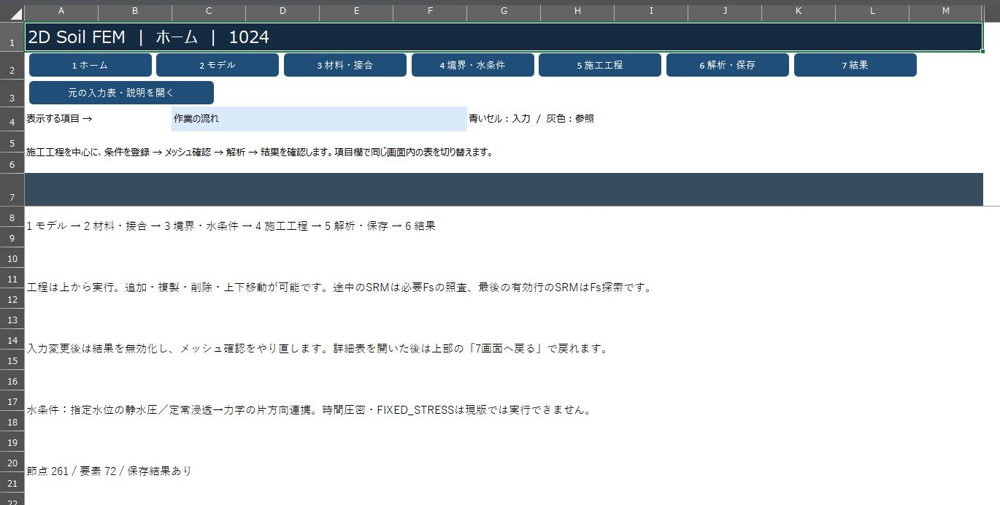

図1 ホーム。解析の流れ、節点・要素数、結果の有効状態を確認します。メッシュ確認と解析開始は「解析・保存」から行います。

|画面|主なセクション|役割|
|---|---|---|
|ホーム|作業の流れ|入力状態、節点・要素数、結果の有効状態|
|モデル|形状の座標／形状の領域／メッシュ生成・支持条件|輪郭点、材料領域、穴、格子間隔、形状メッシュと次回生成時の外周拘束|
|材料・接合|材料特性／接合条件／材料の水理特性／圧密材料特性|材料定数、SOIL・STRUCT・JOINT、接合、水理特性|
|境界・水条件|水条件の基本／水位線／水理境界／載荷条件／節点の支持・変位|水位線、静水圧・定常浸透、境界、載荷、生成済み節点の拘束|
|施工工程|工程の編集／時間・連成設定／時間の詳細設定／排水条件セット／水位の時系列|自重、載荷、除荷、盛土、掘削、水位変更、SRM、リセット、材料変更の順序|
|解析・保存|解析・SRM／保存・再開／高速化／詳細設定|解析条件、ログ・チェックポイント、DLL・GMRES、メッシュ品質とソルバー|
|結果|図と概要／表示設定／工程別数値／時間履歴／水量収支／時刻別の図／節点結果／要素結果／水圧結果／接合結果／診断|最終図、増分図、工程・節点・要素・水圧・接合・診断結果|

通常表示の7画面は、計算に使う元表を編集する窓口です。青いセルを編集すると計算に使用する元表へ反映します。数式を含む座標、節点番号・要素番号に依存する大きな表、結果表の13列を超える列は、画面上部の「元の入力表を開く」「元の結果表を開く」から詳細表へ移動します。詳細表の「7画面へ戻る」でホームへ戻り、上部の画面番号から通常画面を選びます。

### 水理モードを最初に見分ける

「境界・水条件」の「水条件の基本」でNONE、HYDROSTATIC、STEADYを確認します。HYDROSTATICは入力水位線から静水圧を作り、STEADYは透水係数と水理境界から全水頭と流束を計算します。入力水位線は「水位線」、計算水頭はSTEADYの水圧確認・水圧結果で確認します。

### 入力セルの見分け方

|表示|意味|扱い|
|---|---|---|
|淡い青色のセル|7画面で編集する入力欄|値または選択肢を入力|
|灰色のセル|参照値・自動出力|直接変更しない|
|詳細表の黄色セル|正規表の入力欄|大規模表・数式・番号依存条件を編集|
|上部ボタン|画面移動・操作|セクションを変えて同じ画面を使う|

元表の項目名、KEY、説明、推奨値は入力値ではありません。材料値、荷重、拘束、透水係数、強度定数には案件の調査・設計条件を入力します。

### 工程を組み替える

「施工工程」の1行が1つの解析操作です。B列で自重・載荷・除荷・盛土／追加・掘削／撤去・水位変更・SRM照査・リセット・材料変更を選びます。A列は自動管理の工程ID、E列は1=実行／0=スキップです。

|ボタン|操作|水位設定との関係|
|---|---|---|
|追加|末尾へ工程を追加|新しいIDを付与|
|複製|選択工程を末尾へ複製|新しいIDに水理計画も複製|
|削除|選択工程を削除|そのIDの計画だけを削除|
|上へ／下へ|選択工程の順序を変更|IDと水理計画を保持|
|元に戻す|直前の工程編集1回を復元|工程と水理計画をまとめて復元|

最後の有効行がSRM照査ならFsを探索します。後ろに施工が続くSRM照査は、D列に入力した必要Fsの判定です。水位変更はG列にONE_WAY、H列に水位線IDを指定し、I列で採用水位線を確認します。無効化した工程の計画は残り、再び有効にすると同じ設定を使います。

## 4. 解析手順（例題を1回通す）

ここでは小さな例題（6点の斜面、要素72個）で、入力から結果確認までを行います。所要時間は計算を含めて数分です。

**本章の確認値**（72要素の保存メッシュ）

|項目|値|
|---|---|
|メッシュ|72要素、261節点（地形追従格子）|
|ステージ|1 GRAVITY（自重）→ 2 SRM|
|結果|両ステージ PASS。Fs_PASS=2.625、Fs_FAIL=2.638、区間幅0.012（SRM_TOL=0.02）|
|計算時間|72.85秒（DLL使用、1024版の実測）|

本章では72要素・261節点の保存メッシュを使います。「モデル → メッシュ生成・支持条件」D14=2を使って形状から作り直すと、同じ座標・格子間隔でも節点・要素・接続が変わります。上表の72要素・261節点・Fsを新規生成の期待値にはしません。操作位置は以下の画面を参照し、旧結果を再現するときと新方式で作り直すときを、手順4で分けて選びます。

### 手順1 ブックを開く

1. 展開したフォルダーの`2DSoilFEM_ui_20261024.xlsm`をダブルクリックします。
2. 画面上部に黄色の「セキュリティの警告」バーが出たら「コンテンツの有効化」を押します。赤いバー（「このファイルのソースが信頼されていないため…」）が出た場合は、Excelを閉じ、ファイルを右クリック→「プロパティ」→「全般」タブの「許可する」にチェックして開き直します。
3. 「ホーム」が表示されれば準備完了です。

図2 ホームを開いた状態。画面上部の「3 材料・接合」から材料入力へ移ります。

### 手順2 材料を入力する（「材料・接合 → 材料特性」）

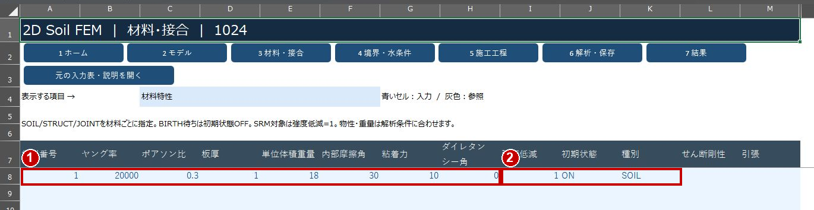

図3 「材料・接合 → 材料特性」。青いセルが入力欄、7行目が見出しです。

図4 入力する行を確認します。既存の行を消去する場合は青い入力セルの内容をクリアし、行や見出しは削除しません。

図5 ①A8:H8に材料定数、②I8:K8に強度低減・初期状態・種別を入力します。

|番号|セル範囲|入力するもの|単位|例（材料1）|
|---|---|---|---|---|
|①|A8|材料番号（1から連番）|－|1|
|①|B8|ヤング率E（SOIL・STRUCT）|kN/m²|20000|
|－|B列（JOINTの行）|法線剛性Kn（JOINTではEの代わり）|kN/m³|（解析例11）100000|
|①|C8|ポアソン比ν|－|0.3|
|①|D8|板厚|m|1|
|①|E8|単位体積重量γ|kN/m³|18|
|①|F8|内部摩擦角φ|度|30|
|①|G8|粘着力c|kN/m²|10|
|①|H8|ダイレタンシー角ψ|度|0|
|②|I8|強度低減（1=SRM対象、0=対象外）|－|1|
|②|J8|初期状態（ON=最初から有効、OFF=BIRTHまで無効）|－|ON|
|②|K8|種別（SOIL／STRUCT／JOINT）|－|SOIL|
|－|L8|JOINTのときだけ：せん断剛性Ks|kN/m³|空欄|
|－|M8|JOINTのときだけ：引張許容（1=ON、0=OFF）|－（単位なし）|空欄|

**触らないセル**：7行目（見出し）。材料を増やすときは9行目、10行目…と下に追加します。

> **解説　新しいケースに切り替えるときは古い行を最後まで消す**
>
> 計算済みのブックの先頭に短い表を上書きすると、後ろの古い行が残ります。解析は各表の最後のデータ行まで読むので、古い材料・載荷・工程が新しいケースに混ざります。行やシートを削除せず、データ行を選んで「数式と値のクリア」をします。

「元の入力表を開く」から詳細表を開き、次の範囲の内容を消去します。

|詳細表|消す範囲|注意|
|---|---|---|
|「材料データ」|A2:M（最後の行まで）|見出し・書式・入力規則は残す|
|「載荷」・「接合」|A2:J・A2:E（最後の行まで）|DISP=0の行は「無効」ではなくゼロ変位拘束として働く|
|「ステージ」|A2:F（最後の行まで）|残す行はE列=1の数と順番を照合する|
|「形状入力」（形状から作る場合）|B8:D・G8:J（最後の行まで）|新しい形状を入れてメッシュを作り直す|
|「節点データ」「要素データ」（保存メッシュを使う場合）|A2:I・A2からA:J列（最後の行まで）|「形状からメッシュ作成」は押さない|

> 表が2000行より長ければ、その最後の行まで消します。保存先とファイル名を新しくし、「解析・保存 → 保存・再開」D13（途中結果から再開）は空欄にします。古い`_out`フォルダーを新しいケースの再開元にしません。開始前に、材料数・節点数・要素数・有効な工程の数・各表の最後の行を確認します。

> **解説　単位と符号**
>
> 自動の単位換算はありません。mとmm、NとkN、密度（kg/m³）と単位体積重量（kN/m³）を混ぜると、結果が大きく狂います。長さm・力kNで入力するなら、E・c・応力はkN/m²（kPa）、γはkN/m³、JOINTのKn・KsはkN/m³です（第10章）。
>
> 変位・節点力・反力はXが右、Yが上を正とします。沈下量を下向き正で整理するときは s＝−uy です。変位ノルム√(ux²＋uy²)は常に正の値で、沈下そのものではありません。連続体の応力は**圧縮を正**として保存されます（引張正に直すときは全成分の符号を反転）。ひずみも圧縮正で、XYせん断は工学せん断ひずみγxy＝2εxyです。JOINTの法線応力も圧縮正、開口は開く向きが正です。
>
> 材料定数には、どの地盤にも使える推奨値はありません。ν（C列）はSOIL・STRUCTで−1より大きく0.5未満、JOINTでも数値の入力が必要です。材料を登録しただけでは領域に割り当てたことにならないので、「要素データ」J列の材料番号も確認します（第5章）。

### 手順3 形状を入力する（「モデル → 形状の座標／形状の領域」）

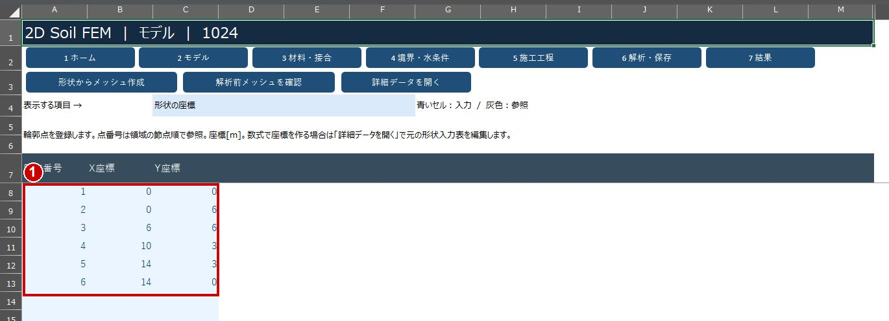

図6 「モデル → 形状の座標」。①A8:C13が点番号・X・Yです。

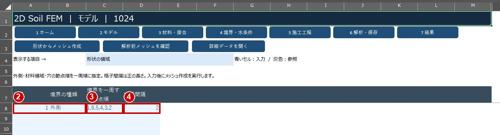

図7 「モデル → 形状の領域」。②境界番号と種類、③周回する点番号、④格子間隔を入力します。

図8 座標（上）と領域（下）の対応。点番号で輪郭を結び、外側領域の行順で材料を対応させます。

|番号|セル範囲|入力するもの|単位|例|
|---|---|---|---|---|
|①|A8:A13|点番号（重複しない）|－|1〜6|
|①|B8:C13|点のX座標・Y座標|m|(0,0)(0,6)(6,6)(10,3)(14,3)(14,0)|
|②|A8|境界の番号|－|1|
|②|B8|境界の種類（外側／内側。内側は穴を表す）|－|外側|
|③|C8|境界を一周する点番号（カンマ区切り。最後に始点を繰り返さない）|－|1,6,5,4,3,2|
|④|D8|格子間隔（小さいほど要素が増える）|m|2|

**触らないセル**：2〜7行目（題名・リンク・見出し）。点を増やすときは14行目以降へ、境界を増やすときは9行目以降へ追加します。

### 手順4 外周の拘束を決めてメッシュを作る（「モデル → メッシュ生成・支持条件」）

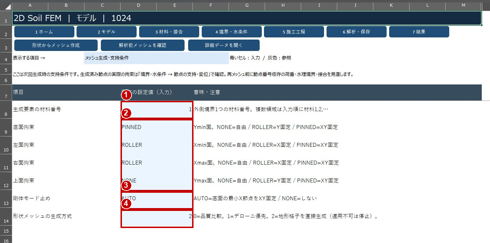

図9 ①D8 材料番号の補充値。②D9:D12 底面・左面・右面・上面の拘束。③D13 剛体モード止め。④D14 生成方式。

|番号|セル範囲|入力するもの|単位|例|
|---|---|---|---|---|
|①|D8|材料番号の補充値（どの外側境界にも入らない要素に使う。材料は境界の行順で決まる→第5章）|－|1|
|②|D9:D12|底面・左面・右面・上面の拘束（NONE=自由、ROLLER=面に垂直方向を固定、PINNED=XY固定）|－|PINNED／ROLLER／ROLLER／NONE|
|③|D13|剛体モード止め（AUTO=底面の最小X節点をXY固定、NONE=しない）|－|AUTO|
|④|D14|生成方式（0=候補の品質比較、1=デローニ優先、2=地形格子を直接生成）|－|新規作成は2。旧例は下記を参照|

#### 現行の生成方式と旧例題の使い分け

新規に地形格子を直接生成するときはD14=2を選びます。保存メッシュの例題は、節点・要素をそのまま読み込みます。

|目的・D14|現行版の動作|確認すること|
|---|---|---|
|新しく作成・2|デローニと33候補比較を省き、地形格子を直接生成。不適用・品質不足は理由付きで停止し、別方式へ自動変更しない|新たな節点数・要素数・品質を記録し、材料・拘束・番号依存の入力を確認|
|候補を品質で比較・0|従来のデローニと候補比較の経路|旧版と同じ節点番号・分割になるとは限らない|
|デローニ優先・1|従来のデローニ優先の経路。配布時の初期値|直接生成の経路ではない|
|保存済みの旧例題を再表示・再計算|形状メッシュの作成ボタンを押さず、保存された「節点データ」「要素データ」を使う|対応する材料・拘束・載荷・工程・設定もそろえる|

方式2の内部では、単純な斜面・水平地盤は地表追従、水平／鉛直境界の段差・複数材料・矩形空洞は直交格子、完全に入れ子の凸多角形トンネルは放射格子を選びます。テーパー擁壁・斜めの材料境界は、周辺地盤まで重ならない凸四辺形ブロックに分けて入力します。四辺形ブロックの共有辺は辺全体を一致させ、T字接続を作りません。円形は32／64角形などによる近似で、曲線要素ではありません。これらはD14=2の中の形状判定であり、D14を自動で0/1へ切り替える機能ではありません。[対応形状と入力順](../MESH_TERRAIN_COMPLEX.md)を参照してください。

旧例題の再現は次の順です。

1. [計算例ブック一覧](examples/README.md)から、対象の保存ブックを専用コピーで開きます。例として[解析例1の72要素ブック](examples/ex01_material_20261021.xlsm)、[解析例2の330要素ブック](examples/ex02_shape_mesh1m_20261022.xlsm)があります。前者は粘着力20 kPaの解析例1で、本章の粘着力10 kPaの基準値とは計算条件が違います。
2. 「形状からメッシュ作成」は押さず、保存された節点・要素表と材料・拘束・載荷・工程を確認し、「解析前メッシュを確認」で表示します。保存結果の確認は対応する結果シートで行います。
3. 再計算する場合も保存メッシュを保持し、例題の条件と設定を照合して解析します。最新版へ入力を移す場合は、節点・要素表だけでなく、節点番号・要素辺番号に依存する拘束・載荷・接合・水理境界も対応させます。
4. 形状や格子間隔を変える場合は新規メッシュの検討へ移り、旧結果の再現とは分けます。新しいメッシュでは番号依存条件を設定し直し、最初から計算・検算します。

#### 水理境界・接合・節点載荷があるときの再メッシュ

水理境界は要素番号と辺番号に結び付いています。形状・格子間隔を変えると番号が変わるため、保存済みの境界表を残したままD14=2で生成すると停止します。次の順で入力し直します。保存メッシュの再表示・再計算だけなら、この解除は不要です。

1. ブックを別名保存し、対応する`ブック名_out`も退避します。「水条件」A216:F415、接合、載荷の入力を別ファイルなどへ控え、どの面・位置へ指定したかを図と一緒に記録します。
2. 「水条件」A216:F415の**内容を消去**します。415行目より下にも入力・説明を置いた場合は、A列の最終使用行までのA:Fも消去します。215行目の見出しや行自体は削除しません。説明の文字だけが残っていても停止するため、F列まで空欄にします。B3をNONEに変えるだけでは解除になりません。水位線A12:D211と材料水理特性F12:J211は残します。
3. 有効な接合がある場合は「接合」D列を0にして一時解除します。「載荷」にFORCE、節点番号・座標指定のFIX/DISPがある場合は、該当行の入力を控えてからA:Jの内容を消去します。FORCEの値を0にするだけでは解除できません。TOP/BOTTOM/LEFT/RIGHT指定のFIX/DISPは直接生成で扱えますが、新形状で対象となる節点を確認します。
4. 形状・格子間隔と「モデル → メッシュ生成・支持条件」D9:D13の拘束を設定し、「形状からメッシュ作成」→「解析前メッシュを確認」の順に進めます。新しい節点番号・要素番号・辺の向き・材料領域を確認します。
5. 水理境界は新しい要素番号・辺番号で登録し直します。接合の材料組合せと有効フラグ、載荷の節点番号・位置指定も新メッシュに合わせて設定します。旧番号をそのまま貼り戻さず、外面・空洞内面・切断面とHEAD/EXPOSED/NOFLOW/DRYの対応を図で確かめます。
6. 「水圧プレビュー」と設定チェックをやり直し、水圧・合力・収支・拘束・載荷を確認してから新規解析します。再メッシュ前の結果を新メッシュの結果として表示・比較しません。

**入力欄**：D8:D14の青いセルです。項目名・説明・見出しは参照用です。形状の座標・領域は同じ画面の項目選択で切り替えます。

図10 ①「形状からメッシュ作成」を押します。②「解析前メッシュを確認」は作成済みメッシュを表示し直すボタンです。

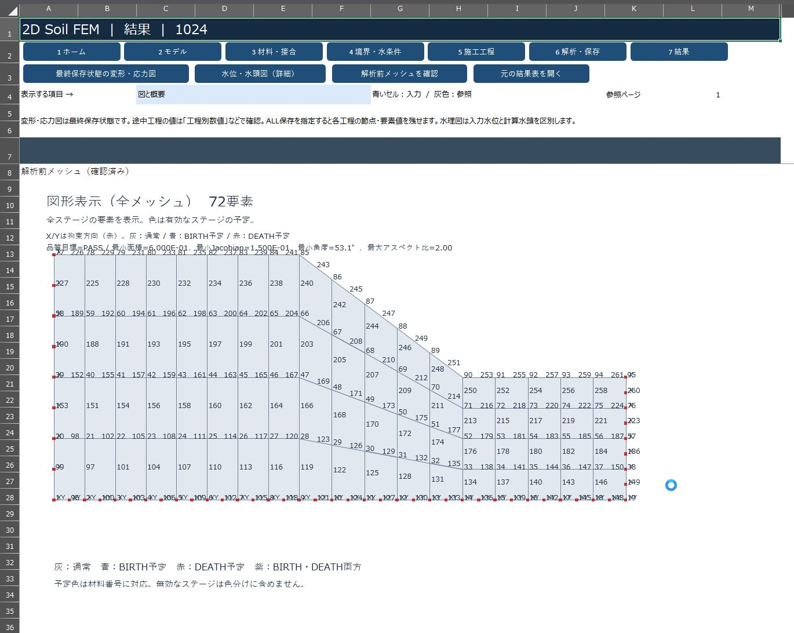

図11 保存メッシュの確認図。72要素の形状・拘束と、図の上にある品質サマリを読みます。

図12 72要素の保存メッシュ。形状から再生成する場合は、生成された節点数・要素数と品質をその都度確認します。

> **解説　メッシュ品質の判断**
>
> 品質に関する表示は3種類あり、判定の対象と意味が違います。メッセージの「不合格」を「Jacobianが負」と同じ意味に読まないでください。

|表示|出る場所|判定の対象|次の操作|
|---|---|---|---|
|作成比較の「合格／警告／不合格」と角度範囲|「形状からメッシュ作成」後のメッセージ（図11）、「詳細設定」C33|要素の内角だけ。合格＝45〜135°、警告＝30〜150°の範囲内、それ以外＝不合格|不合格・警告の要素があれば、境界点の配置と格子間隔を見直すか、品質修正候補を作る|
|品質目標（最小面積比・最小Jacobian比・最小／最大角度・最大アスペクト比）|「解析前メッシュを確認」の品質サマリ|「解析・保存 → 詳細設定」D11:D15の目標（配布値 1e−06、1e−06、45°、135°、5）|目標未達（WARN）はPASSと扱わない。候補を比べ、同じ形・領域を保つものだけ採用|
|計算できない形状|解析開始時・メッシュ確認時のエラー|Jacobianが正でない要素、接続の不整合・重複・孤立節点|解析を始めない。点の座標・境界の順番・共有辺を直して作り直す|

> 品質修正の操作は、「品質修正候補を確認」（元のメッシュを残して候補を作る）→比較結果・Jacobian・形・領域のつながりを確認→「候補を採用」（節点・要素表を更新）です。採用しない場合は何もしなければ元の入力が残ります（取消）。候補を作った後に入力を変えたら、候補を作り直します。候補の作成には反復回数と作業配列の上限（「詳細設定」C21:C25）があり、必ず修復できるとは限りません。直らないときは形状を見直します。

|気になる点|直し方|
|---|---|
|輪郭・寸法が違う|形状入力の座標と境界の順番を直して作り直す。穴（内側）と後で掘削する領域を混同しない|
|共有辺がつながらない|両側の境界に同じ点（途中の点も）を入れる。片側だけの追加点や近接した別座標の点を残さない|
|基礎や薄い壁が粗い|その領域を分けて格子間隔を小さくする。薄い部材を厚さ方向1要素だけで済ませない|
|細長い・曲がった要素|境界点の配置と間隔の差を見直す。角だけを極端に細かくしない|
|作り直した後|節点番号が変わるので、要素の材料番号・拘束・載荷の対象（番号・BOX）を確認して最初から計算する|

> 許容値を緩めて合格にする方法はとりません。品質が合格でも計算の精度は保証されません。計算後は、収束に加えて変形の妥当性・反力の釣合い・粗密の違いを確認します。

> 節点番号を探すとき：「表示モード」（「出力・表示」C21）をDETAILにしても、節点番号が描かれるのは500節点以下のメッシュだけです（大きなメッシュで番号が出ないのは、未生成という意味ではありません）。「節点データ」のB:C列（座標）をフィルターで絞り、A列の番号を読みます。例：解析例13の水平地盤（粗）では X=1 m、Y=5 m が節点39です。別のメッシュにこの番号を流用しません。

### 手順5 接合・載荷・施工順を確認する

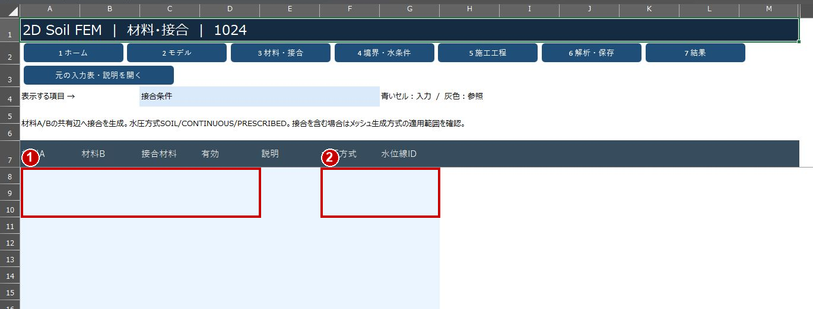

図13 「材料・接合 → 接合条件」。①見出し。②A8:E（必要な行だけ）。この斜面例は地盤のみで、接合面は設定しません。

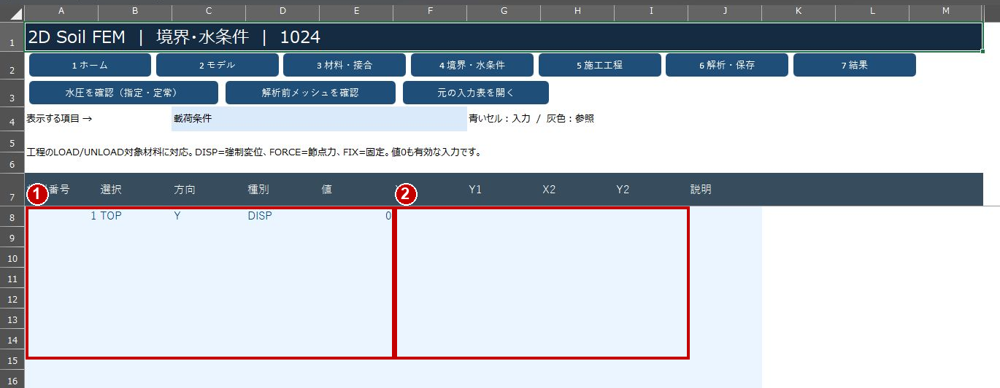

図14 「境界・水条件 → 載荷条件」。①見出し。②A8:I8。この斜面例は自重とSRMだけです。載荷行を適用するLOAD工程はありません。

「境界・水条件 → 載荷条件」A8が空欄のままブックの表を整えると、2行目に既定の行「1, TOP, Y, DISP, 0」が補われます（上面のゼロ変位拘束）。LOAD工程を追加する前に、この行が残っていないか必ず確認します。

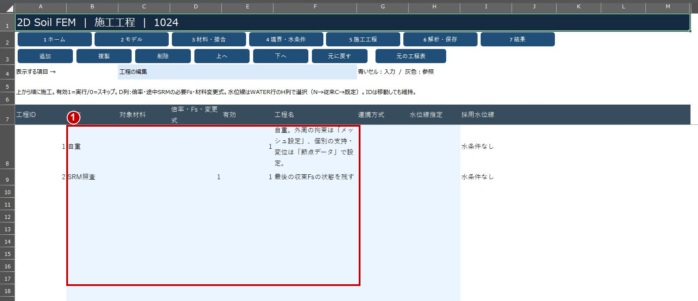

図15 「施工工程」。①B8:F9で自重とSRM照査を入力します。A列の工程IDは自動管理、G/H列は水理計画、I列は採用水位線の参照です。

|番号|セル範囲|入力するもの|単位|例|
|---|---|---|---|---|
|①|A8:A9|工程ID（自動管理）|－|1、2|
|①|B8:B9|操作（自重、載荷、盛土・追加、掘削・撤去、SRM照査など）|－|GRAVITY、SRM|
|①|C8:C9|対象の材料番号（BIRTH/DEATH/LOADで必要）|－|空欄|
|①|D8:D9|パラメータ（途中SRMの必要Fs、MATSETの内容）|－|空欄、1|
|①|E8:E9|有効（数値1=実行、0=スキップ）|－|1、1|

**触らないセル**：7行目（見出し）、A列（工程ID）、I列（採用水位線）。実行順を変えるときは行を選び「上へ」「下へ」で移動します。追加・複製には新しい工程IDが付与され、水理計画は工程IDとともに保持されます。

### 手順5-A 水条件を確認する（「水条件」）

水条件を使う場合だけ、手順5-Aを手順6の前に行います。「水条件の基本」B8でモードを選び、水位線・K・水理境界を入力したあと、「水圧プレビュー」を押します。HYDROSTATICでは入力水位線、GP水圧、等価節点荷重を確認します。STEADYでは全水頭、固定水頭境界、水頭残差、全体・要素収支を確認します。

この章の乾燥地盤の最初の例題は「境界・水条件 → 水条件の基本」B8=`NONE`のまま進めます。以下の画面は、操作項目を説明するための別の実計算モデルです。図4-5-A/Dは遮水構造体cutoff、Bは工程別水位変更one_way、Cは湿潤斜面fixed13です。各画面の条件を乾燥例題へそのまま転記しません。

|順番|シート・位置|入力と確認|
|---|---|---|
|1|境界・水条件 → 水条件の基本 B8:B11|方式、γw、既定の水位線ID、外水圧AUTO/OFFを選ぶ|
|2|境界・水条件 → 水位線 A8:D207|同じIDのXを昇順にし、モデル左右端を覆う入力水位の折れ線を登録|
|3|材料・接合 → 材料の水理特性 A8:E207|材料番号、TOTAL/EFFECTIVE、K、使用する水位線IDを設定|
|4|境界・水条件 → 水理境界 A8:F207|STEADYでは要素辺のHEAD/EXPOSED/NOFLOW/DRYと水頭を設定|
|5|境界・水条件 上部「水圧を確認（指定・定常）」|入力線と水圧外力、STEADYでは計算h・qと収支を確認|
|6|ステージ A:F → 水条件 L:T|工程の順番・有効フラグを設定し、必要なWATER工程だけ水位線IDを対応させる|
|7|解析後 H7「水圧結果」|受理した水圧・全/有効応力・水頭・流束の数値表を確認|

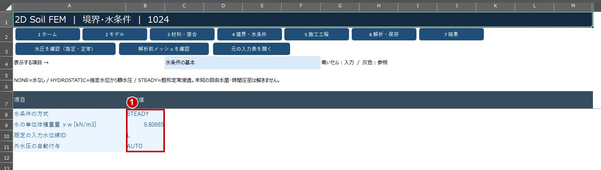

図4-5-A　遮水構造体cutoffの「水条件の基本」。①B8:B11でSTEADY、γw、既定ID=L、外水圧AUTOを指定します。

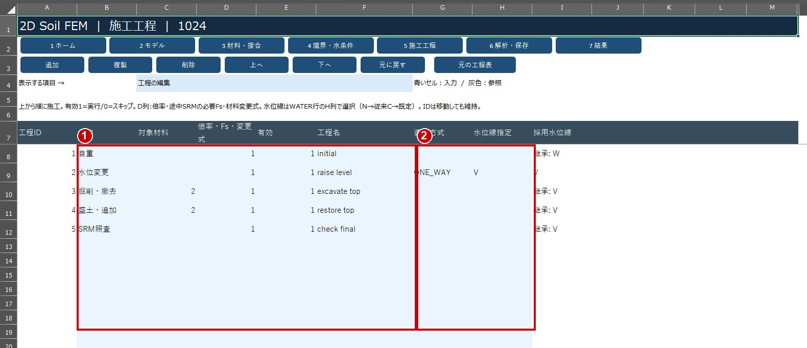

図4-5-B　one_wayの施工工程。工程2のG列にONE_WAY、H列に水位線Vを指定します。採用水位線はI列で確認します。

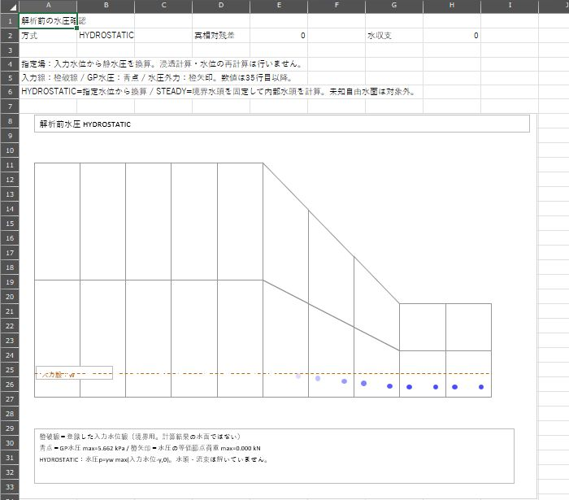

図4-5-C　fixed13の湿潤斜面（幅20 m・高さ10 m、指定水位W=1 m）のHYDROSTATICプレビュー。第30章の固定Fs=1.3ブックの施工前水圧確認です。入力水位から静水圧を換算し、水頭・流束は解いていません。

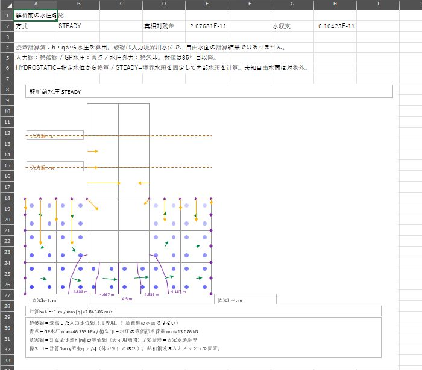

図4-5-D　cutoffのSTEADYプレビュー（第28章）。左5 m・右4 mの境界水頭から内部の全水頭・流束を計算した結果です。図4-5-Cとは形状・境界条件が異なり、同じモデルの方式切替比較ではありません。

### 手順6 解析条件を確認する（「解析・保存 → 解析・SRM」）

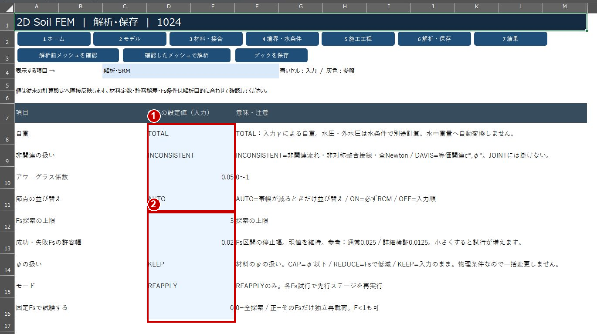

図16 ①D8:D11 基本条件。②D12:D16 SRMの条件。例題は配布時の値のまま使います。

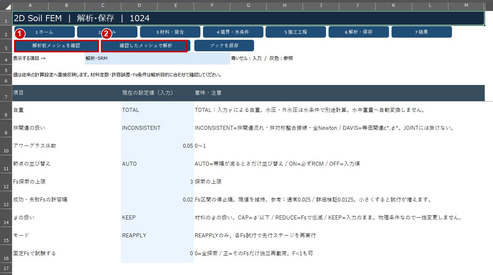

図17 「解析・保存」。通常の解析開始は「解析前メッシュを確認」→「確認したメッシュで解析」。解析開始時に設定の形式・範囲と、材料・メッシュ・工程の整合性を検査します。

図18 詳細表「解析設定」の「設定の形式・範囲をチェック」のメッセージ。個別の形式検査が必要な場合は、Excelのシートタブを右クリックして「再表示」から「解析設定」を開きます。通常は図17の解析開始時の検査を使います。

|番号|セル範囲|入力するもの|単位|例（配布値）|
|---|---|---|---|---|
|①|D8|自重の扱い|－|TOTAL|
|①|D9|非関連流れの扱い|－|INCONSISTENT|
|①|D10|アワーグラス係数（0〜1）|－|0.05|
|①|D11|節点の並び替え|－|AUTO|
|②|D12|Fs探索の上限|－|3|
|②|D13|成功・失敗Fsの許容幅|－|0.02|
|②|D14|ψの扱い|－|KEEP|
|②|D15|SRMモード|－|REAPPLY|
|②|D16|固定Fs（0=全探索）|－|0|

**触らないセル**：B・E・F・G列。

D13の配布値0.02はそのまま使います。画面の説明にある「通常0.025／詳細検証0.0125」は参考値で、変える必要はありません。「設定の形式・範囲をチェック」で見つからなかった誤りも、解析の入口で設定と入力を検査し、不正なら**結果を消す前に**止まります（貼り付けで入力規則を回避した値も検査されます）。エラーに表示されたシート・セル・KEYを直します。検査を通っても、入力が工学的に妥当という保証にはなりません。

|実行前の確認|見るところ|
|---|---|
|単位と材料|E・ν・γ・c・φ・ψ、板厚、SRM対象（I列）、種別（K列）|
|メッシュと支持|節点の連番、接続、要素の材料番号（J列）、拘束の方向、品質|
|載荷・施工|方向・符号・対象節点の数、ステージの有効欄（E列=1）、BIRTHする材料の初期OFF|
|解析・保存|流れ則、ψの扱い、Fs上限・許容幅、新規（「保存・再開」D13空欄）か再開か、ログ設定|

> **解説　SRM（強度低減法）の仕組み**
>
> SRMは、I列=1の材料の強度を c/Fs、atan(tanφ/Fs) に下げ、Fsを変えながら釣合い計算を繰り返します。成功したFsと失敗したFsの区間が「成功・失敗Fsの許容幅」（D13）より狭くなったら止まります。
>
> 「ステージ」の最後の有効行がSRMならFsを探索します。後ろに施工が続く途中のSRMは、D列の必要Fsを満たすかを判定する関門です。満たせば施工を続け、満たさなければ止まります。
>
> D16（固定Fs）に正の値を入れると、そのFsだけを試します。成功しても限界のFsを求めたことにはなりません。探索するときは0に戻します。

### 手順7 高速化・出力の設定を確認する

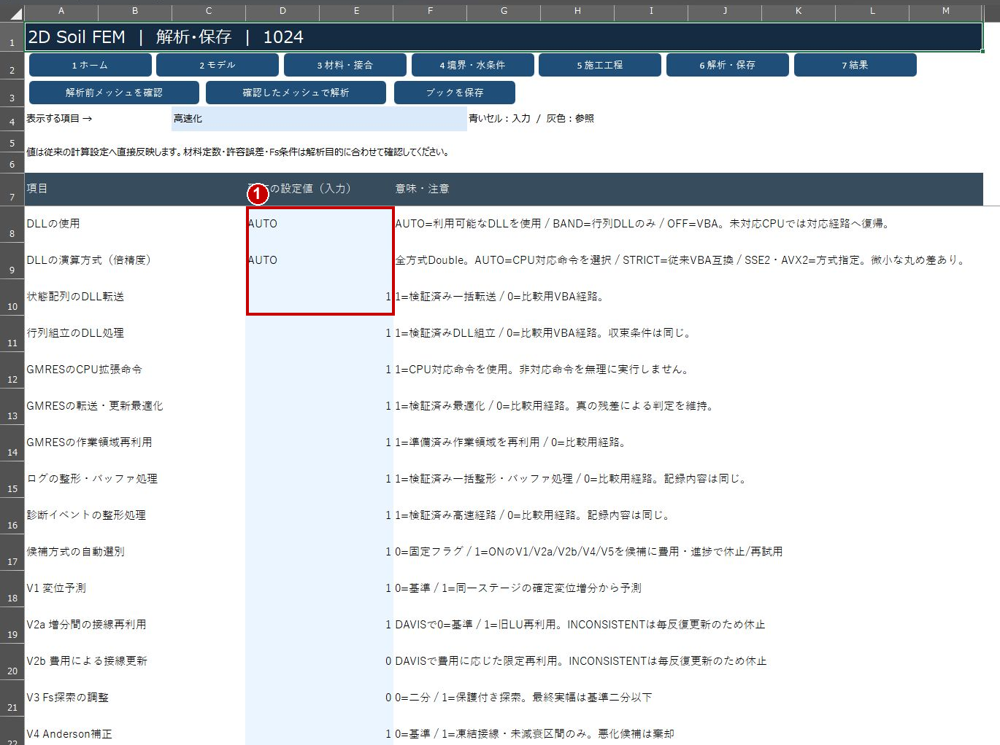

図19 「解析・保存 → 高速化」でDLL方式を確認します。推奨値への復元が必要な場合は、Excelのシートタブを右クリックし「再表示」で詳細表「高速化設定」を開き、同表の推奨ボタンを使います（材料・荷重・支持・Fs条件は変わりません）。

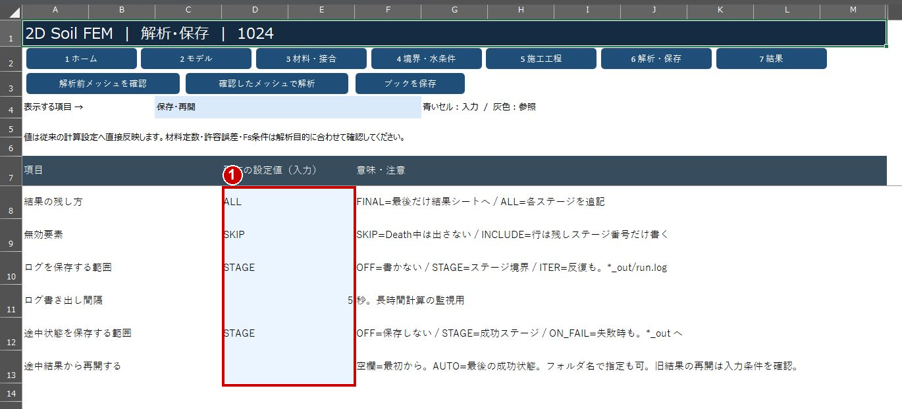

図20 「解析・保存 → 保存・再開」。①D8:D13は結果の残し方、ログ、途中状態、再開元です。

図21 「結果 → 表示設定」。①D8が変位倍率、②D9が表示量です。上部の「最終保存状態の変形・応力図」で描画します。

### 手順8 解析前にメッシュを確認する

「解析・保存」の「解析前メッシュを確認」（図23の①）を押します。

図22 「結果」画面の確認図。灰色＝通常、青＝BIRTH予定、赤＝DEATH予定です。この時点では計算は始まっていません。

> **解説　メッシュの品質・収束・精度は別のこと**
>
> メッシュの品質の判定（PASS）、材料の計算の収束、解析の精度は、それぞれ別に確かめます。品質がPASSでも、収束するとは限りません。収束しても、メッシュが粗ければ精度は足りないことがあります。
>
> 変形図は、元の形と変形後の形を区別して確認します。掲載した施工例では、各要素の形を11×11点でも調べ、元の形と変形後の形（倍率1）の両方でJacobian（形の写像の行列式）が正であること（要素が裏返っていないこと）を別に確かめています。小ひずみの計算が収束したことと、変形後の形として成り立っていることも、別のことです。
>
> 解析済みのモデルの節点・要素を直したときは、変位・応力の履歴は新しいメッシュへ移されません。初期の入力から計算し直します。

### 手順9 解析を開始する

図23 「6 解析・保存」へ戻ります。①「解析前メッシュを確認」で形状・拘束を確認した後、②「確認したメッシュで解析」を押します。入力変更で確認状態が失効した場合は再びメッシュを確認します。

図24 計算中はExcelの左下（ステータスバー）に進み具合が表示されます（赤枠）。例：「ステージ 2/2 SRM 探索 試行16 Fs=2.70」。計算中はExcelを操作しないでください。

画面が止まって見えても、それだけで非収束と判断しません。ステータスバーと`ブック名_out\run.log`の進み具合を確認します。強制終了した場合は、そのときの結果を採用せず、ログと保存済みの成功状態を確認します。

> **解説　増分・反復・残差**
>
> 計算は荷重を少しずつ進めます（増分）。1つの増分の中では、釣合いが取れるまで修正を繰り返します（反復）。収束しないときは増分を小さくしてやり直すため、試行の回数と進んだ増分の数は一致しません。残差は外力と内力の差です。残差が小さくても、拘束・材料・単位が意図どおりとは限りません。収束したかどうかと、結果が力学的に妥当かどうかは分けて確認します。
>
> 「残差」にはいくつか種類があります。線形方程式を解くGMRESの途中の残差、Newton反復の釣合い残差、最後に記録される全体の相対残差（「診断」RelativeResidualFree）は同じ量ではありません。途中の値だけで良否を決めず、最終の判定、全変位、Fs区間と合わせて見ます。
>
> 1つの荷重増分の反復回数には上限があります。INCONSISTENTでは全体反復100回（弾性補正モードでは1000回）、線探索は最大16回、DAVISでは全体反復50回・線探索4回です。上限に達すると増分を小さくしてやり直し、最小の増分でも収まらないと「計算失敗」になります。SRMでは各Fsで先行工程を計算し直すので、総反復数と時間は大きくなることがあります。反復が長いこと自体は停止の理由ではありません。

図25 終了時のメッセージ。「計算終了」とFsの探索結果（FOS_PASS、FOS_FAIL、FOS_MID、FOS_WIDTH）が表示されます。「OK」で閉じます。

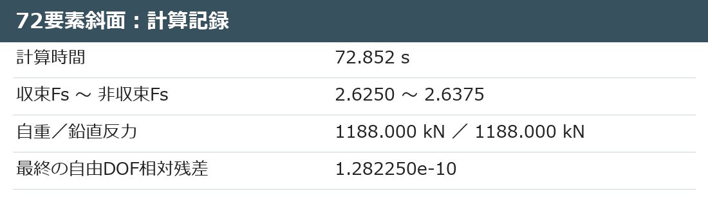

図26 計算時間の記録。計算開始から終了まで72.852秒、最終収束Fsは2.6250です。

図27 詳細表「結果増分」。最後に収束した荷重増分のひずみ増分を保持します（列の意味は第11章）。個別の値はExcelのシートタブを右クリックし「再表示」から同表を開いて確認できます。通常は解析後に「結果」画面へ戻ります。手順10で工程の成否、手順11で色図・増分図を確認します。

### 手順10 結果を確認する

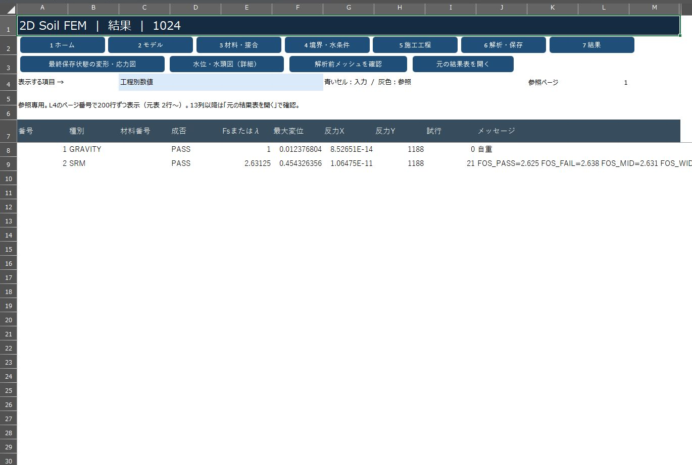

図28 「結果 → 工程別数値」。8行目の自重、9行目のSRMの成否、Fs、反力、メッセージを確認します。

「ステージ結果」F列の「最大変位」は、計算中に試した状態を含めた自由度の変位成分の最大値（試行中の最大値）で、解析開始からその工程までの最大を引き継ぎます（`FEMEngine.bas`のP3MaxTrialDisp）。工程が終わったときの変位ではありません。工程ごとの変位は「結果節点」をA列（工程）で絞り、E:F列から max｜ux｜、max｜uy｜、max√(ux²＋uy²) を求めます（第11章）。

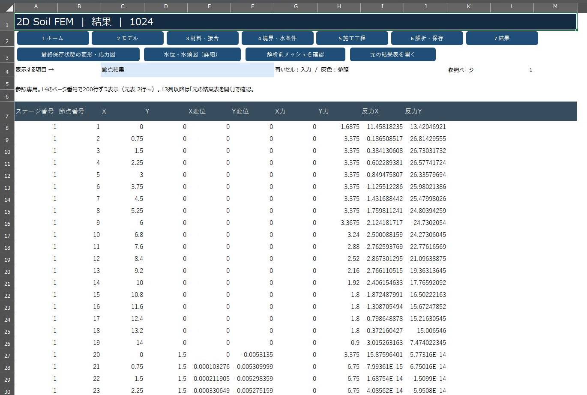

図29 「結果 → 節点結果」。節点ごとの座標、変位、力、反力。

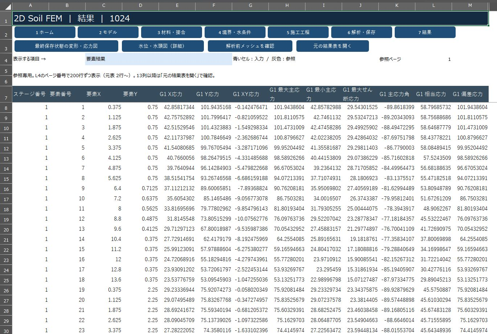

図30 「結果 → 要素結果」。4つの積分点ごとの応力・ひずみ・降伏状態。

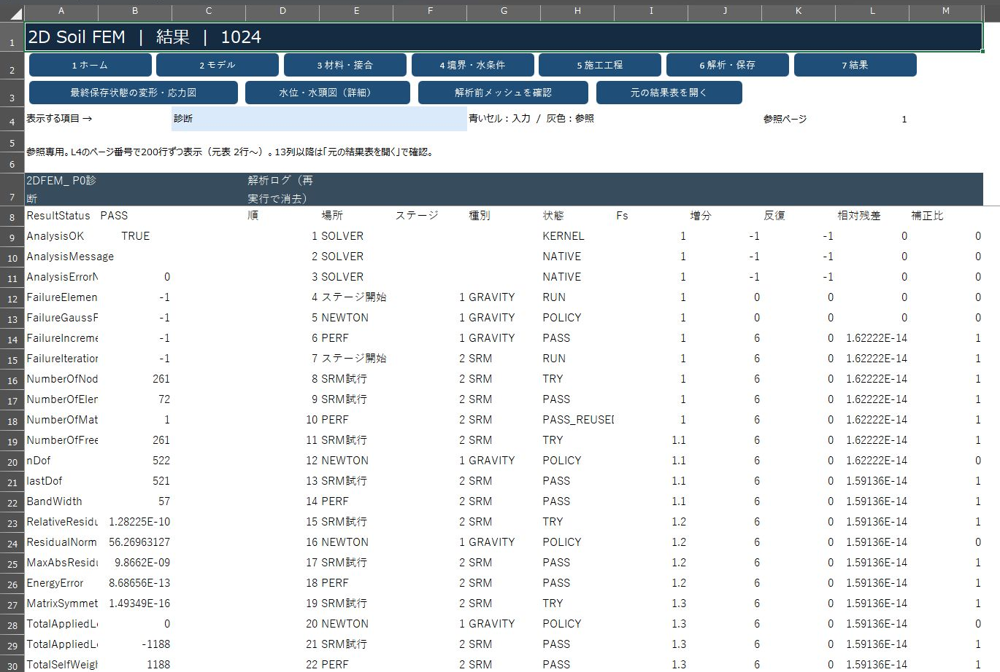

図31 「結果 → 診断」。解析状態、残差、失敗位置を確認します。

### 手順11 変形・応力図を表示する

「結果 → 表示設定」の「最終保存状態の変形・応力図」（図21上部）を押します。

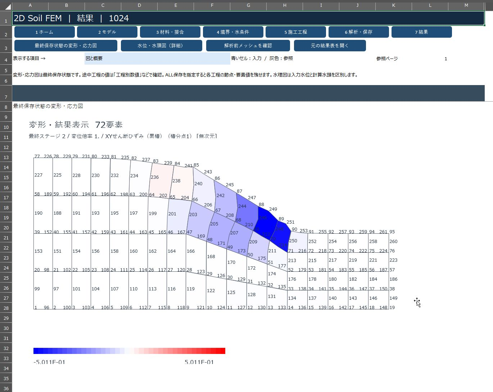

図32 結果図。表示量＝D9「XYせん断ひずみ（累積）（積分点1）」、対象＝最終ステージ（SRMで最後に成功したFs=2.625の状態）、色スケール＝SYMMETRIC（0を中心に正負対称）、変位倍率＝1。凡例は図の下にあります。

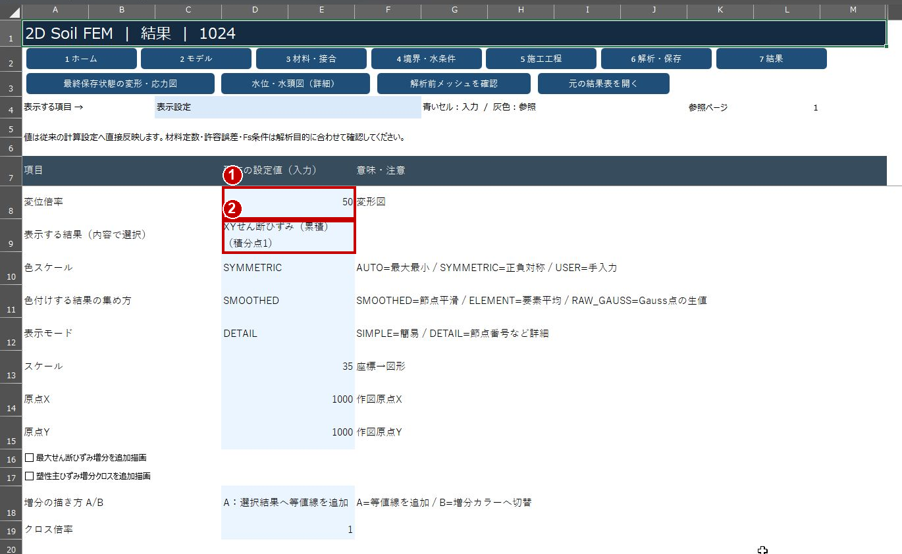

図33 ①D8の変位倍率を50に変更し、②D9で表示量を選びます。

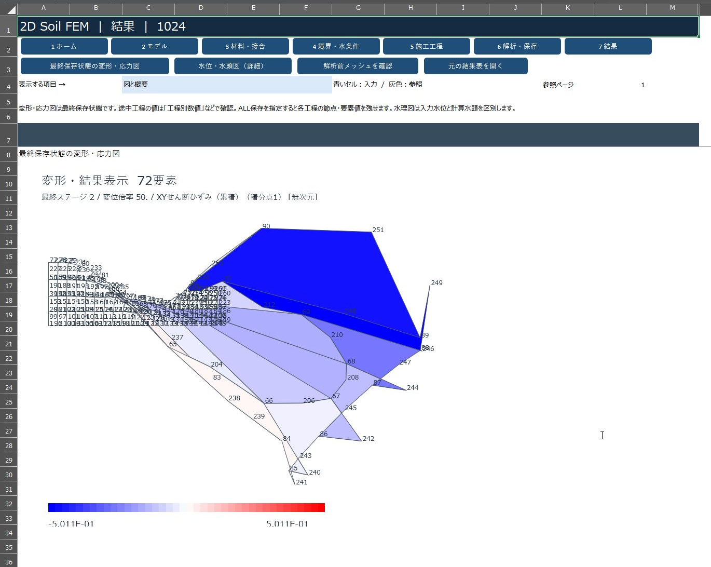

図34 過大な変位倍率50の表示例。変位を50倍すると要素が重なり、形状を読み取りにくくなります。計算値は変わりません。倍率1の形は図32で確認します。

### 手順12 保存する

Excelの「上書き保存」で保存します。外部出力（ログ・途中状態）はブックと同じ場所の`ブック名_out`フォルダーに保存されます。ブックと一緒にこのフォルダーも保管してください。

> **解説　保存した結果の再表示と、途中からの再開は別の操作です**
>
> 再表示：解析後に保存したブックを開き直し、「最終保存状態の変形・応力図」を押すと、再解析せずに図が出ます。「ステージ結果」の工程・Fsと図を照らし合わせます。
>
> 途中から再開：「解析・保存 → 保存・再開」D12（途中状態を保存する範囲）で保存した状態を、D13（途中結果から再開する）にフォルダー名（例 stg03_BIRTH）で指定します。再開したことは`run.log`の記録で確認します。D13=AUTOとしただけでは再開した証拠になりません。新しいケースではD13を空欄にします。
>
> 「USER」の色スケールは縮尺と原点を手入力する設定で、色の上下限を固定する機能ではありません。図を比べるときは凡例の数値を必ず併記します。
>
> D12（EXPORT_MODE）は途中状態（チェックポイント）を書き出す設定で、Excelブックを自動保存する設定ではありません。結果表をCSVに保存しただけでは、応力・塑性履歴・施工状態を含む再開用の一式の代わりになりません。再開には版・モデル・施工計画の一致が必要で、FAILになった状態からは再開できません。D13=AUTOで対応する成功状態が見つからないと最初から計算することがあるので、run.logで再開を確認します。

## 5. 材料が2つ以上あるときの注意

「材料・接合 → 材料特性」で材料を1行ずつ登録し、「モデル → 形状の領域」で領域の入力順を確認します。

形状メッシュでは、要素の材料番号は**「形状入力」の外側境界の行順**で決まります。上から1行目の外側境界の中の要素が材料1、2行目の中が材料2です。G列の「番号」を書き換えても材料番号は変わりません。「モデル → メッシュ生成・支持条件」D8は、どの外側境界にも入らなかった要素に付ける補充値です。

図35 「材料・接合 → 材料特性 → 元の入力表を開く」で表示する詳細表「材料データ」。①2行目＝材料1、②3行目＝材料2（剛性の大きい材料の例）。

図36 「モデル → 形状の領域 → 詳細データを開く」で表示する詳細表「形状入力」。①点1〜6。②1行目の外側境界`1,4,3,2`（左の領域）→材料1。③2行目の外側境界`4,6,5,3`（右の領域）→材料2。

図37 作成したメッシュ（336要素）。

図38 「モデル」の「詳細データを開く」で開く「要素データ」。①J列が材料番号です。作成後はJ列をフィルターし、材料2の要素が右の領域にあることを確認します。

外側境界の行を並べ替えると材料の割当ても変わります。J列を手で直す場合は、対象の要素を座標と接続で確かめ、その行のJ列だけを実在する材料番号に変えます（表の一部の列だけを並べ替えない）。メッシュを作り直すと手で直したJ列は上書きされるので、直す前後のコピーと要素番号の一覧を残し、作り直すたびに確認します。

> **解説　材料の自動割当を確かめる**
>
> メッシュを作ると、要素の中心がどの境界（領域）の中にあるかで材料番号が決まります。「モデル → メッシュ生成・支持条件」D8（MESH_MATERIAL）は、要素の中心がどの外側の領域にも入らないときに使う補いの材料番号です。C9だけで全体の材料を決める設定ではありません。穴の境界は外側の領域とは別に数えます。
>
> 自動の割当を無条件に信用せず、「要素データ」J列を図の材料の色と照らし合わせます。手で直すときは、対象の要素を座標と接続で特定し、その要素の行のJ列だけを実在する材料番号に変えます。

## 6. 拘束（支持条件）の決め方

「モデル → メッシュ生成・支持条件」は次回生成時の支持です。生成後の節点ごとの拘束は「境界・水条件 → 節点の支持・変位」で確認します。

拘束の入力先は、メッシュを作り直すかどうかで変わります。

|場合|操作|
|---|---|
|メッシュを作り直すとき|「モデル → メッシュ生成・支持条件」D9:D13で拘束を選び、「形状からメッシュ作成」を押します。作成時に「節点データ」D:E列へ拘束が書き込まれます。節点番号が変わるので、載荷の対象も確認し直します。|
|保存済みのメッシュをそのまま使うとき|「モデル → メッシュ生成・支持条件」D9:D13を変えるだけでは拘束は変わりません。「節点データ」のB:C列（座標）とA列（節点番号）で対象を探し、D列（X拘束）・E列（Y拘束）を0（自由）または1（拘束）に直接書き換えます。|

図39 「境界・水条件 → 節点の支持・変位」で開く「節点データ」。①D:E列が拘束（0=自由、1=拘束）です。変更後は「解析前メッシュを確認」で赤いX/Y記号を確認します。

外周の拘束は、座標の最小・最大の面（Ymin＝底面、Xmin＝左面など）にある節点にだけ付きます。斜面全体に支持が付くわけではありません。

解析が読むのは「節点データ」D:E列の値です。「モデル → メッシュ生成・支持条件」D9:D13はメッシュを作るときの設定で、保存済みの節点を書き換えるボタンではありません。設定を変えてプレビューが無効になっても、拘束が更新された証拠にはなりません。

例：保存メッシュの右側をX方向ローラーにする場合は、「節点データ」B列でXが最大の節点を絞り、その番号の一覧を残してD列を1にします。底面との共有隅点では、E列の既存のY拘束をそのまま残します。D:Eを0にする「拘束の解除」と、F:G列や「載荷」DISPの値を0にする操作は別です（DISP=0はゼロ変位拘束）。変更後は「解析前メッシュを確認」で記号を照合し、「解析・保存 → 保存・再開」D13を空欄にして最初から解析します。「載荷」のUNLOADは載荷シートの指定を外す操作で、「節点データ」D:Eの固定はそのまま残ります。

> **解説　境界の位置**
>
> この説明書の例の拘束は、入力の例です。実際の検討では、モデルの境界を荷重や掘削から十分に遠くへ置き、地形と荷重の向きに応じて拘束が結果を左右していないかを確かめます。境界を近づけた計算と遠ざけた計算を比べると、境界の影響が分かります。
>
> 旧版の簡易メッシュの点1〜4の座標と分割数nx・nyは、現在のブックでは使いません（表示もされません）。

### 「節点データ」・「要素データ」の列

|シート・列|入力内容|
|---|---|
|「節点データ」A:C|節点番号、X座標、Y座標。|
|「節点データ」D:E|X/Y拘束。0は自由、通常は1で拘束。|
|「節点データ」F:G|互換用のX/Y強制変位。空欄は0。|
|「節点データ」H:I|互換用のX/Y節点力。空欄は0。|
|「要素データ」A|要素番号。|
|「要素データ」B:I|Q8の8節点番号。4隅を左下・右下・右上・左上の順（反時計回り）に指定し、続けて辺1-2、2-3、3-4、4-1の中点を指定（図40）。|
|「要素データ」J|材料番号。独立して施工する領域には別番号を割り当てます。|

図40 Q8要素の節点の順番（模式図）。隅の4点（1〜4、反時計回り）の後に、辺の中点（5〜8）を続けます。×は積分点（2×2）の概念位置です。

番号は1から始め、重複・欠番を避けます。要素内の節点の重複、存在しない節点、未登録の材料、Jacobianが正でない要素は、入力と接続を見直します。

通常の新規載荷は「載荷」とLOADを使います。同じ自由度に複数経路で荷重や変位を重ねないようにします。

> **解説　JSONの入力例と旧版の例をこのブックへ移す**
>
> リポジトリの入力例は2種類あります。形状入力のJSONは `points` を「形状入力」B:D、`boundaries` をG:J（番号・種類・点の順番・格子間隔）へ入れ、「形状からメッシュ作成」で作ります。保存メッシュのJSONは `nodes` を「節点データ」A:I、`elements` を「要素データ」A:Jへ入れ、メッシュは作り直さずに「解析前メッシュを確認」へ進みます。どちらも `materials` は「材料データ」A:M、`stages` は「ステージ」A:F、`loads` は「載荷」A:Kです。K列は名前付き載荷セットIDで、10列形式のJSONでは空欄です。
>
> 保存済みの計算例ブックを使って計算し直すときは、現在のブックの別名コピーを作り、古い行を消した後（第4章 手順2の解説）、旧ブックの材料A:M・節点A:I（拘束を含む）・要素A:J・ステージA:F・載荷A:K・接合A:Gのデータ行だけを「値の貼り付け」で移します。設定はセルの位置ではなくF列のKEY名で照合して転記し、「解析・保存 → 保存・再開」D13は空欄にします。シート全体・VBA・旧結果はコピーしません。保存結果の閲覧と、新しい計算の出力先を分けます。

### 時間連成の入力JSONから新しく計算する

解析例19～23の入力は、形状だけでなく水理材料・時間・排水・名前付き載荷まで含みます。保存結果を読む場合と、配布ブックで新しく計算する場合は、次の入口を使います。

|解析例|入力JSON名|保存結果を開く場所|
|---|---|---|
|19 拘束柱|column_smoke|accepted/column_smoke/fresh_results.xlsm|
|20 Mandel|mandel_hybrid_refine|下記のJSON実行手順を使う。Mandelの結果ZIPは数値・ログを読む資料|
|21 盛土・30日圧密|fill_30day|accepted/fill_30day/fresh_results.xlsm|
|22 掘削・埋戻し|wet_birth_ramp|accepted/wet_birth_ramp/fresh_results.xlsm|
|23-A 時系列水位|watercurve / water_external_linear|accepted/各JSON名/fresh_results.xlsm|
|23-B 斜面SRM|saturated_slope_srm|accepted/saturated_slope_srm/fresh_results.xlsm|

保存結果は[連成実計算ブック集](../fixed-stress-evidence/20261024/accepted_records.zip)を展開し、表のパスから開きます。各ケースのフォルダーを丸ごと展開し、保存時の出力フォルダー名を変えずにブックと同じ場所へ置きます。たとえばcolumn_smoke_out、fill_30day_out、水位時系列のcolumn_water_curve_outです。「結果 → 時間履歴」K列の保存先が、その場所にあることを確認します。その後、工程・時刻を確認してから「時刻別の図」のB8で保存状態を選びます。Cは施工本線、SはSRM照査枝です。

新しく計算するときは、現在の配布XLSMとDLLを使い、次の順で入力を移します。

1. 現在の配布ブックを別名コピーし、「解析・保存 → 保存・再開」D13を空欄にします。表の「元の入力表を開く」から詳細表を開きます。水条件・載荷・施工の旧データ行を消し、異なる例の行を混在させません。見出し・設定KEY・シートは削除しません。
2. JSONの配列を、下表の先頭セルから**列順を変えず、値として**転記します。内側の配列1個がExcelの1行です。nullは空欄とします。表に存在しない任意の配列は空欄にします。節点と要素を移した後はメッシュを再生成しません。
3. `water.mode/gamma/defaultProfile/auto`を「水条件」B3/B4/B5/B6へ移します。`settings`はセル番地でなくKEY名で照合して設定します。空の載荷セットIDと名前付きセットを同じものとして扱いません。
4. 通常の7画面へ戻り、材料・水位・工程IDと時間詳細を照合します。元表の工程A列を転記した後は、通常画面の「追加／複製／上下」で編集し、参照A列を直接変更しません。
5. 解析前メッシュと水圧プレビューを確認し、解析します。時間履歴・水量収支・全変位と各例の確認値を比較します。

|JSON配列|元の入力表・開始セル|列の内容（配列の左から）|
|---|---|---|
|nodes / elements|節点データ A2からA:I列、要素データ A2からA:J列（形式付きはKまで）|節点は番号・X・Y・拘束X/Y・変位X/Y・力X/Y。要素は番号・8接続番号・材料番号・形式|
|materials / stages|材料データ A2からA:M列、ステージ A2からA:F列|材料列は第10章。工程はID・操作・対象・値・有効・説明|
|loads / jointPairs|載荷 A2からA:K列、接合 A2からA:G列|載荷A:Jは材料・対象・方向・種類・値・BOX4値・説明、**Kは載荷セットID**|
|water.profiles|水条件 A12（A:D列）|水位線ID・X・水位標高・説明|
|water.materials|水条件 F12（F:J列）|材料番号・TOTAL/EFFECTIVE・透水係数・水位線ID・説明|
|water.boundaries|水条件 A216（A:F列）|要素番号・辺番号・種類・水位線ID・指定値・説明|
|water.stagePlans|水条件 L12（L:T列）|工程ID・連携方式・水位線ID・工程時間・初期刻み・排水セットID・連成反復上限・許容値・説明|
|water.coupledMaterials|水条件 V12（V:AB列）|材料番号・Biot係数α・貯留S・kx・ky・説明・間隙率（6列形式は間隙率空欄）|
|water.timeOptions|水条件 AC12（AC:AL列）|工程ID・時間単位・水位変化方式・載荷方式・最小刻み・最大刻み・保存間隔・水位時系列ID・載荷セットID・説明|
|water.drainSets|水条件 V216（V:AB列）|セットID・要素番号・辺番号・種類・水位線ID・指定値・説明|
|water.timeCurves|水条件 V420（V:X列）|時系列ID・工程内時刻・水位線ID|

Mandel入力の`loads`の11番目にはM000等のIDがあります。A:Jだけを移すと、このIDを失います。載荷K列と`timeOptions`の9番目（元表AK列、通常画面「時間の詳細設定」I列）が一致することを確認します。M000の行だけを消したり、数値0へ変えたりしません。

同じ転記を自動で行う場合は、リポジトリを展開してExcelを閉じ、[JSON実行ドライバー](../../tests/run_groundwater_fixture.ps1)を使います。PowerShell 7とVBAプロジェクトへのアクセス許可が必要です。リポジトリのフォルダーで次を実行します。Bookは配布ブック、Outは存在しない新規フォルダーを指定します。ドライバーはBookをコピーして入力・計算し、原本を保持します。

<pre style="font-size:8pt;white-space:pre-wrap">pwsh -NoProfile -File tests/run_groundwater_fixture.ps1 `
  -Book workbook/ui_20261024/2DSoilFEM_ui_20261024.xlsm `
  -Fixture tests/fixtures/fixed_stress/mandel_hybrid_refine.json `
  -Out tests/tmp/manual_mandel_new -Resume</pre>

`-Resume`は新規計算に加えて保存再開を比較する指定です。保存済みブックを開く閲覧操作とは別です。ほかの例はFixtureのファイル名とOutを替えます。[入力一覧とMandel理論比較のコマンド](../../tests/fixtures/fixed_stress/README.md)を併用します。

JOINTは6節点です。「要素データ」B:GにA側の端点1・端点2・中点3、対応するB側の端点4・端点5・中点6を指定します。周回順ではありません。H:Iは有効節点に含みません。

## 7. 計算の考え方

この章では、解析例に入る前に、本ソフトが何をどう計算しているかを説明します。式と考え方は、配布ブックのVBA（`FEMEngine.bas`・`FEM.bas`）の処理に合わせています。

### 解析モデルと実務での使い分け

平面ひずみ・小ひずみ、奥行1 m当たりのQ8/T6連続体を使います。SOILは地盤、STRUCTは構造体、JOINTは接合面です。STRUCTの断面力は連続体応力を積分して整理し、アンカーは等価節点力でモデル化します。梁・トラス専用要素、鉄筋のひび割れ・耐力、切羽の三次元効果は別の設計モデルで照査します。

静水圧と定常浸透はONE_WAYで力学へ渡し、飽和地盤の時間圧密はFIXED_STRESSで反復します。自由水面・不飽和化・大変形が支配する問題は、この飽和・小ひずみモデルの適用範囲と区別します。施工中の再メッシュでは応力・変位履歴を引き継がないため、後の掘削・盛土範囲まで初めのメッシュに区切ります。

### 7.1 解析モデル（平面ひずみ・Q8要素・材料の種類）

本ソフトは、奥行方向に一様な断面を切り出した**平面ひずみ**の2次元解析です。奥行方向のひずみを0とし、奥行1 m（材料データD列の板厚t）当たりの力・反力で結果を出します。要素は8節点の四辺形Q8と、6節点の直線辺三角形T6を使用でき、変位が小さいとして釣合いを解く**小ひずみ**の計算です（大変形・形状の更新は行いません）。

|材料の種類（材料データK列）|表すもの|計算のしかた|
|---|---|---|
|SOIL|地盤・盛土|Q8連続体。Mohr–Coulombの弾完全塑性（7.2）|
|STRUCT|擁壁・支保などの構造体|**SOILと同じQ8連続体**。梁・トラス・板の要素ではありません。強度を大きくし、I列＝0（SRMで低減しない）にして弾性に近い挙動にします|
|JOINT|材料の境目（すべり・開口）|厚さ0の接合要素（7.6）。KnとKsのばねとCoulomb則|

> **解説　梁・トラス・アンカーの専用要素はありません**
>
> 本ソフトには、梁（曲げ部材）・トラス（軸力部材）・アンカー・ロックボルトの専用要素はありません。擁壁や支保はSTRUCT材料の連続体として厚さ方向に要素を並べてモデル化し、断面力（N・V・M）は積分点の応力を断面で積分して求めます（解析例9）。アンカーは、頭部と定着部に等大・反対向きの節点力を与える「アンカー相当力」で近似します（解析例12）。アンカー体の軸剛性・引抜き・緊張力の経時変化は表せません。

Q8は四隅・積分点だけでなく、参照領域全体のJacobianの正値性を検査します。内部で折り返す形や、強い歪みで正値性を確認できない要素は要素番号付きで停止します。辺中点の位置・輪郭・接続を直してから再確認します。

### Q8/T6混在メッシュを使用する

「モデル → メッシュ生成・支持条件」の「不適合Q8をT6へ置換」は0=OFF、1=ONです。既定は0です。品質修正後も目標を満たさないQ8だけを2個のT6へ分割し、正常なQ8は保持します。逆転・自己交差・面積0を許可する機能ではありません。分割後も角度・面積・辺長比を確認します。

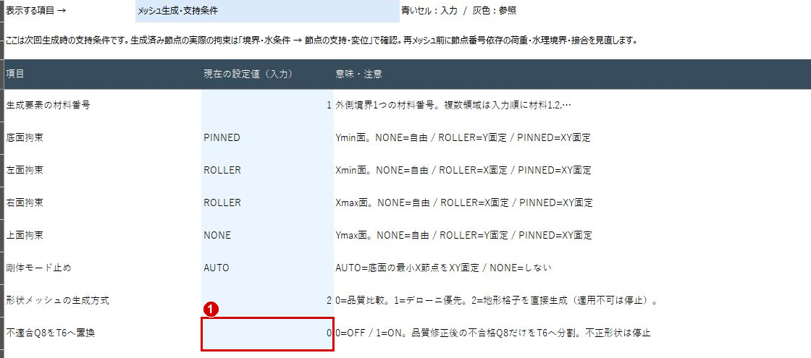

図7-T6　「モデル → メッシュ生成・支持条件」。①不適合Q8をT6へ置換する0/1。詳細表では「メッシュ設定」C30です。

解析前の図ではT6を緑の輪郭で表示し、「要素データ」K列で形式を確認します。連成ではQ8変位/Q4圧力、T6変位/P1圧力を使い、共通辺の端点と中間節点を接続します。T6の水理辺は1・2・4、3は縮退辺です。再メッシュ後は支持・載荷・水理境界・接合を再確認します。要素数が増えるので計算時間も比較します。

曲線T6、混在後の適応再分割・SMOOTH候補は対象外です。円形境界は直線辺による多角形近似です。手編集した直線辺の部分重複接続（hanging node）は拒否します。RESET_STRESSでT6の辺中点条件が失われる場合も、座標・履歴を更新する前に停止します。7 Q8＋2 T6、44節点の圧密・保存再開では全変位・応力・反力・残差の照合に合格しています。[混在要素の設定と検証](../MESH_MIXED_T6_VALIDATION.md)。

### 7.2 Mohr–Coulombの強度と弾完全塑性

地盤の強度はMohr–Coulombの強度線 τf＝c＋σn·tanφ で表します（σnは圧縮を正とした法線応力）。積分点の応力がこの線（降伏面 f＝0）に達するまでは弾性（E・ν）で、達すると塑性ひずみが生じ、応力は降伏面上にとどまります。本ソフトは硬化・軟化のない**弾完全塑性**で、降伏後に強度が上がったり下がったりはしません。

図41 弾完全塑性の模式図。降伏後は強度一定。除荷は弾性で、塑性ひずみが残ります。

|記号|入力列|意味|
|---|---|---|
|c|G列（粘着力、kN/m²）|強度線の切片。σn＝0でのせん断強度|
|φ|F列（内部摩擦角、°）|強度線の傾き。拘束圧が大きいほど強くなる割合|
|ψ|H列（ダイレタンシー角、°）|塑性変形の向き（体積の増え方）。強度ではありません（7.3）|

> **解説　「降伏した積分点」の数え方**
>
> 結果要素の降伏関数 f は、応力が降伏面上にあるとき0、内側にあるとき負です。塑性修正した点は計算の丸めで f が約−10⁻¹⁵ kPaになるため、本書では f ≥ −10⁻⁹ kPa の点を「降伏した積分点」と数えます（解析例11・11-B）。

### 7.3 関連流れ・非関連流れとダイレイタンシー

塑性ひずみの**向き**は、強度を決める降伏面 f とは別の関数（塑性ポテンシャル g）で決まります。g を f と同じにする（Mohr–Coulombでは ψ＝φ）のが**関連流れ**、変えるのが**非関連流れ**です。ψは、せん断したときに体積がどれだけ膨らむか（ダイレイタンシー）を表します。ψ＝φの関連流れは実際の土より体積膨張を大きく見積もるため、地盤ではψをφより小さく（本書の例ではψ＝0）とする非関連流れがよく使われます。

図42 (a) 降伏面と塑性ひずみの向き。関連流れ（ψ＝φ）は降伏面の法線方向、ψ＝0では法線応力方向の成分がなくせん断方向だけになります。(b) ψ＞0ではせん断で体積が増え、ψ＝0では体積が変わりません。どちらも模式図で、矢印の長さは塑性ひずみの量を表しません。

本ソフトは「解析・保存 → 解析・SRM」D9（非関連の扱い、FLOW_POLICY）で、非関連流れの扱い方を次の2つから選びます。

|C10|処理（`FEMEngine.bas`）|特徴|
|---|---|---|
|INCONSISTENT（配布値）|低減後の c・φ・ψ をそのまま材料計算に渡し、φ≠ψの非関連流れを直接解きます|剛性行列が非対称になり、Fsの限界近くで反復が長くなることがあります|
|DAVIS|JOINT以外の連続体に**Davis換算**をかけ、等価な関連流れ（ψ*＝φ*）として解きます|対称で収束しやすい一方、強度そのものが換算後の値に下がります。INCONSISTENTと同じ構成則ではありません|

Davis換算は、β＝cosψ·cosφ／(1−sinφ·sinψ)、c*＝β·c、φ*＝atan(β·tanφ)、ψ*＝φ*です（φ＝ψのときは換算しません）。例：φ＝28°、c＝15 kPa、ψ＝0°では β＝0.8829、c*＝13.24 kPa、φ*＝ψ*＝25.15°となり、**Fs＝1の状態から**INCONSISTENTより弱い材料で計算します。I列＝0の材料（SRMで低減しない）にもDavis換算はかかります。JOINTにはかかりません。

> **解説　どちらを使うか**
>
> 2つの流れ則でFs・変位・反復回数・計算時間が違っても、それだけで計算の誤りとは言えません。解析例7（第4章の斜面）では、INCONSISTENTが2.625〜2.638、DAVISが2.700〜2.713でした。比べるときは、流れ則以外の条件（メッシュ・材料・ψの扱い・収束設定）をそろえます。収束しやすくするために残差の許容値や反復上限を緩めて、Fsを合わせることはしません。

> **解説　流れ則はモデルの選択**
>
> - 流れ則は、土のモデルとして何を仮定するかの選択です。計算時間だけを理由に入れ替えません。入れ替えるときは、強度の低減とψの扱いがどう変わるかを確かめます。
> - φ＝ψ＝0の材料（非排水の全応力解析で、cを非排水せん断強度cuとして入れる場合）では、関連流れと非関連流れの差はなくなります。DAVISでも換算は起きません（β＝1）。
> - 「材料データ」I列＝0（SRMで低減しない材料）でも、DAVISではJOINT以外の連続体にDavis換算がかかります。I列はSRMの低減の対象を決める列で、換算の対象を決める列ではありません。
> - DAVISは入力のc・φをそのままにψだけを関連に切り替えた計算ではありません。強度も換算されます。
> - 計算時間を比べるときは、節点・要素、材料、施工の順序、支持、荷重、出力、DLL、収束・SRMの条件をすべて同じにして、C10（FLOW_POLICY）だけを変えます。同じFsでの全変位と残差、最終のFs区間と停止の理由を並べて記録します。メッシュの違う計算の時間から、流れ則の速さを判断しません。

### 7.4 強度低減法（SRM）と安全率Fsの意味

SRMは、強度低減係数Fsで材料の強度を割り、その弱い材料でも釣合い計算が収束するかを試す方法です。I列＝1の材料に、次の低減をかけます。

|量|低減後の値|注意|
|---|---|---|
|粘着力|c_r＝c／Fs|—|
|摩擦角|φ_r＝atan(tanφ／Fs)|角度φそのものをFsで割るのではなく、**tanφ**を割ります|
|ダイレタンシー角|「解析・保存 → 解析・SRM」D14（ψの扱い）による|KEEP（配布値）＝入力のまま。CAP＝ψがφ_rを超えたらφ_rに制限（INCONSISTENTのとき）。REDUCE＝tanψもFsで割る。D14が空欄・未知の値のときの既定はCAPです|

図43 第4章の地盤（c＝10 kPa、φ＝30°）の強度線。Fsが大きいほど切片と傾きが下がります。Fs＝2.63は第4章の例の区間付近の値です。

Fsの探索は次の順に進みます（`P3RunStrengthReduction`）。

|段階|処理|
|---|---|
|①|Fs＝1から0.1刻みで上げ、各Fsで施工の先行工程を計算し直します（SRM_MODE＝REAPPLY）。SRMより前に有効な RESET_U・RESET_STRESS・MATSET があるときは、そのうち**最後の工程の直後に保存した状態**（起点）に戻し、起点より後の工程だけを低減した強度で計算し直します（`P3LastOriginIndex`）。起点の工程そのものと、それより前の施工は計算し直しません（下の解説と7.5の表）|
|②|最初に収束しなかったFsと、その直前に収束したFsで区間をつくり、中点を試す二分法で区間を狭めます|
|③|区間の幅が「解析設定」の許容幅（SRM_TOL）以下になったら終了。最後に収束したFsの状態を結果として残します|
|④|上限（SRM_FMAX、C15）まで収束したときは、それ以上は探しません（LOWER_BOUND：Fs≧上限）|

図44 解析例12の実記録（`examples/ex12_anchor_srm_logs_20261021/case_out/run.log`）。Fs＝1.0〜1.7は収束、1.8で非収束、その後1.75（非収束）・1.725（収束）・1.7375（非収束）と区間を狭め、12回の試行で1.725〜1.7375になりました。

> **解説　SRMで計算し直す範囲（起点）**
>
> SRMの各Fsの試行では、施工を最初から計算し直すとは限りません。SRMより前の有効な工程に RESET_U・RESET_STRESS・MATSET があると、最後のものが「起点」になります（`P3LastOriginIndex`）。MATSETの工程は物性を入れ替えた直後の状態を保存し（`P3CaptureReplayOrigin`）、各試行はこの状態に戻ってから（`P3RestoreReplayOrigin`）、起点より後のGRAVITY・BIRTH・DEATH・LOAD等だけを低減した強度で計算します。起点より前の施工（たとえば掘削の段階）は、元の強度で計算した結果がそのまま使われます。
>
> 例：解析例10（トンネル）は工程8がMATSETなので、Fsの各試行で計算し直すのは工程9（BIRTH）だけです。保存記録のrun.logでも、各試行（Fs＝1.0、1.1、1.2…）の中で動いているのは工程9だけです（`construction-evidence/20261020/tunnel10/run.log.gz`）。解析例8（SRMなし）のようにMATSETで材料を入れ替える施工のあとにSRMを追加すると、材料を入れ替える前の施工は低減した強度では計算し直されません。「全施工を低減した強度で計算したFs」とは意味が違うので、起点の位置を確認して読みます。

終了メッセージの読み方は次のとおりです（`P3PublishFos`）。

|表示|意味|
|---|---|
|NUMERICAL_BRACKET|収束したFs（FOS_PASS）と収束しなかったFs（FOS_FAIL）の区間が求まった。FOS_MIDはその中点|
|LOWER_BOUND|上限まで収束した。FsはFOS_PASS以上としか言えない|
|FIXED_FS_VERIFIED|C19（固定Fs）に正の値を入れ、そのFsだけを試して収束した。崩壊するFsを求めたわけではありません|

> **解説　Fsは「収束しなくなる境界」です**
>
> SRMのFsは、強度を下げていったとき**数値計算が収束しなくなる境界**として定義されます。非収束は「その強度（そのFs）の設定では、この計算で収束解が得られなかった」という数値計算上の事実です。すべり面がつながって釣合いが取れなくなった可能性を示しますが、反復上限・荷重の刻み・メッシュ・境界条件の影響も受けるので、それだけで物理的な崩壊とは断定しません。そのため、Fsは区間（成功〜失敗）で読み、すべり面の位置はせん断ひずみの図（最後に収束したFsの状態）で確かめます。SRMの最大変位は強度を下げた状態の値で、元の強度での変位ではありません。

> **解説　極限平衡法（分割法）との比較**
>
> 分割法（Fellenius・Bishopなど）も、安全率を「すべり面に沿ったせん断強度を何分の1にすると釣り合うか」で定義します。c／Fs、tanφ／Fsという低減の形はSRMと同じです。違いは、分割法がすべり面の形（円弧など）を仮定して力やモーメントの釣合いを取るのに対し、SRMはすべり面を仮定せず、応力とひずみの計算の結果として破壊領域が現れることです。均質な斜面では両者の値は近くなることが多く、解析例7の文献比較（Griffiths–Lane、Pruška）はこの関係を確かめたものです。ただし、メッシュ・流れ則・区間の幅で数％の差は出ます。

> **解説　途中のSRM（ゲート）**
>
> ONE_WAYでSRMの行が最後の有効工程でないときは、Fsを求めたあと、ステージD列の値（空欄・0以下なら1）以上かどうかを判定します。満たせば強度をFs＝1に戻して先行工程を計算し直し、次の工程へ進みます。満たさなければ「途中SRM：Fs＜必要」で止まります。D列は固定Fsの指定ではありません。時間連成では、受理した親状態の時刻・水圧を保持したSRM枝を作り、照査後は低減前の親状態へ戻って施工を継続します（第9章）。

> **解説　Fs区間と変位の読み方の補足**
>
> - Fs区間は、反復の上限や刻みの制約も含んだ「数値計算の収束の境界」です。厳密な力学の上界・下界や、設計の安全率を保証するものではありません。保存される結果は成功した側（下端）のFsの状態で、失敗した側の途中の変位ではありません。
> - Fsが1より小さく出たときは、元の強度（Fs＝1）の設定ではこの計算で収束解が得られなかったことを示します。「元の強度で安定」という意味にはなりません。物理的に崩壊するかどうかは、停止の原因（ログ）・メッシュ・境界条件・荷重の刻みを検討し、変位・せん断帯・塑性状態の図と合わせて推定します。
> - 粗いメッシュと細かいメッシュでFsが近くても、下端の状態の変位は大きく違うことがあります（φ＝0の斜面では、粗いメッシュの最大変位が細かいメッシュの10倍以上になった例があります）。Fsが一致したことから、変位やひずみの集中も一致すると判断しません。変位は、ひずみの集中・最後のFs・メッシュ・反復の経路と一緒に確かめます。
> - SRMの変位は強度を下げた状態の値です。小ひずみのモデルなので、大きな局所ひずみが出た例から実物の移動量を予測できるとは扱いません。
> - 強度線 τ＝c＋σ tanφ の図（図43）は、入力の値を式に入れた説明の図で、荷重−変位の曲線ではありません。c やφを増やせば、どの問題でも同じ割合でFsが上がる、という換算には使いません。

### 7.5 施工段階（ステージ）の考え方

施工段階の計算では、各工程の結果（変位・応力・塑性の履歴）を次の工程に引き継ぎます。同じ形状でも、施工の順番が違えば結果は変わります。

|種類（ステージB列）|考え方|
|---|---|
|GRAVITY|有効な要素の自重で初期の応力をつくります。自重だけで鉛直に支える条件では、鉛直反力の合計は Σ(断面積×γ×板厚)＝Σ(体積×γ) に一致します（m²×kN/m³×m＝kN。コードは積分点ごとに 面積×板厚＝体積 を求め、γを掛けて合計します）|
|BIRTH|材料をONにして追加します（盛土・擁壁・支保の施工）。追加した要素は応力・塑性履歴0の状態から計算を始め、自重を受け持ちます|
|DEATH|材料をOFFにして取り除きます（掘削）。取り除いた要素が負担していた力が、残る地盤に解放されます|
|MATSET|材料の物性を別の材料番号の値に入れ替えます。OFFの要素に使うと、履歴のない状態で埋め戻し材に変えられます（解析例8）。入れ替えた直後の状態は、後のSRMの起点として保存されます（下の表）|
|RESET_U|変位・応力・塑性履歴を0にします（座標はそのまま）。強度もFs＝1に戻します。この直後の状態は、後のSRMの起点として保存されます|
|RESET_STRESS|変形後の座標を新しい基準にしてから、変位・応力・塑性履歴を0にします。この直後の状態も、後のSRMの起点になります|
|LOAD・APPLY／UNLOAD|載荷表の荷重・強制変位を加える／外す|
|SRM|それまでの工程を前提にFsを求めます（7.4）。各Fsの試行で、起点（最後のRESET_U・RESET_STRESS・MATSET。なければ最初）より後の工程を、低減した強度で計算し直します|

> **解説　結果をそのまま積み重ねる**
>
> 「節点の変位」は最初の工程（GRAVITY）からの累積です（例外：RESET_U・RESET_STRESSを使うと、その工程で変位が0になり、以後はその状態からの累積になります。7.8「RESETの後の全ひずみと増分」）。工程ごとの増分は「結果増分」で、施工による沈下は「ux−ux0、uy−uy0」のように差を取って読みます。自重による変位を0にしたいときも、応力の履歴を消すRESET_U・RESET_STRESSを使う必要はありません。差を取れば済みます。

**SRMで計算し直す工程（起点）のまとめ**（`FEMEngine.bas` の `P3LastOriginIndex`・`P3CaptureReplayOrigin`・`P3RestoreReplayOrigin`）

|SRMより前の工程|SRMの各Fsの試行で計算し直す工程|計算し直さない工程|
|---|---|---|
|RESET_U・RESET_STRESS・MATSETがない|最初の工程からSRMの直前までのすべての工程（GRAVITY・BIRTH・DEATH・LOAD等）|－|
|ある（複数あれば最後のもの＝起点）|起点より後の GRAVITY・BIRTH・DEATH・LOAD・UNLOAD 等|起点とそれより前の工程（元の強度で計算した結果を使う）。起点より後にある別のSRMも再実行しない|

各試行は、起点の工程の直後に保存した状態（変位・応力・塑性履歴・材料）に戻ってから計算を始めます。起点の状態がないと「SRM replay originがありません」の誤りで止まります。例：解析例10（工程8がMATSET）では、各試行で計算し直すのは工程9だけです。解析例4・8のようにRESETやMATSETを使う施工のあとにSRMを追加するときも、起点の位置を確かめて「どの工程までが元の強度か」を記録します。

### 7.6 接合要素（JOINT）

接合要素は、材料の境目（ブロックの底面、擁壁と地盤の間など）に置く**厚さ0の6節点要素**で、境目のすべりと開口を表します。「接合」シートで材料Aと材料Bの共有辺を指定すると、B側の節点を複製して要素を作ります。

図45 (a) 節点の並び（A側：端点1・端点2・中点3、B側：端点4・端点5・中点6）。応力は辺に沿った3つの積分点で計算します。(b) せん断応力はすべり量×Ksで、上限 τmax＝c＋max(σn,0)·tanφ で頭打ちになります。(c) 法線応力は σn＝−Kn×gap（圧縮正）。M＝0のときは開口すると剥離して応力0になります。値は模式例（c＝5 kPa、φ＝20°）。

|入力（材料データ）|意味|単位|
|---|---|---|
|B列（Kn）|法線方向のばね剛性（法線応力／開口量）|kN/m³|
|L列（Ks）|せん断方向のばね剛性（せん断応力／すべり量）|kN/m³|
|F列（φ）・G列（c）|接合面のCoulomb摩擦の摩擦角と粘着力|°・kN/m²|
|H列（ψ）|0にします|°|
|M列（引張許容）|1＝開口しても剥離に切り替えず引張を負担、0＝開口したら剥離|－|

計算の手順（`FEMEngine.bas` の接合要素ルーチン）は次のとおりです。

|手順|式・判定|
|---|---|
|①|A側とB側の相対変位から、開口量 gap（法線方向、＞0で開く）とすべり量（接線方向）を求めます|
|②|内部の法線力 fn＝Kn×gap（引張正）。表示する法線応力は σn＝−fn（圧縮正）|
|③|M＝0で gap＞0 なら**剥離**（接触状態1）。法線・せん断とも応力0、剛性0|
|④|それ以外は τmax＝c＋max(σn,0)·tanφ。|Ks×すべり量|＞τmax なら**すべり**（状態2、せん断応力＝±τmax、せん断剛性0）、以内なら**密着**（状態0）|

> **解説　接合要素を使うとき・剛性の決め方**
>
> 境目に沿ったすべりや浮き上がりが結果を左右する問題（ブロックの滑動、擁壁底面のすべり、構造物と地盤の剥離）に使います。境目が一体として動く場合は、共有節点でつなぐだけで十分です（解析例9の擁壁は接合なし）。
>
> KnとKsは「応力／相対変位」の単位（kN/m³）で、連続体のEとは次元が違います。小さすぎると密着していても境目が大きく変形し、大きすぎると剛性行列の条件が悪くなり収束しにくくなります。隣接する要素の E／要素寸法 と同じ桁を目安に置き、結果（反力・すべりの範囲）が剛性を変えてもあまり変わらないことを確かめます。解析例11は Kn＝Ks＝100000 kN/m³（地盤 E＝20000 kN/m²、要素寸法1 m）です。
>
> この接合は**履歴を持たない応力上限モデル**です。すべり量は全相対変位で、塑性すべりを累積しません。荷重を戻したときの残留すべりなど、履歴の効く問題には使えません。また、摩擦は圧縮側（σn＞0）だけが受け持ち、引張の点（M＝1で開口した点）は c だけで抵抗します。

### 7.7 荷重増分・反復・収束

1つの工程の荷重（自重・載荷・掘削の解放力）は、一度にかけずに荷重係数λを0から1まで少しずつ増やしてかけます。λを進める1回分が**増分**、その増分の中で釣合い（外力と内力の差＝残差）が許容値以下になるまで剛性を更新して解き直すのが**反復**（Newton法）です。反復の上限内に収束しなければ、その増分は不採用になり、幅を縮めて試し直します（カットバック）。幅が最小値まで縮んでも収束しなければ、その工程は非収束（NONCONVERGED）です。

図46 解析例12のSRM記録（`examples/ex12_anchor_srm_logs_20261021/case_out/increment_summary.csv`）の工程1（GRAVITY、強度を低減した状態での再計算）。Fs＝1.70では途中で5回不採用になったあとλ＝1まで進みました。Fs＝1.80ではλ≒0.929で反復上限（100回）と線探索の失敗を繰り返し、増分が最小幅まで縮んで非収束になりました。この非収束がFs区間の「失敗」側です。

> **解説　残差が小さいことと、結果が正しいことは別です**
>
> 残差は外力と内力の不釣合いの大きさで、収束したかどうかの判定に使います。残差が小さくても、拘束・材料・単位・荷重の入れ方が意図どおりとは限りません。逆に、変位が大きいだけで計算失敗とは決められません。収束の判定（PASS／FAIL）と、反力の合計・変位の向き・せん断ひずみの分布といった力学的な確認は、分けて行います。

### 7.8 せん断帯の見方

SRMや載荷の結果図では、せん断ひずみが帯のように集まる部分（せん断帯）が見えます。せん断帯は「どこでひずみが集中し、どの範囲が一緒に動こうとしているか」を読み、破壊の機構（破壊の形）を推定する参考にする図です。この節では、増分図の色と塑性主ひずみ増分のクロスの読み方、全ひずみ図との違い、メッシュの影響、極限平衡法のすべり面との比べ方をまとめます。

#### 色が表すもの

増分図（第11章「増分図を読む」）の色は次の量です。

|項目|内容|
|---|---|
|量|最大工学せん断ひずみ増分（3次元、平面ひずみの面外成分0を含む主値の最大−最小）|
|いつの増分か|**最後に収束した荷重増分1回分**。収束しなかった試行（SRMで非収束になったFs）の値ではありません|
|累積か|累積ではありません。その増分の開始時から収束時までの変位の差ΔuからB×Δuで求めた量です|
|要素の値|要素の4積分点の最大値（4GP最大）。等値線（A）は4点最大値を共有する隅節点で平均し、線形に補間して描きます|
|SRMの場合|最後に成功したFsの最終増分。表の「Fs」（R列）、「荷重増分番号」（S列）、「荷重係数」（T列）で、どの状態の図かを確かめます|

「結果増分」シートのM列が最大工学せん断ひずみ増分、N列が最大塑性工学せん断ひずみ増分、O・P列が面内塑性主ひずみ増分の最大・最小、Q列が最大主軸の角度です（列の一覧は第11章）。

これに対して「最大せん断ひずみ」（累積）の図は、保存された全変位から計算した量です（結果を書き出すときに、各要素で 全変位×B（`CalcStrain`、`TDisp`）を計算します）。自重による変形や施工の履歴を含むので、破壊の形よりも「それまでにどれだけ変形したか」を表します。せん断帯を読むときは、まず増分図を見て、全ひずみ図は補助に使います。

#### RESETの後の全ひずみと増分

全ひずみ（累積）が「最初の工程から」にならない例外が、RESET_U・RESET_STRESSです（`FEMEngine.bas` の `P3ResetKinematicState`・`P3ZeroTrialKinematics`）。

|項目|RESET_U・RESET_STRESSの後|
|---|---|
|全変位・全ひずみ（累積）|RESETの工程で全変位を0にするので、以後の累積の変位とひずみはRESETの状態から数えます。RESETより前の変形は含みません。RESET_STRESSでは、さらに変形後の座標が新しい基準の形になります（B行列も作り直します）|
|応力・塑性履歴|0になります（強度もFs＝1に戻ります）|
|増分（「結果増分」）|RESETの工程で増分のデータを消します。RESETの後の工程を計算すると、その工程の最後に収束した増分が新しく記録されます。RESETが最後の工程のとき（または工程ごとの出力でRESETの工程の行）は増分がなく、「結果増分」は「増分結果なし」になり、増分図は描けません|
|SRM|RESETの直後の状態が起点になります（7.5）|

施工の全体の変形を見たいときにRESETを使うと、RESETより前の変形が全ひずみ図から消えます。施工の途中から差を取りたいだけなら、RESETではなく変位の差（ux−ux0）を使います（7.5の解説）。

#### 等値線と塑性主ひずみ増分のクロス

|表示|読み方|
|---|---|
|色・等値線（A）|ひずみ増分が集まる場所と、その連なり（帯の向き）。等値線は最大値の25・50・75%で描くので、帯の「芯」と広がりが分かります|
|クロス（塑性主ひずみ増分）|**最後に収束した荷重増分1回分の、塑性ひずみ増分の向き（塑性流れの方向）**を示します。要素ごとに1つで、積分点ごとではありません。要素の4積分点の塑性ひずみ増分（εx・εy・γxy）を平均した値の主軸を、要素の中心（4隅の平均の位置）に描きます（`FEMIncrementRead`・`FEMIncrementCross`）。青が圧縮（縮む向き）、赤が引張（伸びる向き）で、長さは図全体の最大値に対する割合です。**弾性か降伏かを判定する表示ではありません**（下の「クロスが描かれない条件」と「弾性か降伏かを確かめる」）|
|両者の関係|色が大きく、しかもクロスが並んでいる部分は、最後の増分でひずみが集まり、そこで塑性ひずみ増分が生じている帯です。クロスがないことから「弾性」とは判断しません|

クロスの軸の傾きは、180°回しても同じ向きを表します。引張か圧縮かは色で読みます。帯の方向は、圧縮と引張の主軸のおおむね間の向きです。関連流れ（ψ＝φ）と非関連流れ（ψ＜φ）では、同じ帯でもクロスの比率（体積が増えるか）が変わります（7.3）。

#### クロスが描かれない条件（VBAの作図の条件）

クロスは、次の条件を満たすときだけ描かれます（`FEMViewer.bas`、`FEMIncrementSvg.bas` の `FEMIncrementOverlaySvg`・`FEMIncrementCross`・`FEMIncrementAxis`）。

|条件|内容|
|---|---|
|表示の設定|「出力・表示」29行のチェック（塑性主ひずみ増分クロス、J29）がONのとき|
|図全体|全要素の中で、平均した塑性ひずみ増分の主値の絶対値の最大 maxP が0より大きいとき。maxP＝0なら、1本も描かれません|
|要素ごと|その要素の主値 p（最大・最小の2本それぞれ）が0でなく、線の長さ h×│p│/maxP が10⁻⁶より大きいとき（h＝min(0.3ℓ, 12 px)×D19倍率。ℓは描画座標（px）上で、増分図の対象の各要素の最短辺（正の値）を全要素で平均した値。hは全要素で共通の1つの値で、h×│p│/maxP は要素の中心から片側の長さ。クロス全体の長さはその2倍。実長mではなく、別の図の間で長さを比べる尺度でもありません）|
|対象の要素|有効な連続体の要素だけ（無効な要素・JOINTには描きません）|

したがって、クロスがない（または見えないほど短い）要素は、次のどれかです。どれなのかは、クロスの図だけでは区別できません。

- 最後に収束した増分で、その要素の4点とも塑性ひずみ増分が0だった（弾性のまま、除荷して弾性に戻った、または前の増分・前の工程までに降伏していて最後の増分では塑性ひずみが増えなかった）。
- 最後の増分でその要素の変位が変わらず、塑性ひずみ増分を0として記録した（`FEMIncrementCapture` の局所変位0の判定）。
- 4点を平均したため、値が小さくなった（一部の点だけ塑性ひずみが生じた要素や、点ごとに向きが違って打ち消し合う要素）。
- ほかの要素よりずっと小さく、図の上で短すぎる（長さは図全体の最大値に対する割合）。

保存した計算で確かめた例：解析例2（Fs＝1.5125の最終状態、330要素）では、降伏した積分点（f ≥ −10⁻⁹ kPa）を含む要素が168個、クロスが0でない要素も168個で一致しました。ただし、そのうち110個は長さが最大の5%未満で、図ではほとんど見えません。また、それまでの増分で塑性ひずみが生じていたのに、最終状態で降伏点がなくクロスも0の要素が29個ありました。解析例12のSRM（580要素）では、それぞれ109個・109個、74個、254個でした（`case_out/stg*_SRM/gauss.csv`・`plastic_cumulative.csv` から集計）。クロスがないことは「弾性」を意味しません。

#### 弾性か降伏かを確かめる

弾性か降伏かは、クロスではなく、「結果 → 表示設定」D9の**塑性状態**の色図で確かめます（20261022版で追加）。それまでに生じた塑性ひずみの大きさは、**累積塑性せん断ひずみ**の色図で見ます。どちらも、20261022版で最初から解析した結果（シート「結果塑性」）を使います。旧版で計算した結果のままでは描けません（「この結果には塑性状態の保存がありません」と表示されます）。

**手順1　塑性状態の色図を描く**

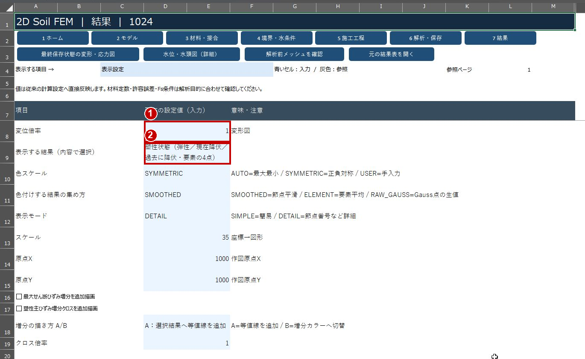

図47 「結果 → 表示設定」。②D9で塑性状態を内容名から選び、上部の「最終保存状態の変形・応力図」で表示します。

|番号|セル|入力するもの|単位|例|
|---|---|---|---|---|
|②|「結果 → 表示設定」D9|塑性状態（弾性／現在降伏／過去に降伏・要素の4点）|－|（左の名前を一覧から選ぶ）|

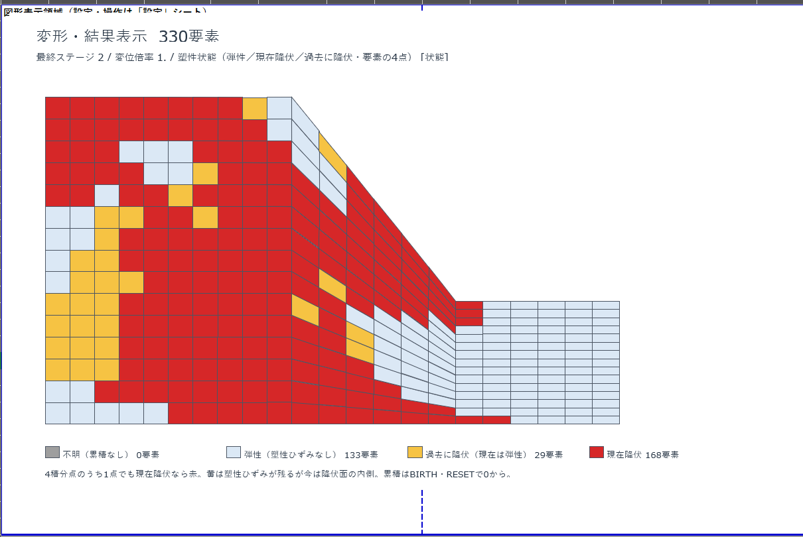

図48 解析例2の最後に成功したFs＝1.5125の状態。下の凡例に、色ごとの要素数が出ます（この例では 現在降伏 168要素・過去に降伏 29要素・弾性 133要素）。

|色|意味|判定（積分点ごと→要素）|
|---|---|---|
|赤|現在降伏|表示している状態で、4積分点のうち1点以上が降伏面上（f ≥ −10⁻⁹ kPa。塑性点の数え方と同じ判定。7.2）|
|黄|過去に降伏（現在は弾性）|いまは4点とも降伏面の内側だが、BIRTH・RESET以降に塑性ひずみが生じた点がある|
|淡い青|現在は弾性、記録範囲内で塑性履歴なし|4点とも現在降伏しておらず、保存した範囲で塑性ひずみを観測していない。再開前も未塑性かどうかはM列の範囲で確認|
|灰|累積記録なし|累積記録を読み出せない状態。再開しただけで必ず灰になるわけではない|

「結果塑性」M列がFROM_ZERO_STATEなら基準状態からの累積、PARTIAL_FROM_RESUMEなら再開後だけの累積です。後者の淡青色は、再開前に塑性化していなかったことを示しません。累積色図の白や数値0も、成分の相殺や記録範囲を含む値なので、過去の塑性履歴なしという判定と区別します。現在降伏の有無、L列の状態、M列の範囲を一緒に確認します。

赤の要素が帯のようにつながっていれば、その範囲が最後の状態で降伏しています。黄は、途中で降伏したあと除荷された（応力が降伏面の内側に戻った）場所です。1要素の色は4点の要約なので、点ごとの状態は「結果塑性」シートで確かめます。

**手順2　累積塑性せん断ひずみの色図を描く**

「結果 → 表示設定」D9で「累積塑性せん断ひずみ（4点最大）」を選び、同じボタンで描きます。

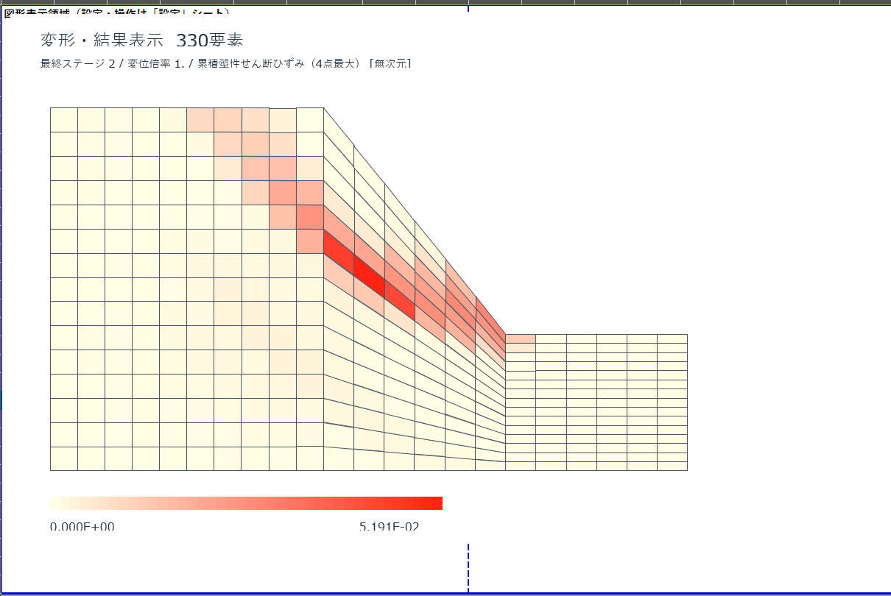

図49 解析例2の累積塑性せん断ひずみ（要素の4点の最大）。白は累積テンソルの最大工学せん断ひずみ0、赤いほど大きく、範囲は0〜5.191×10⁻²です。累積の塑性ひずみの各成分を足し合わせたテンソルから求めた最大工学せん断ひずみ（3D）で、BIRTH・RESET_U・RESET_STRESSで0から数え直します。SRMでは最後に成功したFsの試行の値です。

**数値で確かめる（補助）**

|確かめたいこと|使うもの|
|---|---|
|積分点ごとの状態・累積値|シート「結果塑性」：D列 降伏関数f、E列 現在降伏(1/0)、F〜I列 累積塑性ひずみ、J列 累積塑性乗数、K列 累積最大塑性工学せん断ひずみ、L列 状態（2・1・0・−1）、M列 累積の範囲（FROM_ZERO_STATE＝最初から数えた値、PARTIAL_FROM_RESUME＝再開以後だけ、NONE＝記録なし）|
|fの値そのもの|「結果 → 表示設定」D9の「降伏関数（積分点1）」〜「降伏関数（積分点4）」の色図（f＝0が降伏面上、f＜0が弾性）、「結果要素」の各積分点の降伏関数の列|
|最後の増分で塑性ひずみが増えた場所|「結果 → 表示設定」D9の「最大塑性せん断ひずみ増分（最終収束増分・4点最大）」、「結果増分」N列|
|工程ごとの累積の記録|ブック横の `ブック名_out` の `stg*/plastic_cumulative.csv`|

解析例2では、「結果塑性」で現在降伏の要素は168、「結果要素」の降伏関数で降伏点を持つ要素も168個で一致しました（2026-10-22の保存結果）。20261021版と20261022版で同じブックを計算し直し、「ステージ結果」「結果要素」「結果節点」の全セルが一致することも確かめました（Fs区間 1.5125〜1.525）。頂点での塑性乗数はψ>0で−(Δεpx＋Δεpy＋Δεpz)/(2sinψ)、ψ=0では非負乗数の最小和です。06以前の頂点の値（ひずみノルム）とは直接比較しません。累積塑性せん断ひずみの定義は共通です。

#### 剛体のような動きとせん断ひずみの集中を分ける

ひずみは変位の「場所による違い」（変位の勾配）から求めます（ひずみ＝B×変位）。土塊がまとまって平行に動く（剛体の移動）ときは、変位が大きくてもひずみはほぼ0です（小ひずみの計算なので、回転が小さい範囲で成り立ちます）。

|図|分かること|
|---|---|
|変形図・変位（「結果節点」、変位倍率）|どこが、どの向きに、どれだけ動いたか。すべる土塊は全体が大きく動いて見えます|
|ひずみの色・等値線（全ひずみ・増分）|どこで変位が急に変わるか。すべる土塊と動かない地盤の**境目**（せん断帯）に集まり、土塊の内側は小さく出ます|

たとえば斜面のすべりでは、変形図では土塊全体が大きく動き、ひずみ図では土塊の下の境目だけが帯になります。変位が大きい場所をそのまま「せん断帯」とは読みません。逆に、ひずみが大きくても変位が小さい場所（基礎の角の直下など）もあります。破壊の形は「大きく動く範囲（変形図）」と「その境目のひずみの帯（ひずみ図）」の両方で読みます。

#### 最終収束Fsの帯を機構推定の参考として読む

SRMでは、Fsを上げるにつれて変形が一つの帯に集まり、収束解が得られなくなったところで計算が止まります。最後に成功したFsの最終増分の図は、「その次のFsでは数値計算が収束しなかった」直前の状態です。これを機構推定の参考として読み、物理的な破壊の形と断定はしません。停止の原因（ログ）・メッシュ・境界条件を検討し、変位・せん断帯・塑性状態（7.8「弾性か降伏かを確かめる」）の図と合わせて読みます。

図49-A 解析例9（擁壁、DAVIS）の最後に成功したFs＝1.7000の最終増分（荷重増分120、荷重係数1）。色は最大工学せん断ひずみ増分、クロスは塑性主ひずみ増分、変形倍率は1です（保存記録 `construction-evidence/20261020/wall_davis08/`）。

図49-Aでは、擁壁のつま先（X≒19 m、Y≒0 m）から前面の斜面を通って法尻（X≒26 m、Y≒−3 m）に抜ける帯と、背面の盛土側（X≒12〜18 m、Y≒0〜3 m）に向かう帯がつながっています。さらに擁壁の下の地盤（X≒17〜20 m、Y≒−4〜−8 m）にも増分が分布しています。帯は**擁壁の近くだけでなく、前面の斜面と基礎の地盤の中を通っています**。擁壁の安定を読むときは、壁の周りの色だけでなく、帯が地盤のどこを通って地表に抜けるかを読みます。

読むときは、帯の図だけで判断せず、次の量と一緒に確かめます。

|一緒に読む量|確かめること|
|---|---|
|擁壁の変位（「結果節点」）|帯の向きと、擁壁が前へ出る・回転する・沈む向きが合っているか。最終増分の変位の向きと全変位の向きを比べます|
|反力（「ステージ結果」「結果節点」）|全体の反力が荷重と釣り合っているか（7.5）。帯が拘束の近くに当たっていないか|
|Fs区間と収束（「ステージ結果」）|帯の図が「最後に成功したFs」の状態か。区間の幅が粗すぎないか（7.4）|
|塑性点（「結果要素」の降伏状態）|帯に沿って降伏点がつながっているか。帯から離れて孤立した降伏点は、局所の応力集中のことがあります|

#### メッシュの影響

せん断帯の幅は、要素の大きさに左右されます。弾完全塑性のモデルには長さの尺度がないため、帯は数値計算上、要素の大きさ程度の幅に集まりやすくなります。

図50 保存済みの斜面SRM（Griffiths φ＝20°、c＝10 kPa、γ＝20 kN/m³、高さ10 m・勾配1:2）の最後に成功したFsの状態。色は全変位から求めた面内最大せん断ひずみ（増分ではありません）、要素の4点の最大値です。(a) 200要素、Fs＝1.3500、(b) 450要素、Fs＝1.3375。破線は同じ条件でBishop簡易法により探した臨界円（Fs＝1.38、下端が下の固定面に接する円）です（作図 `images/theory/make_band_figs.py`、データ `docs/inconsistent-evidence24/`）。

図50の(a)と(b)では、帯の通る位置はほぼ同じですが、細かいメッシュの方が帯は細く、ひずみの値も変わります。Fsも1.3500と1.3375で少し違います。このため、

- 帯の**位置と形**（どこから入りどこへ抜けるか）は、メッシュを変えても安定しているかを確かめてから読みます。
- 帯の**幅**とひずみの**値**は、メッシュで変わります。帯の幅を土の性質（せん断帯の厚さ）として読むことはできません。
- 帯が要素のつぶれた部分や縦横比の大きい部分を通るときは、メッシュの形の影響を疑います（第14章のNG例）。

#### 極限平衡法のすべり面と比べる

図50の破線のように、極限平衡法の臨界すべり面とSRMの帯は、通る位置もFsも近くなることが多いです（この例ではFs 1.34〜1.35に対し1.38）。比べるときは次に注意します。

- 極限平衡法はすべり面の形（円弧など）を先に仮定し、Fsが最小になる面を探します。SRMはすべり面を仮定せず、変形が集まった結果として帯が現れます。形が円弧から外れる（擁壁や硬い層に沿って折れる）ときは、SRMの帯の方が実際の条件を反映していることがあります。
- 帯は幅を持つので、すべり面の「線」とは帯の芯（等値線の75%付近）を比べます。
- Fsの値は定義も計算方法も違うので、完全には一致しません。違いが大きいときは、材料定数・水の扱い・流れ則（7.3）・Fs区間の幅（7.4）・メッシュを確かめます。

#### 支持力の例

図51 解析例13の水平地盤（左）と斜面（右）に、細かいメッシュで追加沈下50 mmを与えた最終荷重増分。上段はY方向応力（4点平均）、下段は最大工学せん断ひずみ増分と塑性主ひずみ増分のクロス（保存記録 `construction-evidence/20261021/bearing_*_fine_s050000_workbook.zip`）。

図51の下段では、基礎の両端（X≒1 m、3 m）から下に向かってくさび状に帯が延び、基礎の下で閉じています。基礎の下の土が押し込まれる形です。斜面側（右）でも、この沈下量では帯は基礎の直下に閉じていて、斜面の法面まで抜けていません。帯が地表まで抜ける（全体破壊の形）か、基礎の下で閉じる（局所の押し込み）かは、沈下量と地盤の条件で変わります。載荷の途中の形であることを、荷重−沈下の関係と一緒に読みます（第11章）。

#### せん断帯の図だけで決めないこと

> **解説　帯の図から決めてはいけないもの**
>
> - **帯の幅**：メッシュで変わる数値上の幅です。土の性質ではありません。
> - **部材の破壊**：帯が擁壁やアンカーの近くを通っても、部材が壊れることを示すものではありません。部材の照査は、断面力（第21章）を別の方法で行います。この説明書の例では擁壁を線形弾性として扱っています。
> - **設計の安全率**：Fsは、収束した境界の区間です（7.4）。帯の形がもっともらしくても、Fsの値の妥当性は、材料定数・メッシュ・区間の幅・荷重の条件を確かめて判断します。
> - **非収束の状態**：非収束の試行の状態は、結果図にも「結果増分」にも使われません。図はつねに「最後に収束した状態」です。

## 8. 水条件と定常浸透（入力・出力の共通操作）

水条件は「境界・水条件」の項目選択で入力します。工程中の水位変更は「施工工程」のWATER行に指定します。

### 8.1 目的

[水条件の実計算ブック集](examples/water_display_examples.zip)を展開します。`cutoff`（水位差・遮水構造体）、`box_inside`（空洞内水と浮力）、`one_way`（工程ごとの水位変更）、`joint`（接合面水圧）、`wet_srm_INCONSISTENT`・`wet_srm_DAVIS`（同条件の湿潤斜面SRM）、`fixed13`（固定Fs=1.3）の各フォルダーを使います。再計算時はZIP直下のDLL1個を、開くXLSMの隣へコピーしてください。

水条件を指定した地盤・構造物の解析では、入力した水位線から静水圧を作る方法と、地盤内の全水頭を解いて定常浸透場を作る方法を選べます。計算した水圧は力学解析へ一方向に渡し、応力・変位・塑性・SRMを通常の施工工程として解きます。

この章では、「水条件」シートの入力、計算前の水圧確認、結果の読み方、WATER工程、保存再開、浮力と空洞内水位の扱いを説明します。入力例は[入力・結果を保存した実計算ブック](https://github.com/tak063495-prog/excel-vba-soil-fem/raw/main/docs/manuals/examples/groundwater_examples.zip)で再現できます。既存の解析例と同様、まず配布例を展開し、材料・水位線・境界の表と計算済み結果を確認してから、自分の形状へ置き換えてください。

水条件の具体的な計算例は、解析例14～18（第27～31章）にまとめています。折れ線水位、遮水構造体、空洞内水、施工とSRM、接合面水圧の順に確認できます。

### 8.2 対象と条件

対象は平面ひずみのQ8/T6要素、飽和・定常・等方一定透水係数の浸透場です。STEADYでは全水頭を未知量として

`q = -K grad(h)、div(q) = 0`

を解き、受理した水頭から `p=γw(h-y)` を計算します。このONE_WAY経路は時間を解かず、圧密による過剰水圧の消散は第9章のFIXED_STRESSで扱います。不飽和・未知自由水面・浸出面の計算は行いません。各連結領域には固定水頭境界が必要です。

水条件は次の3モードです。初期値はNONEで、既存の入力例へ自動で水位を加えません。

|モード|内容|使う条件|
|---|---|---|
|NONE|水圧場を使わない従来解析|乾燥条件、比較用|
|HYDROSTATIC|水位線から `p=γw max(水位-y,0)` を直接作る|静水圧、外水圧、内水位、浮力|
|STEADY|水頭を解いて水圧を作る|透水地盤、遮水構造、左右水位差、cutoff|

SOILの応力基準は`EFFECTIVE`または`TOTAL`を材料ごとに指定します。EFFECTIVEでは材料更新時に受理済み水圧を全応力から差し引き、今回の水圧を全応力へ戻します。TOTALでは水圧を材料評価から差し引きません。材料の単位体積重量は入力した全重量を使い、飽和域の重量を水中重量へ自動変更しません。浮力を別の荷重として追加しないでください。構造物・STRUCTはTOTALです。

材料試験・設計で採用した強度定数の基準と、「水条件」G列の応力基準を一致させます。水位の有無だけで切り替えません。

|手元の強度定数・材料|「水条件」G列|材料評価|
|---|---|---|
|有効応力基準のc′・φ′を使うSOIL|EFFECTIVE|受理した水圧を差し引いた有効応力で強度を評価|
|全応力基準のc・φを使うSOIL|TOTAL|水圧を差し引かず、その全応力基準の強度を評価|
|線形弾性のSTRUCT|TOTAL|構造材料のE・νと全重量を使用|

飽和域には適切な飽和単位体積重量を「材料データ」E列へ入力します。水圧を与える解析でγを水中重量へ置き換えると、浮力の効果を二重に差し引くおそれがあります。水位を変えても入力γは自動で変わりません。水面上下で重量が異なる場合は材料領域を分けます。γ・c・φ・ψ・E・Kは調査・試験と設計条件から選び、例題値を推奨値として転用しません。湿潤状態のMATSETは未対応であり、水位に連動した工程別重量切替はできません。

### 8.3 水条件の入力

|画面の項目|青い入力欄|内容|
|---|---|---|
|境界・水条件 → 水条件の基本|B8:B11|方式、γw、既定水位線、外水圧|
|境界・水条件 → 水位線|A8:D207|ID、X、標高、説明|
|材料・接合 → 材料の水理特性|A8:E207|材料、応力基準、K、水位線、説明|
|境界・水条件 → 水理境界|A8:F207|要素、辺、種別、ID、水頭、説明|
|施工工程|G/H列|ONE_WAYとWATERの水位線|

元の詳細表「水条件」の対応は次のとおりです。通常は上表の7画面の入力欄を使います。

|セル|入力|意味|
|---|---|---|
|B3|NONE / HYDROSTATIC / STEADY|水条件モード|
|B4|γw [kN/m³]|水の単位体積重量。初期値9.80665|
|B5|水位線ID|既定の水位線|
|B6|AUTO / OFF|外周SOIL面への自動外水圧|

水位線表の`A12:D211`に、ID、X、標高、説明を入力します。同じIDのXは厳密に昇順にし、解析領域の左右端を覆います。水平水位なら左右端の2点、折れ線水位なら途中点も登録します。材料表`F12:J211`には、材料番号、応力基準、K [m/s]、水位線ID、説明を入力します。STEADYのSOILは正のK、遮水STRUCTは`TOTAL`かつK=0を明示します。水位線IDを`*`または空欄にすると、その工程で採用されたIDを継承します（WATER工程の優先順は8.5節）。

水理境界表は`A216:F415`です。要素番号、辺番号、境界種別、水位線ID、必要な全水頭、説明を入力します。辺は要素の反時計回りで、辺1=隅点1→2、辺2=2→3、辺3=3→4、辺4=4→1です。中央節点は辺の配分に使われます。

|種別|水理条件|力学上の扱い|
|---|---|---|
|HEAD|指定ID、またはE列の全水頭を固定|解析切断面用。自動外水圧を重ねない|
|EXPOSED|地盤の全面水没辺は指定水位の固定全水頭。STRUCTはK=0|指定水位の外水圧を圧力積分|
|NOFLOW|辺流量を0|水圧を0にする指定ではない|
|DRY|外水位境界を作らず流量0|自動外水圧も抑える|

`AUTO`は外周の上向きSOIL面にだけ外水圧を載せます。側面・下面の切断面、STRUCT外面、空洞内面は自動判定に任せず、EXPOSEDまたはDRYを明示します。土と構造の共有面へEXPOSEDを重ねると二重載荷防止で停止します。NOFLOWやSTRUCTは水圧ゼロを意味しません。

図8-1　「境界・水条件 → 水条件の基本」。①B8:B11で方式・γw・既定ID・外水圧を指定します。cutoffの条件です。

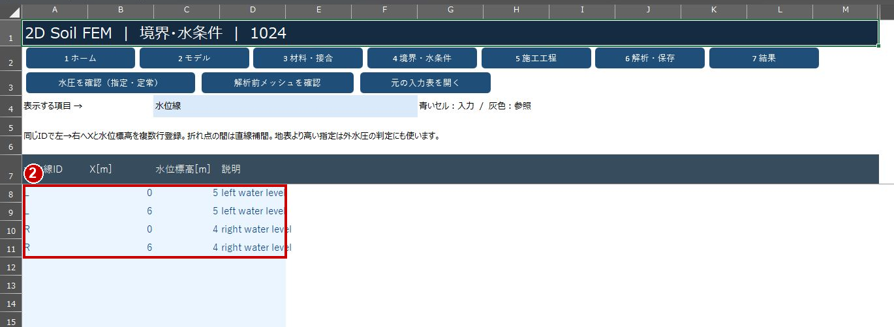

図8-1-B　「境界・水条件 → 水位線」。②同じIDのXと水位標高を左から右へ登録します。

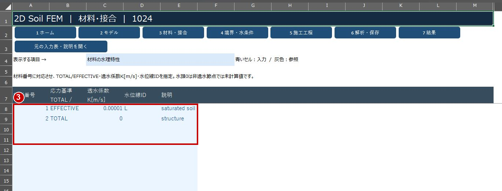

図8-1-C　「材料・接合 → 材料の水理特性」。③材料ごとにTOTAL/EFFECTIVE、透水係数K、水位線IDを入力します。

折れ線水位は「境界・水条件 → 水位線」A8:D207へ同じIDで途中点を追加します。横軸Xに対して標高が1つに決まる折れ線とし、同じXを重複させません。隣り合う点の間は直線補間です。入力手順と実計算は解析例14（第27章）で説明します。

### 8.4 計算手順

1. 入力ブックを専用コピーで開き、「境界・水条件 → 水条件の基本」B8:B11を設定します。
2. 「境界・水条件 → 水位線」A8:D207、「材料・接合 → 材料の水理特性」A8:E207、「境界・水条件 → 水理境界」A8:F207を入力します。
3. HYDROSTATIC/STEADYの場合は「境界・水条件」の「水圧を確認（指定・定常）」を実行します。水位線、GP水圧、等価節点水圧荷重、境界の誤りを確認します。入力を変更したら署名が変わるため、プレビューをやり直します。
4. 「解析前メッシュを確認」で要素の向き、材料番号、支持条件を確認します。
5. NONEは水圧プレビューを使わず、従来どおり解析します。HYDROSTATICでは、生成された水圧と外水圧合力を確認してから解析します。STEADYでは水頭残差、全体・要素収支、負圧の有無を確認します。
6. 解析を実行し、「水圧結果」「結果節点」「結果要素」「ステージ結果」を保存します。必要ならEXPORTで工程チェックポイントも保存します。

定常浸透では真相対残差`1e-10`以下、全体・要素水収支`1e-8`以下を検査します。固定水頭が不足する、競合する境界がある、連結していないHEADがある場合は停止します。負圧を計算後に0へ切って受理する処理はありません。

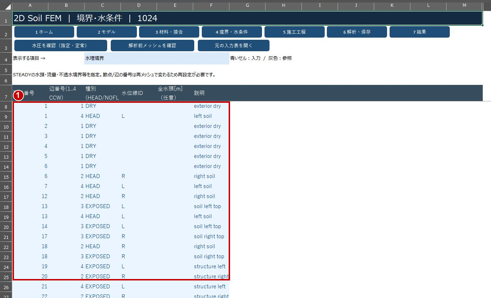

図8-2　「境界・水条件 → 水理境界」。①A8:F207へ要素番号・辺番号とHEAD/EXPOSED/NOFLOW/DRYを登録します。

### 8.5 WATER工程と工程別の入力欄

通常画面の「施工工程」で「水位変更（WATER）」を追加し、C列を空欄、E列を1、G列をONE_WAY、H列を工程別の水位線IDにします。I列で採用水位線を確認します。通常画面のC列は材料番号用で、WATER行のC列へIDを入力すると拒否されます。

H列のIDは元の「水条件」N列へ反映されます。H列が空欄なら「境界・水条件 → 水条件の基本」B10の既定IDを使います。材料・境界の`*`は採用IDを継承します。WATERは水圧場を置換して力学的に再平衡する工程です。前の水荷重へ加算しません。

旧詳細表を直接編集する場合の互換入力は、「水条件」N列（L列の工程IDが一致する行）→「ステージ」C列→「水条件」B5の順に採用します。N列とC列を併記するときは同じIDにし、異なる場合は停止します。通常画面のH列入力と、旧詳細表のC列入力を区別します。

「施工工程 → 時間・連成設定」は元の「水条件」L12:T211に対応します。工程IDと水位線の優先順はONE_WAYでも時間連成でも共通です。次表は元表の列です。

|列|意味|入力と動作|
|---|---|---|
|L|工程ID|「ステージ」A列と照合|
|M|連携方式|ONE_WAY／FIXED_STRESS／INHERIT|
|N|水位線ID|WATER工程で採用。空欄は工程C列、次に既定B5|
|O・P|工程時間・初期刻み|「時間の詳細設定」で指定した単位。未指定は秒|
|Q|排水条件ID|空欄は継承。非空欄は指定セットで置換|
|R・S|反復上限・連成許容値|時間連成の水理・力学反復に用いる|
|T|説明|条件のメモ|

ONE_WAYのWATERは、水理場を作って力学へ渡す工程です。FIXED_STRESS開始後のWATERは、指定した時間・水位変化の方式で連成を進めます。一定境界水位でも内部過剰水圧は消散します。詳細な入力、時刻別出力、圧密とSRMの接続は第9章、実計算は第32～36章です。

### 8.6 結果の確認と出力

HYDROSTATICの地盤面では、外水位と地盤側水位を両端と両折れ線の全折れ点で照合します。片方向STEADYの共有内部面HEADは未対応の注排水源になるため入力エラーです。SOIL/PRESCRIBEDで水理節点が分離したJOINT面の境界指定とは区別します。

「境界・水条件」で水を入力し、「水圧を確認（指定・定常）」で入力水位・水頭・荷重を確認します。解析後の水理図は「結果」の「水位・水頭図（詳細）」で開きます。変形・応力図の表示量は「結果 → 表示設定」D9で選びます。「水圧結果」では工程・要素・積分点・座標・水圧、全応力と有効応力、GP流束、水圧元を確認します。「水圧確認」では入力水圧、GP座標、残差・収支、等価節点水圧荷重、面ごとの合力・モーメント、全水頭、固定水頭、反力流量、辺流量を確認します。

|確認したいこと|シートと保存する範囲（見出し35行目、データ36行目以降）|
|---|---|
|有効応力と水圧|水圧結果 A:O。全σと有効σ、水圧、GP座標を一緒に保存|
|外水圧・内水の合力とモーメント|水圧結果 W:AD。内面/外面・水位線IDを保持|
|全水頭・供給流量|水圧結果 AF:AM。境界反力流量は領域への流入が正|
|要素ごとの水収支|水圧結果 AO:AS。辺流量は外向きが正|
|力学の釣合い・SRM|結果節点・結果要素・ステージ結果に加え、outのperf_summary.csvとrun.log|

「水圧結果」AF:AMの水頭0は、その工程の流れ場に属さないDOF（非透水STRUCTだけに属する節点など）では未計算の表示値です。構造体内で計算された水頭0と解釈せず、水頭分布・水頭勾配・流量の評価から除外します。有効なSOILの流れ場に属する節点では、0も計算された実値になり得ます。値が0かどうかだけでは選別せず、その工程の有効要素・材料区分・接続を確認します。水理DOFは内部番号で、入力節点番号との対応にも注意してください。

工程別に比較するときは「解析・保存 → 保存・再開」D8（工程別出力）をALLにして、工程番号を含む表を保存します。途中工程の図をチェックポイント再開だけで復元できるとは限らないので、元のブックとoutも保持してください。

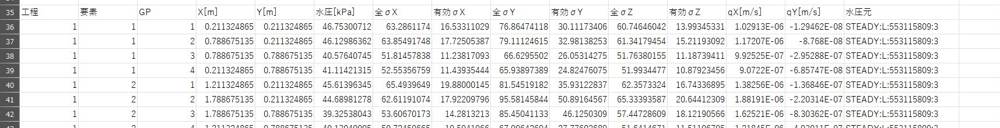

図8-3　35行目以降のGP結果。水圧と全/有効応力、qx/qyを同じ点で照合できます。

GP流束は水頭勾配から得た生のDarcy流束です。辺流量は共有面の連続と要素収支を満たすために再構成した`EQUILIBRATED`流量で、生のGP流束と同じ値ではありません。辺流量の補正率と要素収支誤差も保存します。図の矢印長は表示用の正規化で、実圧力や変位の尺度ではありません。

EXPORTの工程フォルダーには、節点の座標・変位、積分点の全応力・塑性状態、dofロック、水圧チェックポイントを保存します。水圧CSVには`WATER_V2`署名、水位線、Fs診断、全要素の圧力を保存します。再開時は入力署名と再生成した水圧場を照合します。ひずみは保存CSVから読むのではなく、保存変位と再構築した`B`から再計算されます。再開時は連続計算と全節点変位・水圧・応力・残差を照合します。

検証記録と数値の詳細は[水条件検証記録](https://github.com/tak063495-prog/excel-vba-soil-fem/blob/main/docs/GROUNDWATER_VALIDATION.md)と[acceptance比較](https://github.com/tak063495-prog/excel-vba-soil-fem/blob/main/docs/groundwater-evidence/20261022/comparison.json)を参照してください。

前半の操作では、水理の入力値と計算で得られた水頭を別々に確認します。入力画面は図4-5-A/B、方式別のプレビューは図4-5-C/D、境界入力は8.3節を参照し、次の順で結果を確認します。

1. 「水条件」B3で`NONE`、`HYDROSTATIC`、`STEADY`のいずれかを選びます。`NONE`は水理場を使いません。`HYDROSTATIC`は入力水位線から静水圧を直接作ります。`STEADY`は透水係数KとHEAD/EXPOSED/NOFLOW/DRY境界から全水頭を計算し、受理した水圧を力学へ渡します。
2. 「水条件」画面で、水位線、材料ごとのKと応力基準、水理境界を確認します。オレンジ破線は登録した入力水位線、紫の菱形は固定水頭の節点、紫実線はSTEADYで計算された全水頭の等値線、緑矢印はDarcy流束、橙矢印は力学へ渡す等価節点水圧荷重です。HYDROSTATICでは計算水頭・流束はありません。
3. 「水圧プレビュー」で、水位線と水圧・等価荷重を確認します。STEADYの場合は水頭残差、全体・要素収支、負圧の有無も確認します。
4. 「解析前メッシュを確認」で要素の向き、材料番号、支持条件を確認し、解析後は「水圧確認」「水圧結果」で入力水位、計算水頭、水圧、全/有効応力、流束を照合します。

図8-4　STEADYの結果。水圧、全/有効応力、GP流束、収支を同じ条件で確認します。

### 8.7 接合面の水圧を使う場合

接合要素（JOINT）の水圧は「接合」F:G列で設定します。材料のTOTAL/EFFECTIVEと、ばねの有効接触応力・全法線応力は別の概念です。入力欄、面の向き、接触力と水圧の検算、結果列の読み方を解析例18（第31章）で説明します。

### 8.8 注意

水圧、全応力、有効応力、材料の応力基準を混同しないでください。TOTAL材料の`σ-p`表示は整理用で、強度入力を有効応力へ自動変換した値ではありません。水中重量を別途差し引くと浮力を二重計上します。

水位線は入力範囲内で厳密に昇順にし、各連結領域を固定水頭で閉じます。部分水没のEXPOSED浸透境界、自由水面、不飽和領域、負圧を0に切る運用は対象外です。水圧のpreviewが成功しても、材料・境界・メッシュの工学的妥当性は保証されません。水条件を変更した工程は、元のrun、入力署名、結果ファイルを一緒に保存してください。

## 9. 時間連成の入力・計算・時刻別表示

### 9.1 解析方式を工程ごとに選ぶ

初期の水圧を与えて釣合いを作り、施工後に時間を進める順序で入力します。初期GRAVITYはONE_WAYです。圧密を始める工程からFIXED_STRESSにし、その後はINHERITで受理した水圧・変位・履歴を引き継ぎます。時間連成中の水位は、WATER工程で変更しない限り境界条件として保持されます。内部水圧は変形・排水とともに変化します。

|確認したい現象|工程と連携方式|主に確認する結果|
|---|---|---|
|初期自重と指定水圧|GRAVITY、ONE_WAY|初期の全応力・有効応力、反力|
|盛土直後・瞬時載荷|BIRTH／LOAD、FIXED_STRESS、工程時間0|直後の沈下・過剰水圧|
|一定水位で放置・圧密|WAIT、INHERIT、正の工程時間|沈下の進行、水圧消散、排水量|
|水位の時間変化|WATER、INHERIT、LINEAR／時系列|境界水頭、内部水圧、流束、外水圧|
|施工途中の強度照査|SRM、時間0|親時刻の水圧を保持した照査枝とFs|

時間連成を始めた後にONE_WAYへ戻すと残存過剰水圧を失うため、入力エラーになります。途中のSRMは時間を進めず、照査後は低減前の施工本線へ戻ります。時間圧密は旧CONSOL_ENABLEではなく、ここで説明する工程別入力を使用します。

### 9.2 材料と初期水圧を入力する

「材料・接合 → 材料特性」に排水骨格のE・ν、強度、全単位体積重量を入力します。対象地盤は「材料の水理特性」でEFFECTIVEにし、続いてC4を「圧密材料特性」へ切り替えます。水中重量へ置き換えて水圧の効果を二重に差し引かないようにします。構造体はTOTALのまま、地盤とは別材料です。

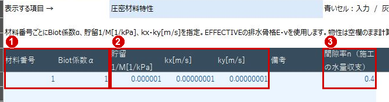

図9-1　「材料・接合 → 圧密材料特性」。①材料番号とBiot係数、②貯留と方向別透水係数、③施工水量の計算に用いる間隙率。画面の値は解析例21の入力です。

|画面の欄|単位・意味|選び方と確認|
|---|---|---|
|A列 材料番号|材料特性の番号|EFFECTIVEの地盤と一致させる|
|B列 Biot係数α|無次元|有効応力と骨格体積変化の連成係数。調査条件・モデルから設定|
|C列 貯留1/M|1/kPa|水と粒子の圧縮性に相当する貯留。間隙率や圧密係数そのものではない|
|D・E列 kx・ky|m/s|水平方向・鉛直方向の透水係数。片方向のKと区別して両方入力|
|G列 間隙率n|無次元|湿潤掘削・盛土で持出・持込水量を計算するときに必要|

「境界・水条件」で水位線と水理境界を入力し、初期の水圧確認図を見ます。HYDROSTATICは水位線から与える指定場、STEADYは定常浸透を解いた初期場です。いずれも、その後のFIXED_STRESSの初期水圧として使えます。水位線はX・水位標高の空間折れ線です。時間方向の変化は31.5の別表へ入力します。

### 9.3 工程・継続時間・刻みを入力する

「施工工程 → 工程の編集」に、初期自重、盛土、SRM、時間経過、再照査などを並べます。上部の追加・複製・削除・上へ・下へ・元に戻すを使います。工程IDは実行順の番号ではなく、関連する入力表を結び付けるキーです。

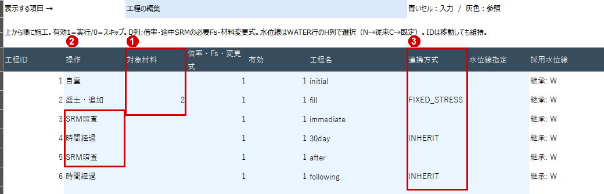

図9-2　解析例21の工程。①BIRTHの材料番号、②途中SRMと時間経過、③工程IDに対応する連携方式。工程を移動した後もIDを基準に時間設定を確認します。

C4を「時間・連成設定」に切り替え、A列の工程番号を「工程の編集」のA列と一致させます。

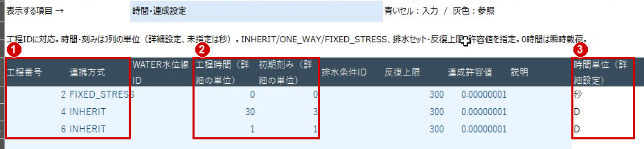

図9-3　①工程2でFIXED_STRESSを開始し、後続はINHERIT。②工程4の時間30、初期刻み3。③J列の時間単位Dを確認します。この例の30は30秒ではなく30日です。

|欄|入力と動作|
|---|---|
|A 工程番号|工程の編集A列と一致。表示行の位置だけで対応させない|
|B 連携方式|ONE_WAY／FIXED_STRESS／INHERIT。空欄は継承|
|C WATER水位線ID|WATER工程の採用水位線。元の工程C列と両方指定するなら同じID|
|D 工程時間・E 初期刻み|J列に表示された単位。J列の変更は「時間の詳細設定」B列で行う|
|F 排水条件ID|空欄は継承。非空欄は31.4のセットへ置換|
|G 反復上限・H 連成許容値|空欄時100回・1e-8。各刻みで水理・力学の両方を確認|

時間0のLOAD/BIRTHは、時間を進めない初期応答です。WAITは正の工程時間が必要です。時間を細かくすることと、連成反復を収束させることは別の確認です。初期刻みを半分にした結果と、沈下・水圧・Fsを比較します。

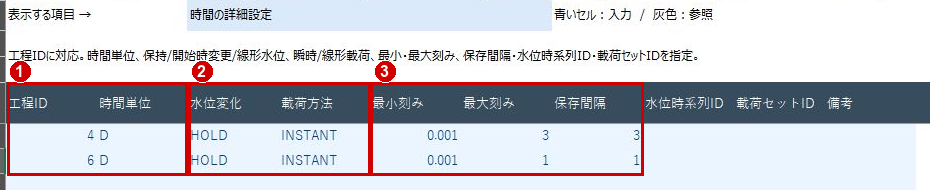

図9-4　①工程IDと単位D、②境界水位HOLDと瞬時載荷INSTANT、③刻みの範囲と保存間隔。解析例21では3日ごとに全場を保存します。

|詳細設定の列|意味|
|---|---|
|A・B|工程IDとS/MIN/H/D（秒／分／時間／日）|
|C|HOLD=水位保持、START=開始時に変更、LINEAR=時間内で変化|
|D|INSTANT=瞬時載荷、LINEAR=工程時間内で荷重・強制変位を線形変化|
|E・F|最小・最大刻み。空欄時は初期刻み/1024、初期刻み|
|G|全場の保存間隔。0／空欄は全受理時刻、正数は間隔と工程末|
|H・I|水位時系列ID、載荷セットID|

失敗した刻みは直前の受理状態へ戻り、刻みを半減して再試行します。BIRTHのLINEARは、要素を工程開始時に有効化し、自重荷重を時間内で増やします。剛性が徐々に増す操作ではありません。

### 9.4 排水条件と載荷セットを指定する

「施工工程 → 排水条件セット」にID、要素番号、辺番号、種類を入力します。同じセットIDを複数行に使えます。工程の排水条件IDが空欄なら直前を継承し、非空欄なら通常の排水・流束条件をセットで置き換えます。新しいセットに記載しない面は流束0です。JOINT固有の指定水頭は維持します。外水圧のEXPOSED設定は、この排水セットとは別です。

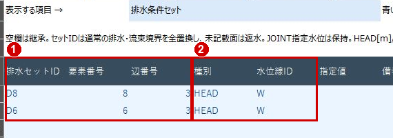

図9-5　解析例22のD8/D6。①セットIDと要素・辺番号、②HEADの水位線ID。掘削で露出する面に合わせてセットを切り替えます。

|種別|指定値|区別すること|
|---|---|---|
|HEAD|全水頭h[m]、または水位線ID|水圧pではない。p=γw(h−y)|
|PRESSURE|水圧p[kPa]|排水面p=0は、全水頭h=yに相当|
|FLUX|内向きを正にした流束[m/s]|流量m³/sを直接入れる欄ではない|
|NOFLOW|流束0|水圧0の固定ではない。共有内部透水面は不可|

番号は生成済みメッシュに対応させます。T6の辺は1=AB、2=BC、4=CA、3は縮退辺です。共有圧力節点への異なる指定値は停止します。NOFLOWは外周面・水理分離JOINT面へ指定し、共有内部透水面では時間連成でも拒否します。片方向STEADYの内部HEADも受理しません。

載荷は「境界・水条件 → 載荷条件」の説明J列の右隣、K列にセットIDを付け、「時間の詳細設定」I列で選択します。対象DOFの値は目標値へ上書きし、未指定DOFは受理状態を継承します。同じDOFのFORCEは加算、FORCE=0は明示的な解除です。DISPは絶対変位[m]、FORCEは節点力[kN]です。従来の空欄セットと名前付き行を混ぜずに選びます。

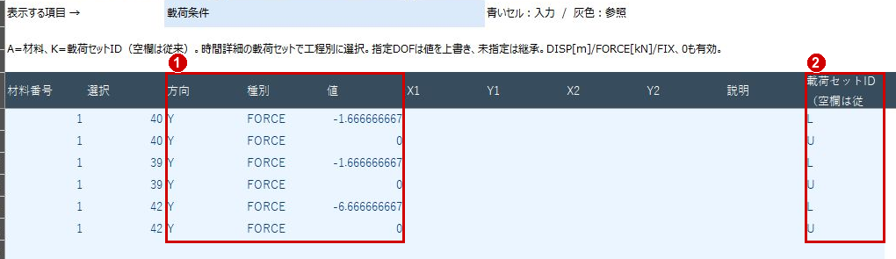

図9-6　①方向・種別・値、②K列の載荷セットID。Lは載荷、UはFORCE=0の除荷です。「時間の詳細設定」I列で工程に対応させます。

### 9.5 折れ線水位を時間方向に変化させる

先に「境界・水条件 → 水位線」にW、W2等の空間折れ線を登録します。その後「施工工程 → 水位の時系列」に、同じ時系列IDで工程内時刻と水位線IDを昇順に入力します。開始0から工程終了までを2点以上で指定します。時間単位は当該工程の詳細設定と同じです。

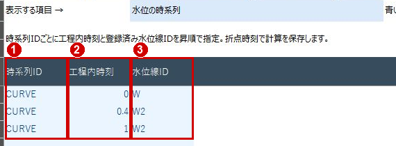

図9-7　①時系列ID CURVE、②工程内時刻0・0.4・1、③水位線ID W/W2。この例では単位Dなので0.4日は9.6時間です。

「時間の詳細設定」H列にCURVEを指定します。WATER工程内では水位線間を時間補間し、時系列の折点時刻でも結果を保存します。材料・境界の水位線欄が`*`なら工程の変化を継承し、個別IDならその線に固定されます。WATER水位線の採用順は、工程別の水位線欄→元の工程C列→既定水位線です。相反する2つの指定は受理しません。

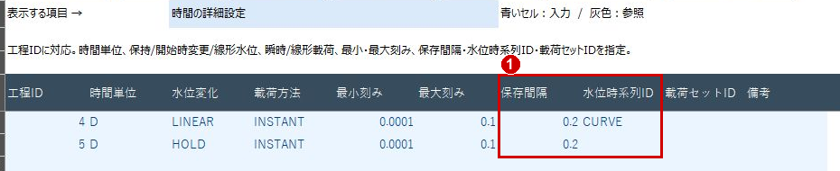

図9-8　①「時間の詳細設定」のG列は保存間隔、H列は水位時系列ID。この例では工程4にCURVEを割り当て、0.2日ごとと水位変化の折点で保存します。

### 9.6 計算して時刻別の結果を読む

「解析・保存」で解析を開始します。各受理時刻で力学残差、流体の元の連続式残差、水量誤差、反復変化を確認します。工程時間の終了に達したかを「結果 → 時間履歴」で読みます。刻みの試行中の値と、受理済みの保存状態を混同しないようにします。

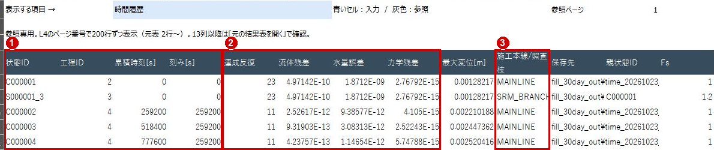

図9-9　①工程・累積秒・刻み、②連成反復と水理／力学残差、③MAINLINEとSRM_BRANCH。SRM枝は親の時刻を保持します。

「結果 → 水量収支」では、貯留変化＋骨格体積変化と境界流入量の閉合を見ます。施工持込・掘削持出の水量は境界流量とは別の列です。単位は板厚を含むm³です。

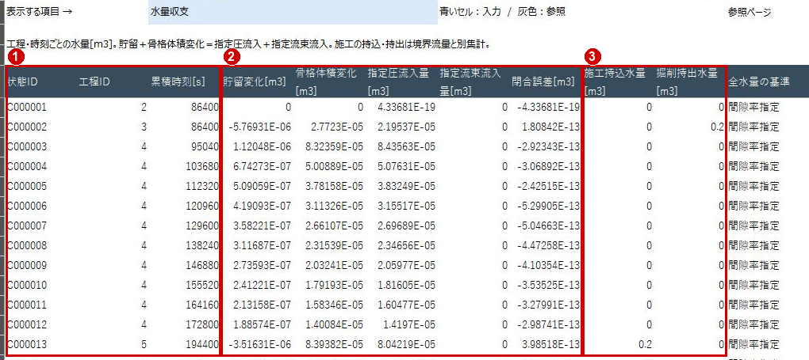

図9-10　①時刻、②貯留・骨格変形・流入の水量、③施工で領域が増減した水量。掘削による持出を、排水面から出た水と合算して読みません。

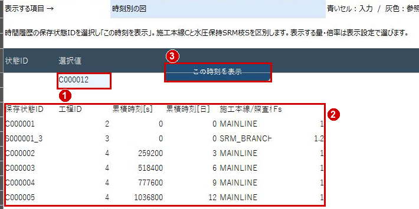

図9-11　「結果 → 時刻別の図」。①B8の保存状態ID、②工程・累積日・施工本線／照査枝、③「この時刻を表示」。保存先のある行を選択します。

B8から状態IDを選び、「この時刻を表示」を押します。Cは施工本線、SはSRM照査枝です。工程・累積時刻・枝・Fsを図の見出しで照合します。表示量・倍率・増分図は「結果 → 表示設定」を使用します。次の状態を選ぶときは「時刻別の図」へ切り替えて選び直します。

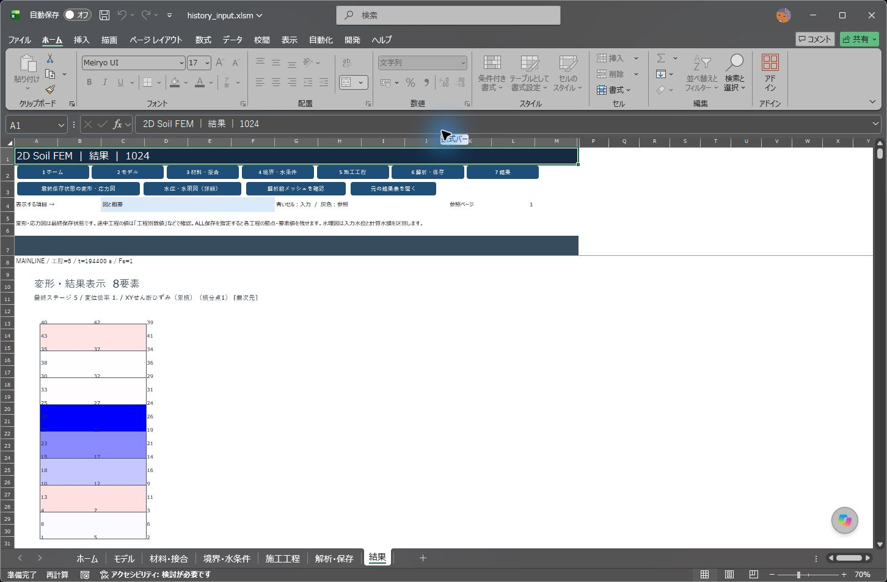

図9-12　湿潤再盛土の途中、t=194400秒。保存時点で有効な8要素を表示しています。将来の完成形を重ねた図ではありません。

|目的|残して整理する出力|
|---|---|
|沈下の時間経過|時間履歴、選択節点のnode.csv、工程・時刻・MAINLINE|
|水圧の消散・有効応力|water.csv、全応力／有効応力の表、初期または有効化時の基準水圧|
|排水量と施工水量|時間履歴のN:U相当の水量項目、符号、厚さ、間隙率|
|安全性の照査|S枝のFs区間または必要Fs、親状態ID、固定した親水圧、残差|
|図の再表示・途中再開|ブックと同名の出力フォルダー、時刻別全場、入力一式|

過剰水圧は初期活性化時のGP水圧との差で、BIRTH要素は有効化時を基準にします。水位が変わっても基準は自動で置き換わりません。非透水構造体の水頭0は未計算値です。全場を省いた要約行は図・再開に使えません。施工本線の保存先から再開し、S枝は照査図の確認に使います。旧計算識別の途中保存は新しいブックへ直接持ち込まず、同一識別のブックで継続するか入力から再解析します。

### 9.7 適用範囲と収束の確認

対象は飽和・小ひずみのBiot連成です。Q8変位/Q4圧力、直線T6変位/P1圧力、両者の混在を扱います。未知の自由水面、不飽和化、浸出面の自動切替、連成中のRESET/MATSET・再メッシュは対象外です。JOINTの水理接続は固定し、開口が1e-8 mを超える場合は空隙内の流体貯留を表せないため受理しません。

負の水圧候補を0に切って受理する処理はありません。飽和範囲を外れる入力では、境界水位・施工・刻みとモデルの適用範囲を見直します。閉鎖・貯留0・体積拘束で水圧基準が定まらない場合も停止します。刻みを細かくしても境界条件の矛盾や不定性は解消しません。

## 10. 入力項目の説明

各表の編集場所は次の対応表で選びます。列定義のA～M等は、表中に示した元表の列を指します。

|元の詳細表|通常の入力・参照画面|
|---|---|
|材料データ|材料・接合 → 材料特性|
|接合|材料・接合 → 接合条件|
|載荷|境界・水条件 → 載荷条件|
|ステージ|施工工程|
|解析設定|解析・保存 → 解析・SRM|
|高速化設定|解析・保存 → 高速化|
|メッシュ設定|モデル → メッシュ生成・支持条件|
|詳細設定|解析・保存 → 詳細設定|
|節点データ|境界・水条件 → 節点の支持・変位|
|形状入力|モデル → 形状の座標／形状の領域|
|出力・表示（保存）|解析・保存 → 保存・再開|
|出力・表示（作図）|結果 → 表示設定|
|水条件|境界・水条件、材料・接合 → 材料の水理特性、施工工程|

### 共通の単位と入力規則

自動単位換算はありません。Xの正方向は右、Yの正方向は上です。下向きの力と変位には負値を使います。

|量|長さm・力kNを使う場合|
|---|---|
|座標・板厚・変位・開口・すべり|m|
|ヤング率・粘着力・応力|kN/m²（kPa）|
|単位体積重量|kN/m³|
|節点力|kN|
|JOINTのKn・Ks|kN/m³（応力／相対変位）|
|摩擦角・ダイレタンシー角|度|
|ひずみ・Fs|無次元|

材料・節点・要素番号は1からの連番です。重複と欠番を避けます。入力表の不要な古い行も確認してください。

### 「材料データ」

|列|項目|意味・入力方法|
|---|---|---|
|A|材料番号|1からの連番。|
|B|ヤング率／Kn|SOIL・STRUCTでは正のヤング率。JOINTでは正の法線剛性Kn。|
|C|ポアソン比|数値を入力。SOIL・STRUCTでは−1より大きく0.5未満。|
|D|板厚|正の値。奥行方向の厚さ。|
|E|単位体積重量|GRAVITYとBIRTHの自重に使用。|
|F|内部摩擦角φ|度で入力。|
|G|粘着力c|応力と同じ単位。|
|H|ダイレタンシー角ψ|塑性流れの体積変化に関係する角度。JOINTでは0。|
|I|強度低減|1／ONはSRM対象。0／OFFは低減しません。|
|J|初期状態|ONは開始時から有効。OFFはBIRTHを待ちます。|
|K|種別|SOIL、STRUCT、JOINTを明示。|
|L|せん断剛性Ks|JOINTでは正の値。空欄または0以下なら内部で0.1×Kn。|
|M|引張|JOINTで1／ONは引張を保持。0／OFFまたは空欄は引張を保持しません。|

A:Hは数値が必要です。I/Jは空欄だとONとして扱われるため、値を明示します。STRUCTという名前だけで塑性評価が無効になるわけではありません。I列の強度低減と、結果の塑性状態を確認します。

JOINTは履歴なしの応力上限モデルです。総すべり×KsをCoulomb強度で制限します。塑性すべりの累積、残留すべり、ダイレタンシーは扱いません。

### 「接合」

|列|項目|意味|
|---|---|---|
|A|材料A|節点を残す側の材料番号。|
|B|材料B|節点を複製する側の材料番号。Aとは別番号。|
|C|接合材料|「材料データ」でK=JOINTにした材料番号。|
|D|有効|1で生成対象。0で無効。|
|E|説明|任意のメモ。|

異なる材料の共有辺に接合要素を作ります。材料A/Bを逆にすると複製する側が変わります。既存の接合要素には再挿入しません。組合せを変更して作り直す場合は、接合生成前のメッシュのコピーから始めます。

### 「載荷」

|列|項目|意味|
|---|---|---|
|A|材料番号|LOAD/UNLOADの対象材料。|
|B|選択|TOP、BOTTOM、LEFT、RIGHT、BOX、または元の節点番号。|
|C|方向|XまたはY。|
|D|種別|FORCEは節点力、DISPは強制変位、FIXはゼロ変位拘束。|
|E|値|FORCEでは選択した各節点の力。DISPでは目標変位。FIXでは値を使いません。|
|F:I|X1、Y1、X2、Y2|BOXの矩形座標。境界を含みます。|
|J|説明|任意のメモ。|

TOPなどは対象材料の座標範囲の端を選びます。曲面や斜面全体を選ぶ指定ではありません。BOXはその材料に属する節点を矩形で選びます。

FORCEは合力を自動配分しません。例えば5節点に−10を指定すると、合力は−50です。対象節点数を確認してください。

DISPは現在値からの追加量ではなく、目標変位です。自重後のY変位が−0.064405714 mで、さらに0.010 m沈下させる入力例では、目標は−0.074405714 mです。DISP=0も拘束として働きます。不要な載荷は行を削除するか、対応するLOADを無効にします。

> **解説　載荷表の既定値と、節点力の配り方**
>
> - 「載荷」が空のままLOADを置くと、既定の行「材料1・TOP・Y・DISP・0」が補われます。DISP＝0は「変位0」の拘束として働きます。LOADを追加する前に、載荷表を確かめます。載荷しない行は、A列を「(」で始めて説明の行にするか、その LOAD 工程を無効（E列＝0）にします。
> - FORCEのE列は合力ではなく、選んだ**各節点**に加える力です。TOPで上面の全節点を選んで同じ値を入れると、面圧（等分布荷重）にはなりません。
> - 面圧pを2次要素（Q8）の直線の辺に加えるときの等価な節点力は、辺の長さL、奥行tとして、端点・中点・端点に p×L×t/6 ×[1, 4, 1] です。隣り合う辺の共有の端点は、両方の辺の値を足します。例：p＝10 kPa、L＝1 m、t＝1 mなら −1.666667、−6.666667、−1.666667 kN（合計−10 kN）。合計が「−p×載荷幅×奥行」になることを確かめます。
> - メッシュを細かくして節点の数が変わったときは、面圧・合力が同じになるように節点力を配り直します。前のメッシュの節点番号や、以前のチェックポイントをそのまま使いません。

### 「ステージ」

|列|項目|意味|
|---|---|---|
|A|番号|管理用番号。番号の書換えだけでは実行順は変わりません。|
|B|種別|下表のキーワード。|
|C|材料番号|BIRTH/DEATH/MATSETでは必須。LOAD/UNLOADでは対象グループ。|
|D|パラメータ|MATSETの変更内容、途中SRMの必要Fsなど。|
|E|有効|数値1で実行、0で無効。文字のONは使いません。|
|F|説明|任意のメモ。|

|キーワード|動作・確認点|
|---|---|
|GRAVITY|自重を計算。支持は「メッシュ設定」や「節点データ」で指定。|
|LOAD|「載荷」の対象材料の行を適用。|
|UNLOAD|対象の荷重・強制変位を外す。要素は残します。|
|BIRTH|対象材料の要素を有効にして自重を計算。J列を初期OFFにして準備。|
|DEATH|対象材料の要素を無効化。同番号の別領域も対象になります。|
|MATSET|対象材料を変更。D列が数値ならその材料をコピー。文字なら`c=20;phi=30`などで指定。|
|RESET_U|変位・応力・塑性履歴をゼロにする。基準座標は維持。|
|RESET_STRESS|変形後座標を基準にし、変位・応力・塑性履歴をゼロにする。|
|SRM|先行工程を再実行しながら強度低減を試す。最終行と途中行では扱いが異なります。|
|WATER|水位線の指定順は「水条件」N列（L列の工程IDが一致する行）→「ステージ」C列→「水条件」B5。N/C両指定は同一IDとし、矛盾は停止。採用した静水圧または定常水頭を力学へ渡す。E列=1で実行（8.5節）。|

MATSETの主なキーは`c、phi、psi、E、nu、gamma、kn、ks`です。指定した値だけ更新します。JOINTと連続体の相互コピーはできません。RESET系は除荷とは異なるため、履歴を消す目的を確認して使います。

最後の有効行がSRMなら、Fs探索結果を保存します。後ろに施工が続くSRMでは、D列を必要Fsとして成功側FSSと比較します。未達なら中断します。通過後はFs=1で履歴を再生し、施工を続けます。途中SRMのD列は固定Fs試験の指定ではありません。

入力例：自重とSRMは`GRAVITY → SRM`です。掘削と再盛土は`GRAVITY → DEATH（掘削材料）→ BIRTH（初期OFFの盛土材料）`です。追加する材料を登録し、対象要素にその番号を割り当てておきます。

> **解説　工程の順序と再盛土**
>
> - 再盛土は DEATH（掘削）→ MATSET（物性を入れ替える）→ BIRTH（有効にする）の順に置きます。MATSETは物性を入れ替えるだけで、要素を有効にはしません（解析例8）。
> - 施工の順序を変えると、最後の断面が同じでも応力の履歴が変わり、結果も変わります。前の結果を使い回さず、最初から計算し直します。

### 元の詳細表「解析設定」

通常の入力は「解析・保存 → 解析・SRM」D8:D16です。以下のC列は元表のセルです。

|セル|項目|意味|
|---|---|---|
|C9|自重|TOTAL。入力した全重量を使用。水条件による有効応力の扱いは第8章。|
|C10|非関連の扱い|INCONSISTENTは非関連流れ・非対称整合接線のNewton法。DAVISは等価関連材料への変換。JOINTにDAVIS変換は適用しません。|
|C11|アワーグラス係数|Q8の安定化係数。範囲0～1。|
|C12|節点の並び替え|AUTO、ON、OFF。計算順序の設定。|
|C15|Fs探索の上限|探索を打ち切るFs。|
|C16|成功・失敗Fsの許容幅|探索区間の終了幅。小さくすると試行が増えます。|
|C17|ψの扱い|KEEPは入力を保持。CAPは低減後φ以下に制限。REDUCEはFsで低減。|
|C18|モード|REAPPLY。各Fsで先行ステージを再実行。|
|C19|固定Fsで試験する|0は全探索。正の値はそのFsだけを試験。|

SRMは対象材料の`c/Fs`と`tanφ/Fs`を用います。φそのものをFsで割る操作ではありません。ψの方針と流れ則は結果に影響する条件です。速度比較のためだけに変更しません。

### 元の詳細表「高速化設定」

通常の入力は「解析・保存 → 高速化」です。以下のC列は元表のセルです。

|セル|項目群|使い方|
|---|---|---|
|C9|DLLの使用|AUTOは利用可能なDLLを使用。BANDは行列DLLのみ。OFFはVBA。|
|C10|DLLの演算方式|AUTO、STRICT、SSE2、AVX2。倍精度を使用。CPU対応命令を自動選択するAUTOが通常の入口。|
|C11:C17|DLL転送・組立・GMRES・I/O|通常は1。収束条件を緩める設定ではありません。|
|C20:C32|候補の選別・V方式・比較用係数|通常は現値を維持。各KEYは付録を参照。|

> **解説　推奨ボタンと設定の移行**
>
> 「推奨」ボタンが変えるのは、DLLの使用と入出力に関する9項目だけです。流れ則や収束・SRMの条件は変えません。旧版のV方式は比較用の経路で、流れ則と適応選別の状態によっては使われません。
>
> 高速化設定のセルの位置を変えたり、セルに数式を入れたりしたブックでは、設定の参照を正しく移せないとき、ブックは変更の前に処理を止めます。元のブックを保存し、設定の項目の位置と参照を確かめてから直します。元の数式を一律に値に置き換えることはしません。

### 元の詳細表「出力・表示」

通常の入力は「解析・保存 → 保存・再開」D8:D13と「結果 → 表示設定」D8:D19・16/17行のチェックを使います。以下のC列は元表のセルです。

|セル|項目|意味|
|---|---|---|
|C9|結果の残し方|FINALは最終ステージ。ALLは各ステージの数値結果。|
|C10|無効要素|SKIPは除外。INCLUDEは無効を示す行を残す。|
|C11|ログを保存する範囲|OFFはなし、STAGEはステージ境界、ITERは反復も記録。|
|C12|ログ書き出し間隔|秒単位。|
|C13|途中状態を保存する範囲|OFF、STAGE、ON_FAIL。STAGEは成功ステージ、ON_FAILは失敗時も保存。|
|C14|途中結果から再開する|空欄は最初から。AUTOは最後の成功保存。フォルダー指定も可能。|
|C17|変位倍率|図の変形を拡大する倍率。数値結果は変えません。|
|C18|表示する結果|内容名から選択。累積と増分、積分点を確認。|
|C19|色スケール|AUTOは最小～最大。SYMMETRICは0中心の正負対称。USERは手動配置。|
|C20|色付けする結果の集め方|従来の表示処理用。現行図をこの設定だけで節点平滑図に切り替えることはできません。|
|C21|表示モード|SIMPLEまたはDETAIL。|
|C22:C24|スケール・原点X・原点Y|USERで作図位置と縮尺を調整。色の数値上下限を指定する欄ではありません。|
|C27|増分の表示方法|Aは選択結果に等値線を追加。Bは増分専用カラー。|
|28・29行のチェック|せん断増分・塑性クロス|それぞれ独立して追加。|
|C30|クロスの表示倍率|0より大きく10以下。通常は1。|

再開には成功状態の保存と、計算部・モデル・施工計画の一致が必要です。入力を変えた場合はC14を空欄にして最初から計算します。ブックだけでなく対応する出力フォルダーも保存します。

> **解説　表示の設定と解析結果の関係**
>
> - 変位倍率（C17）は、図の上で変位を拡大して見せるだけです。保存された応力・ひずみの値を倍率で割ったり掛けたりしません。倍率1が実際の変位です。
> - 色の範囲（C19）：ケースを比べるときは同じ色範囲にして凡例を並べます。AUTOでは図ごとに色の範囲が変わるので、色が同じでも値が同じとは限りません。USERは縮尺・原点の指定で、色の上下限の指定ではありません。
> - C20のSMOOTHEDなどは旧版の表示（P1）用の設定です。現在の結果図を節点で平滑化した図に切り替えるものではありません。
> - 表示の設定（C18〜C24、C27〜C30）を変えても、解析結果は無効になりません。ボタンで描き直すと反映されます。材料・形状・施工の入力を変えたときは、解析し直す必要があります。
> - C9・C10はブックの中の結果表、C11は外部のログ（run.log など）、C13は計算を再開するための状態の保存です。互いの代わりにはなりません。結果表をCSVで保存しただけでは、計算を再開できません。
> - 旧版の表示量の番号は互換のため読み込めますが、通常は内容の名前で選びます。

### 「詳細設定」

|セル|項目群|意味・操作|
|---|---|---|
|C9:C11|ソルバーと監視|C9 SOLVER＝BAND_LU（標準）／BAND_LDLT_EXPERIMENTAL（試験用。比較だけに使い、本番はBAND_LU）。通常は現値を維持。物理破壊監視だけで計算成否は決まりません。|
|C14:C18|面積・Jacobian・角度・アスペクト|メッシュ品質の目標。角度は度。アスペクトは長辺／短辺。|
|C21:C25|修正反復・移動係数・改善判定|品質修正候補の作成条件。|
|C26:C29|要素数比・細分化割合|生成比較と再メッシュ候補の制限。|
|C32:C33|生成方式と比較結果|自動出力。編集しません。|
|C34:C35|ベンチマーク|比較試験用。通常解析ではC34を0にします。|

## 11. 結果の見方

「結果」で図・工程別数値・節点・要素・水圧・接合・診断を選びます。L4で200行ずつ参照ページを切り替え、全列の確認は「元の結果表を開く」を使います。

### SRMのFsを読む

|表示|意味|
|---|---|
|FOS_PASS|数値計算に成功した側のFs。|
|FOS_FAIL|数値計算に成功しなかった側のFs。|
|FOS_MID|区間の中点。中点そのものを計算したとは限りません。|
|FOS_WIDTH|失敗側−成功側の区間幅。|
|NUMERICAL_BRACKET|数値的な収束境界を挟む区間。|
|UNDETERMINED|Fsを確定できなかった状態。停止理由を確認。|

例題では成功側2.625、失敗側2.638（表示は丸め値）、幅0.012です。通常の最終数値結果は保持した成功側の状態です。

非収束には入力、拘束、材料、メッシュ、線形解法などの原因があります。FAILや数値区間だけで物理的な破壊を確定できません。上限まで成功した場合も、閉じた成功・失敗区間は得られていません。UNDETERMINEDで表示Fsが0の場合は、Fs=0の計算結果と読みません。

> **解説　8ケースの実測（INCONSISTENTのFs区間と計算時間）**
>
> 2026年10月10日の計算部（INCO_24）で、文献の8ケースをINCONSISTENTで計算した保存記録です（`docs/manuals/construction-evidence/20261021/slope-srm-guide/cases.csv`、入力は `docs/inconsistent-evidence24/fixtures.json`）。計算時間は1ケース1.7〜10時間です。

|ケース|c・φ|節点・要素|Fs区間|最大変位|計算時間|
|---|---|---|---|---|---|
|Griffiths φ20 粗|10・20°|661・200|1.350〜1.3625|12.4 mm|14277秒（4.0時間）|
|Griffiths φ20 細|10・20°|1441・450|1.3375〜1.350|10.5 mm|36423秒（10.1時間）|
|Griffiths φ0 粗|50・0°|641・192|1.4625〜1.475|1046.6 mm|6164秒（1.7時間）|
|Griffiths φ0 細|50・0°|1393・432|1.450〜1.4625|77.5 mm|18484秒（5.1時間）|
|Griffiths 基礎地盤|10・20°|789・240|1.350〜1.3625|27.1 mm|10466秒（2.9時間）|
|Pruška H7 φ10|20・10°|789・240|1.225〜1.2375|780.6 mm|15885秒（4.4時間）|
|Pruška H7 φ20|20・20°|789・240|1.6625〜1.675|1024.1 mm|8512秒（2.4時間）|
|Pruška H10.5 φ10|20・10°|789・240|0.8125〜0.825|949.2 mm|15076秒（4.2時間）|

> 8ケースとも数値的な区間（成功側・失敗側）が得られました。材料の内力と自重の釣合いの相対残差（cases.csvのmaterial_residual）は、7ケースが1×10⁻⁶以下、Griffiths φ20 細が1.47×10⁻⁶（8ケースの最大）でした。保存記録にはこの照合の合否の閾値は記録されていないので、ここでは実測の最大値だけを示します。最大変位は最後に成功したFsでの値で、破壊の大きさではありません。φ=0の粗いメッシュのように変位が大きくても、Fsはメッシュの細かさで少し変わります。計算時間は先行施工とSRM探索を含み、Excelの起動・入力・描画は含みません。

### 節点・要素の数値を見る

|シート|主な列・値|読み方|
|---|---|---|
|「結果節点」|A:Bは工程・節点番号、C:Dは基準座標、E:Fは変位、G:Hは力、I:Jは反力|変形後座標は基準座標＋変位。RESET_STRESS後は基準が変わります。|
|「ステージ結果」|F列「最大変位」|計算中に試した状態を含む自由度の変位成分の最大（試行中の最大）。解析開始から引き継ぐので、工程が終わったときの変位ではない|
|「結果要素」|A:Dは工程・要素・代表座標。E:BTは4積分点×17量|積分点ごとの応力・ひずみ・降伏状態を確認。|

工程が終わったとき（収束状態）の変位は「結果節点」で求めます。A列で工程を絞り、E列からmax｜ux｜、F列からmax｜uy｜、E:F列からmax√(ux²＋uy²)を計算し、どれを使ったかを書き添えます。値は解析開始（GRAVITY前）からの累積なので、施工による変位は基準の工程の値を差し引きます（解析例8・10の確認値）。

ALLで保存した結果はA列のステージ番号で絞ります。無効要素とJOINTは連続体の節点応力平均に含みません。JOINT行の「接合結果参照」は、専用表で読む案内です。

> **解説　工程ごとの図・反力・釣合いの確かめ方**
>
> - **途中の工程の図**：結果図は最後の有効な工程を表示します。途中の工程の図を比べるときは、入力が同じブックのコピーを工程の数だけ作り、それぞれ比べたい工程より後の行のE列を0にして、最初から計算します（解析例8）。各コピーで同じ表示量・変位倍率・色の範囲を選んで描きます。
> - **支持反力の合計**：「結果節点」のA列（工程）で工程を絞り、支持された自由度について反力（J列＝Y方向、I列＝X方向）を合計します。G・H列は外力です。合計を自重（Σ面積×奥行×γ）や外力と比べます。無効な要素の節点の変位は、地盤の変形の代表値にしません。
> - **全体の釣合い**：「支持反力＋自由節点の残差−自重」で鉛直の釣合いの誤差を求めます。例：解析例10では、反力と自重の差は−0.00512 kN（自重の1.0×10⁻⁷）で、自由節点の残差の合計＋0.00512 kNを加えると、釣合いの誤差は3.4×10⁻⁹ kNでした。
> - **PASSの意味**：PASSは数値計算が終わったことを示すだけです。単位・拘束・変形の形・モデルの範囲が正しいかは、別に確かめます。
> - **最大変位のグラフ**：工程ごとの最大変位（ノルム）は、モデル全体の最大値です。特定の計測点の沈下曲線ではありません。

### 接合結果を見る

|列|内容・符号|
|---|---|
|A:F|ステージ番号、要素番号、材料番号、積分点、X/Y座標。|
|G:H|法線応力は圧縮が正。せん断応力。|
|I:J|開口は開く向きが正。すべり。|
|K:L|接触状態。0=密着、1=剥離、2=すべり。|
|M:O|有効状態、Kn、Ks。|

接合は線上の3積分点で確認します。結果図では紫線で表示され、連続体の応力色範囲から除外されます。

### 増分図を読む

|表示|読み方|
|---|---|
|最大せん断ひずみ増分|全ひずみの主値差。平面ひずみの面外成分0も含む3次元最大工学せん断ひずみ。要素の4点最大値で表示。|
|最大塑性せん断ひずみ増分|塑性ひずみの主値差。面外塑性成分も含め、4点最大値で表示。|
|Aの等値線|選択結果の色を残す。4点最大値を共有隅節点で平均し、最大値の25・50・75%の線を表示。|
|Bの増分カラー|せん断増分のチェックを入れると増分専用の色図を表示。|
|塑性主ひずみ増分クロス|最後に収束した増分の塑性ひずみ増分を要素の4点で平均し、その主軸を要素中心に表示。青は圧縮・内向き、赤は引張・外向き。長さは図全体の最大値に対する割合。弾性・降伏の判定には使わない（降伏関数の色図・「結果要素」で確かめる。7.8）。|

増分は「最後に収束した荷重増分」1回分です。全ひずみ増分は、収束時の変位とその増分の開始時の変位の差ΔuからB×Δuで計算します。塑性ひずみ増分はその増分内の塑性成分で、Newton反復の間やSRMの試行の間の差ではありません。クロスは見やすさのための共通尺度と表示倍率で描くので、図上の長さ（cm）を実際の変位に読み替えません。主軸は180°反転しても同じ軸です。

工学せん断ひずみは`γxy=2εxy`です。最大工学せん断ひずみは最大主値−最小主値です。テンソルせん断ひずみの定義とは係数2が異なります。図の集中域は数値と照合し、メッシュの粗密による違いも確認します。

増分データのない保存結果は最初から再解析します。表示設定だけの変更は、ボタンを押して再描画できます。

|結果の表|内容|
|---|---|
|「ステージ結果」|工程ごとの成否・Fs・試行中の最大変位・全体反力|
|「結果節点」|工程ごとの節点変位・外力・反力|
|「結果要素」|工程ごとの積分点の応力・ひずみ・降伏状態|
|「結果増分」|最後に収束した荷重増分のひずみ増分（増分図の元データ）|
|「接合結果」|JOINTの法線応力・せん断応力・開口・接触状態|
|「診断」|ResultStatus・残差・停止理由・失敗位置|

> **解説　増分が0の積分点**
>
> 最後の荷重増分で局所の変位増分が0だった積分点では、塑性ひずみ増分は0として保存されます。古い保存結果の増分図には、前の値が残っていることがあります。増分のデータがない古い結果は、現在のブックで最初から計算し直します。
>
> 増分の対象は、最後に収束した荷重増分です。施工の全期間の累積値や、隣り合うSRMの試行の間の差ではありません。

### 保存と再表示

ブックを保存するときは対応する`ブック名_out`も保存します。`run.log`は進捗・停止位置、`perf_summary.csv`はFs別の状態と計算量、`increment_summary.csv`は荷重増分の経過、`manifest.csv`は途中保存の記録です。

`perf_summary.csv` の umax は自由度の変位成分の最大絶対値（ノルムではない）です。結果節点から求める√(ux²＋uy²)とは別の量なので、同じ列に並べません。

再実行するとログや同番号の保存フォルダーが更新されます。比較前に出力フォルダー全体をコピーします。材料、形状、拘束、施工順などを変更した場合は再解析してから表示します。

> **解説　計算の根拠と再現の方法**
>
> 各解析例の入力ブックと確認値は `docs/manuals/examples/` にまとめています（同じフォルダーのREADMEに、どのファイルがどの解析例かを書いています）。
>
> 大きな例（解析例8〜10、文献例）は、リポジトリのルートでPowerShellから次のように再計算できます。ほかのExcelが起動していると開始しません。出力先には存在しないフォルダーを指定します。
>
> `pwsh -NoProfile -File tests/run_manual_case.ps1 -Fixture tests/manual_cases/road_widening_shape.json -OutDirectory tmp/road -Flow INCONSISTENT`
>
> `-Fixture` を `slope_wall_shape.json`（`-Srm -Flow DAVIS` を追加）、`tunnel_mesh.json`（`-Srm -Flow INCONSISTENT` を追加）に変えると解析例9・10になります。出力の `result.json` には入力表・全工程の結果・診断・設定が入っています。`python tests/check_manual_case.py <出力>/result.json` で、Q8の形（Jacobian）、固定節点の変位、反力と自重の釣合いを別に検算できます。
>
> 結果を報告するときは、ケース名、ブックの版、材料・境界・施工順、流れ則、Fs区間とその解釈（NUMERICAL_BRACKET／LOWER_BOUNDなど）、停止理由、最終残差、反力・変位、図の表示量・倍率・対象の工程を残します。比較表には計算識別とケース名を添え、同じ材料・メッシュ・境界・照査時点の結果を対応させます。

> **解説　結果を残すときの記録**
>
> |時期|記録するもの|
> |---|---|
> |解析の前|ブックの名前、材料・単位・境界・荷重、ステージ、流れ則、ψ、Fsの上限・許容幅、DLL・精度の設定|
> |解析の後|成功・失敗と停止の理由、Fs区間と試行の数、全変位、最大変位の位置、最後の残差、反力・外力|
> |図|表示量と積分点、工程、変位倍率、単位、色の範囲、元の形の表示の有無|
> |速度の比較|同じ入力・条件・出力、ほかのExcelの負荷を避ける、複数回の中央値、初回の画面準備の扱い|
> |保管|入力のブック、DLL、_outフォルダー全体、比較の記録、図を、再現できる組で保存|
>
> SRMの記録を整理するときは、perf_summary.csv（fs、numerical_status、umax、relres、elapsed_s）で施工の行（Fs＝1）とSRMの試行を分け、increment_summary.csv で SRM の工程の trial_id と fs ごとに、accepted／outcome で採用・不採用を区別します。
>
> VBAとDLL、CPUの違う計算を比べると、途中のGMRESの値が違っても最終の結果は同じことがあります。比べる量（Fs区間・全変位・最後の残差・停止の理由）と許容差を前もって決めます。ログは「ブック名_out」に保存され、再実行で更新されるので、ケースの名前を分けて_outフォルダーごと保存します。

## 12. よくあるエラーと対処

### 設定値が範囲外

図164 詳細表「解析設定」C16（SRM_TOL）に負の値が入った状態。通常画面の対応欄は「解析・保存 → 解析・SRM」D13です。

図165 詳細表の設定チェックが示すエラー。メッセージの解析設定C16は、通常画面のD13に対応します。正の値（例0.02）へ戻します。

### 境界に存在しない点番号がある

図166 詳細表「形状入力」のI8に、存在しない点番号9が入った状態。通常画面は「モデル → 形状の領域」C8です。

図167 形状の境界で参照する点番号が未登録のときのエラー。「モデル → 形状の領域」C8と「形状の座標」A列の点番号を一致させます。

### 入力を変えた後に結果図を表示しようとした

図168 解析後に材料や形状などを変えてから「最終保存状態の変形・応力図」を押すと表示されます。**対処**：現在の入力で解析し直してから表示します（「解析・保存 → 保存・再開」D13は空欄にします）。

### その他

|症状・表示|確認と対処|
|---|---|
|ボタンが動かない|デスクトップExcelで開き、拡張子とマクロ許可を確認します。第4章 手順1で開き直します。|
|DLLが使われない|同じフォルダーのDLL、Excelの64ビット対応、NATIVE_DLL、「診断」の利用状態を確認します。DLLを使わない場合はOFFにします。|
|セルを編集できない|見出しや灰色の参照欄ではなく、通常画面の青い入力欄を選びます。詳細表では黄色の入力欄を選びます。|
|設定エラー|「設定の形式・範囲をチェック」の指示に従い、表示されたKEYに対応する1024画面の青い入力欄を修正します。元表の番地は第10章の対応表で確認できます。|
|点番号・境界エラー|番号の重複、未登録参照、未使用点、末尾の始点重複、格子間隔を確認します。|
|Jacobianが正でない|交差、潰れた要素、節点順、中点位置を確認します。形状と分割を見直して生成します。|
|拘束が想定と違う|図のX/Y表示と「節点データ」D:Eを照合します。外周の座標範囲だけで支持が選ばれていないか確認します。|
|BIRTHが効かない|材料J列がOFFか、要素の材料番号と工程C列が一致するかを確認します。工程E列は数値1にします。|
|DEATHで別領域も消える|同じ材料番号が対象です。施工ごとに材料番号を分けます。|
|載荷されない・位置が違う|LOADの有効欄、材料番号、実行順、載荷の選択・方向・種類を確認します。|
|力が大きすぎる|FORCEは各節点への値です。対象節点数と合力を確認します。|
|DISPで上へ戻る|目標の総変位を入力しているか確認します。追加沈下量だけを指定しないようにします。|
|接合が作られない|異なる材料の共有辺、接合D列の1、接合材料K列のJOINTを確認します。|
|非収束・切戻しが続く|「診断」とログで工程・Fs・要素・理由を確認します。拘束不足、単位、接続、材料値、極端な剛性差、メッシュ品質を調べます。|
|入力変更後に図が出ない|現在入力で再解析します。「解析・保存 → 保存・再開」D13は空欄にします。|
|結果が選択できない|内容名を選び直します。「結果 → 表示設定」D9のドロップダウンで内容名を選びます。|
|図が画面外に出る|色スケールをAUTOまたはSYMMETRICにして再表示します。USERでは縮尺と原点を確認します。|
|増分図が出ない|増分データを保存できるブックで最初から再解析します。|
|再開が拒否される|成功保存、同じ計算部・モデル・施工計画、必要ファイルを確認します。条件変更時はD13を空欄にして再計算します。|
|ログがない|DEBUG_MODE、EXPORT_MODE、書込権限、ブック横の出力フォルダーを確認します。両方OFFなら外部出力しません。|
|SRMが動かない|「ステージ」の有効欄を確認します。通常解析のBAND_LU_BENCHは0にします。|

問い合わせ時は、ブック名、入力条件、操作、表示メッセージ、停止工程・Fs・要素番号を記録します。対応するブックとログを保管しておくと原因を確認しやすくなります。

> **解説　よくある問題の切り分け**
>
> |症状|先に確かめること|
> |---|---|
> |ボタンが動かない|マクロが有効か、デスクトップ版のExcelか、取得元・ブロックの状態（第2章）|
> |INPUT_ERROR|表示されたシート・セル・項目名。空欄、選択肢、整数、範囲、材料・節点の参照|
> |解析が進まない|run.logの工程・Fs・増分・残差。初回の画面準備、ログの量、モデルの大きさ|
> |DLLが使われない|「高速化設定」のDLLの設定、DLLの置き場所、64ビット版か、診断の利用状態|
> |Fsが決まらない|UNDETERMINEDか、上限に達したか、数値の障害か。停止の理由|
> |図が前のまま|入力を変えた後に解析し直したか、結果の有効状態、最後の有効な工程と図の見出しの工程、表示量、倍率|
> |再開を拒否される|ブックの名前と_out、版、モデル、計画の一致。モデルを変えたときは新しく解析|
>
> 不具合を報告するときは、入力のブックのコピー、DLLの有無と版、実行の条件、診断、run.log、solver_events.csv、再現の手順を添えます。収束の許容値を緩める前に、入力と停止の原因を切り分けます。

## 13. 解析例1 材料の強さを変える（粘着力c）

**入力画面**　材料・接合 → 材料特性（G8のc）／解析・保存 → 解析・SRM（D12のFs上限）。

### 目的

材料の粘着力cだけを変えて、SRMの安全率Fsがどう変わるかを確かめます。第4章の例題（c=10kN/m²）を基準にします。

### 解析対象

図52 解析例1の解析対象（第4章と同じ斜面）。保存した節点・要素から描いた模式図（色＝材料番号、斜線＝初期OFF、▲＝XY固定、○＝X固定、赤矢印＝荷重）。

|項目|内容|
|---|---|
|想定|天端の高さ6 m・天端幅6 mの均質な斜面（法面は点3(6,6)→点4(10,3)、法尻から先は高さ3 mの平場）。粘着力cの違いが安全率にどう効くかを見ます|
|形状|6点（(0,0)・(0,6)・(6,6)・(10,3)・(14,3)・(14,0)）の外側境界1つ|
|地盤|材料1：E＝20000 kN/m²、ν＝0.3、γ＝18 kN/m³、φ＝30°、c＝10→**20** kN/m²、ψ＝0|
|境界・荷重|底面XY固定、左右X固定、上面自由。荷重は自重だけ|
|確かめること|cを2倍にしたときのFsの変化と、すべり面の位置（せん断ひずみの図）。cは強度線の切片なので、浅いすべりほど効き方が大きくなります|

### 条件

|項目|基準（第4章）|解析例1|
|---|---|---|
|形状・メッシュ|6点の斜面、格子間隔2m、72要素・261節点|同じ|
|材料1|E=20000、ν=0.3、γ=18、φ=30°、c=10、ψ=0|**c=20**（ほかは同じ）|
|ステージ|GRAVITY → SRM|同じ|
|「解析・保存 → 解析・SRM」D12（Fs探索の上限）|3|**5**|

### 手順1 粘着力を変える

図53 「材料・接合 → 材料特性」。①G8（粘着力c）を10から20に変えます。

|番号|セル範囲|入力するもの|単位|例|
|---|---|---|---|---|
|①|G8|粘着力c|kN/m²|20|

### 手順2 Fs探索の上限を上げる

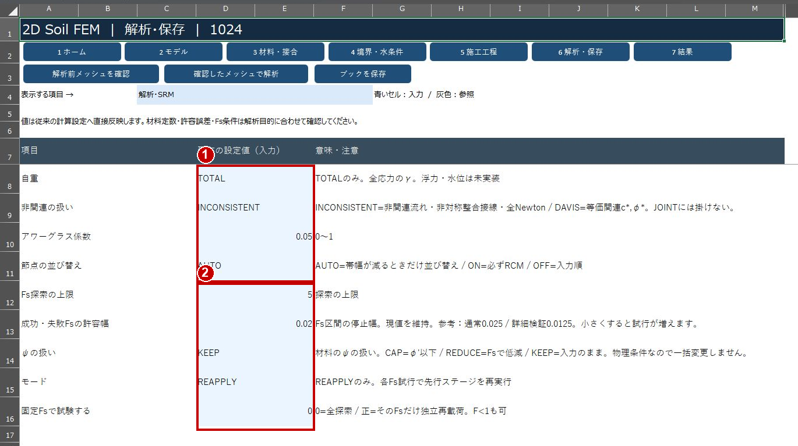

図54 「解析・保存 → 解析・SRM」。②D12（Fs探索の上限）を3から5に変えます。

|番号|セル範囲|入力するもの|単位|例|
|---|---|---|---|---|
|②|D12|Fs探索の上限|－|5|

> **解説　上限のままだとFsは決まりません**
>
> 上限3のまま計算すると、Fs=3.000でも計算が成功し、「FOS_FAIL=NA」「判定=LOWER_BOUND」と表示されました。これは「Fsは3以上」という意味で、Fsの値は決まっていません。上限を上げて計算し直し、成功側と失敗側の区間が閉じることを確認します。

### 手順3 メッシュを作り、解析する

第4章の手順4〜9と同じ操作で、「形状からメッシュ作成」→「解析前メッシュを確認」→「解析・保存」の「確認したメッシュで解析」の順に押します。

図55 終了メッセージ。FOS_PASS=3.963、FOS_FAIL=3.975と表示されます。

### 手順4 結果を確認する

図56 「ステージ結果」。①SRM行のFs（3.96875）とメッセージを確認します。

図57 「結果 → 表示設定」。①D8（変位倍率）=1。②D9で「最大せん断ひずみ（積分点1）」を選びます。

図58 結果図。表示量＝最大せん断ひずみ（積分点1）、対象＝SRMで最後に成功したFs=3.963の状態、変位倍率＝1。法尻から法肩に向かうせん断ひずみの集中が見えます。

### 確認値

|項目|基準（c=10）|解析例1（c=20）|
|---|---|---|
|要素・節点|72・261|72・261|
|GRAVITYの反力Y|1188 kN|1188 kN|
|Fs区間（成功〜失敗）|2.625〜2.638|3.963〜3.975|

### 注意点

> **解説　c・φ・ψの役割**
>
> cは強度線 τ=c+σn·tanφ の切片、φは傾きです。ψ（ダイレタンシー角）は塑性変形の向き（体積の増え方）を決める値で、強度そのものではありません。SRMでは c/Fs と atan(tanφ/Fs) で強度を下げます。角度φをFsで割るのではありません。ψの扱いは「解析・保存 → 解析・SRM」D14で決まります（KEEP=入力のまま、REDUCE=Fsで低減、CAP=低減後のφ以下に制限）。
>
> cを2倍にしてもFsが2倍になるわけではありません。比べるときは、変えた値以外の条件（形状・メッシュ・設定）をそろえます。

## 14. 解析例2 形状を変える（斜面を高くする）

**入力画面**　モデル → 形状の座標（C9:C10）／形状の領域（D8の格子間隔）。

### 目的

斜面の高さを6mから8mに上げ、Fsと変形がどう変わるかを確かめます。

### 解析対象

図59 解析例2の解析対象（斜面を8 mに高くする）。保存した節点・要素から描いた模式図（色＝材料番号、斜線＝初期OFF、▲＝XY固定、○＝X固定、赤矢印＝荷重）。

|項目|内容|
|---|---|
|想定|同じ地盤で、斜面の天端だけを2 m高くした場合。形状の変更はメッシュの作り直しを伴います|
|形状|点2・点3のY座標を6→8 m。法面は(6,8)→(10,3)になり、急で長くなります|
|地盤・境界|第4章と同じ（材料1、底面XY固定・左右X固定、自重のみ）|
|確かめること|高さが増えたときのFsの低下と自重反力の増加（断面積×γ）。形状を変えたときに**要素がつぶれていないか**（メッシュ品質）も確かめます|

### 条件

|項目|基準（第4章）|解析例2|
|---|---|---|
|点2・点3のY座標|6 m|**8 m**|
|格子間隔（形状入力J8）|2 m|**1 m**（理由は手順2の解説）|
|材料・ステージ・設定|第4章と同じ（c=10、Fs上限D12=3）|同じ|

### 手順1 点の座標と格子間隔を変える

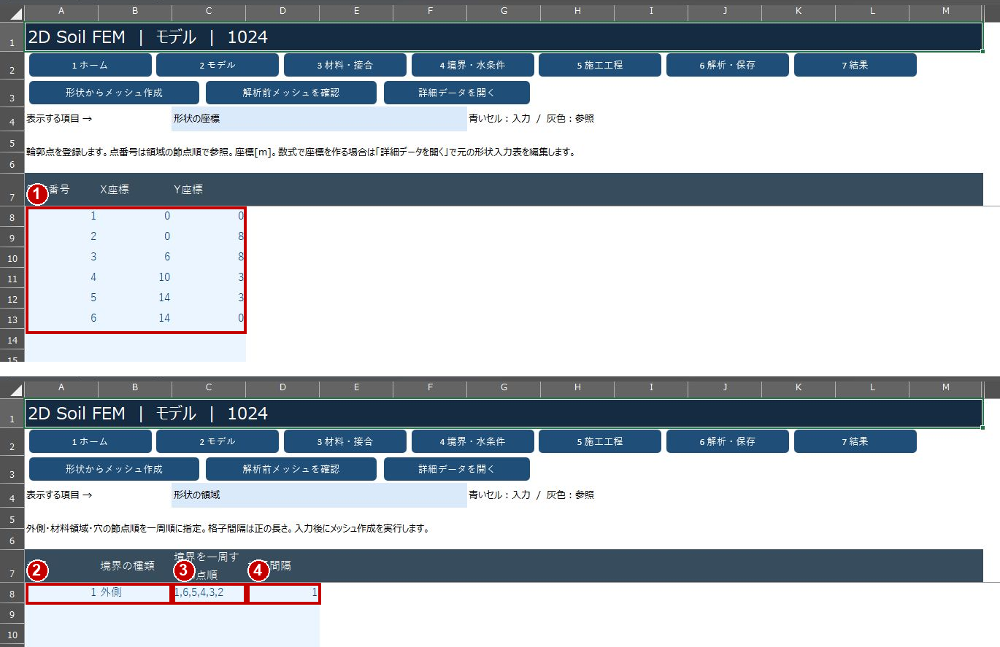

図60 「モデル → 形状の座標／形状の領域」。①C9:C10（点2・点3のY座標）を6から8に、④D8（格子間隔）を2から1に変えます。

|番号|セル範囲|入力するもの|単位|例|
|---|---|---|---|---|
|①|C9|点2のY座標|m|8|
|①|C10|点3のY座標|m|8|
|④|D8|境界1の格子間隔|m|1|

### 手順2 メッシュを作り直し、品質を確かめる

以下は直接生成の追加前に保存した例です。旧候補比較では「地形追従格子」の330要素・1065節点が採用され、良312・警告18・不良0（角度38.7〜141.3°）でした（2026-10-22の保存結果）。このメッシュと結果を確認・再計算する場合は、手順4の旧例題ルートに従い、`ex02_shape_mesh1m_20261022.xlsm`の保存メッシュを保持します。「モデル → メッシュ生成・支持条件」D14=2で形状から作り直す場合は直接生成となるため、330要素という値や旧Fsを再現の期待値にしません。新たなメッシュ数・品質・結果を記録して比較します。形状を変更した場合は再生成し、番号依存の条件を設定し直します。

図61 作り直したメッシュ（330要素・1065節点）。図の上の行に「最小角度＝38.7°、最大アスペクト比＝5.34」と表示されます。

> **解説　NG例：旧生成方式で格子間隔2 mのまま高さを変えた保存例**
>
> 旧生成方式で格子間隔を2 mのまま高さだけ8 mに変えた保存例は、84要素・303節点です（図62の左）。法面に沿った分割数に合わせて左右の領域の行数も増えるため、高さ3 mの法尻側に薄い要素が何層も重なり、**全84要素の縦横比が5を超え、最大44.8**となりました。このNG例のメッシュではFs＝1.688〜1.700、試行中の最大変位0.663 mとなり、修正後（1.5125〜1.525、0.0316 m）と大きく違いました。形状変更後の品質検査と粗密確認に使います。保存メッシュを使う再現手順は手順4に示します。
>
> **直し方**：格子間隔を小さくし（ここでは1 m）、メッシュを作り直して、メッセージと図の上の行で最小角度と最大アスペクト比を確かめます。許容値を緩めて合格にすることはしません。

図62 左：**NG例**（格子間隔2 m、84要素、最大縦横比44.8、5を超える要素84）。右：修正後（格子間隔1 m、330要素、最大縦横比5.3、5を超える要素2）。色は要素の縦横比（最長辺／最短辺）。

図63 **NG例**：格子間隔2 mのまま作成した画面（84要素）。右側の法尻で要素が薄く重なっています。この画面のメッシュでは解析しません。

> **解説　作り直すと節点番号が変わります**
>
> メッシュを作り直すと、節点番号と要素番号が変わります。節点番号で載荷を指定していた場合は、「節点データ」のB:C列（座標）で対象を探し直します。不良の要素がある場合は「品質修正候補を確認」で候補を比べます。

### 手順3 解析する

第4章の手順8〜9と同じ操作で解析します。保存計算では、SRMの探索に1321秒（試行10回）かかりました。終了メッセージには FOS_PASS=1.513、FOS_FAIL=1.525 が表示されます。

### 手順4 結果を確認する

図64 「ステージ結果」。①SRM行のE列（Fs）は1.51875（区間の中点）、F列（試行中の最大変位）は0.0316 mです。J列のメッセージは FOS_PASS=1.513、FOS_FAIL=1.525、NUMERICAL_BRACKET です。保存された最後の成功状態（Fs＝1.5125）の結果節点では max｜ux｜=0.0192 m、max√(ux²＋uy²)=0.0322 mです。

図65 結果図。表示量＝面内最大せん断ひずみ（累積、積分点1）、対象＝最後に成功したFs=1.5125の状態、変位倍率＝1。法尻から天端に向かう帯状のせん断ひずみ（すべり面）が見えます。

> **解説　この図のせん断帯（7.8）**
>
> 図65は累積の全ひずみの図です。法尻から天端へ抜ける帯が、この斜面で推定されるすべり面の位置（機構推定の参考）を示します。最後に収束した増分だけの帯を見るときは、「結果 → 表示設定」D18をAまたはBにして増分図を描きます。帯の幅は格子間隔1 mのメッシュでの値で、メッシュを変えると変わります（7.8「メッシュの影響」）。

### 確認値

|項目|基準（第4章、高さ6 m）|解析例2（高さ8 m、格子間隔1 m）|（参考）NG例（格子間隔2 m）|
|---|---|---|---|
|要素・節点|72・261|330・1065|84・303|
|最大の縦横比|2.0|5.3|44.8|
|GRAVITYの反力Y|1188 kN|1476 kN|1476 kN|
|Fs区間|2.625〜2.638|**1.5125〜1.525**|1.688〜1.700（採用しない）|

自重の反力は断面積×γ×板厚tです（この説明書の例はすべて t=1 m）。基準は66 m²×18 kN/m³×1 m=1188 kN、解析例2は82 m²×18×1=1476 kNで、表の値と一致します。反力はメッシュによらず同じですが、Fsはメッシュの品質で大きく変わります。材料データD列の板厚を変えたときは、その倍率も掛けます。

### 注意点

> **解説　Fsと変位は別に読みます**
>
> SRMの最大変位（F列0.0316 m）は、強度を下げた計算の中で記録された値です。元の強度（Fs=1）で起きる変位ではありません（自重の工程の最大変位は0.0222 m）。
>
> Fsは「数値計算が収束した境界」の区間です（7.4）。メッセージの「NUMERICAL_BRACKET」は、この区間の推定であることを示します。
>
> **解説　高さの影響とメッシュの違いを分ける**
>
> 基準（高さ6 m、格子間隔2 m、72要素）と解析例2（高さ8 m、格子間隔1 m、330要素）は、高さと要素分割の両方が違います。Fsの差（2.625〜2.638 → 1.5125〜1.525）には、高さの影響だけでなく、要素分割（離散化）の違いの影響も含まれ得ます。また、つぶれた要素を直したこと（品質の改善）と、メッシュを細かくしても結果が変わらないこと（メッシュ収束）を確かめたことは別です。この例ではメッシュ収束は確かめていません。
>
> 高さや勾配の影響を量で比べたいときは、各形状を同じ程度の格子間隔で作って比べます。さらに、それぞれの形状を細かくした計算も行い、Fs区間・変位・せん断帯（7.8）がどれだけ変わるかを確かめます。

## 15. 解析例3 支持条件を変える（保存済みメッシュ）

**入力画面**　施工工程（自重のみ）／境界・水条件 → 節点の支持・変位（D/E列）。

### 目的

メッシュを作り直さずに「節点データ」の拘束を直接変え、支持が足りないとどうなるかを確かめます。

### 解析対象

図66 解析例3の解析対象（左面の拘束を外す）。保存した節点・要素から描いた模式図（色＝材料番号、斜線＝初期OFF、▲＝XY固定、○＝X固定、赤矢印＝荷重）。

|項目|内容|
|---|---|
|想定|モデルの側面（解析領域の切断面）の拘束が足りないと、自重だけでも計算が成り立たないことを確かめます|
|形状・地盤|第4章と同じ保存メッシュ（72要素・261節点）|
|境界|ケースA：左面X固定（正しい設定）。ケースB：左面のX拘束を外す（底面の節点は残す）|
|確かめること|ケースBでは自重の計算が収束せず（NONCONVERGED）、反力も釣り合わないこと。側面は「土が続いている」ことを表す境界なので、X方向を固定するのが基本です|

### 条件

|項目|ケースA|ケースB|
|---|---|---|
|形状・材料|第4章と同じ（72要素・261節点）|同じ|
|ステージ|GRAVITYのみ|同じ|
|左面（X=0）の拘束|ROLLER（X固定）|**底面以外のX拘束を外す（D列=0）**|

### 手順1 ステージをGRAVITYだけにする

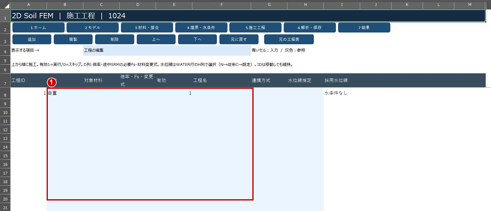

図67 「施工工程」。①B8で自重を選び、残す工程を選んで他の工程を「削除」します。

|番号|セル範囲|入力するもの|単位|例|
|---|---|---|---|---|
|①|B8|種別|－|GRAVITY|
|①|E8|有効|－|1|

### 手順2 ケースAを解析する

第4章の手順8〜9と同じ操作で解析します。

図68 ケースAの「ステージ結果」。①GRAVITYがPASS、反力Y=1188 kNです。

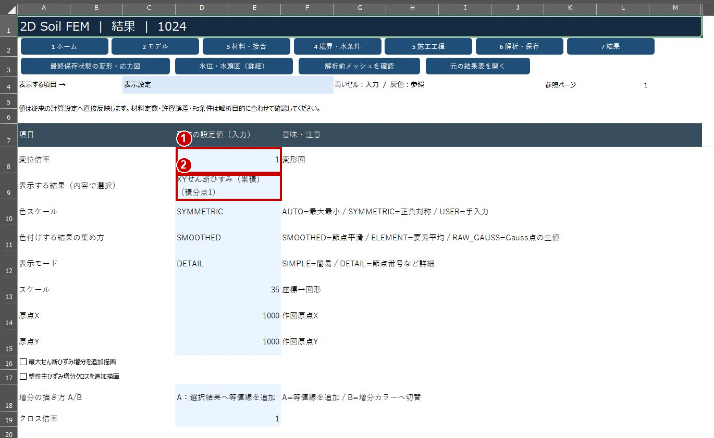

図69 「結果 → 表示設定」。①D8（変位倍率）=100。②D9で「Y応力（積分点1）」を選びます。

図70 結果図。表示量＝Y応力（積分点1）、対象＝GRAVITY、変位倍率＝100。深いほど圧縮応力が大きくなります。

### 手順3 節点データの拘束を直接変える（ケースB）

「境界・水条件 → 節点の支持・変位」で「元の入力表を開く」を押し、詳細表「節点データ」を開きます。詳細表のフィルターでX=0を選びます。

「境界・水条件 → 節点の支持・変位」を押して「節点データ」を開きます。

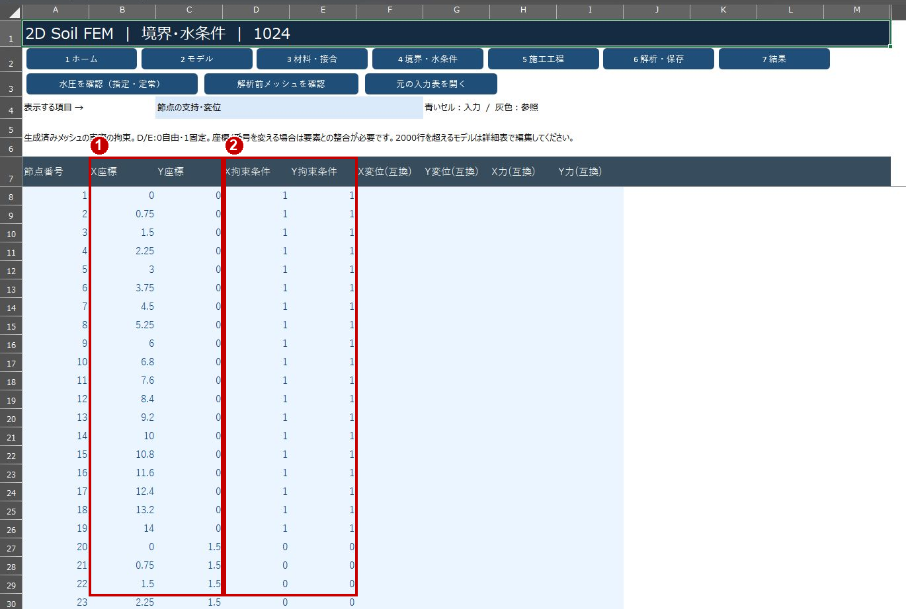

図71 「境界・水条件 → 節点の支持・変位」（列の位置の確認用）。①B:C列が座標、②D列がX拘束、E列がY拘束です。この図の赤枠は列の位置を示すもので、変更する節点は図72で選びます。

図72 B列（X）を0で絞り込んだ「節点データ」（保存ex03、変更後）。①B:C列＝座標、②D列＝X拘束。Y>0の8節点（20、39、58、77、99、153、190、227）のD列を1から0にしました。Y=0の節点1（隅点）はD=1・E=1のまま、E列はどの節点も変えません。

|番号|セル範囲|入力するもの|単位|例|
|---|---|---|---|---|
|①|B:C列|節点の座標（探すために見る列。編集しない）。B列のフィルターでX=0に絞る|m|X=0、Y>0|
|②|D列（上の8節点の行だけ）|X拘束（0=自由、1=拘束）|－|1→0|
|－|E列|Y拘束。**変更しない**（左面の8節点はもともと0）|－|そのまま|
|－|節点1（X=0、Y=0）と底面の節点|底面の拘束。**変更しない**|－|D=1、E=1のまま|

変更が終わったらフィルターを解除し、8行以外が変わっていないことを確認します。

「モデル → メッシュ生成・支持条件」D9:D13を変えるだけでは、保存済みの節点の拘束は変わりません（第6章）。

### 手順4 ケースBを解析する

図73 「計算失敗 [NONCONVERGED] 全体反復と回復補正の合計が上限に達しました」と表示されます。

図74 ケースBの「ステージ結果」。①GRAVITYがFAIL、F列（試行中の最大変位）2.38 m（未収束の値）です。

### 確認値

|項目|ケースA|ケースB|
|---|---|---|
|GRAVITY|PASS|FAIL（NONCONVERGED）|
|F列 最大変位（試行中の最大）|0.0124 m|2.38 m（未収束。採用しない）|
|反力Y|1188 kN|893 kN（釣り合っていない）|

### 注意点

> **解説　非収束は原因を調べます**
>
> 確認できるのは「左面のX拘束を外したら、自重の工程が反復上限で止まった（NONCONVERGED）」ことです。斜面が横に動けるようになり釣合いが取れなくなった、というのは拘束の変更から考えた推定で、FAIL時の変位図から機構を断定するものではありません。非収束の原因には、拘束不足のほか、単位の誤り、材料値、極端な剛性差、メッシュ品質などがあります。収束条件を緩めて通す方法はとりません。「診断」シートで停止した工程・要素・理由を確認します。
>
> 反力の合計（Y）が自重（1188 kN）と合わないことも、計算が釣り合っていない目安になります。

> **解説　保存した計算例を開いて図を見直すとき**
>
> `docs/manuals/examples/` の ex01〜ex07 は、保存時の表示量が「結果 → 表示設定」D9＝XYせん断ひずみ（累積）（積分点1）、「結果 → 表示設定」D8（変位倍率）＝1になっています。本文の図と同じ見え方にするには、各図のキャプションにある表示量・倍率を「結果 → 表示設定」D9・D8で選び直してから「最終保存状態の変形・応力図」を押します。ex03は**ケースBを計算した後（FAILの状態）**で保存しています。ケースAの図を見るには、図72の8節点のD列を1に戻し、「解析・保存 → 保存・再開」D13を空欄にして計算し直します。

## 16. 解析例4 掘削と盛土（DEATH・BIRTH）

**入力画面**　材料・接合 → 材料特性（A8:M10）／モデル → 形状の領域／施工工程。

### 目的

3つの領域を持つ地盤で、左上の領域を掘削（DEATH）し、右上に盛土（BIRTH）する施工段階を計算します。

### 解析対象

図75 解析例4の解析対象（掘削と盛土）。保存した節点・要素から描いた模式図（色＝材料番号、斜線＝初期OFF、▲＝XY固定、○＝X固定、赤矢印＝荷重）。

|項目|内容|
|---|---|
|想定|高さ4 mの地盤の左上（材料2）を掘削し、右上（材料3）に盛土する施工順の計算|
|形状|3つの外側境界（材料1：下部地盤、材料2：掘削する土、材料3：盛土）。共有辺の点は両方の境界に入れます|
|材料|材料1・2：地盤（ON）。材料3：盛土（E＝15000、γ＝19、c＝5、φ＝30°、**初期状態OFF**）|
|境界・荷重|底面XY固定、左右X固定。自重のみ|
|確かめること|DEATHで掘削した土の重さの分だけ反力が減り、BIRTHで盛土の重さの分だけ増えること。工程ごとに反力と変位の変化を読み分けます|

### 条件

|項目|内容|
|---|---|
|領域|材料1＝下部地盤（0〜14m、高さ0〜4m）、材料2＝左上の掘削する土、材料3＝右上の盛土|
|メッシュ|格子間隔1m、324要素・1053節点|
|材料3|E=15000、γ=19、c=5、φ=30°、**初期状態OFF**|
|ステージ|GRAVITY → DEATH 2 → BIRTH 3|

### 手順1 材料を3つ入力する

図76 「材料・接合 → 材料特性」。①A8:K10に材料1〜3を入力します。

図77 ①J8:J10（初期状態）。材料1・2はON、後から盛る材料3はOFFにします。

|番号|セル範囲|入力するもの|単位|例|
|---|---|---|---|---|
|①|A8:K8|材料1（下部地盤）|第10章の単位|1, 20000, 0.3, 1, 18, 30, 10, 0, 1, ON, SOIL|
|①|A9:K9|材料2（掘削する土）|同上|2, 20000, 0.3, 1, 18, 30, 10, 0, 1, ON, SOIL|
|①|A10:K10|材料3（盛土）|同上|3, 15000, 0.3, 1, 19, 30, 5, 0, 1, OFF, SOIL|
|②|J10|材料3の初期状態|－|OFF|

### 手順2 3つの外側境界を入力する

図78 「モデル → 形状の座標／形状の領域」。①A8:C16に点1〜9。②A8:D10に3つの外側境界。1行目→材料1、2行目→材料2、3行目→材料3になります（第5章）。

|番号|セル範囲|入力するもの|単位|例|
|---|---|---|---|---|
|①|A8:C16|点番号とX・Y座標|m|1(0,0) 2(14,0) 3(14,4) 4(7,4) 5(0,4) 6(0,6) 7(5,6) 8(9,6) 9(14,6)|
|②|C8|外側境界1（材料1）|－|1,2,3,4,5|
|②|C9|外側境界2（材料2）|－|5,4,7,6|
|②|C10|外側境界3（材料3）|－|4,3,9,8|
|②|D8:D10|格子間隔|m|1|

### 手順3 メッシュを作る

図79 作成したメッシュ（324要素）。領域の境目で節点が共有されていることを確認します。材料の割当ては「要素データ」J列で確認します（図38）。

### 手順4 施工順を入力する

「追加」で工程を作り、B列で日本語の操作を選びます。A列の工程IDは自動管理です。表の順序を「上へ」「下へ」でそろえ、対象材料・D列の値・E列の有効を入力します。

図80 「施工工程」。①「追加」で3工程を作り、B8:F10へ操作と対象材料等を入力します。②B:C列が工程の種類と対象の材料番号です。

「追加」で行を作り、B:Fへ種別・対象材料・パラメータ・有効・説明を入力します。A列の工程IDは自動採番された参照値です。以下のA:F表は完成時の確認用で、A列を直接編集しません。E列が空欄または0の工程は実行されません。

|番号|セル範囲|入力するもの（A, B, C, D, E, F）|単位|例|
|---|---|---|---|---|
|①|A8:F8|1行目：自重|－|1, GRAVITY, （空欄）, （空欄）, 1, 初期地盤の自重|
|②|A9:F9|2行目：掘削（材料2を除く）|－|2, DEATH, 2, （空欄）, 1, 左上を掘削|
|②|A10:F10|3行目：盛土（材料3を加える）|－|3, BIRTH, 3, （空欄）, 1, 右上に盛土|
|－|A11:F11以降|使わない行|－|すべて空欄（古い行を残さない）|

各工程の結果を残すため、「解析・保存 → 保存・再開」D8（結果の残し方）を`ALL`にします。

> **解説　BIRTH・DEATHの準備**
>
> DEATHは材料番号の単位で要素を無効にします。同じ番号の別の場所も一緒に消えるので、掘削する範囲には専用の材料番号を付けます。BIRTHする材料は「材料・接合 → 材料特性」J列をOFFにしておきます。ONのままだと最初から存在し、BIRTHしても変化しません。
>
> 構造物（支保など）を置く場合は、その範囲の土をDEATHで除き、MATSETで構造材料に変えてからBIRTHします。土と構造物を重ねた要素にはしません。

### 手順5 解析して結果を確認する

図81 「ステージ結果」。①3行ともPASS。反力Yは自重1224 kN → 掘削後1008 kN → 盛土後1236 kNです。

図82 結果図。表示量＝Y応力（積分点1）、対象＝3行目BIRTH後、変位倍率＝50。左上の領域が消え、右上に盛土が加わっています。

### 確認値

|項目|値|
|---|---|
|要素・節点|324・1053|
|反力Y（GRAVITY）|1224 kN＝（材料1 56 m²＋材料2 12 m²）×18|
|反力Y（DEATH 2後）|1008 kN＝56 m²×18|
|反力Y（BIRTH 3後）|1236 kN＝1008＋材料3 12 m²×19|

反力の変化が、取り除いた土・加えた土の重さと一致することを確認します。

### 注意点

> **解説　RESETとUNLOAD**
>
> RESET_Uは変位・応力・塑性履歴をすべて0にします（座標はそのまま）。RESET_STRESSは変形後の位置を新しい基準にしてから0にします。どちらも「沈下の表示だけを0にする」操作ではありません。また、RESET_U・RESET_STRESSは後のSRMの起点になります。この後にSRMを置くと、各Fsの試行で計算し直すのはRESETより後の工程だけです（7.5「SRMで計算し直す工程（起点）のまとめ」）。施工後の変位だけを見たいときは、結果節点の変位から基準となる工程の変位を差し引いて整理します。UNLOADは載荷条件を外す操作で、履歴は消えません。

## 17. 解析例5 荷重を加える（節点力FORCE）

**入力画面**　境界・水条件 → 載荷条件（A8:J9）／施工工程。

### 目的

上面の一部に下向きの節点力を加え、反力の増え方を確かめます。

### 解析対象

図83 解析例5・6の解析対象（上面の載荷）。保存した節点・要素から描いた模式図（色＝材料番号、斜線＝初期OFF、▲＝XY固定、○＝X固定、赤矢印＝荷重）。

|項目|内容|
|---|---|
|想定|水平な地盤の上面に、基礎や構造物の荷重が加わる場合|
|形状|幅12 m・高さ6 mの長方形、格子間隔1 m（288要素・937節点）|
|地盤・境界|第4章と同じ材料1。底面XY固定、左右X固定|
|荷重|自重のあと、上面X＝4〜8 mの節点に各−10 kN（鉛直下向き）|
|確かめること|反力の増分が加えた荷重の合計に一致すること（釣合いの確認）と、荷重直下の変位|

### 条件

|項目|内容|
|---|---|
|形状|幅12m・高さ6mの長方形（点1〜4、境界1,2,3,4）、格子間隔1m|
|メッシュ|288要素・937節点|
|材料|材料1のみ：E=20000、ν=0.3、t=1、γ=18、φ=30°、c=10、ψ=0（第4章と同じ値）|
|載荷|上面のX=4〜8mの節点に、各節点−10 kN（Y方向）|
|ステージ|GRAVITY → LOAD 1|

### 手順0 モデルを準備する

完成したモデルを再現するだけなら、`docs/manuals/examples/ex05_load_20261021.xlsm` の別名コピーを開き、手順2へ進みます（載荷・ステージ・メッシュが入力済み）。前の例のブックから作る場合は、次の順番で長方形のモデルに作り替えます。解析例6もこのモデルを使います。

1. 第4章 手順2の解説の表に従い、「材料・接合 → 材料特性」「形状入力」「載荷」「ステージ」の古いデータ行を消します（シートや行は削除しない）。
2. 「材料・接合 → 材料特性」A8:M8に材料1を入れます（図84）。
3. 「形状入力」に4点と外側境界1つを入れます（図85）。
4. 「モデル → メッシュ生成・支持条件」D8（生成要素の材料番号）＝1、D9:D12（底面PINNED・左面ROLLER・右面ROLLER・上面NONE）、D13（剛体モード止め）＝AUTOを確認し、「形状からメッシュ作成」を押します（図86・図87）。
5. 「ステージ」に1行目（GRAVITY）だけを残します（図88）。2行目は手順1の後に入れます。

図84 「材料・接合 → 材料特性」。①A8:M8に材料1。②E8が単位体積重量γ（kN/m³）です（F列は内部摩擦角φ）。

|番号|セル範囲|入力するもの|単位|例|
|---|---|---|---|---|
|①|A8:K8|材料1（番号, E, ν, 板厚, γ, φ, c, ψ, SRM対象, 初期状態, 種別）|第10章の単位|1, 20000, 0.3, 1, 18, 30, 10, 0, 1, ON, SOIL|
|－|A9:M9以降|使わない行|－|空欄|

図85 「モデル → 形状の座標／形状の領域」。①A8:C11に4点、②A8:D8に外側境界1つ。

|番号|セル範囲|入力するもの|単位|例|
|---|---|---|---|---|
|①|A8:C11|点番号とX・Y座標|m|1(0,0) 2(12,0) 3(12,6) 4(0,6)|
|②|A8:D8|境界番号, 種類, 点の順番, 格子間隔|－, －, －, m|1, 外側, 1,2,3,4, 1|
|－|A12:D・A9:J以降|使わない行|－|空欄|

図86 「モデル → メッシュ生成・支持条件」。①D8（生成要素の材料番号）＝1、②D9:D12（底面・左面・右面・上面の拘束）＝PINNED, ROLLER, ROLLER, NONE、③D13（剛体モード止め）＝AUTO。格子間隔は「形状入力」J8で指定します。

図87 作成したメッシュ（288要素・937節点）。

図88 入力後の施工工程。自重と載荷の2行を登録します。載荷行の対象材料を「載荷条件」と一致させます。

### 手順1 載荷を入力する

図89 「境界・水条件 → 載荷条件」。①A8:E8で材料・選択・方向・種類・値。②F8:I8でBOXの範囲。

|番号|セル範囲|入力するもの|単位|例|
|---|---|---|---|---|
|①|A8|対象の材料番号|－|1|
|①|B8|選択（TOP／BOTTOM／LEFT／RIGHT／BOX／節点番号）|－|BOX|
|①|C8|方向|－|Y|
|①|D8|種類（FORCE／DISP／FIX）|－|FORCE|
|①|E8|値（各節点の力）|kN|−10|
|②|F8:I8|BOXの範囲 X1, Y1, X8, Y8（境界を含む）|m|4, 6, 8, 6|

図90 「施工工程」。①「追加」で自重と載荷の2工程を作り、B8:F9へ入力します。②LOAD行のC列＝1は、「境界・水条件 → 載荷条件」A列と同じ対象の材料番号です。

|番号|セル範囲|入力するもの（A, B, C, D, E, F）|単位|例|
|---|---|---|---|---|
|①|A8:F8|1行目：自重|－|1, GRAVITY, （空欄）, （空欄）, 1, 自重|
|②|A9:F9|2行目：載荷（「境界・水条件 → 載荷条件」A列＝1の行を適用）|－|2, LOAD, 1, （空欄）, 1, 上面中央に節点力|
|－|A10:F10以降|使わない行|－|空欄|

E列（有効）が空欄だとLOAD工程は実行されず、荷重は加わりません。

### 手順2 解析して結果を確認する

図91 「ステージ結果」。①反力Yは自重1296 kN → 載荷後1466 kNです。

図92 結果図。表示量＝Y応力（積分点1）、対象＝LOAD後、変位倍率＝100。載荷した範囲の下で圧縮応力が大きくなります。

### 確認値

|項目|値|
|---|---|
|要素・節点|288・937|
|反力Y（GRAVITY）|1296 kN＝72 m²×18|
|反力Y（LOAD後）|1466 kN（増加170 kN＝17節点×10 kN）|
|F列 最大変位（試行中の最大）|0.0120 m → 0.0196 m|
|LOAD後の変位（結果節点、工程2の全937節点）|max｜uy｜＝max√(ux²＋uy²)＝0.0196 m、max｜ux｜＝0.0012 m|

### 注意点

> **解説　FORCEは「各節点の力」です**
>
> E列の値は合力ではなく、選ばれた節点1つずつに加える力です。この例ではBOX内に17節点（Q8の中間節点を含む）があり、合計170 kNになりました。メッシュを細かくすると節点が増え、合力も増えます。
>
> 一様な面圧pを加えたいときは、Q8の1辺（長さL、奥行t）ごとに端点：中点：端点＝pLt/6×[1, 4, 1]で節点力を割り振り、隣り合う辺の共有端点は足し合わせます。例：p=10 kN/m²、L=1m、t=1mなら−1.667／−6.667／−1.667 kN（合計−10 kN）。TOPで全節点に同じ値を入れても面圧にはなりません。
>
> 載荷の行が残っていると、DISP=0でもゼロ変位の拘束として働きます。使わない行は消すか、対応するLOAD工程を無効にします。
>
> アンカーの緊張力を表すときは、頭部側と定着側に大きさが等しく向きが反対の節点力を入れ、合力とモーメントが0になることを確認します（専用のアンカー要素ではないため、軸剛性や引抜きは表せません）。

## 18. 解析例6 強制変位で押し込む（支持力）

**入力画面**　境界・水条件 → 載荷条件（D8=DISP、E8=目標変位）。

### 目的

上面の幅2mを強制変位（DISP）で押し込み、地盤の反力を読みます。

### 解析対象

図93 解析例6の解析対象（強制変位で押し込む）。保存した節点・要素から描いた模式図（色＝材料番号、斜線＝初期OFF、▲＝XY固定、○＝X固定、赤矢印＝荷重）。

|項目|内容|
|---|---|
|想定|剛な基礎を一定の量だけ押し込んだときの地盤の抵抗（反力）を求める場合|
|形状・地盤・境界|解析例5と同じ|
|荷重|自重のあと、上面X＝5〜7 mの節点を目標変位−0.02 mまで押し込む（DISP）|
|確かめること|押し込んだ節点の反力の合計（地盤の抵抗）。DISPの値は「その工程の増分」ではなく**目標の総変位**であることに注意します|

### 条件

|項目|内容|
|---|---|
|形状・メッシュ|解析例5と同じ（288要素・937節点）|
|載荷|上面のX=5〜7mの節点を、Y方向の目標変位−0.02 mまで押し込む|
|ステージ|GRAVITY → LOAD 1|

### 手順1 載荷を入力する

図94 「境界・水条件 → 載荷条件」。①A8:E8（D8=DISP、E8=−0.02）。②F8:I8＝5, 6, 7, 6。

|番号|セル範囲|入力するもの|単位|例|
|---|---|---|---|---|
|①|D8|種類|－|DISP|
|①|E8|目標変位（自重による変位を含む総変位）|m|−0.02|
|②|F8:I8|BOXの範囲|m|5, 6, 7, 6|

> **解説　DISPは「目標の総変位」です**
>
> E列は自重後からの追加量ではなく、最終的な変位です。自重で上面が沈んだ量をuy0とすると、さらにδだけ押し込むには E=uy0−δ と入力します。水平で一様な地盤なら、uy0は手計算で確かめられます：拘束弾性係数 M=E(1−ν)/((1+ν)(1−2ν))、地表沈下 s=γH²/(2M)。
>
> この例（E=20000、ν=0.3、γ=18、H=6m）では M=26923 kN/m²、s=0.0120 mで、GRAVITYの最大変位0.0120 mと一致します。目標−0.02 mは、自重後にさらに約8 mm押し込む量です。
>
> 最初に−0.05 mで計算したところ「荷重増分が収束せず、最小増分に達しました」でFAILしました。押し込み量が大きすぎて地盤が支えきれない場合はFAILになります。

### 手順2 解析して結果を確認する

図95 「ステージ結果」。①LOADがPASS、F列（試行中の最大変位）0.0196 mです。

図96 結果図。表示量＝最大せん断ひずみ（積分点1）、対象＝LOAD後、変位倍率＝20。押し込んだ範囲の両端からせん断ひずみが広がります。

### 確認値

|項目|値|
|---|---|
|GRAVITYの地表沈下（F列）|0.0120 m（手計算0.0120 m）|
|LOAD後のF列（試行中の最大）|0.0196 m|
|LOAD後の変位（結果節点、工程2の全937節点）|max｜uy｜＝0.0200 m（目標変位）、max√(ux²＋uy²)＝0.0200 m|
|平均載荷圧力（工程2、載荷幅の9節点）|ΣRy＝−142.07 kN → q＝−ΣRy／(2 m×1 m)＝71.04 kPa（圧縮正）|
|−0.05 mで計算した場合|FAIL（最小増分に到達）|

### 注意点

> **解説　平均載荷圧力の求め方**
>
> 押し込んだ節点の反力は「結果節点」のI:J列にあります。LOAD後の工程（A列＝2）で、載荷幅（X=5〜7m、Y=6m）に入る9節点（隅5点＋Q8の中間4点：311〜315、911、913、915、917）の反力Y（J列）を合計します。保存例ではΣRy＝−142.0729 kNです。圧縮を正とする平均圧力は q＝−ΣRy／(載荷幅2 m×板厚1 m)＝71.04 kPa です。「ステージ結果」の反力Yは支持点を含む全体の合計なので、そのまま載荷圧力にはなりません。平均載荷圧力は極限支持力を自動で判定した値ではありません。押し込み量を少しずつ増やした計算を並べて、圧力と沈下の関係から判断します。

## 19. 解析例7 流れ則を変える（DAVIS）

**入力画面**　解析・保存 → 解析・SRM（D9=DAVIS）。

### 目的

「解析・保存 → 解析・SRM」D9（非関連の扱い）をINCONSISTENTからDAVISに変え、Fsの違いを確かめます。

### 解析対象

図97 解析例7の解析対象（流れ則の比較）。保存した節点・要素から描いた模式図（色＝材料番号、斜線＝初期OFF、▲＝XY固定、○＝X固定、赤矢印＝荷重）。

|項目|内容|
|---|---|
|想定|第4章の斜面（φ＝30°、ψ＝0）を、非関連流れの2つの扱い方で計算し比べる|
|形状・地盤・境界|第4章と同じ|
|確かめること|INCONSISTENTとDAVISでFsがどれだけ違うか（7.3）。DAVISはFs＝1の状態から換算後の弱い強度で計算します。あわせて、文献の斜面（Griffiths–Lane、Pruška）と区間を比べます|

### 条件

|項目|基準（第4章）|解析例7|
|---|---|---|
|C10（非関連の扱い）|INCONSISTENT|**DAVIS**|
|そのほか|第4章と同じ（φ=30°、ψ=0）|同じ|

### 手順1 流れ則を変える

図98 「解析・保存 → 解析・SRM」。①D9をDAVISに変えます。

|番号|セル範囲|入力するもの|単位|例|
|---|---|---|---|---|
|①|D9|非関連の扱い（INCONSISTENT／DAVIS）|－|DAVIS|

### 手順2 解析して結果を確認する

図99 終了メッセージ。FOS_PASS=2.700、FOS_FAIL=2.713です。

図100 「ステージ結果」。①SRM行のFsは2.70625です。

図101 結果図。表示量＝最大せん断ひずみ（積分点1）、対象＝最後に成功したFs=2.700の状態、変位倍率＝1。

### 確認値

|項目|INCONSISTENT（第4章）|DAVIS（解析例7）|
|---|---|---|
|Fs区間|2.625〜2.638|2.700〜2.713|
|試行回数|21|22|

### 注意点

> **解説　INCONSISTENTとDAVISの違い**
>
> INCONSISTENTは、低減後のc・φ・ψをそのまま使い、φ≠ψの非関連流れを扱います。DAVISは、連続体の材料を等価な関連流れ（ψ*=φ*）に置き換える近似です。換算は β=cosψr·cosφr/(1−sinφr·sinψr)、c*=β·cr、φ*=atan(β·tanφr) です。例：φ=28°、c=15、ψ=0なら β=0.883、c*=13.24、φ*=25.15°。初期状態から材料の評価が違うため、Fsも変わります。
>
> 流れ則は計算速度の切替えではなく、材料の扱いの選択です。比べるときは、同じメッシュ・材料・施工順・設定でC10だけを変えます。JOINTにはDAVIS換算はかかりません。I列=0の材料でもDAVIS換算は行われます。

> **解説　文献の例題との比較（Griffiths & Lane 1999、Pruška）**
>
> 均質な斜面の文献条件による保存計算です（`workbook/validation/literature_cases_20261009.zip`、DAVIS）。Griffiths & Lane（1999）の粗いメッシュ（661節点・200要素、c=10、φ=20°、ψ=0、γ=20、E=100000）を、保存計算のブック（`2DSoilFEM_ui_20261021.xlsm`）で再計算しました（2026-10-21、作業コピー `run6\griffiths\case.xlsm`）。

|ケース|節点・要素|Fs区間（このブック）|文献値|文献値との関係（中点＝区間の中央）|計算時間|
|---|---|---|---|---|---|
|Griffiths φ20 粗（**2026-10-21再計算**）|661・200|1.338〜1.350|1.40|−4.0%|16.3秒|
|Griffiths φ20 粗（保存記録）|661・200|1.350〜1.3625|1.40|−3.1%|1516.8秒|
|Griffiths φ20 細（保存記録）|1441・450|1.3375〜1.350|1.40|−4.0%|4526.5秒|
|Pruška H7 φ10（保存記録）|789・240|1.2375〜1.250|1.21〜1.31|中点1.244が文献の範囲内|1894.1秒|
|Pruška H7 φ20（保存記録）|789・240|1.6875〜1.700|1.64〜1.71|中点1.694が文献の範囲内|2415.4秒|
|Pruška H10.5 φ10（保存記録）|789・240|0.825〜0.83125|0.83〜0.91|中点0.828は文献の下限0.83未満。Fs区間の上側（0.83〜0.83125）だけが文献の範囲と重なる|4565.9秒|

図102 Griffiths & Lane（1999）の例題、DAVISの結果図（保存記録 `visual_checks`）。

図103 強度低減係数と変位の関係（保存記録）。横軸はDAVIS換算後の強度低減係数（Fsの試行値）、縦軸は最大変位を基準の値で割った正規化変位で、対数目盛です。係数が上がると変位が急に増えます。

図104 Pruškaの例題の形状（H=7m、10.5m）。

> 改訂後の計算記録は先行する保存記録より約0.0125低い区間になりました。保存記録は2026年10月9日の旧版ブック（許容幅0.0125）、改訂後の記録は現在のブック（許容幅0.02）で、SRMの探索幅と計算部の版が違います。計算時間の大きな差は、計算部の版の違いによるもので、同じ条件の速度比較ではありません。文献値は解析法やメッシュによって幅がある値で、この比較は「同程度の値が出る」ことの確認です。
>
> 文献の形状はこのブックで独立に作り直したもので、文献ソフトのK0による初期応力の作り方は再現していません。Griffithsの粗・細（保存記録）のFsの差は、区間の中点どうしで約0.92%ですが、2つのメッシュだけで精度が収束したとは判断しません。出典：Griffiths, D.V. & Lane, P.A. (1999) Slope stability analysis by finite elements, Géotechnique 49(3), 387–403／Pruška, J. Comparison of geotechnic softwares – Geo FEM, Plaxis, Z-Soil。

## 20. 解析例8 道路拡幅の11工程（盛土・掘削・MATSET・再盛土）

**入力画面**　モデル → 形状の座標／形状の領域、材料・接合 → 材料特性、施工工程。

### 目的

道路の盛土を3回に分けて施工し、中央を掘削して別の材料で埋め戻す11工程を計算します。BIRTH・DEATHに加えて、掘削した領域の材料を入れ替えるMATSETを使います。あわせて、最後の工程の増分図（A：等値線、B：増分カラー）の読み方を確認します。

### 解析対象

図105 解析例8の解析対象（道路拡幅の11工程）。保存した節点・要素から描いた模式図（色＝材料番号、斜線＝初期OFF、▲＝XY固定、○＝X固定、赤矢印＝荷重）。

|項目|内容|
|---|---|
|想定|既設道路の小規模盛土を拡幅・かさ上げする。中央の盛土を取り除き、直下の基盤を掘削して置き換え、別の材料で埋め戻して台形の上部盛土を追加する|
|形状|18点・8つの外側境界。全領域を1つの共有メッシュとして先に作り、工程ごとに材料のON・OFFを切り替えます（斜線＝初期OFF）|
|材料|1〜4：基盤（ON）。5〜7：初回盛土（OFF）。8：再盛土（OFF）。3・6は掘削のあと、MATSETで再盛土の物性に入れ替えます|
|境界・荷重|底面XY固定、左右X固定。自重のみ（SRMなし）|
|確かめること|工程ごとの反力が「有効な領域の重さ」に一致すること、施工完了時の変位（工程11、結果節点）、最後の工程の増分図|

### 条件

|項目|内容|
|---|---|
|入力ファイル|`tests/manual_cases/road_widening_shape.json`（リポジトリに収録）|
|形状|点18個、外側境界8個、格子間隔2m。328節点・95要素（Q8）|
|材料1〜4（基盤）|E=30000、ν=0.3、γ=20、φ=30°、c=20、初期状態ON|
|材料5〜7（初回盛土）|E=12000、ν=0.3、γ=18、φ=25°、c=8、初期状態OFF|
|材料8（再盛土）|E=20000、ν=0.28、γ=19、φ=32°、c=15、初期状態OFF|
|支持|底面PINNED、左右ROLLER、上面NONE|
|流れ則|INCONSISTENT（SRMなし）|
|入力・保存ブック|`run4\road\case.xlsm`|

### 手順1 形状を入力する

図106 「モデル → 形状の座標／形状の領域」。①A8:C25に点1〜18、②A8:D15に外側境界1〜8を入力します。外側境界の行の順番が材料番号1〜8になります（第5章）。

|番号|セル範囲|入力するもの|単位|例|
|---|---|---|---|---|
|①|A8:C25|点番号・X・Y|m|1(0,−6) 2(0,−2) 3(4,−2) … 17(5,4) 18(7,4)|
|②|C8|境界1（基盤下部・残置）|－|1,2,3,4,5,6|
|②|C10|境界3（基盤の掘削・再盛土部）|－|3,9,10,4|
|②|C13|境界6（初回盛土の掘削・再盛土部）|－|9,14,15,10|
|②|C15|境界8（再盛土の上部）|－|14,17,18,15|
|②|D8:D15|格子間隔|m|2|

### 手順2 材料を入力する

図107 「材料・接合 → 材料特性」。①A8:K15に材料1〜8。②J列で、後から施工する材料5〜8をOFFにします。

|番号|セル範囲|入力するもの|単位|例|
|---|---|---|---|---|
|①|A8:K11|基盤（材料1〜4）|第10章の単位|1, 30000, 0.3, 1, 20, 30, 20, 0, 1, ON, SOIL|
|①|A12:K14|初回盛土（材料5〜7）|同上|5, 12000, 0.3, 1, 18, 25, 8, 0, 1, OFF, SOIL|
|①|A15:K15|再盛土（材料8）|同上|8, 20000, 0.28, 1, 19, 32, 15, 0, 1, OFF, SOIL|
|②|J12:J15|初期状態|－|OFF|

### 手順3 施工順を入力する

「追加」で工程を作り、B列で日本語の操作を選びます。A列の工程IDは自動管理です。表の順序を「上へ」「下へ」でそろえ、対象材料・D列の値・E列の有効を入力します。

図108 「施工工程」。①A8:F18に11行。②B:D列が工程の種類と対象の材料番号です。

|番号|セル範囲|入力するもの|単位|例|
|---|---|---|---|---|
|①|A8:F8|1行目：自重|－|1, GRAVITY, , , 1, 初期基盤の自重|
|①|A9:F11|2〜4行目：初回盛土|－|BIRTH 5 → BIRTH 6 → BIRTH 7|
|①|A12:F13|5〜6行目：掘削|－|DEATH 6（盛土中央）→ DEATH 3（基盤を深さ2mまで）|
|②|B14:D15|7〜8行目：材料の入れ替え|－|MATSET 3 → 8、MATSET 6 → 8（C列＝対象、D列＝新しい材料）|
|①|A16:F18|9〜11行目：再盛土|－|BIRTH 3 → BIRTH 6 → BIRTH 8|

> **解説　MATSETで材料を入れ替える**
>
> MATSETは、C列の材料番号の要素に、D列の材料の物性を割り当て直します。掘削した領域（無効の要素）をMATSETしてからBIRTHすると、元の土ではなく新しい材料で埋め戻したことになります。MATSETの工程では荷重は変わらないので、反力・変位は前の工程と同じ値になります。
>
> D列（パラメータ）にはコピー元の材料番号（この例は8）を入れます。「材料・接合 → 材料特性」に入力した材料8の値がそのままコピーされるので、要素の材料番号を付け替える必要はありません。D列に `c=20;phi=30` のように強度だけを書く使い方もあります。MATSETによる変更は計算中のデータだけで、「材料・接合 → 材料特性」の表へ書き戻されません（`FEMEngine.bas` の P3ApplyMatSet）。表の値を見て結果を判断しないでください。
>
> この掘削・埋戻しの例では、MATSETを掘削（DEATH）の後、再BIRTHの前に置きます。無効の領域の物性を入れ替えるので、MATSET直後の反力・変位は変わりません。MATSETは有効な要素にも使え、その場合は履歴を残したまま物性だけが変わります（P3ApplyMatSet）。物性を変えるために有効な領域をDEATH→BIRTHすると、その領域の応力・塑性の履歴が失われます。BIRTHした要素は応力・塑性の履歴が0から始まります（P3SetMaterialElementsActive）。残した領域の履歴と、共通の節点の累積変位はそのまま続きます。

### 手順4 解析して結果を確認する

メッシュを作り（第4章 手順4）、解析を開始します。解析時間は約4秒でした。

図109 「ステージ結果」。①11工程すべてPASS。②H列（反力Y）は1440 kN → 1728 kN（盛土完了）→ 1424 kN（掘削完了）→ 1842 kN（再盛土完了）です。

図110 結果図A。表示量＝Y応力（積分点1）、対象＝11工程目、変位倍率＝1。「結果 → 表示設定」D18を「A：選択結果へ等値線を追加」にすると、応力の色の上に最大せん断ひずみ増分の等値線（最大値の25・50・75%）と塑性主ひずみ増分のクロスが重なります。

> **解説　この図のせん断帯（7.8）**
>
> 道路拡幅はSRMを含まないので、等値線とクロスは「11工程目で最後に収束した荷重増分」で動いた場所です。破壊の形ではなく、最後に加えた盛土（材料8）の荷重を地盤のどこが受けて変形したかを読みます。帯が盛土の下から旧盛土の法面に沿って続くかを、11工程目の沈下（ux−ux0、uy−uy0）と一緒に確かめます。

図111 結果図B。「結果 → 表示設定」D18を「B：増分専用カラー」にした図です。最後に加えた台形上部（材料8）の下で増分が大きくなっています。

図112 「結果 → 表示設定」。D18でA/Bを切り替え、16行・17行のチェックボックスで最大せん断ひずみ増分と塑性主ひずみ増分クロスを個別にON/OFFします。D19はクロス倍率です。

|番号|セル範囲・部品|入力するもの|単位|例|
|---|---|---|---|---|
|①|D18|増分図の種類|－|A：選択結果へ等値線を追加／B：増分専用カラー|
|②|16・17行のチェックボックス（元表のリンクセルJ28:J29）|最大せん断ひずみ増分の等値線・塑性主ひずみ増分クロスを追加|－|チェックあり（J28:J29＝TRUE）|
|③|D19|クロスの表示倍率|－|1|

### 確認値

|項目|値|検算|
|---|---|---|
|節点・要素|328・95|旧版の記録と同じ|
|反力Y（1：自重）|1440 kN|（48＋8＋8＋8）m²×20|
|反力Y（4：盛土完了）|1728 kN|1440＋（4＋8＋4）m²×18|
|反力Y（6：掘削完了）|1424 kN|1728−8×18−8×20|
|反力Y（11：再盛土完了）|1842 kN|1424＋（8＋8＋6）m²×19|
|解析時間|4.1秒|Rico（Windows・Excel）で実測|

変位は、試行中の統計と、施工完了時（工程11の収束状態）の変位を分けて読みます。どちらも解析開始（GRAVITY前）からの累積です。

|項目|ステージ結果F列（試行中の最大）|施工完了時の変位（結果節点、工程11、全328節点）|
|---|---|---|
|定義|計算中に試した状態を含む自由度の変位成分の最大。工程6以降は前の工程の最大を引き継ぐ|工程11が収束した後の各節点の変位|
|値|0.0466 m（工程6で記録、工程11まで同じ値）|max｜uy｜＝0.02199 m（節点20、X=6、Y=0）、max｜ux｜＝0.00706 m、max√(ux²＋uy²)＝0.02199 m|
|使い方|計算の経過の目安。沈下量としては使わない|施工完了の沈下はこちらを使う（自重だけの工程1は max｜uy｜＝0.00891 m）|

反力Yが、加えた土・取り除いた土の面積×単位体積重量×板厚（t=1 m）だけ変わることを確認します。

> **解説　「診断」で確かめるKEY**
>
> 「診断」シートのA列（KEY）で ResultStatus（PASS/FAIL）、AnalysisMessage（停止理由）、RelativeResidualFree（自由節点の相対残差）、FOS_INTERPRETATION（Fsの解釈。SRMのときだけ意味を持つ）を探して記録します。道路例はFs=1の施工解析で、SRMの安全率は求めていません。

### 注意点

> **解説　増分図が示すもの**
>
> 増分図は「最後に収束した荷重増分」の値です。累積のひずみでも、工程全体の変化量でもありません。最大せん断ひずみ増分は全ひずみの主値差（工学せん断ひずみγ＝2ε）、塑性主ひずみ増分のクロスは青＝圧縮・内向き、赤＝引張・外向きです。古い結果には増分データがないため、新しい版で最初から再解析します。表示設定だけを変えたときは「最終保存状態の変形・応力図」を押せば再描画されます。

> **解説　工程ごとの図と、読む場所**
>
> 工程ごとの図では、色はその工程での材料（MATSETで入れ替えた後の材料）を表します。MATSETした元の材料3・6も、入れ替えた後は再盛土の材料8と同じ色で示されます。白い部分は、その工程で無効（掘削中）の領域です。
>
> |読む場所|確かめること|
> |---|---|
> |掘削の底と元の地盤の境|応力の再配分、増分の集中、共有節点で変位がつながっているか。局所の値はメッシュの影響も確かめる|
> |MATSET→BIRTHの領域|材料3・6の物性が材料8になり、有効になっているか。MATSETだけでは再盛土されない|
> |残した地盤・盛土|掘削で除いた領域だけでなく、残った領域の変位・応力も工程ごとに比べる|
>
> γを変えた確認では、工程11の支持反力Yの増え方が「再盛土の面積×奥行×γの差」と一致するかを確かめます（例：面積22 m²、γ 19→20 kN/m³で 1842＋22×1×(20−19)＝1864 kN）。

### 応用1 再盛土の単位体積重量を19→20 kN/m³に変える

材料8（再盛土）のγだけを変え、反力の変化を確かめます。`ex08_road_result_20261021.xlsm` の別名コピーで、メッシュ・施工順はそのままです（2026-10-21、`examples/ex08_road_gamma20_20261021.xlsm`）。

図113 「材料データ」。①A9:K9が材料8（再盛土）。②E9（単位体積重量γ）を19から20に変えます。F9（内部摩擦角φ＝32°）は変えません。

|番号|セル範囲|入力するもの|単位|例|
|---|---|---|---|---|
|②|E9|材料8の単位体積重量γ|kN/m³|19→20|

図114 「ステージ結果」。①11工程すべてPASS。②H12（工程11の反力Y）＝1864 kNです。

|工程|元（γ8=19）|γ8=20|差と検算|
|---|---|---|---|
|1〜8|1440〜1424 kN|同じ|材料8はまだ使っていない|
|9：BIRTH 3（MATSETで材料8の物性）|1576 kN|1584 kN|＋8 m²×1 kN/m³＝＋8|
|10：BIRTH 6（同上）|1728 kN|1744 kN|＋（8＋8）m²×1＝＋16|
|11：BIRTH 8|1842 kN|**1864 kN**|＋22 m²×1＝＋22（旧版の記録1864 kNと一致）|
|施工完了時の変位（工程11、全328節点）|max｜uy｜＝0.02199 m|max｜uy｜＝0.02264 m（節点20）|F列（試行中の最大）はどちらも0.0466 m|

MATSETで材料3・6に材料8の物性を割り当てているので、γ8の変更は工程9・10の反力にも効きます。

### 応用2 再盛土の天端を1 m高くする（形状の変更）

点17・18のYを4 mから5 mに変えてメッシュを作り直します。`ex08_road_input_20261021.xlsm` の別名コピーを使います（2026-10-21、`examples/ex08_road_taller_20261021.xlsm`）。

図115 「モデル → 形状の座標」。①A24:C25が点17・18。②C24:C25（Y座標）を4→5にします。

|番号|セル範囲|入力するもの|単位|例|
|---|---|---|---|---|
|②|C24:C25|点17・18のY座標|m|4→5|

図116 「形状からメッシュ作成」の後。352節点・103要素になりました（元は328・95）。節点番号が変わるので、番号で指定した載荷・拘束があれば探し直します。

図117 「ステージ結果」。①11工程すべてPASS。②H12＝1899 kNです。

|項目|元|天端+1 m|検算|
|---|---|---|---|
|節点・要素|328・95|352・103|旧版の記録（352・103）と一致|
|反力Y（工程11）|1842 kN|**1899 kN**|＋材料8の面積の増加3 m²×19＝＋57（旧版の記録と一致）|
|施工完了時の変位（工程11）|max｜uy｜＝0.02199 m|max｜uy｜＝0.02369 m（節点20）|F列は0.0463 m（試行中の最大）|

形を変えたときは、メッシュの品質（第4章 手順4の表）を確認します。旧版の記録では、この形で角度の比較が「警告」の要素が4つ残りました。再作成時は「解析前メッシュを確認」で形状を確認し、「解析・保存 → 詳細設定」のメッシュ品質条件と生成時の診断も照合してください。反力が面積×γだけ変わることは、形の変更が正しく入った確認であり、精度やSRMの検証ではありません。

### 実務で整理する帳票：土量と工程別の変位

道路拡幅では、既設盛土だけでなく基盤の掘削範囲にも専用材料番号を付け、切土前・掘削後・再盛土後の3状態を同じ座標で比較します。材料が変わる部分は、掘削と新材料の有効化を別工程にします。MATSETで残存地盤の材料を替える工程と、新しい領域をBIRTHする工程を混同しません。

|比較する状態|保存記録からの値|実務での確認|
|---|---|---|
|基準の11工程完了|鉛直反力1842 kN/m、最大変位ノルム21.9871 mm|自重・掘削持出・盛土持込と最終反力|
|再盛土天端を1 m高くする|鉛直反力1899 kN/m、最大変位ノルム23.6952 mm|法尻・既設道路の変位と接続部のひずみ|
|形状変更による増分|面積+3 m²、重量+57 kN/m、反力+57 kN/m|追加重量と反力増分の一致|

図8-P1　道路拡幅の基準と高盛土の保存計算。左は最終鉛直反力、右は最大変位ノルムです。変位の増加は、形状とメッシュも変えた比較です。[入力・独立検算](construction-evidence/20261021/manual-applied/exercise_summary.json)。

### 工程ごとの土量・反力・沈下を同じ表へまとめる

道路拡幅では、掘削した範囲と再盛土する範囲を材料番号で分けます。初回盛土の3層をBIRTH、盛土と基盤の撤去をDEATH、再使用する領域の物性をMATSET、再盛土をBIRTHの順に並べます。工程7・8は物性の割当てで、撤去済み領域をその場で再び有効化する操作ではありません。

図116-A　保存した11工程の結果を再集計。青帯は掘削、黄帯は再盛土。下段は基盤の節点20（X=6、Y=0 m）のY変位を工程1から差し引いた追加沈下（下向き正）です。工程ごとの最大値ではなく同じ測点を追っています。

|工程末|土工の状態|鉛直反力[kN/m]|節点20の追加沈下[mm]|
|---|---|---:|---:|
|1|初期基盤、自重後の基準|1440|0.000|
|4|初回盛土の完成|1728|4.981|
|6|盛土8 m²と基盤8 m²を掘削|1424|0.947|
|11|γ=19 kN/m³で22 m²を再盛土|1842|13.073|

「結果 → 工程別の結果」で工程1・4・6・11を順に選び、全節点変位と全積分点応力を残します。反力は支持点のY反力を合計し、沈下は「結果節点」のA列=工程ID、B列=20を抽出して、s=−(uy工程−uy工程1)で求めます。最終の累積沈下21.987 mmと、施工による追加沈下13.073 mmを帳票の別欄にします。

奥行1 mでは、掘削の重量減は8×18＋8×20=304 kN、再盛土の重量増は22×19=418 kNです。反力の変化1728→1424→1842 kNと照合すると、撤去・再施工する材料や有効状態の入力漏れを見つけやすくなります。盛土天端と既設道路側の測点も同じ物理座標で抽出し、再メッシュした場合は節点番号を選び直します。

[工程別の再集計値と出典](../manual-field-evidence/20261024/field_examples.json)。

## 21. 解析例9 L型擁壁と背面盛土・SRM、断面力の整理

**入力画面**　材料・接合 → 材料特性、モデル → 形状の領域、施工工程、結果 → 要素結果。

### 目的

斜面の途中にL型擁壁（STRUCT材料）を設置し、背面に盛土をしてからSRMでFsを求めます。さらに、工程3（盛土完了・Fs=1）の積分点応力から、縦壁と底版の断面力（N・V・M）を整理します。

### 解析対象

図118 解析例9の解析対象（L型擁壁と背面盛土）。保存した節点・要素から描いた模式図（色＝材料番号、斜線＝初期OFF、▲＝XY固定、○＝X固定、赤矢印＝荷重）。

|項目|内容|
|---|---|
|想定|斜面の途中の作業段にL型擁壁を設置し、その背面を盛土して道路をつくる|
|形状|地盤（境界1）、L型擁壁（境界2、縦壁厚0.4 m・底版厚0.4 m）、背面盛土（境界3）。擁壁と地盤・盛土は共有節点でつなぎます（接合要素なし）|
|材料|1：地盤、2：擁壁（STRUCT、I列＝0でSRMの低減対象外、初期OFF）、3：背面盛土（初期OFF）|
|境界・荷重|底面XY固定、左右X固定。自重のみ|
|確かめること|施工完了（工程3）の変位、擁壁の断面力（縦壁・底版のN・V・M）、施工後のSRMによるFs|

### 条件

|項目|内容|
|---|---|
|入力ファイル|`tests/manual_cases/slope_wall_shape.json`|
|形状|点16個、外側境界3個（地盤・擁壁・背面盛土）、格子間隔2.0／0.8／1.2m。1857節点・580要素|
|材料1（地盤）|E=200000、ν=0.3、γ=20、φ=28°、c=15、ON|
|材料2（擁壁）|E=25000000、ν=0.2、γ=24、c=10000000、I列=0（SRMで低減しない）、OFF、STRUCT|
|材料3（背面盛土）|E=100000、ν=0.3、γ=19、φ=30°、c=10、OFF|
|ステージ|GRAVITY → BIRTH 2（擁壁）→ BIRTH 3（盛土）→ SRM|
|流れ則|DAVIS、SRM上限3、許容幅0.02|
|入力・保存ブック|`run4\wall\case.xlsm`|

### 手順1 形状を入力する

図119 「モデル → 形状の座標／形状の領域」。①A8:C23に点1〜16、②A8:D10に外側境界3つ。2行目が擁壁（材料2）、3行目が背面盛土（材料3）です。

|番号|セル範囲|入力するもの|単位|例|
|---|---|---|---|---|
|①|A8:C23|点番号・X・Y|m|7(18.6,0) 13(15,0.4) 14(18.6,0.4) 15(18.6,3.4) 16(19,3.4)|
|②|C9|擁壁の外側境界|－|8,7,6,16,15,14,13|
|②|D9|擁壁の格子間隔|m|0.8|
|②|C10|背面盛土の外側境界|－|10,9,8,13,14,15|

擁壁の底版は全幅4.0 m（X=15.0〜19.0 m）、厚さ0.4 m。このうち縦壁より左の張出し部が3.6 m（X=15.0〜18.6 m）です。縦壁は幅0.4 m、底版の上の高さ3.0 m（Y=0.4〜3.4 m）です。断面積は 4.0×0.4＋0.4×3.0＝2.8 m² で、自重の増加 2.8 m²×24 kN/m³×1 m＝67.2 kN と一致します（張出し3.6 mで計算すると2.64 m²になり、合いません）。

### 手順2 材料を入力する

図120 「材料・接合 → 材料特性」。①A8:K10に材料1〜3。②K列で擁壁をSTRUCTにします。

|番号|セル範囲|入力するもの|単位|例|
|---|---|---|---|---|
|①|A9:K9|擁壁|第10章の単位|2, 25000000, 0.2, 1, 24, 0, 10000000, 0, 0, OFF, STRUCT|
|②|K9|種別|－|STRUCT（連続体。梁要素ではない）|
|①|I9|SRMでの低減|－|0（擁壁は低減しない）|

### 手順3 施工順を入力する

「追加」で工程を作り、B列で日本語の操作を選びます。A列の工程IDは自動管理です。表の順序を「上へ」「下へ」でそろえ、対象材料・D列の値・E列の有効を入力します。

図121 「施工工程」。①A8:F11に4行。

|番号|セル範囲|入力するもの|単位|例|
|---|---|---|---|---|
|①|A8:F8|自重|－|1, GRAVITY, , , 1|
|①|A9:F9|擁壁の施工|－|2, BIRTH, 2, , 1|
|①|A10:F10|背面盛土|－|3, BIRTH, 3, , 1|
|①|A11:F11|施工後のSRM|－|4, SRM, , , 1|

### 手順4 解析して結果を確認する

図122 「ステージ結果」。①4工程すべてPASS。②SRM行のFsは1.70625（区間1.700〜1.713）です。解析時間は110.7秒でした。

図123 結果図。表示量＝Y応力（積分点1）、対象＝最後に成功したFs=1.700の状態、変位倍率＝1。擁壁の背面と斜面のり尻付近に応力が集中しています。

> **解説　この例のせん断帯（7.8）**
>
> この例の最後に成功したFs＝1.700の増分図が図49-Aです。帯は擁壁のつま先から前面の斜面を通って法尻へ抜け、背面の盛土側と擁壁の下の地盤にも広がります。Fsは擁壁の周りだけでなく、この帯の全体が決めていると読みます。擁壁の前への変位・回転と反力（「ステージ結果」）を合わせて確かめます。帯が擁壁の近くを通っても、擁壁という部材が壊れることを示すものではありません（擁壁は線形弾性として扱っています。断面力は手順5）。

### 手順5 断面力を整理する（Python）

断面力はExcelのボタンでは出力されません。保存した結果（result.json.gz）の工程3・Fs=1の積分点応力を、Pythonスクリプトで断面ごとに積分します。スクリプトは2つあり、用途が違います。

|スクリプト|用途|読む結果|
|---|---|---|
|`docs/manuals/construction-evidence/20261021/wall-moment-guide/rebuild_sections.py --out 出力先`|**保存済みの比較図（図124）を作り直す専用**|常に `construction-evidence/20261020/wall_davis08` と `wall_davis12` の result.json.gz（引数で変えられない）。新しい計算には使わない|
|`docs/manuals/construction-evidence/20261021/wall-moment-fbd/sections_from_result.py --result 結果 --stage 3 --material 2 --out 出力先`|**自分で計算した新しい結果**の断面力と自由体の確認|`--result` で指定したresult.json.gz。読んだファイルのパス・SHA-256・工程の行（種別・成否）を最初に表示する|

新しい結果を処理するときは、表示された工程の行が「3, BIRTH, 3, PASS」であること、ファイルの日時とパスが処理対象の出力（`ブック名_out`）であることを確認します。出力先は結果のフォルダーとは別にします。断面の位置と擁壁の範囲はこの例の形状に合わせてスクリプトの先頭（STEM・BASE）に書いてあるので、形状を変えたときはそこを直します。

> **解説　別の形状に使うときに書き換える箇所**
>
> `sections_from_result.py` の次の3か所は固定値です。①20〜21行の STEM／BASE（縦壁のx0・x1・天端ytop、底版のx0・y0・y1と断面位置stations）、②22行の GAMMA（擁壁の単位体積重量、この例24 kN/m³）、③58行の自由体検査位置 `fbd(els,'stem',1.8)`・`fbd(els,'base',18.0)`。STEM／BASEだけを変えても③は連動しません。実行後に、検査断面が新しい形状の中にあること、表示された工程の行・材料番号・要素の範囲、`source`（読んだ結果のパス）とsha256が処理対象の結果と一致することを確認します。

|番号|項目|入力するもの|例|
|---|---|---|---|
|①|スクリプト（新しい結果）|`sections_from_result.py`|`python docs/manuals/construction-evidence/20261021/wall-moment-fbd/sections_from_result.py --result docs/manuals/examples/ex09_wall_result_20261021.json.gz --stage 3 --out tmp/ex09_sections`|
|②|対象|工程3（BIRTH 3）、Fs=1、材料2の要素|縦壁 y=0.6〜3.2m、底版 x=15.2〜18.4m|
|③|符号|圧縮正の保存応力を引張正に変換。縦壁は法線+Y、底版は法線+X|N・Vは kN/m、Mは kN·m/m（奥行1m）|

> **解説　断面力の式と積分点の列**
>
> 切断面の単位法線をn、保存応力（圧縮正）をCとすると、縦壁（n=+Y、x=18.6〜19.0、中心xc=18.8）は N=−∫Cyy dx、V=−∫Cxy dx、M=−∫(x−xc)Cyy dx。底版（n=+X、y=0〜0.4、yc=0.2）は N=−∫Cxx dy、V=−∫Cxy dy、M=+∫(y−yc)Cxx dy です。N・Vは kN/m、Mは kN·m/m（奥行1 m当たり）。
>
> 応力は「結果要素」から読みます。A列＝工程、B列＝要素番号。積分点1のσx・σy・τxyはE・F・G列、積分点2はV・W・X列、積分点3はAM・AN・AO列、積分点4はBD・BE・BF列です（1積分点17列）。

|別の案件で置き換えるもの|この例の値|
|---|---|
|読む結果と工程|ex09の result.json.gz、材料2（擁壁）、工程3（BIRTH 3、Fs=1）|
|断面・厚さ・奥行|縦壁 x=18.6〜19.0 m、底版 y=0〜0.4 m、奥行1 m|
|自重と切り出す範囲|γ=24 kN/m³、縦壁の上部・底版の左部。材料・範囲を変えたら局所の釣合いも確かめ直す|

図124 曲げモーメントの分布。粗いメッシュ（580要素）と細かいメッシュ（1074要素）の保存計算を重ねています。

図125 断面力の整理に使ったメッシュ（左：粗い、右：細かい）。

### 確認値

|項目|値|検算|
|---|---|---|
|節点・要素|1857・580|－|
|反力Y（自重）|8300 kN|－|
|反力Y（擁壁施工後）|8367.2 kN|＋擁壁2.8 m²×24＝＋67.2|
|反力Y（盛土後）|8746.82 kN|＋盛土19.98 m²×19＝＋379.62|
|Fs区間（DAVIS）|1.700〜1.713（試行12回）|NUMERICAL_BRACKET|
|底版 x=18.0m の断面M（切断面の応力を積分）|−10.420 kN·m/m（粗）／−10.566（細）|保存記録と完全一致。粗細の差1.4%|
|縦壁 y=1.8m の断面M（同上）|6.061 kN·m/m（粗）／5.914（細）|粗細の差2.5%|
|底版 x=18.4m の断面M（壁脚の近く）|−11.617 kN·m/m（粗）／−13.165（細、保存記録）|粗細の差13.3%。壁脚に近いほどメッシュの影響が大きい|
|細メッシュのN・V（保存記録）|縦壁 y=1.8：N＝−32.452 kN/m、V＝＋3.428 kN/m／底版 x=18.0：N＝＋9.188、V＝＋13.685|－|

保存した再計算結果から求めた断面力（sections.csv）は、参照記録とバイト単位で一致しています。

断面Mの粗細の比較と、自由体の釣合いの確認は別の検査です。自由体の確認では、断面で切り出した壁の部分（縦壁：Y=1.8〜3.4 m、底版：X=15.0〜18.0 m）について、**切断面以外の3辺**の復元応力と自重から、切断面に必要なモーメントを求めます。切断面の積分値と一致すれば、復元した応力場が釣り合っていることになります。

|断面|①切断面の応力の積分（断面M）|②切断面以外の3辺＋自重から求めたM|③モーメントの不釣合い残差 ＝ s×(①−②)（s＝−1：縦壁、＋1：底版。後処理の切断面法線の符号）|③の大きさ／各辺のモーメントの絶対値の和|
|---|---|---|---|---|
|縦壁 y=1.8 m（粗）|6.061|9.659|3.598|23%|
|縦壁 y=1.8 m（細）|5.914|6.559|0.645|4.8%|
|底版 x=18.0 m（粗）|−10.420|10.962|−21.382|3.5%|
|底版 x=18.0 m（細）|−10.566|8.389|−18.955|3.1%|

（単位 kN·m/m、奥行1 m、反時計回り正。sは `sections_from_result.py` の csign（縦壁−1、底版＋1）。例：縦壁・粗 (−1)×(6.061−9.659)＝＋3.598、底版・粗 (＋1)×(−10.420−10.962)＝−21.382。`construction-evidence/20261021/wall-moment-fbd/` の ex09_coarse／davis12_fine の fbd.json）

②も同じ復元応力（特に底版の下面の接地圧）を使っているので、独立した理論値ではありません。底版では下面の接地圧によるモーメントが約290 kN·m/mと大きく、その数%の誤差で②の符号まで変わります。したがって①と②のどちらも、そのまま設計用の曲げモーメントとはしません。

### 注意点

> **解説　隅角の最大応力と断面力を分ける**
>
> 縦壁と底版の入隅では、要素を細かくするほど最大応力が大きくなります（応力特異点）。この値をそのまま設計値にしません。部材の曲げは、断面に沿って応力を積分した断面力（N・V・M）で見ます。断面位置は物理座標で固定し、粗いメッシュと細かいメッシュで比べます。
>
> −18.955 kN·m/m（細かいメッシュの底版）は理論の曲げモーメントではなく、閉じた領域の4辺の復元応力と自重を合計したときの**モーメントの不釣合い残差**です（上の表③、後処理の出力名 `moment_closure_kNm_per_m`）。断面Mと別の欄で扱います。粗細の断面Mが1.4%で一致しても、残差が大きいので「曲げが収束した」とは判断しません。STRUCTは連続体であり、梁・板の曲げ要素ではありません。RCのひび割れ・配筋・耐力照査はこの計算の範囲外です。
>
> 断面力は工程3（盛土完了・Fs=1）の結果から求めます。SRMの最終状態は強度を下げた別の状態なので、通常時の曲げに混ぜません。

> **解説　流れ則と計算時間（細かいメッシュの記録）**
>
> 同じ細かいメッシュ（3383節点・1074要素）で流れ則だけを変えた保存記録では、INCONSISTENT：Fs 1.7125〜1.725、15503.9秒、DAVIS：Fs 1.6625〜1.675、299.9秒でした。各Fsの試行は施工段階を最初から計算し直すので、時間は試行回数と収束の経路に左右されます。
>
> 同じ記録で、全3383節点・6766変位成分を節点番号ごとに照合した結果：施工完了（Fs=1）の最大変位ノルムは INCONSISTENT 9.656020×10⁻³ m／DAVIS 9.690657×10⁻³ m、全成分の最大の差は2.13×10⁻⁴ m。SRMの最終保存状態は1.803×10⁻¹／1.267×10⁻² mで、各方式の最後に成功したFsが違うため、流れ則と強度低減量の両方の差を含みます（保存記録）。

> **解説　この例の擁壁モデルの範囲**
>
> - 擁壁の大きな粘着力は、擁壁を線形弾性として扱うための仮の値です。コンクリートの設計強度として使いません。
> - 地盤と擁壁は節点を共有してつながっていて、この例にはJOINTを入れていません。擁壁の底面のすべりや開口の検討の代わりにはなりません（解析例11）。接触・剥離・鉄筋・ひび割れを表す部材もありません。
> - 施工の履歴と接続の条件を含んだ結果です。自由な片持ち梁に三角形の土圧をかけた解と同じものとして扱いません。
> - 応力図の平滑化・色の範囲・変位倍率は、断面力の計算の入力ではありません。図の色や最大主応力から曲げモーメントを逆算しません。
> - 断面力の曲線は、計算した断面の間を結んだものです。計算していない位置の最大値（極値）を保証しません。
> - 断面の釣合いの診断は、ソルバーの節点内力の残差とは別のものです。計算が収束したことと、後処理した部材の曲げの精度とは分けて判断します。設計に使うには、厚さ方向を含めた段階的な細分化、同じ座標での断面の比較、応力の復元法や節点内力・境界の反力との照合を加え、隅角の最大応力は採用せず、RC断面の照査は別に行います。

### 実務で整理する帳票：通常施工と安定照査

擁壁は「基盤の自重→擁壁施工→背面盛土→地盤SRM」の順に整理します。壁体と背面盛土は別の材料番号とし、壁体を地盤と同時に強度低減する設定にしないよう、SRM対象欄を確認します。背面盛土の完成時（Fs=1）で部材応力を保存し、その後のSRM枝は地盤安定の照査用として別に出力します。

|成果物|選ぶ状態・出力|照合する内容|
|---|---|---|
|壁の変形・基礎地盤の沈下|盛土完了工程の全節点変位|同じ物理座標の壁天端・法尻、変位倍率1の形状|
|縦壁・底盤のN/V/M|同工程の全積分点応力、断面位置と奥行|応力積分、外力・自重との力とモーメントの釣合い|
|地盤の安定性|最後の成功SRM状態、Fs成功・失敗側|せん断帯の連続性、残差、流れ則、境界の位置|

細メッシュの縦壁自重は15.36 kN/m、底盤は28.8 kN/mです。自重と土圧を断面力と同じ奥行で整理します。断面力の数値と不釣合い残差は、この例の「確認値」に分けて掲載しています。

## 22. 解析例10 トンネルの段階掘削（保存メッシュを使う）

**入力画面**　施工工程（自重・段階掘削・支保の設置）。

### 目的

円形トンネル（直径8m）の上半・下半を順に掘削し、支保（STRUCT）を設置します。O型の保存メッシュ（節点・要素）を読み込んで計算します。形状入力からは作りません。

### 解析対象

図126 解析例10の解析対象（トンネルの段階掘削）。保存した節点・要素から描いた模式図（色＝材料番号、斜線＝初期OFF、▲＝XY固定、○＝X固定、赤矢印＝荷重）。

|項目|内容|
|---|---|
|想定|土かぶりのある地山に、内空径8 mの円形トンネルを上半・下半の順に掘削し、支保を施工する|
|形状|保存メッシュ（O型、中心(0,−24)、内空半径4.0 m、支保厚0.3 m）。掘削範囲を材料1〜5の番号で分けます|
|材料|地山1〜5：E＝300000、γ＝22、φ＝35°、c＝300。支保6：STRUCT、I列＝0、初期OFF|
|境界・荷重|底面XY固定、左右X固定。自重のみ|
|確かめること|掘削と支保の順番による変位（工程9＝施工完了）と、施工後のSRMのFs。平面ひずみなので、切羽の3次元効果や応力解放率は表しません|

### 条件

|項目|内容|
|---|---|
|入力ファイル|`tests/manual_cases/tunnel_mesh.json`（節点・要素を直接入力）|
|メッシュ|中心(0,−24)、内空半径4.0 m（内空径8.0 m）、支保厚0.3 mで外周半径4.3 m（掘削する領域の外径8.6 m）。497節点・160要素（Q8、O型）|
|材料1〜5（地山）|E=300000、ν=0.25、γ=22、φ=35°、c=300（材料番号で掘削範囲を分ける）|
|材料6（支保）|E=10000000、ν=0.2、γ=24、I列=0、OFF、STRUCT|
|ステージ|GRAVITY → 上半の掘削・支保（2〜5）→ 下半の掘削・支保（6〜9）→ SRM|
|流れ則|INCONSISTENT、SRM上限3|
|入力・保存ブック|`run4\tunnel\case.xlsm`|

### 手順1 保存メッシュを読み込む

節点データA:I（番号・X・Y・拘束）と要素データA:J（番号・8節点・材料番号）にJSONの値を貼り付けます。「形状からメッシュ作成」は押しません（押すと形状入力から作り直され、保存メッシュが消えます）。そのまま「解析前メッシュを確認」へ進みます。

|番号|セル範囲|入力するもの|単位|例|
|---|---|---|---|---|
|①|節点データ A2:I498|節点番号・X・Y・拘束|m|497行|
|②|要素データ A2:J161|要素番号・8節点・材料番号|－|160行|

### 手順2 材料を入力する

図127 「材料・接合 → 材料特性」。①A8:H13に材料1〜6の定数。②K13で支保をSTRUCTにします。

|番号|セル範囲|入力するもの|単位|例|
|---|---|---|---|---|
|①|A8:K12|地山（材料1〜5、同じ物性）|第10章の単位|1, 300000, 0.25, 1, 22, 35, 300, 0, 1, ON, SOIL|
|②|A13:K13|支保（材料6）|同上|6, 10000000, 0.2, 1, 24, 0, 10000000, 0, 0, OFF, STRUCT|

材料1〜5は物性が同じですが、掘削する範囲ごとに番号を分けています（4＝上半の空洞、2＝上半の支保の場所、5＝下半の空洞、3＝下半の支保の場所）。

### 手順3 施工順を入力する

「追加」で工程を作り、B列で日本語の操作を選びます。A列の工程IDは自動管理です。表の順序を「上へ」「下へ」でそろえ、対象材料・D列の値・E列の有効を入力します。

図128 「施工工程」。①A8:F17に10行。②B:D列で、支保の場所を掘削→MATSETで支保の物性へ→BIRTHの順にします。

|番号|セル範囲|入力するもの|単位|例|
|---|---|---|---|---|
|①|A8:F8|初期地山の自重|－|1, GRAVITY|
|②|B9:D12|上半|－|DEATH 4 → DEATH 2 → MATSET 2→6 → BIRTH 2|
|②|B13:D16|下半|－|DEATH 5 → DEATH 3 → MATSET 3→6 → BIRTH 3|
|①|A17:F17|施工後のSRM|－|10, SRM|

### 手順4 解析して結果を確認する

図129 「ステージ結果」。①10工程すべてPASS。②SRM行はFs=3（上限）で、LOWER_BOUNDです。解析時間は16.3秒でした。

図130 結果図。色＝Y応力（積分点1）、対象＝SRMの最後に成功したFs=3.0の状態、変位倍率＝1。重なっている曲線は最大せん断ひずみ増分の等値線（最大値の25・50・75%、D18＝A）で、応力の流れ（応力線）ではありません。色の応力と曲線のひずみ増分は別の量として読みます。

> **解説　この例のせん断帯（7.8）**
>
> この例はFsの上限（3.0）まで収束したので、増分の等値線は「収束しなくなる直前の形」ではなく、Fs＝3.0の最後の増分で動いた場所です。破壊の形としては読みません。また、この例のSRMは工程9だけを低減した強度で計算し直しています（7.4の解説「SRMで計算し直す範囲」）。

### 確認値

|項目|値|検算|
|---|---|---|
|節点・要素|497・160|－|
|反力Y（自重）|50688 kN|48m×48m×22|
|反力Y（上半空洞の掘削後）|50135.2 kN|−552.8 kN（半円 π×4²/2＝25.1 m² ×22）|
|反力Y（支保施工完了）|49598.1 kN|－|
|釣合い（施工完了・工程9）|反力Y 49598.0564 kNと自重の差は約10⁻¹¹ kN|保存結果（ex10）で再集計|
|釣合い（工程10・SRMの最終成功状態Fs≧3.0、保存記録）|最終反力と自重の差 −0.00512 kN（自重比1.03×10⁻⁷）|自由節点の残差合計＋0.00512 kNを加えると誤差3.4×10⁻⁹ kN|
|SRM|Fs≧3.0（LOWER_BOUND、試行21回）|上限まで成功|

|項目|ステージ結果F列（試行中の最大）|施工完了時の変位（結果節点、工程9、全497節点）|
|---|---|---|
|定義|計算中に試した状態を含む自由度の変位成分の最大（工程6で記録し、以後引き継ぐ）|工程9（下半の支保BIRTH）が収束した後の各節点の変位。解析開始からの累積|
|値|0.1124 m|max｜uy｜＝max√(ux²＋uy²)＝0.07609 m（節点351、X=0、Y=0＝地表の中央）、max｜ux｜＝0.00288 m|
|使い方|計算の経過の目安。施工完了の変位としては使わない|自重だけ（工程1）は0.07040 m。掘削・支保による地表の追加沈下は 0.07609−0.07040＝0.0057 m|

|施工による変化（工程9−工程1、保存記録）|値|
|---|---|
|内空高さの減少（天端と下端、半径4.0 mの対向節点間）|23.7871 mm|
|内空幅の減少（左右）|−1.6918 mm（負は拡大）|
|地表中央(0, 0)の追加沈下|5.6898 mm|

### 注意点

> **解説　保存メッシュとトンネルのモデル化**
>
> この例は内空に沿うO型の保存メッシュを使います。現在の地形格子では円を折れ線の内側境界として入力できますが、同じO型接続を再現する方式ではありません。O型メッシュを使う場合は節点・要素を直接入力し、辺中点・接続とJacobianを確認します（第4・7章）。
>
> この例は2次元の平面ひずみで、切羽の3次元効果（掘削前の応力解放率）は入れていません。支保は連続体（STRUCT）で、梁の曲げ要素ではありません。LOWER_BOUNDは「上限Fs=3まで計算が成功した」という意味で、Fs=3が答えではありません。上限を上げて再計算すると区間が得られることがあります（解析例1）。
>
> この例のSRM（工程10）の起点は最後のMATSET（工程8）です。各Fsの試行で低減した強度で計算し直すのは工程9（下半支保のBIRTH）だけで、工程1〜8（上半の掘削・支保と下半の掘削）は元の強度で計算した結果を使います（7.4の解説「SRMで計算し直す範囲」）。Fs＝3（上限）までの成功は、この範囲での結果です。
>
> 支保のない掘削段階が収束しないとき、収束条件を緩めて通過させることはしません。支保を入れる時期・応力解放の扱いを見直します。

> **解説　変位の基準をそろえて読む**
>
> 施工による変化は、同じ節点の工程9と工程1の変位の差で読みます。どちらもFs＝1の結果で、SRMの後の変位とは区別します。内空の高さ・幅の減少は、半径4.0 mの天端と下端、左右の向かい合う節点の間の距離の変化で、負の値は広がったことを意味します。支保の外周（半径4.3 m）の変位を半径方向に整理するときは、内向きを正とします。
>
> 自重による沈下、掘削による増分、支保を施工した後からの変形は、基準が違います。支保はBIRTHのときに履歴が初期化されるので、最初の自重からの全変位の勾配をそのまま支保の弾性ひずみとして読み替えません。

### 実務で整理する帳票：上下半掘削と支保切替

施工領域は、上半・下半・支保占有域で初めから分けます。支保を設置する場所を空洞と二重計上せず、掘削する地山をDEATHし、支保材料へ切り替えてBIRTHします。施工順を変えるときは、支保設置前の無支保工程が意図せず残らないか確認します。

|保存する段階|整理する出力|読み方|
|---|---|---|
|掘削前の初期地山|自重反力と節点変位|初期重量50688 kN/mと反力を照合し、後の追加変位の基準にする|
|各掘削・支保切替直後|天端・側壁・底面の同じ節点の変位、支保の応力|内空変位を対向点の相対変位から整理し、支保設置後の増分を区別|
|最終SRM|Fs区間、最後の成功状態の変位と残差|通常施工時の変位と強度低減後の変位を別の図表にする|

保存計算は497節点・160要素、最終有効112要素・10工程です。最終保存状態の最大変位ノルムは76.8133 mm、相対残差は7.10e-6です。これは工程10のSRM状態であり、通常時の内空変位の設計値へそのまま転用せず、施工段階ごとの値を取り出します。[工程と釣合いの検算](construction-evidence/20261020/tunnel10/independent_checks.json)。

### 施工計測に合わせて内空変位と地表沈下を読む

現場の計測位置に合わせ、天端・下端・左右側壁・地表中央の5点を先に固定します。奥行方向の掘進距離ではなく、この断面の上半・下半の工程IDを横軸にします。表示は「結果 → 工程別の結果」で工程1〜9を順に選び、工程10のSRMは別の照査結果として保存します。

|測点|節点番号|座標(X,Y)[m]|使う変位|
|---|---:|---|---|
|天端／下端|330／114|(0,−20)／(0,−28)|uyの差で内空高さ|
|左／右側壁|438／222|(−4,−24)／(4,−24)|uxの差で内空幅|
|地表中央|351|(0,0)|uyの工程1からの差|

図10-1　上半・下半施工中の内空高さ・幅と地表沈下。すべて初期自重後（工程1）を基準にした差分です。内空幅の負値は幅が広がったことを表します。工程4・8のMATSETでは有効化前のため、曲線の値は前工程と同じです。

高さの減少量は −{(uy天端−uy下端)工程−(uy天端−uy下端)工程1}、幅の減少量は −{(ux右−ux左)工程−(ux右−ux左)工程1} とします。両端の移動を引くため、断面全体の沈下を内空の閉合と取り違えません。最終の高さ減少23.7871 mm、幅減少−1.6918 mm、地表追加沈下5.6898 mmは上の確認値と対応します。

実務の整理表は工程ID・掘削範囲・有効支保・同一測点の変位・内空閉合・残差でまとめます。支保時期の比較でもDEATH→MATSET→BIRTHの対応を保ち、RESETで基準を変えず工程1との差を使います。[測点と工程別数値](../manual-field-evidence/20261024/field_examples.json)。

## 23. 解析例11 接合（JOINT）で地盤とブロックの境目を表す

**入力画面**　材料・接合 → 材料特性／接合条件、境界・水条件 → 載荷条件。

### 目的

地盤の上に置いたブロックの底面に接合要素（JOINT）を入れ、接合面の法線応力・せん断応力・接触状態を読みます。

### 解析対象

図131 解析例11・11-Bの解析対象（地盤上のブロックと接合面）。保存した節点・要素から描いた模式図（色＝材料番号、斜線＝初期OFF、▲＝XY固定、○＝X固定、赤矢印＝荷重）。

|項目|内容|
|---|---|
|想定|地盤の上に置いたブロックの底面が、すべったり浮き上がったりする境目を接合要素（JOINT、7.6）で表す|
|形状|地盤12 m×4 m（材料1）、ブロック4 m×2 m（材料2）。底面の共有辺に接合要素（材料3、赤線）|
|材料|接合：Kn＝Ks＝100000 kN/m³、φ＝20°、c＝5、引張許容1|
|境界・荷重|底面XY固定、左右X固定。解析例11は自重のみ。解析例11-Bはブロックに水平力を加えます|
|確かめること|接合面の法線応力・せん断応力・接触状態（密着・すべり・剥離）。11-Bでは、すべり耐力の手計算（78.2 kN）と、計算が止まる荷重を比べます|

### 条件

|項目|内容|
|---|---|
|形状|地盤 12m×4m（材料1）、ブロック 4m×2m（材料2、x=4〜8m、y=4〜6m）、格子間隔1m。762節点・232要素（接合要素を含む）|
|材料1・2|E=20000、ν=0.3、γ=18（地盤）・20（ブロック）、φ=30°、c=10|
|材料3（JOINT）|Kn=100000、Ks=100000（kN/m³）、φ=20°、c=5、ψ=0、引張許容1|
|接合|材料1と材料2の共有辺に、材料3の接合要素を作る|
|ステージ|GRAVITY（自重）。水平力の工程は「注意点」で試します|
|入力・保存ブック|`examples/ex11_joint/2DSoilFEM_ex11_joint_saved_20261021_*.xlsm`|

### 手順1 材料を入力する

図132 「材料・接合 → 材料特性」。①A8:M10に材料1〜3。②K10をJOINT、L10にKsを入れます。

|番号|セル範囲|入力するもの|単位|例|
|---|---|---|---|---|
|①|A10:M10|接合の材料|kN/m³、度、kPa|3, 100000, 0.3, 1, 0, 20, 5, 0, 0, ON, JOINT, 100000, 1|
|②|B10|法線剛性Kn（JOINTではEの代わり）|kN/m³|100000|
|②|L10|せん断剛性Ks|kN/m³|100000|

### 手順2 形状と接合を入力する

図133 「モデル → 形状の座標／形状の領域」。①A8:C15に点1〜8。②A8:D9に外側境界2つ（1行目＝地盤、2行目＝ブロック）。

|番号|セル範囲|入力するもの|単位|例|
|---|---|---|---|---|
|①|A8:C15|点番号・X・Y|m|1(0,0) 2(12,0) 3(12,4) 4(8,4) 5(4,4) 6(0,4) 7(4,6) 8(8,6)|
|②|C8|地盤の外側境界|－|1,2,3,4,5,6|
|②|C9|ブロックの外側境界|－|5,4,8,7|

図134 「材料・接合 → 接合条件」。①A8:D8に材料A=1、材料B=2、接合の材料=3、有効=1を入力します。②C8が手順1で入れたJOINT材料の番号です。メッシュを作る前に入力します。

|番号|セル範囲|入力するもの|単位|例|
|---|---|---|---|---|
|①|A8:B8|接合する2つの材料|－|1, 2|
|②|C8|接合の材料番号|－|3|
|①|D8|有効（1／0）|－|1|

図135 「形状からメッシュ作成」の後。ブロックの底面（x=4〜8m、y=4m）に接合要素ができます。

### 手順3 施工順を入力する

「追加」で工程を作り、B列で日本語の操作を選びます。A列の工程IDは自動管理です。表の順序を「上へ」「下へ」でそろえ、対象材料・D列の値・E列の有効を入力します。

「施工工程」のA8:F8に `1, GRAVITY, （空欄）, （空欄）, 1, 自重` の1行だけを入力し、A9:F9以降は空欄にします。

### 手順4 解析して接合結果を確認する

図136 「ステージ結果」。①GRAVITYがPASS。②反力Yは1024 kNです。

図137 結果図。表示量＝Y応力（積分点1）、変位倍率＝100。紫の線が接合要素で、連続体の色の範囲からは除かれます。

図138 「接合結果」（「結果 → 接合結果」の「元の結果表を開く」）。①G:H列＝法線応力（圧縮正）とせん断応力、②L列＝接触状態です。

### 確認値

|項目|値|検算|
|---|---|---|
|節点・要素|762・232（うち接合要素8）|ブロック底面4m÷要素幅0.5m|
|反力Y|1024 kN|地盤48 m²×18＋ブロック8 m²×20|
|法線応力（24積分点の単純平均）|40.5 kPa（35.9〜76.2）|積分点の値をそのまま平均した値。端部の点が多めに効く|
|法線応力（積分平均＝法線合力÷4m）|40.0 kPa|3点Gauss重みで積分した法線合力160 kN÷（4 m×1 m）。ブロックの重さ160 kNと一致|
|せん断応力の合計|0（±27.2で左右対称）|水平力なし|
|接触状態|24点すべて「密着」|－|
|F列 最大変位（試行中の最大）|0.0123 m|－|

端部（x=4.06m、7.94m）の積分点で法線応力が76 kPaと大きくなります。重さと比べるのは、積分点の単純平均（40.5 kPa）ではなく、Gauss重み×要素長さ×板厚で積分した合力（160 kN、面平均40.0 kPa）です。

### 注意点

> **解説　JOINTの範囲**
>
> JOINTは履歴を持たない応力上限のモデルです。すべりの値が出ても、累積の塑性すべりを再現した証拠にはなりません。法線応力は圧縮が正（内部の fn=Kn×gap は引張正）、開口は開く向きが正です。
>
> せん断の上限は、圧縮正の法線応力σnを使って **|τ|の上限＝c＋max(σn, 0)×tanφ** です（`FEMEngine.bas`、JOINTの応力計算）。圧縮側（σn＞0）だけが摩擦に寄与し、引張側（σn＜0）では摩擦の項は0で、粘着力cは残ります。|τ|が上限を超える点は上限の値に戻され「すべり」（接触状態番号2）、そのせん断の接線剛性は0になります。せん断応力τの符号は向きを表し、上限と比べるのは絶対値です。
>
> 引張許容（材料データM列）：M=1では、開口量gap＞0でも「剥離」に切り替わらず、法線の引張応力（内部 fn＝＋Kn×gap、表示 σn＝−Kn×gap）と上のせん断抵抗を持ち続けます。M=0では、gap＞0の点は「剥離」（接触状態番号1）になり、法線応力・せん断応力とも0になります。開口量（「接合結果」I列）と接触状態（L列）は別の量です。KnとKsの単位は kN/m³（応力／相対変位）で、連続体のEとは次元が違います。DAVIS換算はJOINTにはかかりません。端部の積分点では応力が大きくなるため、平均値と分布の両方を見ます。

> **解説　ブロック上面に水平力を加えると約28 kNで止まる（観測と推定）**
>
> ブロック上面に水平力を加える工程を追加しました。「載荷」A2:I2＝2, BOX, X, FORCE, 5（各節点）, 4, 6, 8, 6、「ステージ」A3:F3＝2, LOAD, 2, （空欄）, 1, 水平力 です。BOXで選ばれるのはブロック上面の17節点（Q8の中間節点を含む）なので、目標の合計は17×5＝85 kNです。

図139 「境界・水条件 → 載荷条件」。①A8:E8へ材料2、BOX、X、FORCE、5 kN、②F8:I8へブロック上面の範囲を入力します。

図140 「施工工程」。①9行目の操作を載荷、対象材料C9=2、有効E9=1にします。対象材料は載荷条件のA列と一致させます。

図141 終了メッセージ「計算失敗 [NONCONVERGED] P3荷重増分が収束せず、最小増分に達しました。」

図142 「ステージ結果」。①2行目がFAIL。最後に収束した荷重段階の反力Xは−27.3 kNです（目標85 kNには達していません）。

**観測した事実（保存記録とログ）**

|項目|値|根拠|
|---|---|---|
|目標荷重 各節点5 kN（計85 kN）|FAIL、最後に収束した反力X 27.3 kN|ステージ結果・終了メッセージ（最小増分に到達）|
|目標荷重 各節点2 kN（計34 kN）|FAIL、最後に収束した反力X 28.8 kN|同上|
|各節点1.5 kN（計25.5 kN）の追加計算|PASS。降伏した積分点22点、**すべて材料2（ブロック）**。接合24点は密着23・すべり1|Rico 2026-10-21、`examples/ex11_limit_runs_20261021/jw_p15_*`|
|各節点1.6 kN（計27.2 kN）の追加計算|PASS。降伏した積分点34点、**すべて材料2**（ブロックの4段すべてに分布し、最上段（要素中心Y=5.75 m）が18点）。接合24点は密着23・すべり1。法線合力160 kN、局所上限の積分78.2 kNに対しせん断合力27.2 kN|同上 `jw_p16_*`|

「降伏した積分点」は、工程2の「結果要素」の各積分点の降伏関数（G1〜G4の降伏関数列）が f ≥ −10⁻⁹ kPa の点です。塑性修正した点は f が約−10⁻¹⁵ kPaの丸め誤差になるため、厳密に f ≥ 0 で数えると約半数（25.5 kN：11点、27.2 kN：16点）しか数えられません。許容値を10⁻¹²〜10⁻⁶ kPaのどれにしても個数は同じです（`ex11_limit_runs_20261021/*_elems.tsv` で集計）。

**推定（上の事実から考えられる機構）**

> 止まる直前（27.2 kN、PASS）では、降伏した積分点はすべてブロックの中にあり、地盤（材料1）には0点、接合面はほぼ全点が密着で、せん断合力は接合面の上限の積分の約35%です。このことから、約27〜29 kNで止まるのは接合面のすべりではなく、ブロック自体（c=10 kPa、φ=30°）のせん断降伏が広がったためと**推定**します。参考の目安は c·cosφ×幅＝10×cos30°×4 m≈35 kN です。止まった荷重の段階（FAIL）の塑性点・接合状態は保存されていないので、FAILの瞬間の機構を確定したものではありません。塑性点の「個数」だけでは位置は決まらないので、材料番号・要素番号で確かめています（解析例11-BのケースBでも32点が降伏していますが、すべて材料1の地盤で、ブロックは0点です）。
>
> 接合面のすべりを確かめたいときは、ブロックを強い材料（例：粘着力を大きくする）にします。手順と確認値は次章の解析例11-Bにあります。
>
>
> 「載荷」A列と「ステージ」のLOAD行C列は、どちらも対象の材料番号です。BOXはその材料に属する節点だけを選びます。載荷A列を1（地盤）にすると、ブロック上面の節点が選ばれず、エラーも出ないまま荷重0で終わります。荷重を入れた後は、反力が加えた力だけ変わったかを必ず確認します。

## 24. 解析例11-B 接合面のすべり耐力を確かめる（強いブロック）

**入力画面**　材料・接合 → 接合条件、境界・水条件 → 載荷条件、結果 → 接合結果。

### 目的

解析例11のブロックを強い材料に替え、水平力を接合面のすべり耐力の参考値（全域圧縮を仮定した手計算 78.2 kN）付近まで増やします。計算が止まった荷重・理由と、PASSした状態の接合結果（法線応力・開口・密着／すべりの分布）を読み分けます。

### 条件

|項目|内容|
|---|---|
|形状・接合・材料1・材料3|解析例11と同じ（762節点・232要素、接合要素8）|
|材料2（ブロック）|粘着力c＝**1000**（解析例11は10）。そのほかは同じ（E=20000、ν=0.3、γ=20、φ=30°）|
|載荷|材料2、BOX（4, 6, 8, 6）、X、FORCE。**ケースA：各節点6 kN（17節点で計102 kN）**、ケースB：各節点4.4 kN（計74.8 kN）|
|ステージ|A2:F2＝1, GRAVITY, （空欄）, （空欄）, 1, 自重／A3:F3＝2, LOAD, 2, （空欄）, 1, 水平力|
|手計算（参考値）|c×B＋W×tanφ＝5×4＋160×tan20°＝**78.2 kN**（W＝4×2×20＝160 kN）。接合面の全域が圧縮で、法線応力が一様な場合の値。引張の点がある本モデル（M4=1）の上限とは前提が違う|
|転倒の目安|つま先回りの抵抗モーメント 160×2＝320 kN·m ÷ 高さ2 m ＝ 160 kN（すべりより十分大きい）|
|入力・保存ブック|`examples/ex11b_joint_strongblock_20261021_1958.xlsm`（ケースA）、`examples/ex11b_joint_strongblock75_20261021_2009.xlsm`（ケースB）|

### 手順1 材料を入力する

図143 「材料・接合 → 材料特性」。①A8:H10に材料1〜3の定数。材料2の粘着力（G9）を1000にします。②I8:M10に強度低減・初期状態・種別などを指定し、K10:L10はJOINTとKs（解析例11と同じ）。

|番号|セル範囲|入力するもの|単位|例|
|---|---|---|---|---|
|①|G9|ブロックの粘着力c|kPa（kN/m²）|1000|
|①|A8:M8、A10:M10|材料1・材料3|－|解析例11と同じ|
|②|K10:L10|JOINT、Ks|－、kN/m³|JOINT, 100000|

形状・接合・メッシュは解析例11の手順2と同じです。

### 手順2 水平力と施工順を入力する

図144 「境界・水条件 → 載荷条件」。①A8:E8に 2, BOX, X, FORCE, 6。②F8:I8にブロック上面の範囲 4, 6, 8, 6。

|番号|セル範囲|入力するもの|単位|例|
|---|---|---|---|---|
|①|A8|対象の材料番号（ブロック）|－|2|
|①|B8:D8|選択・方向・種類|－|BOX, X, FORCE|
|①|E8|各節点の力|kN|6（ケースA）、4.4（ケースB）|
|②|F8:I8|X1, Y1, X8, Y8|m|4, 6, 8, 6|

図145 「施工工程」。①A8:F9に2行：「1, GRAVITY, （空欄）, （空欄）, 1, 自重」「2, LOAD, 2, （空欄）, 1, 水平力」。E列（有効）＝1がないとLOADは実行されません。

### 手順3 解析する

第4章の手順8〜9と同じ操作で「形状からメッシュ作成」→「解析・保存」の「確認したメッシュで解析」を押します。どちらも数分で終わります。

### 結果　ケースA（102 kN）：約80 kNで計算が止まる

図146 終了メッセージ「計算失敗 [NONCONVERGED] P3全体反復が上限回数に達しました。」。ログ（solver_events.csv）には、帯行列のLU解が残差の検査で棄却された記録（NONSYM_BAND_REJECT、reason=RESIDUAL）が532件あります。これは「解の残差が大きいので採用しなかった」という記録で、行列が特異であることの検出ではありません。

図147 「ステージ結果」。①2行目がFAIL。最後に収束した荷重段階の反力Xは−80.25 kN（荷重係数0.7869×目標102 kN）です。目標の102 kNには達していません。F列（試行中の最大変位）は0.023 mです。

### 結果　ケースB（74.8 kN）：すべり直前の接合面

図148 「ステージ結果」。①2行目がPASS。反力X＝−74.8 kN（加えた力と一致）、反力Y＝1024 kNです。

図149 結果図。表示量＝Y方向応力（積分点1）、変位倍率＝100。水平力でブロックが傾き、左端（かかと）が浮き上がる向き、右端（つま先）が押し込まれる向きに変形しています。紫の線が接合要素です。

図150 「接合結果」。①G列＝法線応力（圧縮正）、H列＝せん断応力、L列＝接触状態。24積分点のうち17点が「すべり」、7点が「密着」です。I列（開口、開く向きが正）は左端の2点（x=4.25 m、4.06 m）で正です。

### 確認値

|項目|値|検算・意味|
|---|---|---|
|ケースA 最後に収束した荷重段階の反力X|**80.25 kN**（λ=0.7869、目標102 kN）|FAIL。この値はモデルの耐力を確定した値ではない（下の観測と推定）|
|ケースA 停止の理由（ログで確認）|全体反復100回の上限（GLOBAL_ITERATION_LIMIT、最後の相対残差1.00332×10⁻⁵）|帯行列LU解の棄却532件はすべてreason=RESIDUAL|
|ケースA F列（試行中の最大変位）|0.023 m|FAILの工程の値。採用しない|
|ケースB 反力X・Y|−74.8 kN・1024 kN|加えた力・重さと一致|
|ケースB 接触状態|すべり17点、密着7点|すべりは左（かかと）側の要素と右端の1点|
|ケースB 法線応力|単純平均40.5 kPa（−29.3〜185.0）。積分した法線合力160 kN（面平均40.0 kPa）|水平力のモーメントで右端に集中し、左端の2点は引張（σn＜0）|
|ケースB 開口（I列）|左端2点で正（+2.21×10⁻⁵ m、+2.93×10⁻⁴ m）、他の22点は負（閉じる向き）|開口しても状態は「すべり」のまま（剥離にならない）|
|ケースB せん断応力|すべり17点で｜τ｜＝c＋max(σn,0)×tan20°（差1×10⁻¹³ kPa以下）|引張の2点では上限＝c＝5 kPa、τ＝−5 kPa。単純な式 c＋σn×tan20° では−5.66 kPaになり合わない|
|ケースB 積分した合力（3点Gauss）|せん断合力−74.80 kN、局所上限の積分79.89 kN|上限の積分は、ケースBの応力分布での値。ケースAの耐力や新しい解析結果ではない|

### 限界付近の追加計算（観測と推定を分ける）

ケースAで止まった荷重（約80.25 kN）の直前の状態を確かめるため、ケースBのブックの別名コピーで各節点の力だけを変えて計算し直し、全24接合点の状態と、材料番号付きの塑性点を保存しました（2026-10-21、`docs/manuals/examples/ex11_limit_runs_20261021/`）。

|計算|結果|全24接合点の状態|積分した合力（3点Gauss）|降伏した積分点|
|---|---|---|---|---|
|ケースB 各節点4.4 kN（74.8 kN、保存）|PASS|すべり17・密着7。開口が正の点2|法線160 kN、せん断−74.80 kN、上限の積分79.89 kN|32点、すべて材料1（地盤）|
|各節点4.68 kN（79.56 kN）|PASS|すべり23・密着1。開口が正の点2（左端）|法線160 kN、せん断−79.56 kN、上限の積分80.20 kN|38点、すべて材料1|
|各節点4.72 kN（80.24 kN）|PASS|**すべり24（全点）**。開口が正の点2（左端）|法線160 kN、せん断−80.24 kN、上限の積分80.24 kN（**一致**）|40点、すべて材料1（ブロックは0点）|
|ケースA 各節点6 kN（目標102 kN、保存）|FAIL（全体反復100回の上限）|FAILのため保存されていない|最後に収束した段階の反力X 80.25 kN|保存されていない|

「降伏した積分点」は工程2で降伏関数 f ≥ −10⁻⁹ kPa の点です（解析例11と同じ数え方。厳密に f ≥ 0 とすると4.68 kNで16点、4.72 kNで20点）。

**確認できた事実**：80.24 kN（PASS）では24点すべてが「すべり」で、せん断合力が上限の積分と一致しています。この法線応力の分布のままなら、全点が局所の上限に達しています。法線応力が再分配されると上限の積分も変わるため、系全体の限界荷重をこの1状態だけで確定したものではありません。すべりの点ではせん断の接線剛性が0になることは実装で確認できます（`FEMEngine.bas`）。ケースAの停止の理由は、全体反復の上限（相対残差1.00332×10⁻⁵）と、残差の検査による帯行列LU解の棄却（532件、reason=RESIDUAL）です（`examples/ex11b_logs_20261021/run9_strongblock102_20261021_1958.tar.gz` の solver_events.csv）。

**推定**：ケースAが80.25 kNで止まったのは、接合面の全点がすべりの上限に達し、水平方向の抵抗の増分がなくなったため、と推定します。FAILの段階の接合状態・行列の診断（ピボット等）は保存されておらず、「行列が特異になった」ことは確認していません。荷重の刻みや収束条件を変えたときの止まる荷重の感度も調べていません。

> **解説　78.2 kNとの比べ方（同じ接触・引張の条件で比べる）**
>
> 78.2 kN（c×B＋W×tanφ）は、接合面の全域が圧縮で、法線応力が一様と仮定した参考値です。本モデルは引張許容ON（M4=1）で、ケースBでは左端の2点が引張になっています。実装の上限式 c＋max(σn,0)×tanφ では、引張の点は摩擦の項が0になるので、同じ合計の重さでも上限の合計は分布によって変わります。
>
> 同じ条件で比べるには、保存されたケースBの24点の値を、各接合要素（長さ0.5 m）の3点Gauss重み（5/9、8/9、5/9）×半長0.25 m×板厚1 mで積分します。

|量|ケースBの保存値から積分した値|意味|
|---|---|---|
|法線合力 Σ(w·σn)|160.00 kN|ブロックの重さと一致（面平均40.0 kPa）|
|せん断合力 Σ(w·τ)|−74.80 kN|加えた水平力74.8 kNと釣り合う|
|局所上限の積分 Σ(w·(c＋max(σn,0)·tan20°))|79.89 kN|ケースBの応力分布のもとでの上限の合計|
|参考：全域圧縮・一様の式 c×B＋W×tanφ|78.24 kN|前提が違う参考値|

> 79.89 kNは「ケースBの応力分布のままで、すべての点が上限に達したら」という値で、ケースAの耐力の厳密な値でも、新しく解析した結果でもありません。ケースAが止まった80.25 kNと78.2 kNの差（＋2.6%）は、前提の違う参考値との差であり、同じモデルの厳密解に対する誤差とは呼びません。

### 注意点

> **解説　ブロックが壊れるか、接合面がすべるか**
>
> 解析例11（ブロック c=10）は約28 kN、解析例11-B（c=1000）は約80 kNで計算が止まりました。止まった荷重とログの理由は観測した事実ですが、「どこが壊れたか」は止まった荷重や塑性点の個数だけでは決まりません。材料番号・要素番号付きの塑性点の位置、全接合点の状態、荷重の刻みや収束条件を変えたときの止まる荷重を合わせて判断します（解析例11-Bの「限界付近の追加計算」の表を参照）。

> **解説　計算が止まる＝耐力ではない場合**
>
> 数値計算が収束しなかったことは、物理的な耐力や破壊位置が確定したことと同じではありません。止まった荷重は「この刻み・この収束条件で、ここより先に進めなかった」荷重です。FAILの工程の変位や応力は結果として使わず、ケースBのように少し小さい荷重でPASSした結果を読みます。JOINTは履歴を持たない応力上限のモデルなので、すべり出した後の変位量や、荷重を戻したときの残留すべりは再現しません。

> **解説　左端の引張と開口**
>
> ケースBの左端2点は、正の開口量（I列 +2.21×10⁻⁵ m、+2.93×10⁻⁴ m）が生じています。引張許容（材料データM4＝1）のため、この2点は「剥離」には切り替わらず、法線の引張応力（表示の法線応力 σn＝−Kn×開口＝−2.2 kPa、−29.3 kPa。圧縮正の表示。内部の fn＝＋Kn×gap は引張正で、符号だけが逆）と、粘着力cによるせん断抵抗（5 kPa）を持ち続けます。開口量と接触状態は別の量で、「引張許容ON＝開口しない」ではありません。
>
> M4＝0にすると、開口量が正の点は「剥離」になり、法線応力・せん断応力とも0になります。そのときに止まる荷重がどれだけ変わるかは、M4＝0で別に計算して確かめます（この説明書では計算していません）。

## 25. 解析例12 アンカー相当力を加える（等大・反対向きの節点力）

**入力画面**　境界・水条件 → 載荷条件（節点番号ごとのX/YのFORCE）／施工工程。

### 目的

解析例9のL型擁壁モデルに、アンカーの緊張力を「頭部と定着部へ等大・反対向きに配った節点力」として加え、施工完了（工程3）との変形の違いと、SRMのFsを確かめます。本ソフトには専用のアンカー要素がないため、緊張力の影響だけを表す近似です。アンカー体の軸剛性・引抜き破壊・緊張力の経時変化は計算しません。

### 解析対象

図151 解析例12の解析対象（アンカー相当力）。保存した節点・要素から描いた模式図（色＝材料番号、斜線＝初期OFF、▲＝XY固定、○＝X固定、赤矢印＝荷重）。

|項目|内容|
|---|---|
|想定|解析例9の擁壁を、背面の地盤に定着したアンカーで引き留める。専用のアンカー要素はないため、緊張力を頭部（縦壁）と定着部（地盤）に等大・反対向きの節点力として与えます（図の赤矢印）|
|形状・材料|解析例9と同じ保存メッシュ・材料|
|荷重|T＝100 kN／本、奥行の間隔2 m → 奥行1 m当たり50 kN。水平から15.961°|
|確かめること|アンカー相当力による擁壁の変形の変化と、SRMのFs（解析例9のDAVISとは流れ則が違うので、同じ条件の比較ではありません）|

### 条件

|項目|内容|
|---|---|
|モデル|解析例9と同じL型擁壁・背面盛土（保存メッシュ `tests/manual_cases/slope_wall_mesh.json`、1857節点・580要素）。材料1〜3も解析例9と同じ|
|アンカー|T＝100 kN/本、奥行方向の間隔2 m → 奥行1 m当たり50 kN。頭部の重心(18.6, 2.4)と定着部の重心(7.398, −0.804)を結ぶ向き（水平から15.961°）|
|頭部（材料2、縦壁の面 x＝18.6 m）|節点64, 1677, 1621の3点。各点 Fx＝−16.0241、Fy＝−4.58315 kN（合力 −48.072, −13.749 kN）|
|定着部（材料1、x≈6.0〜8.5 m、y≈−1.5〜0 m）|13節点。各点 Fx＝＋3.69787、Fy＝＋1.05765 kN（合力 ＋48.072, ＋13.749 kN）|
|ステージ|1 GRAVITY → 2 BIRTH 2（擁壁）→ 3 BIRTH 3（盛土）→ 4 LOAD（C列空欄＝全載荷行）→ 5 SRM|
|流れ則|INCONSISTENT（DAVISでは工程4で非収束。注意点を参照）|
|入力・保存ブック|`examples/ex12_anchor_20261021.xlsm`（工程1〜4、INCONSISTENT）、`examples/ex12_anchor_srm_20261021.xlsm`（工程1〜5を計算済み）。ログは `examples/ex12_anchor_logs_20261021/`、`examples/ex12_anchor_srm_logs_20261021/`。自分で作るときは ex12_anchor_20261021.xlsm を別名保存し、「施工工程」の「追加」で12行目に工程5を追加します|

### 手順0 モデルを準備する

解析例9の手順1〜3でL型擁壁モデル（材料・メッシュ）を作るか、保存メッシュのブックを開きます。「解析・保存 → 解析・SRM」D9（非関連の扱い）でINCONSISTENTを選びます（配布ブックは選択済み）。

### 手順1 アンカー相当力を入力する

図152 「境界・水条件 → 載荷条件」の先頭側。①見出しA7:J7。②A列に材料番号（頭部は2、定着部は1）。③B列に節点番号（数値で1点ずつ）、C列にXまたはY、D列にFORCE。④E列に各点の力。1つの節点にX行とY行の2行を使います（頭部3点で6行、定着部13点で26行、計32行）。

|番号|セル範囲|入力するもの|単位|例|
|---|---|---|---|---|
|②|A8:A13|頭部の材料番号|－|2|
|③|B8:D13|頭部の節点番号・方向・種類|－|64/1677/1621、X・Y、FORCE|
|④|E8:E13|頭部の各点の力|kN|X行 −16.0241、Y行 −4.58315|
|②〜④|A14:E39|定着部（材料1）の13節点×X・Y|kN|X行 ＋3.69787、Y行 ＋1.05765|

> **解説　力の決め方と確かめ方**
>
> 奥行1 m当たりの力は T÷間隔＝100÷2＝50 kN。向きは頭部重心から定着部重心へ：角度＝atan(3.204/11.202)＝15.961°、Fx＝−50 cos15.961°＝−48.072 kN、Fy＝−50 sin15.961°＝−13.749 kN（頭部側、地盤へ引き込む向き）。これを頭部3点へ等分（÷3）、定着部13点へ等分（÷13、符号反対）します。入力後、「境界・水条件 → 載荷条件」E列のX行の合計とY行の合計がどちらも0になることを確かめます。保存結果でも工程3と工程4の全体反力Yは8746.82 kNで同じです（外力の合計が0のため）。
>
> 節点番号はこの保存メッシュ専用です。形状を変えてメッシュを作り直したら、座標から頭部・定着部の節点を選び直し、合力を再集計します。BOXで範囲内の全節点へ同じ力を入れると、合力が節点数倍になります。

### 手順2 施工順を入力する

「追加」で工程を作り、B列で日本語の操作を選びます。A列の工程IDは自動管理です。表の順序を「上へ」「下へ」でそろえ、対象材料・D列の値・E列の有効を入力します。

図153 「施工工程」。①8〜11行目が4つの施工工程です。②工程4のB11は「載荷」、C11は空欄（全ての載荷行を同時に作用）。12行目に工程5のSRM照査を追加した状態です。施工だけ確認するときはE12=0、最後にSRM探索を行うときはE12=1にします。

|番号|セル範囲|入力するもの|単位|例|
|---|---|---|---|---|
|①|A8:F8|工程1|－|1, GRAVITY, （空欄）, （空欄）, 1, 斜面と既設作業段の自重|
|①|A9:F9|工程2|－|2, BIRTH, 2, （空欄）, 1, L型擁壁を施工|
|①|A10:F10|工程3|－|3, BIRTH, 3, （空欄）, 1, 道路の背面盛土を施工|
|②|A11:F11|工程4|－|4, LOAD, （空欄）, （空欄）, 1, アンカー相当力を同時に載荷|
|－|A12:F12|工程5（SRMまで計算するとき）|－|5, SRM, （空欄）, （空欄）, 1, 施工後の強度低減|

### 手順3 解析する

「解析・保存」の「確認したメッシュで解析」を押します。保存記録では工程1〜4は約8秒、工程5（SRM）まで含めると3819秒（約64分）でした。

### 結果

図154 「ステージ結果」。①工程1〜4がすべてPASS。②工程4（APPLY）の反力Yは8746.82 kNで、工程3と同じです。

図155 結果図。表示量＝Y方向応力（積分点1）、対象＝工程4、変位倍率＝1。等値線は工程4で最後に収束した荷重増分の最大せん断ひずみ増分で、擁壁の周りに出ます。

> **解説　この例のせん断帯（7.8）**
>
> 等値線は工程4の最後の荷重増分で動いた場所です。アンカー相当力を加えた工程の図なので、帯の形はアンカーの効果そのものではなく、その工程の荷重による変形の集まりです。擁壁の周りだけでなく、斜面や基礎の地盤の中にも等値線が続いていないかを確かめ、擁壁の変位と反力の表と合わせて読みます。

### 確認値

|項目|値|
|---|---|
|工程1〜4|すべてPASS（INCONSISTENT）。工程4の相対残差 3.36×10⁻¹¹|
|頭部・定着部の合力|頭部 (−48.072, −13.749) kN、定着部 (＋48.072, ＋13.749) kN、合計0|
|全体の反力Y|工程3・工程4とも 8746.82 kN（自重の合計と一致）|
|頭部節点64の変位（結果節点、ux, uy）|工程3：(＋0.00025, −0.00176) m → 工程4：(−0.00044, −0.00173) m。縦壁の頭部側がX負の向き（背面盛土側）へ約0.7 mm動く|
|施工完了の変位（結果節点、全節点のmax√(ux²＋uy²)）|工程3：0.009656 m、工程4：0.009661 m|
|工程5 SRM|2026-10-21の再計算（Rico、22:02〜23:06、3819秒、試行12回）：Fs＝1.600・1.700・1.725で成功、1.800・1.750・1.7375で失敗（LINE_SEARCHの非収束）。**Fs区間 1.725〜1.7375**（中点1.731、NUMERICAL_BRACKET）。最後の成功Fs＝1.725の相対残差4.657×10⁻⁸、最大変位ノルム0.0235 m（結果節点、工程5）、鉛直反力8746.82 kN。旧版の説明書の記録値（1.725〜1.7375、残差4.656802×10⁻⁸、0.0235237 m）と一致|
|DAVISで同じ入力|工程4がFAIL（ResultStatus＝NONCONVERGED、「荷重増分が収束せず、最小増分に達しました」、荷重増分19で切り下げが続いて停止。2026-10-21再計算、約6秒）。SRMへ進まない。旧版の記録ではLINE_SEARCHの非収束として記録|

### 注意点

> **解説　図の工程と表の工程を区別する**
>
> 図155と変位の比較はFs＝1の工程3・4の結果です。SRMの安全率は工程5の結果で、図のFs＝1の状態とは別物です。

> **解説　流れ則で結果が変わる**
>
> 同じ入力をDAVISで計算すると工程4で収束せず、SRMまで進みません。旧版の記録でも工程4で止まっており（LINE_SEARCH非収束）、DLLを使わないVBA計算でも再現したと記録されています（本例はDLLあり）。本例はINCONSISTENTの結果を採用し、DAVISの失敗記録も例題フォルダへ残しています。流れ則の違いは解析例7を参照してください。

> **解説　この例でわからないこと**
>
> 等価節点力は「緊張力がかかった状態」を表すだけです。アンカー体の伸び（EA）、定着部の引抜き抵抗、緊張力の減少、頭部の支圧破壊は計算されません。

### 実務で整理する帳票：緊張前後の相対変位

アンカー力は奥行1 m当たりに換算してから、定着側と受圧側に等大・反対向きの節点力として入力します。両端の合力を確認し、緊張前と緊張後の同じ点の変位を差し引きます。SRMでは「施工荷重として保持する力」と「強度低減する地盤」を区別します。

|比較|確認する出力|
|---|---|
|緊張前→緊張後|両端の変位差、斜面変位、全外力と支持反力|
|緊張後→SRM|同じ節点の変位、Fs区間とせん断帯、最後の成功状態の残差|
|現場へ置き換えるとき|アンカー間隔を含む断面当たり荷重、受圧・定着位置、別途の引抜き・部材照査|

## 26. 解析例13 水平地盤と斜面上の支持力（保存メッシュ・追加沈下）

**入力画面**　境界・水条件 → 載荷条件（DISPの総変位）／結果 → 節点結果。

### 目的

幅B＝2 mの載荷帯を、自重のあとさらに1〜50 mm沈めたときの平均載荷圧力qを、水平地盤と斜面上（法肩から1 m）で比べます。解析例6の「DISPは目標の総変位」という考え方を、節点ごとに自重後の沈下が違う斜面へ広げます。

### 解析対象

図156 解析例13の解析対象（水平地盤と斜面上の載荷帯）。保存した節点・要素から描いた模式図（色＝材料番号、斜線＝初期OFF、▲＝XY固定、○＝X固定、赤矢印＝荷重）。

|項目|内容|
|---|---|
|想定|幅B＝2 mの帯基礎を、水平地盤の上と、斜面の法肩から1 mの位置に置いた場合で、同じ沈下での地盤の抵抗を比べる|
|形状|幅28 m・底面y＝−12 m。斜面ケースは高さ5 mの法面を持ちます（図は斜面ケース。水平ケースは地表が一様にy＝5 m）|
|地盤|粘性土：E＝30000、γ＝18、c＝100 kPa、φ＝ψ＝0（非排水の全応力を想定）|
|境界・荷重|底面XY固定、左右X固定。自重のあと、載荷帯の節点に鉛直の追加沈下sを与えます|
|確かめること|沈下s＝1〜50 mmでの平均載荷圧力q。自重後の沈下の手計算との一致と、水平地盤と斜面上でのqの違い|

### 条件

|項目|内容|
|---|---|
|地盤|平面ひずみ、奥行1 m。E＝30000 kPa、ν＝0.30、γ＝18 kN/m³、c＝100 kPa、φ＝ψ＝0°（粘着性地盤の例）|
|領域・拘束|幅28 m、底面y＝−12 m。底面XY固定、左右X固定、上面自由。地表y＝5 m|
|斜面（斜面ケースのみ）|高さ5 m、法面は(−8, 0)〜(0, 5)。法肩から載荷帯左端まで1 m|
|載荷帯|x＝1〜3 m、y＝5 m（B＝2 m）。表面節点へ鉛直の強制変位（DISP）。基礎部材・接触・浮上りは含まない|
|メッシュ（保存メッシュ）|粗：688節点・209要素（載荷幅を4要素、9節点）／細：2629節点・836要素（8要素、17節点）。`bearing_flat_mesh.json`、`bearing_slope_mesh.json`、`*_fine_mesh.json`。形状生成では作らない|
|ステージ|1 GRAVITY → 2 LOAD（材料1）。流れ則INCONSISTENT|
|追加沈下s|粗：1, 5, 10, 20, 50 mm／細：10, 20, 50 mm。各ケースを自重から独立に計算（全16ケース）|
|入力・保存ブック|`examples/ex13_bearing_flat_s010_20261021.xlsm`、`examples/ex13_bearing_slope_s010_20261021.xlsm`（s＝10 mm）。全16ケースの集計とログは `examples/ex13_bearing_logs_20261021/`（2026-10-21 21:21〜21:30 JST 計算）|

### 手順0 モデルを準備する

保存メッシュを使うので「形状入力」「モデル → メッシュ生成・支持条件」は使いません。第15章（解析例3）の手順で保存メッシュのブックを開き、「材料データ」A2:K2に 1, 30000, 0.3, 1, 18, 0, 100, 0, 1, ON, SOIL を入力します（E列＝γ、F列＝φ）。

### 手順1 自重だけを計算して基準の沈下uy0を読む

「ステージ」のLOAD行（3行目）のE列（有効）を0にして解析し、「結果節点」をA列＝1で絞って、載荷帯の各節点のF列（Y変位）uy0を控えます。

|地形|載荷帯のuy0（工程1）|手計算|
|---|---|---|
|水平|9節点とも−0.064405714 m|M＝E(1−ν)/((1+ν)(1−2ν))＝40384.615 kPa、s＝γH²/(2M)＝18×17²/(2×40384.615)＝0.064405714 m（H＝5−(−12)＝17 m）|
|斜面|x＝1 mで−0.059618 m 〜 x＝3 mで−0.062028 m（節点ごとに異なる）|一様断面の式は使えない|

### 手順2 目標変位を入力する

図157 「境界・水条件 → 載荷条件」（水平・粗メッシュ、s＝10 mm）。①見出しA7:J7。②A8:A16に材料番号1。③B8:B16に載荷帯の節点番号（39, 44, 46, 49, 51, 54, 56, 59, 61）、C列Y、D列DISP。④E8:E16に目標の総変位 uy0−s＝−0.074405714。F:I列は空欄です。

|番号|セル範囲|入力するもの|単位|例（水平・s＝10 mm）|
|---|---|---|---|---|
|②|A8:A16|材料番号|－|1|
|③|B8:B16|節点番号（BOXではなく番号で1点ずつ）|－|39, 44, 46, 49, 51, 54, 56, 59, 61|
|③|C8:D16|方向・種類|－|Y, DISP|
|④|E8:E16|目標の総変位 uy0−s|m|−0.074405714|

図158 「境界・水条件 → 載荷条件」（斜面・粗メッシュ、s＝10 mm）。節点番号は水平と同じ9点ですが、④E列は節点ごとに違います（例：節点39（x＝1）−0.069618、節点59（x＝3）−0.072028）。

> **解説　E列に「−0.010」だけを入れない**
>
> DISPのE列は解析開始からの総変位です（解析例6）。各節点のuy0から、正の追加沈下量sを引いた値 E＝uy0−s を入れます。例：uy0＝−0.064405714 m、s＝＋0.010 mなら E＝−0.074405714 m。−0.010だけを入れると、自重で−0.0644 m沈んでいる節点を上へ押し戻す荷重になります。斜面では節点ごとにuy0が違うので、1行ずつ uy0−s を計算します。材料・拘束・寸法を変えたら手順1からやり直します。

図159 「施工工程」。①A8:F9に2行：「1, GRAVITY, （空欄）, （空欄）, 1, 自重」「2, LOAD, 1, （空欄）, 1, 追加沈下」。手順1で0にしたE9を1へ戻します。

|番号|セル範囲|入力するもの|単位|例|
|---|---|---|---|---|
|①|A8:F8|工程1|－|1, GRAVITY, （空欄）, （空欄）, 1, 自重|
|①|A9:F9|工程2|－|2, LOAD, 1, （空欄）, 1, 追加沈下|

### 手順3 解析する

「解析・保存」の「確認したメッシュで解析」を押します。粗メッシュは1ケース約2〜3秒、細メッシュは4〜12秒でした（Windows・Excelの保存記録）。沈下量ごとに、載荷表のE列を書き換えて最初から計算し直します。

### 結果

図160 「ステージ結果」（水平）。①2行ともPASS。反力Y（H列）8568 kNは支持点を含む全体の合計で、載荷圧力ではありません。

図161 「ステージ結果」（斜面）。①2行ともPASS。全体の反力Yは7668 kN（自重と一致）。

図162 結果図（水平）。表示量＝Y方向応力（積分点1）、対象＝工程2、変位倍率＝1。等値線は最後に収束した荷重増分の最大せん断ひずみ増分で、載荷帯の両端から下へ広がります。

> **解説　この例のせん断帯（7.8）**
>
> 追加沈下10 mmでは、増分は載荷帯の両端から下へ広がる段階です。沈下を50 mmまで与えた細かいメッシュの結果（図51）では、両端から基礎の下に閉じるくさび状の帯になります。帯の形は沈下量で変わるので、荷重−沈下の関係（確認値の表）と一緒に読みます。

図163 結果図（斜面）。表示は図162と同じ。左側に法面があり、色の層が法面に沿って傾きます。水平地盤と同じ色範囲ではないので、色の濃さで両者の値を比べず、確認値の表で比べます。

### 確認値

平均載荷圧力 q＝−Σ（載荷帯節点の反力Y、「結果節点」J列、工程2）／（B 2 m×奥行1 m）、単位kPa、圧縮正。2026-10-21の再計算（全16ケースPASS）の値です。旧版の記録値と小数第4位まで一致しました。

|s（mm）|水平・粗|水平・細|斜面・粗|斜面・細|
|---|---|---|---|---|
|1|8.8538|－|8.8231|－|
|5|44.2692|－|44.1157|－|
|10|88.5383|88.1388|88.2314|87.8353|
|20|177.0766|175.8850|176.4628|175.2913|
|50|376.7926|364.9484|378.1452|366.2651|

|項目|値|
|---|---|
|自重後の地表沈下（水平）|0.064405714 m（手計算と一致）|
|s＝10 mm、水平・粗のΣRy|−177.08 kN（9節点）→ q＝88.54 kPa|
|細−粗の差（10/20/50 mm）|最大−3.143%（水平・50 mm）、斜面・50 mm −3.142%、10・20 mmは−0.45〜−0.67%。2段階の比較で、メッシュ収束を確かめたものではない|
|1〜20 mm|qはsにほぼ比例（線形域）。50 mmで比例より小さく、非線形化が始まる|

### 注意点

> **解説　この表は極限支持力ではありません**
>
> qは各沈下量で得られた平均圧力です。荷重–沈下曲線が水平になる点や破壊機構を確かめた極限支持力、許容支持力ではありません。極限を読むには、さらに大きなsまで計算点を増やし、曲線の頭打ちと、ひずみ増分の帯の形を合わせて見ます。

> **解説　水平と斜面の差をそのまま優劣に読まない**
>
> 同じsでのqの差は小さく、初期応力（uy0の違い）・境界・メッシュの影響を含みます。斜面近くの基礎では、局所の支持力に加えて斜面全体の安定（SRM）も別に確かめます。このFs＝1の載荷計算からSRMの安全率は得られません。

> **解説　面圧で載せるとき（FORCE）**
>
> 変位でなく面圧pを与えるときは、Q8の1辺（長さL、奥行t）に両端−pLt/6、中間−2pLt/3の節点力を入れ、隣の辺と共有する端点は足し合わせます。合計が−p×B×tになることを確かめます。BOXで全節点へ同じ値を入れると一様な面圧にはなりません（解析例5）。

> **解説　自重の基準沈下 uy0 は案件ごとに取り直す**
>
> この例の uy0（自重の後の沈下、水平・粗メッシュで約−0.064405714 m）と目標の変位は、この入力でだけ使える値です。材料・支持・寸法を変えたら、LOAD工程を無効（E列＝0）にして自重だけを計算し直し、uy0を取り直してから目標を入れ、LOAD工程を有効に戻します。斜面や細かいメッシュでは、対象の節点番号もuy0も変わります。水平地盤の番号や目標値をコピーしません。斜面に、一様な断面を仮定した式（水平地盤の支持力式など）をそのまま当てはめません。

### 実務で整理する帳票：載荷圧力と追加沈下

基礎の位置・幅を固定し、自重後の節点変位uy0から追加沈下sを引いて総変位を指定します。沈下ごとに載荷帯の反力を合計し、幅×奥行で割って平均圧力を整理します。載荷帯以外の支持反力を、この合力へ混ぜません。

|細メッシュ・追加沈下50 mm|水平地盤|斜面上|
|---|---:|---:|
|節点数／要素数|2629／836|2629／836|
|平均載荷圧力[kPa]|364.948|366.265|
|自由DOF相対残差|4.88e-10|1.37e-8|

両モデルは地形・自重・境界が異なるため、この2値の比を支持力係数とはしません。荷重―沈下曲線と変形機構、粗密比較、引張反力の有無を一緒に整理し、許容沈下に対応する圧力と極限状態を区別します。[水平地盤の検算](construction-evidence/20261021/bearing04/bearing_flat_fine_s050000/bearing_checks.json)、[斜面地盤の検算](construction-evidence/20261021/bearing04/bearing_slope_fine_s050000/bearing_checks.json)。

## 27. 解析例14 折れ線の地下水位を指定する

**入力画面**　境界・水条件 → 水条件の基本／水位線、材料・接合 → 材料の水理特性。

### 27.1 解析対象

斜面の途中で観測水位の勾配が変わる入力を練習します。幅20 m・最大高さ10 mの地盤を、85節点・20個のQ8要素で表します。底面はX/Y固定、左右はX固定、地表は自由です。奥行は1 m、材料はE=10,000 kPa、ν=0.3、γ=20 kN/m³、c′=10 kPa、φ′=25°、ψ=0°、SOIL・EFFECTIVEです。施工はGRAVITY→SRM、INCONSISTENT、固定Fs=1.0とします。材料値は入力を学ぶための仮定値です。

[折れ線水位の実計算ブック・入力・ログ](examples/water_polyline_example.zip)を展開し、DLL1個をXLSMと同じフォルダーに置きます。`water_slope_polyline.xlsm`を別名保存して使用します。メッシュは保存済みのものを保持します。JSONは再現ドライバー用で、Excelから直接読込む入力ではありません。

### 27.2 赤枠に沿って水位線を入力する

下図の赤枠①は共通設定、②は水位線、③は材料の水理特性です。「水条件」のセルを次の順で確認します。

|番号|セル|入力する値|
|---|---|---|
|①|B8 / B9 / B10 / B11|HYDROSTATIC / 9.80665 / W / AUTO|
|②|A8:D11|下表の4点。同じIDのまま、Xを小さい順に入力|
|③|A8:D8|1 / EFFECTIVE / 0.00001 / *|

|行|A：水位線ID|B：X [m]|C：水位標高 [m]|D：説明|
|---|---|---:|---:|---|
|8|W|0|3|左端の観測水位|
|9|W|8|3|折れ点1|
|10|W|14|1.5|折れ点2|
|11|W|20|1.5|右端の観測水位|

図14-1　折れ線水位の入力。上は「水条件の基本」①B8:B11、下は「水位線」②A8:D11です。水位は節点座標と同じ基準の標高で入力します。材料の水理特性は別の項目で入力します。

X=0～8 mは標高3 m、X=8～14 mは3 mから1.5 mへの直線、X=14～20 mは1.5 mとなります。折れ点は節点と一致させる必要はありません。同じIDを途中で変えたり、左右端の範囲を不足させたり、同一Xを2行へ重複させたりしません。垂直線や構造体を挟んだ不連続な左右水位は1本のIDで表さず、解析例15のように異なるIDと境界を設定します。

この例のHYDROSTATICは、与えた水位折れ線を区間ごとに補間し、`p=γw max(水位標高-y,0)`を与える指定水圧場です。勾配のある水位を定常浸透で求めた例ではなく、流速や水頭勾配を評価しません。観測・仮定した水圧場を固定して力学応答を調べる入力例として読みます。水位差による流れや遮水体の回り込みを求める場合はSTEADYの解析例15を使い、未知の自由地下水面は現行機能の対象外です。

### 27.3 計算前と計算後を確認する

1. 「境界・水条件」の「水圧を確認（指定・定常）」を押します。橙破線が登録したWの折れ線で、X=8 mと14 mで勾配が変わることを確認します。青点は各GPの指定水圧です。水頭等値線・Darcy流束はありません。
2. 「解析前メッシュを確認」で保存済みの20要素、材料1、底面・側面の拘束を確認します。
3. 「施工工程」は工程1=自重、工程2=SRM照査、いずれも有効1とします。「解析・保存 → 解析・SRM」のD16=1.0、D9=INCONSISTENTを保持し、「解析・保存」の「確認したメッシュで解析」を実行します。
4. 「ステージ結果」のPASSと、「水圧結果」の工程2・水圧元HYDROSTATIC:Wを確認します。「結果節点」の工程2で変位・反力を整理します。再度プレビューを実行した後は「水圧結果」で保存結果を復元してから「最終保存状態の変形・応力図」を実行します。

固定Fs=1.0の平衡確認なので、安全率の収束・非収束区間を求めた結果ではありません。水平水位1 mの解析例17とも水条件・Fsが異なるため、変位の大小をそのまま流れ則の差と解釈しません。実行条件と全変位・応力・再開結果・ログは同梱記録と[独立検算記録](../water-display-evidence/20261023/polyline/checks.json)を参照してください。

図14-2　実Excelの解析前プレビュー。橙破線が指定水位であり、計算によって得られた自由水面ではありません。この水位は全区間で地表より下にあり、外水圧合力は0です。

### 27.4 実計算と検算

|確認量|専用コピーの実測・独立照合|
|---|---:|
|指定した固定Fs|1.0（Fs探索は行わない）|
|自重 / 鉛直反力|3160.000 / 3160.000 kN|
|最終工程の最大節点変位ノルム|0.0734371 m|
|自由DOF相対残差|5.485×10⁻¹⁵|
|計算時間|5.30 s|
|水圧の独立補間式との最大差|0 kPa（出力座標の精度内）|
|全応力−有効応力と水圧の最大差|1.066×10⁻¹⁴ kPa|
|保存再開の全170自由度変位の最大差|4.990×10⁻¹³ m|

最初の工程・要素1・GP1はX=0.422649731 m、Y=1.056624327 mです。この位置の水位は3 mなので、`9.80665×(3−1.056624327)=19.0580050 kPa`となり、保存水圧と一致します。折れ点間の計算を手で確かめるなら、例えばX=11 m・Y=1 mで水位=2.25 m、水圧=12.2583125 kPaです。後者は補間式の説明用の評価点で、結果表に存在するGPと取り違えません。全160行（2工程×20要素×4GP）の水圧と全/有効応力を独立照合しました。

図14-3　左は入力メッシュと指定水位、右は最終工程の変位を倍率1で反映した後処理図です。色は要素8節点の変位ノルム平均であり、最大節点値やせん断帯を示しません。保存「結果節点」の節点番号・座標と対応させて描画しています。

図14-4　実Excelの「最終保存状態の変形・応力図」。工程2・変形倍率1・Y方向全応力（積分点1）です。水圧図とは別の力学結果で、有効応力と水圧は同じGPの「水圧結果」A:Oで照合します。

## 28. 解析例15 遮水構造体の下を回り込む定常浸透

**入力画面**　境界・水条件 → 水位線／水理境界、材料・接合 → 材料の水理特性。

配布例cutoffは幅6 m、地盤標高0～3 m、中央の遮水構造体はX=2～4 m・標高1～6 mです。地盤14要素と構造体10要素の計24個のQ8要素、97節点を使います。構造体の下に厚さ1 mの透水地盤が連続し、左水位5 m、右水位4 m、地盤K=`1e-5 m/s`、水の単位体積重量`9.80665 kN/m³`でSTEADYを解きます。地盤の上面は水位線に応じたEXPOSED、左右の指定面はHEAD、下面の人工的な切断面と構造体の乾燥面はDRYを明示しています。構造部はTOTAL、K=0です。

図15-1　cutoffの解析対象。中央の遮水体の下を地盤要素がつなぎます。水頭0の構造節点は未計算値であり、水圧ゼロの領域を表すものではありません。

入力済みブックは[groundwater_examples.zip](https://github.com/tak063495-prog/excel-vba-soil-fem/raw/main/docs/manuals/examples/groundwater_examples.zip)を展開し、`groundwater_cutoff.xlsm`をExcelで開きます。「水条件」の材料・水位線・境界表を確認し、再解析するときは入力済み設定を保持して「水圧プレビュー」→「解析前メッシュを確認」→「解析・保存」の「確認したメッシュで解析」の順に進めます。形状や格子間隔を変えて再メッシュする場合は、第4章の境界解除手順を先に行い、新しい要素・辺番号で水理境界を設定し直します。JSONは開発者向けの再現入力で、Excelから直接読み込むファイルではありません。acceptanceの独立照合では圧力誤差およそ`6.3e-10 kPa`、流束誤差`2.5e-15 m/s`、水頭誤差`1.4e-10 m`、局所収支`1e-14`以下でした。形状やメッシュを変えた場合は、流量収支と圧力・反力を改めて照合します。

図15-2　保存した実計算から作図したGP水圧とDarcy流束。矢印は1×10^-6 m/sを図上約0.167 mとして描いています。水圧プレビューの黄矢印（等価節点力）とは別の量です。

図15-3　実際のExcelの水圧プレビュー。橙破線は登録した入力水位線、青点はGP水圧、橙矢印は等価節点水圧荷重、紫実線は計算全水頭、紫菱形は固定水頭節点、緑矢印は計算Darcy流束です。全水頭の等値線は地下水面を表す線ではありません。

図15-4　第28章cutoffの全Y方向応力（積分点1）、変形倍率1。水理図の水圧p・全水頭h・流束qと、力学結果の全応力は別の量です。有効応力は「水圧結果」の対応する全/有効応力列で確認します。

### 止水壁・地下構造物の水位差を整理する

この例は左右の水位差があり、遮水体の下を透水地盤がつなぐ断面です。壁の左右へ別の入力水位線IDを割り当て、HEADの位置と値、遮水体K=0、地盤の透水係数をプレビューで照合します。入力線は境界条件、紫の全水頭等値線と緑の流束は浸透計算の結果です。

|入力・出力|画面で確認するところ|整理する量|
|---|---|---|
|左右の境界水位|境界・水条件 → 水位線／水理境界|左水位・右水位・適用する面とID|
|回り込み|水圧プレビューと水圧結果|遮水体下端の流束方向、GP水圧・全水頭|
|流れの釣合い|境界面を法線方向に積分した流量|流入2.44882919×10⁻⁶、流出2.44882919×10⁻⁶ m³/s（奥行1 m）|
|底面の揚圧力|対象の露出面の水圧と等価節点力|上向き合力・作用位置・構造体反力|

流量は流束q[m/s]を境界面で積分したQ=∫q・n dAです。この例の約2.44883×10⁻⁶ m³/sは、1日では約0.21158 m³（奥行1 m）です。矢印1本の大きさや流束の最大値をそのまま排水量としません。流入・流出はいずれも大きさを示し、その差は約1.7×10⁻¹⁹ m³/sでした。

壁を深くする、左右水位差を変える、透水層を分ける検討は、それぞれ形状・水位線・材料別Kを変えます。形状変更時は水理境界を解除して再メッシュし、新しい要素・辺番号へ設定し直します。比較表は「壁の根入れ／左右水位／K／総流量／下端付近の水圧／構造体反力」とし、地盤の安定性は水圧を受け渡したSRMのFs区間と別に整理します。

## 29. 解析例16 空洞を持つボックスと内外水位・浮力

**入力画面**　境界・水条件 → 水理境界 → 元の入力表を開く（空洞J216:O415）。

配布box例は外形3 m×3 m、中央の1 m×1 mの空洞を持つ構造物です。外水位は4 m、内水位は1.5 m、水の単位体積重量は10 kN/m³、構造材料はTOTALです。外面と内面を別のEXPOSED境界として、それぞれ水位線IDを指定します。

奥行1 m、構造体の体積は(3×3−1×1)×1=8 m³、単位体積重量24 kN/m³なので自重は192 kNです。外水の上向き合力は10×3×3×1=90 kN、空洞内の水は10×1×0.5×1=5 kNの下向き荷重です。したがって水圧の正味合力は85 kN、固定支持の上向き反力は192−85=107 kNです。`groundwater_box_inside.xlsm`の実計算でも`Fx≈0`、`Fy=85.0 kN`、全体原点回りモーメント`127.5 kN·m`、反力`107.0 kN`となりました。内面をDRYとした`groundwater_box.xlsm`では内水荷重0、正味浮力90 kN、反力102 kNです。内水を変える場合は内面の水位線を変え、外水圧から別途浮力を加減算しません。固定支持の負反力は浮き上がり解析の結果ではありません。本例の固定支持では開離を判定しません。水圧下のJOINTの開離は第31章、浮上後の大きな移動は小ひずみモデルの適用外です。

図16-1　入力形状と保存結果の力の釣合い。内水の重さ5 kNを含めると反力は107 kNです。

### 地下ボックスの空洞内を排水する場合の比較

地下ボックス・カルバートでは外水位だけでなく、空洞内の水が残るか、排水されるかを分けます。外面のEXPOSEDへ外水位線、空洞の内面へ内水位線を指定します。乾燥した空洞は内面DRYとし、空洞自体に地盤材料や水の体積要素を入れません。水理境界と外水圧を設定してから、自重を含む力学解析を行います。

図16-2　入力済みの内面DRY／内水位1.5 mの2ケース。左3項は反力R=W−U＋Dの右辺の符号（重量W・内水Dは＋、外水の上向き合力Uは−）です。固定支持反力は各ケースの保存計算値です。

|内面条件|構造自重[kN/m]|外水の上向き合力[kN/m]|内水の下向き合力[kN/m]|理論／計算反力[kN/m]|
|---|---:|---:|---:|---:|
|DRY、空洞に水なし|192|90|0|102／102|
|内水位1.5 m|192|90|5|107／107|

両ケースとも理論値との差は10⁻⁶ kN未満です。内水を抜くと鉛直支持反力が5 kN/m小さくなり、同じ外水位でも接地を維持する余裕が減ります。「水圧結果」で水圧合力と作用位置、「結果節点」で支持点の反力を出力し、反力=構造自重−外水の上向き合力＋内水の下向き合力を確認します。浮力を節点力として重ねて入力しません。

水位を段階変更する場合も、内外面の水位線IDを混同せず、変更前後の反力を保存します。固定支持で反力が0へ近づく場合は、JOINTを使う接触モデル（第31章）で開口量・接触状態・有効接触力を確認します。上図の固定支持2ケースから、浮上後の変位を外挿しません。

## 30. 解析例17 水位変更を含む施工と固定水圧SRM

**入力画面**　施工工程（WATERのG/H列）／解析・保存 → 解析・SRM／結果 → 水圧結果。

### 30.1 水位を切り替える施工入力

工程の切替確認には、幅2 m・高さ2 m、21節点・4個のQ8要素の小さな地盤モデルを使います。上下の材料1/2はともにE=10,000 kPa、ν=0.3、γ=20 kN/m³、c=1,000,000 kPa、φ=ψ=0°のSOIL・EFFECTIVEとし、上部の材料2を掘削・再施工します。非常に大きいcは水位切替と施工時の再構築を確かめるための検算条件で、実務の強度の推奨値ではありません。底面Y固定・左右X固定（底面の左右隅角はXY固定）、STEADY・K=1e-5 m/s、左右のHEADは`*`で工程の水位線を継承します。固定Fs=1.0です。後半の湿潤斜面とは別モデルです。保存メッシュはそのまま使います。形状を変えて作り直す場合は、第4章「水理境界・接合・節点載荷があるときの再メッシュ」の解除・再設定を行います。同じ支持条件を指定するには「モデル → メッシュ生成・支持条件」D9=ROLLER、D10:D11=ROLLER、D12=NONE、D13=NONEとし、生成後の「節点データ」D:Eで底面Y固定・側面X固定を確認します。

図17-1　「施工工程」。①自重、水位変更、掘削・再施工、SRM照査の順序と有効を確認します。②工程2のG/H列がONE_WAYと水位線V、I列が採用水位線です。

実計算ブック集の`one_way/water_stage_one_way.xlsm`では、既定水位線W=3 m、追加水位線V=4 mを登録しています。「ステージ」の工程2をWATER、C列は空欄、E列は1とし、「水条件」L12=2、M12=ONE_WAY、N12=Vを入力します。O:Sは空欄です。プレビューは施工前のW（全水頭3 m）を確認し、解析後の最終工程5の「水圧結果」はV（全水頭4 m）になっていることを確認します。「ステージ結果」の工程2にも採用IDのVが記録されます。これは圧密による時間変化ではなく、WATER工程による指定境界の切替です。

図17-2　工程2で水位線Vへ切り替え、掘削・再施工・SRMを経た最終工程5の受理結果。登録入力線W/Vは両方描きますが、採用した水圧場は固定h=4 mの表示と結果表の「水圧元」で照合します。一定水頭なので計算流束は丸め誤差程度で、緑の流向矢印は省略されます。

### 30.2 湿潤斜面の流れ則とSRM

施工例は`GRAVITY → WATER → DEATH → BIRTH → SRM`です。BIRTH/DEATH後は有効要素だけで浸透場、水圧、外水圧を再構築します。水理モード、K、境界表を工程ごとに切り替える機能、湿潤状態のRESET_U/RESET_STRESS/MATSET、CONSOL_ENABLEとの併用は受理しません。

SRMでは各Fs試行が施工履歴を再生し、その時点の水圧場を固定したまま強度を低減します。同梱の`groundwater_slope_low_srm.xlsm`は幅20 m・高さ10 m、85節点20要素、c=10 kPa・φ=25°・ψ=0°、水位1 mのHYDROSTATICによる検証例です。内部水圧は指定水位から静水圧として与えます。INCONSISTENTの実測は137.60 s、Fs区間1.55〜1.5625、最終残差約`2.483e-14`でした。Fs区間は収束・非収束の数値境界です。停止理由・変位・ひずみ分布を併せて読み、物理的な破壊機構を検討します。

表示と工程別入力を更新した配布ブックでも、同じモデル・探索条件で再計算しました。次表に保存記録の比較を示します。INCONSISTENTは上記の初回受入記録と全170自由度の変位・積分点出力1360成分（応力・ひずみ等）・診断値が一致し、DAVISも表示修正前の同条件記録と一致しました。流れ則同士の差は仕様上のモデル差であり、表示更新による差ではありません。

|流れ則|成功Fs〜非収束Fs|自由DOF残差|最大節点変位ノルム [m]|実行時間 [s]|
|---|---:|---:|---:|---:|
|INCONSISTENT（ψ=0°）|1.5500〜1.5625|2.483×10⁻¹⁴|1.43819|146.79|
|DAVIS|1.5000〜1.5125|1.117×10⁻¹⁰|6.72372|21.39|

自重と鉛直反力はいずれも約3160 kNです。両者の変位は、それぞれ異なる成功Fsでの値です。成功下端でも変位が大きく、小ひずみ解析の物理的な変形予測としてそのまま採用しません。次の2図は、保存「結果節点」の節点番号・座標・変位を照合し、**変形させていない元のメッシュ**へ、要素の8節点の変位ノルム平均を着色した後処理図です。せん断帯の図ではなく、最大節点値とも異なります。Fsの数値境界と変形の適用性を別々に点検する例です。

図17-3　HYDROSTATIC・INCONSISTENTの解析対象と成功Fs=1.55の保存変位。破線は指定水位1 mです。内部の水位を解いた結果ではありません。

図17-4　同じ水位・メッシュのDAVIS。成功Fs=1.50の変位を元の座標に着色し、元の形状で変位の分布を比較します。図17-3とは色の上限が違うため、色だけで大小を比較しません。

同じINCONSISTENTモデルを固定Fs=1.3で確認すると、最大節点変位ノルムは0.08382 m、残差1.317×10⁻⁸、実行時間5.90 sでした。これは探索区間の確定ではなく、指定Fsでの1回の平衡確認です。

図17-5　固定Fs=1.3の保存変位を変形倍率1で描画した例。左は元の形状、右は変形後です。実計算の大きさを保ち、見やすくするために変位を拡大していません。

条件変更の練習は、まず同じ形状・メッシュを別名保存して行います。たとえばcutoffの全SOILでKを一様に2倍し、固定HEAD・NOFLOW境界と水位線を変えない、源なし・線形の本例では、理論上は水頭と水圧は同じで、流束・境界流量だけが約2倍になります。box例の内水位を1.5 mから2 mへ変更する場合は、内水の下向き荷重が変わり、外水90 kN・内水10 kN・構造自重192 kNから、固定支持の鉛直反力は112 kNとなる理論比較です。変更後の計算反力を理論目標112 kNと比較します。変更後は入力署名、プレビュー、全体収支、反力を順に確認します。

## 31. 解析例18 水圧を受ける接合面（JOINT）

**入力画面**　材料・接合 → 接合条件（F/G列の水圧方式とID）／結果 → 接合結果。

擁壁底面や覆工と地盤の間で、接合面の水圧と固体接触による抵抗を分けて扱えます。通常の共有節点では両側の変位が同じですが、JOINTは同一座標に別の節点を置き、開口・すべりを許します。既存の「接合」の材料A・B・接合材料・有効・説明（A:E列）はそのままで、F列・G列へ水圧条件を追加します。「水条件」の「接合の水圧入力」でこの表へ移動します。

|接合F列の選択|使う組合せ・水圧|接合G列|
|---|---|---|
|SOIL|片側SOIL・反対側STRUCT。地盤面の物理水圧を使う。材料A/BのどちらがSOILでもよい|空欄|
|CONTINUOUS|両側SOIL。定常浸透の水頭自由度だけを統合し、水を通す。変位自由度は分離したまま|空欄|
|PRESCRIBED|水域に接する面など、水位線で接合水圧を指定。STEADYでは隣接地盤面にも同じ固定全水頭を与える|水位線IDが必須。`*`は現在のWATER工程の水位を継承|

水条件がNONEなら従来の乾燥JOINTとして動作し、F/G列を力学へ適用しません。有効な水条件でJOINTを使う場合は、後工程でBIRTHする接合もF/G列を設定します。接合する地盤の応力基準は、その材料のTOTAL/EFFECTIVEを選びます。水理材料表にはJOINT材料も登録し、TOTAL・K=0とします。これはJOINTへ連続体用の水圧補正を重ねないための指定で、接触ばねの応力を全応力とする意味ではありません。

初期の3節点対は同位置で、直線状の接合面を両側のQ8辺へ接続し、厚さを一致させます。形状メッシュから作る場合は従来の接合材料の設定を使います。SOIL同士で変位まで共有した節点を置くと、開離・すべりを持つ接合にはなりません。両面の水圧や固定水頭が一致しない場合は、平均せず入力エラーで停止します。

図45(a)は局所節点の登録順を説明する模式図です。水圧JOINTを手入力するときは、端点・端点・中点の登録順に加えて、図18-1の外向き法線条件を確認します。マスター側のQ8辺の反時計回りの始点が接合の局所節点1、終点が2になります。水圧用の外向き法線はこの1→2に対して右側です。従面のQ8辺は逆向きに走査されます。接合の登録順は周回順に並べ替えません。

|確認する並び|局所節点の関係（図45(a)）|
|---|---|
|接合の登録順|主面：端点1・端点2・中点3、従面：対応端点4・対応端点5・中点6|
|主面のQ8辺をたどる順|1 → 3 → 2|
|従面のQ8辺をたどる順|5 → 6 → 4（主面と逆方向）|
|初期に同位置となる対|1/4、2/5、3/6。図で離してあっても実入力は同一座標|

両側に一意な直線Q8辺があり、厚さも一致することを確認します。曲線や面方向の不一致は入力エラーで停止します。

図18-1　水圧用の主面・従面の向き。数字は接合の局所位置です。説明用の隙間は開口量を表さず、実入力は対ごとに初期同位置です。主面の配置により図の上下・左右は変わります。

図18-2　「材料・接合 → 接合条件」。②F列でSOIL/CONTINUOUS/PRESCRIBED、G列で指定水位線IDを選びます。

接合ばねが負担する圧縮正の有効接触応力をσ′n、水圧をpとすると、全法線応力はσn=σ′n+pです。摩擦上限は`c+max(σ′n,0)tanφ`です。水圧は両側へ反対向きの外力として与え、ばね反力から再度pを差し引きません。開離を許す例ではJOINT材料のM列（引張許容）を0にします（7.6節）。開離時は接触力・摩擦抵抗が0になりますが、設定した水圧は残ります。開口が透水性を変える双方向連成ではありません。

図18-3　幅2 m・高さ1 mの構造体（自重48 kN）を、地盤と6節点JOINTで接続した実計算の検算。奥行1 m、γw=10 kN/m³、接合面標高1 m、水位線標高2 mでp=10 kPaです。乾燥時の固体接触力48 kNが、水圧下では28 kNとなり、水圧20 kNと合わせて48 kNを支持します。基盤自重40 kNを含む底面反力は88 kNです。AUTO=OFFで接合面の作用を切り出した検算で、全周が水没した構造体の解析例ではありません。

「水条件」の「接合の水圧結果」で「接合結果」のP:T列へ移動します。工程・要素・材料・積分点のA:D列を固定して、水圧と接触応力を同じ行で照合できます。「接合結果」M列が0の無効要素は合力の集計から除きます。

|接合結果の列|意味と確認方法|
|---|---|
|G・R|有効接触応力σ′n（圧縮正）。水圧をもう一度差し引かない|
|P|物理水圧p。土側・水頭連続・指定水位のどれを使ったかT列も保存|
|Q|全法線応力σn。Q=R+Pを確認|
|H・S|接合せん断応力と摩擦上限。開離中は両方0、すべり時は絶対値が上限に達する|
|I・J・K・L|開口（正が開離）、相対すべり、状態番号・名称。0=密着、1=開離、2=すべり|

図18-4　同じ実計算の接合結果。G/R列はばねの有効接触応力、P列は水圧、Q列は全法線応力です。接触力の合力は要素の積分重み・厚さを使って整理します。水位線が面を横切る場合や折れ点を跨ぐ場合、P列の3点だけを積分しても正確な水圧合力にはなりません。水圧は水位線を区分積分し、「水圧確認」Q:U列の等価節点荷重とも照合します。この節点荷重には外周・接合の両方が含まれます。

BIRTH/DEATHでは、JOINT材料と両側の要素がすべて有効な間だけ接合を評価します。片側が消えた面は外周へ変わるため、外水圧AUTOや境界表の適用も確認します。未指定の露出STRUCTをAUTOで扱うと停止します。水理モード・境界表を工程ごとに切り替える機能はありません。SRMでは接合水圧を固定し、低減対象の接合c・φを従来どおり低減します。水頭連続・指定水位・開離・すべり・施工・SRMと保存再開の検証入力・結果は[JOINT水圧検証記録](https://github.com/tak063495-prog/excel-vba-soil-fem/blob/main/docs/JOINT_WATER_VALIDATION.md)を参照してください。

入力から確認までの小さな再現例は、[joint_water_examples.zip（固定コミット版）](https://github.com/tak063495-prog/excel-vba-soil-fem/raw/main/docs/manuals/examples/joint_water_examples.zip)に保存しています。`joint_water_wet.xlsm`を別名コピーで開き、「水条件」→「接合の水圧入力」を確認し、`水圧プレビュー`→`解析前メッシュを確認`→`このメッシュで解析を開始`の順に進めます。結果は「接合結果」P:Tと反力を確認し、検算例では接触28 kN＋水圧20 kN＝構造体自重48 kN、基盤反力88 kNとなります。水位を2 mから1.5 mへ変える場合は、同じ形状・γw=10・AUTO=OFFで接触が維持されるなら、接合標高1 mでp=5 kPa、水圧支持10 kN、接触38 kN、合計48 kNが手計算目標です。変更後のP:T列と反力をこの手計算目標と照合します。

硬い接合ばねでは小さな変位の丸めが接触応力へ増幅されるため、水圧を使うJOINTのチェックポイントでは座標・変位を17桁の指数表記で保存します。再開時は変位から接触状態・相対すべり・接合内力と結果表を復元します。全工程をスキップして再開した場合、節点・要素の結果表は受理済みの最終状態だけを復元します。途中工程と増分図の履歴は元の計算ブック・outを保持して参照してください。従来の履歴なし応力上限モデルは維持し、塑性すべりの履歴・除荷履歴・ダイレタンシー、有限の透水抵抗、沿面流、開口幅依存の透水、過渡・不飽和浸透は追加していません。

## 32. 解析例19 拘束柱の瞬時載荷と一次元圧密

開始：第6章「時間連成の入力JSONから新しく計算する」の表で`column_smoke`を選びます。保存図の閲覧は`accepted/column_smoke/fresh_results.xlsm`、現在の配布ブックでの再計算は同名JSONを使います。

### 32.1 理論と比較方法

水と骨格を同時に扱うBiotモデルでは、圧縮正の全応力と有効応力は `σ=σ′+αpI` です。流れは全水頭 `h=p/γw+y` とDarcy則 `q=−K grad(h)` に従います。圧縮を正とする体積ひずみεcを使うと、源なしの連続式は `S dp/dt−α dεc/dt+div(q)=0`、`S=1/M` です。排水によりpが低下すると骨格がより多くの荷重を負担し、沈下が進みます。

有限要素・後退Eulerで離散化すると、変位増分Δuと次時刻の水圧pは次の連立式を満たします。ここではQを引張側の変位から作る結合行列とし、Cpは貯留行列、Hは透水行列です。

> `K Δu − Q(p−p_old) = Δf`
>
> `Qᵀ Δu + (Cp+Δt H)p = Cp p_old + Δt f_water`

fixed-stressは、水理方程式に `L=α²/Kdr` に基づく安定化項を入れ、水理→力学を反復します。水理ステップでは前回の骨格体積変化を使い、力学ステップでは更新した水圧を使います。収束後はLによる補助項が相殺され、元の連続式を満たすことを検査します。時間を進めずに一度だけ水圧を渡すONE_WAYとはこの点が異なります。

この例の比較相手は、同じメッシュ・積分・時間刻みで上式を**一括で直接解く独立Python解**です。連続体の厳密解ではありません。分離反復の収束と実装の一致を検査し、空間・時間離散化誤差は次のMandel例で別に評価します。

### 32.2 条件と入力

|項目|値|
|---|---|
|形状・メッシュ|幅1 m、高さ2 m、43節点・8 Q8要素、奥行1 m|
|骨格|E=10,000 kPa、ν=0.3、γ=18 kN/m³、横変形拘束|
|水理|α=1、S=1e-6 1/kPa、kx=ky=1e-8 m/s、初期水位2 m|
|排水|上面の全水頭2 m、側面・底面は流束0|
|追加荷重|上面10 kPa相当、合計10 kN。端点と中点へ等価節点力で配分|
|工程|GRAVITY→時間0のLOAD/FIXED_STRESS→WAIT 1日、刻み8640秒|

[入力column_smoke](../../tests/fixtures/fixed_stress/column_smoke.json)を使います。第9章の順に材料、水位、工程を設定し、時間0の載荷と、正の時間を持つWAITを分けます。反力には初期自重と追加荷重の両方が含まれます。例題の大きい粘着力は、ここで塑性化を生じさせず連成を検算する設定です。

### 32.3 計算結果と差

図19-1　全受理時刻・全変位自由度・全GP水圧の最大差。青は変位、赤は水圧。時間0の瞬時応答と、その後の時間進行を含みます。

|比較|最大差|
|---|---:|
|独立連立解との全変位差|2.8001e-12 m|
|独立連立解との全GP水圧差|2.4205e-8 kPa|
|α=0.65・異方透水の別入力、全変位差|2.50e-12 m|
|同別入力、全GP水圧差|2.77e-8 kPa|

比較値は全受理時刻の最大値です。水圧と有効応力を同時に出力し、沈下の時刻歴、水量閉合、初期場との差を確認します。[比較値・各時刻の差](../fixed-stress-evidence/20261024/final_monolithic.json)、[独立計算コード](../../tests/check_fixed_stress_monolithic.py)。

## 33. 解析例20 Mandelの二次元圧密と理論解

### 33.1 解析対象と水圧が一度上がる理由

剛な不透水板で挟んだ飽和弾性体を鉛直載荷し、側面から排水する平面ひずみ問題です。対称性を使い、幅a・高さbの4分の1領域を計算します。側方排水に伴う応力再配分で、中央付近の過剰水圧が初期値より一度上がってから消散します。これはMandel-Cryer効果です。水圧が一時的に増えることだけで反復不良とは判断せず、理論曲線・残差・水量を合わせて確認します。

### 33.2 級数解

正の根ζnを `tan ζn = [(1−ν)/(νu−ν)]ζn` から求めます。Gはせん断剛性、Kdrは排水体積弾性率、Ku=Kdr+α²M、νuは非排水ポアソン比、B=αM/Kuです。載荷圧qに対して `p0=q B(1+νu)/3` とし、過剰水圧の理論解は次式です。

> `p_e(x,t)=2 p0 Σ{ sinζn / (ζn−sinζn cosζn) × [cos(ζn x/a)−cosζn] × exp(−ζn² c t/a²) }`
>
> `c=K / {γw [S+α²/(Kdr+4G/3)]}`、`τ=ct/a²`

水圧はメッシュ上の**同じ物理GP座標**で比較します。上面の鉛直変位は級数解から境界条件として与えているため、その上面変位の一致を自由応答の検証には数えません。独立に予測した全節点uxと内部uy、および水圧を比較します。初期t=0の離散投影と、t>0の圧密応答も分けます。

基礎式と境界条件は[GEOSのMandel検証](https://geosx-geosx.readthedocs-hosted.com/en/latest/docs/sphinx/advancedExamples/validationStudies/poromechanics/mandel/Example.html)、fixed-stressの背景は[Kim・Tchelepi・Juanes (2011)](https://doi.org/10.1016/j.cma.2010.12.022)を参照してください。

### 33.3 入力と細分化

開始：第6章のJSON実行コマンドで`mandel_hybrid_refine.json`を指定します。載荷K列のM000等と、時間詳細の載荷セットIDを照合します。

[入力mandel_hybrid_refine](../../tests/fixtures/fixed_stress/mandel_hybrid_refine.json)は261節点・64 Q8要素です。初期自重・静水圧を作り、上面の理論変位を時間ごとの載荷セットに分けて入力します。「時間の詳細設定」の載荷セットIDに対応させます。圧力の初期急変を捉えるため、τ=0.025までΔτ=0.00025、その後τ=0.1までΔτ=0.001とします。保存状態は176です。

図20-1　対称軸に最も近いGP（x=0.00660 m）の計算値と、同じ座標で評価した級数解。赤点はt=0の離散投影値です。青点が実計算、黒線が級数解です。

図20-2　粗・細・初期刻み細分化の50共通受理時刻での全GP最大圧力差。比較時刻を補間せず、147.7106～7385.5286秒（τ=0.002～0.1）で比較します。

### 33.4 理論との差と読み方

|入力・比較範囲|最大水圧差[kPa]|
|---|---:|
|粗メッシュ・粗時間、50共通時刻|0.272411|
|空間・時間を細分化、50共通時刻|0.258809|
|初期刻みをさらに細分化、50共通時刻|0.026058|
|同じ最終入力のt>0全175時刻|0.186783|

共通50時刻の誤差比は最終/粗=0.09566です。最終入力の175時刻には、粗入力が保存していない初期の細かい時刻も含まれるので、全時刻最大差と共通時刻最大差は同じ値になりません。共通50時刻の全節点ux・内部uyの最大差は9.35e-8 mです。t=0を含めた全時刻の初期投影誤差は、この値に混ぜません。

中央近傍では初期約4.952 kPaから約5.32 kPaへ上がり、その後低下しました。収束許容値を満たしていても、時間刻みが粗いとこの山の形や誤差が変わります。刻み・空間の細分化と理論照合を行ってから、実務の沈下・排水時間を評価します。[共通時刻・変位・水圧の検算](../fixed-stress-evidence/20261024/mandel.json)。

## 34. 解析例21 盛土直後のSRM照査と30日圧密

開始：第6章「時間連成の入力JSONから新しく計算する」の表で`fill_30day`を選びます。保存図の閲覧は`accepted/fill_30day/fresh_results.xlsm`、現在の配布ブックでの再計算は同名JSONを使います。

### 34.1 解析対象

段階盛土の施工管理では、直後の状態と放置後の状態を区別し、次の施工へ進む前に沈下・水圧・安全性を確認します。この入力練習では幅1 mの地盤柱で横変形を拘束し、その上に厚さ0.5 mの盛土を有効化します。斜面の広がりや局所破壊を求める模型ではなく、載荷・排水・途中照査の工程を一つずつ確認するモデルです。

図21-1　実入力のメッシュ。左は基礎地盤と盛土（解析例21）、右は上部を掘削・再施工する地盤（解析例22）。色は材料1/2で、節点・接続は入力JSONと同じです。

|項目|入力|
|---|---|
|地盤|幅1 m、高さ2 m、E=10,000 kPa、ν=0.3、γ=18 kN/m³|
|盛土|厚さ0.5 m、E=20,000 kPa、γ=18 kN/m³、初期OFFの材料2|
|メッシュ|48節点・9 Q8要素、奥行1 m|
|基礎地盤の水理|EFFECTIVE、α=1、S=1e-6 1/kPa、kx=ky=1e-8 m/s、n=0.4|
|初期水位・排水|水位2 m、地盤上面の全水頭2 m、側面・下面は流束0|
|SRM|固定Fs=1.2で途中状態を照査。最終Fs区間の全探索ではない|

強度は水理と工程の検算用に十分大きくしており、物性の推奨値ではありません。実地盤のSRMには現場のc′・φ′・ψと、斜面・盛土・境界の範囲を設定します。斜面を含む最終Fs探索は解析例23-Bです。

### 34.2 工程の設定

|ID|工程|連携・時間|確認|
|---|---|---|---|
|1|GRAVITY|ONE_WAY、時間0|自重と初期水圧の釣合い|
|2|BIRTH、材料2|FIXED_STRESS、時間0|盛土直後の水圧と沈下|
|3|SRM|継承、時間0、固定Fs1.2|直後の照査枝|
|4|WAIT|INHERIT、30 D、初期刻み3 D|一定境界水位で圧密|
|5|SRM|継承、時間0、固定Fs1.2|30日後の照査枝|
|6|WAIT|INHERIT、1 D|照査後も施工本線から継続|

入力は図9-1～9-4です。「解析・保存 → 解析・SRM」のD16（固定Fs）を1.2にします。工程表D列の必要Fsはこの保存例では1です。固定Fsの指定と途中工程の要求値は別の項目です。BIRTHの対象を材料2、材料2の初期状態をOFFにします。工程4の「時間の詳細設定」はD・HOLD・INSTANT、最小0.001日・最大3日・保存3日です。最終工程6は次施工前の1日放置であり、この計算例自体は次の盛土や追加荷重を入れていません。

[入力fill_30day](../../tests/fixtures/fixed_stress/fill_30day.json)。結果ブックは[実計算記録集](../xlsm-issue-evidence/20261024/fixed_stress_records.zip)のfill_30dayから開きます。ケースの_outフォルダーも保存時の名前で、ブックと同じ場所へ展開します。時間履歴K列の保存先と照合します。

### 34.3 結果の整理

図21-2　上段は盛土と30日圧密、下段は解析例22の湿潤掘削・再盛土。青は初期自重状態からの基礎地盤上端の追加沈下（下向き正）、赤破線は基礎地盤GPの最大過剰水圧、淡赤帯は最小～最大です。SRM枝を含めず施工本線の受理値だけを結んでいます。

|時点|追加沈下[mm]|基礎地盤最大過剰水圧[kPa]|
|---|---:|---:|
|盛土直後、t=0|0.06537|10.62238|
|3日|0.99339|3.41236|
|31日、最終工程末|1.33714|0.00006359|

沈下は地盤上端の節点42（X=0.5、Y=2.0 m）を初期自重後と比較しました。初期からの水圧差はGPごとに求めています。固定した水位が同じでも、載荷直後の水圧と最終の水圧は異なります。

工程3/5の照査後も、施工本線の時刻・水圧と強度低減前の状態を保持します。途中SRMの有無を変えた塑性柱の別検算では、施工本線の全86変位自由度と544応力値を比較し、最大差は2.51e-13 m／3.23e-9 kPaでした。照査枝の大きな変位を、そのまま次の盛土の初期変位へ加えません。

### 施工管理の比較表を作る

計測点を固定し、盛土直後・3日・30日後の「追加沈下／過剰水圧／必要Fsへの合否」を1行ずつ整理します。沈下量だけで待機終了を決めず、残存水圧と次の載荷直後の安定性も確認します。盛土幅・厚さや排水面を現場条件へ変える場合も、BIRTH直後の瞬時応答とWAITの時間進行を分けます。

|入力を変える目的|変える欄|同じ条件に保つものと確認値|
|---|---|---|
|盛土施工を数日かける|BIRTHの継続時間と載荷LINEAR|完成荷重・材料・メッシュを保ち、施工直後の沈下・水圧を比較|
|排水面を変える|工程の排水条件セットID|共有内部辺へNOFLOWを置かず、外周面の水量収支を照合|
|透水性の違いを調べる|材料のkx・ky|同じ実時間で沈下と過剰水圧、同じ時刻のSRMを比較|

この表は現場条件への変更箇所です。上の計算値は表の基準条件に対応します。比較ケースは別名保存し、初期刻みを半分にした結果と、必要に応じて空間細分化の結果も重ねます。

### 次の盛立て前に残す工程別の確認表

「結果 → 時間履歴」では同じ時刻に施工本線Cと照査枝Sが並ぶことがあります。沈下と水圧の経過はCを選び、必要Fsへの合否は対応するSを別列へ記入します。30日WAITの終了時刻は30日、最後の1日WAITの終了時刻は31日です。

|保存する状態|選ぶ工程・状態|出力と比較|
|---|---|---|
|盛土直後|工程2、C、t=0|節点42の追加沈下0.06537 mm、地盤最大過剰水圧10.62238 kPa|
|直後の照査|工程3、S、親t=0|固定Fs=1.2の成否・残差、親水圧を保持した図|
|放置中|工程4、C、3日ごとの全場|3日の追加沈下0.99339 mm、最大過剰水圧3.41236 kPa|
|30日放置後の照査|工程5、S、親t=30日|固定Fs=1.2の成否・残差。Cの沈下・水圧と組にする|
|後続WAITの終了|工程6、C、t=31日|追加沈下1.33714 mm、最大過剰水圧0.00006359 kPa|

「解析・保存 → 保存・再開」で全工程を保存し、「時間の詳細設定」では全場の保存間隔を3日に設定します。「結果 → 時刻別の図」から全場保存のあるC行を選び、変位、水圧・過剰水圧、有効応力、水量収支を同じ時刻で出力します。工程終了時は保存間隔の途中でも保存されます。

次の盛立ては工程6の施工本線の後ろにBIRTH／LOADを追加します。現場で定めた沈下速度・残存水圧・必要Fsの基準とこの表を照合し、載荷直後の照査も再配置します。固定Fs=1.2のPASSと、Fs区間を探索して求めた安全率は帳票の見出しを分けます。

## 35. 解析例22 湿潤掘削と施工時間を持つ埋戻し

開始：第6章「時間連成の入力JSONから新しく計算する」の表で`wet_birth_ramp`を選びます。保存図の閲覧は`accepted/wet_birth_ramp/fresh_results.xlsm`、現在の配布ブックでの再計算は同名JSONを使います。

### 35.1 施工条件

仮設掘削の除荷で地盤が膨張し、放置後に再施工して荷重を戻す順序を確認します。幅1 m、高さ2 m、43節点・8 Q8要素で、上部材料2を掘削し同じ位置へ埋め戻します。基礎地盤の水位は2 mで保持します。例題は同一材料の再施工です。水理連成中のMATSETによる物性変更は行いません。

|工程|時間・設定|排水と施工|
|---|---|---|
|1 GRAVITY|初期平衡|水位2 m|
|2 WAIT|FIXED_STRESS、1日|上面に対応するD8|
|3 DEATH、材料2|時間0|露出面に対応するD6へ置換|
|4 WAIT|1日、刻み0.1日|掘削後の膨張・排水を継続|
|5 BIRTH、材料2|1日、初期刻み0.25日、LINEAR載荷|D8へ戻し、施工時間内で自重を増やす|
|6 WAIT|1日、刻み0.1日|再施工後の時間応答|

原入力の時間は秒です。工程2/4/5/6の継続時間は86400、工程4/6の刻みは8640、工程5は21600です。画面でD単位へ変更するなら、同時にそれぞれ1、0.1、0.25へ換算します。単位だけを変えて86400日と入力しないよう、時間欄と単位をセットで確認します。

### 35.2 排水面と水量を切り替える

図9-5のD8/D6を「時間・連成設定」の排水条件IDへ入力します。掘削で露出する面が変わるので、番号と境界の位置を確認します。セットは全置換で、空欄は継承です。湿潤地盤の持出水量を計算するため、間隙率も入力します。BIRTHは要素を開始時に有効化するため、図9-12では施工途中でも8要素が存在します。

[入力wet_birth_ramp](../../tests/fixtures/fixed_stress/wet_birth_ramp.json)、[工程別・時刻別の計算済みブックとCSV](../xlsm-issue-evidence/20261024/fixed_stress_records.zip)。

### 35.3 結果の読み方

図21-2下段は、残存基礎地盤上端の節点32（X=0.5、Y=1.5 m）の変位を初期自重後から比較しています。負の「追加沈下」は隆起です。掘削後の圧力変化は最小・最大の両方を確認し、負の過剰水圧と負の絶対水圧を区別します。

|時点|追加沈下[mm]|基礎地盤の過剰水圧[kPa]|
|---|---:|---:|
|掘削直後、1日|−0.02772|最小−4.83318、最大−1.08268|
|全工程末、4日|−0.15869|最小0.76598、最大1.81172|

4日で初期状態に完全に戻ったわけではなく、残存水圧と変位が残っています。後続のWAITを追加する場合も、その受理状態から時間を継続します。水量収支では境界からの排水、材料2の掘削持出・再施工持込を分けて整理します。

## 36. 解析例23 水位の時間変化と圧密後のSRM

### 36.1 例23-A 水位時系列と外水圧

開始：第6章の一覧から`watercurve`または`water_external_linear`を選びます。保存結果は`accepted/各JSON名/fresh_results.xlsm`、再計算はそれぞれのJSONを使います。

[入力watercurve](../../tests/fixtures/fixed_stress/watercurve.json)は幅1 m・高さ2 mの拘束柱へ載荷し、1日圧密した後、次の1日で水位を2→2.5 mへ変化させます。図9-7のCURVEを、工程内時刻0=W、0.4日=W2、1日=W2とします。最初の0.4日で上昇し、残り0.6日は保持します。その後のWAITでは境界水位を変えず、内部の水圧応答を継続します。

全場の保存間隔0.2日は4.8時間です。時系列の折点0.4日も保存します。水理図で見る入力線W2は終点の登録線であり、途中時刻の内部水圧や水面の計算結果とは別です。水頭h、水圧p、過剰水圧p−p基準、Darcy流束の順に確認します。

図23-1　別入力water_external_linearのt=30秒。境界水位は4→5 mの途中4.5 m。入力線W/W2と、補間された固定境界、計算GP水圧・Darcy流束を区別します。

水没面がある場合は外水圧も同じ時間補間で変化します。[入力water_external_linear](../../tests/fixtures/fixed_stress/water_external_linear.json)は幅1 mの上面Y=2 mに水位4→5 mを40秒で与えます。理論上の鉛直水荷重は `Fy=−γw(h−2)×1×1`、原点回りモーメントは `M=Fy×0.5` です。等分4時刻の全鉛直荷重差は約7e-12 kN以下、最終支持反力は69.43 kN、理論値との差は2.84e-14 kNでした。通常の節点力へ同じ外水圧を重ねて加算しません。

### 36.2 例23-B 受理した水圧で斜面SRMを照査する

開始：第6章の一覧から`saturated_slope_srm`を選びます。保存結果の`accepted/saturated_slope_srm/fresh_results.xlsm`で親のC状態とS枝を順に表示します。SRM中は親水圧を保持し、追加過剰水圧の発生や圧密の時間進行は解きません。

[入力saturated_slope_srm](../../tests/fixtures/fixed_stress/saturated_slope_srm.json)は幅20 m・最大高さ10 m、85節点・20 Q8要素、c′=10 kPa、φ′=25°、ψ=0°、E=10,000 kPa、ν=0.3、γ=20 kN/m³です。水位12 mの飽和場と所定の外水圧を初期平衡にし、10秒のFIXED_STRESS工程を経てSRM全探索を行います。kx=ky=1e-5 m/s、α=1、S=1e-6 1/kPa、n=0.35です。

この例の時間工程は、初期静水圧を保持した受理状態を照査へ渡す手順です。盛土後30日で安全率が改善する計算例とは異なります。施工や排水の履歴が異なるモデルを比較するときは、同じメッシュ・強度・収束条件で、親の時刻と水圧を明示します。

図23-2　S枝の図。親のt=10秒を保持し、Fs成功側2.1625で表示しています。照査枝の変位を次の施工の初期状態として使用しません。

|確認項目|実計算値|
|---|---:|
|Fs成功側／失敗側|2.1625／2.1750|
|区間幅|0.0125|
|施工本線の最終自由DOF相対残差|1.47e-11|
|SRM枝80GPの親水圧・流束との差|0|
|流束を出力したGP数|80／80|

Fsは数値的な収束境界の区間です。現場の設計安全率の確定値として単独で用いず、強度、排水条件、メッシュ・時間刻み、変位・残差と合わせて判断します。[施工本線・照査枝の検算](../fixed-stress-evidence/20261024/final_srm_parent.json)、[水理出力の照合](../xlsm-issue-evidence/20261024/srm_hydraulic_output.json)。

### 36.3 実務の施工計画へ組み替える

|施工上の確認|工程表に入力する順序|保存・照査する状態|
|---|---|---|
|軟弱地盤の段階盛土|BIRTH→SRM→WAIT→SRM→次のBIRTH／LOAD|直後・放置後・次の載荷直後のCとS|
|掘削と埋戻し|DEATH→排水セット変更→WAIT→BIRTH／LINEAR→WAIT|露出面の変更、持出・持込水量、隆起と再沈下|
|貯水・水位上昇|WATER／時系列→WAIT→SRM|外水圧、内部過剰水圧、同じ親水圧の照査|
|載荷後の仮設荷重撤去|LOAD／名前付きセット→WAIT→UNLOAD／FORCE=0|前の自重・未指定DOFを保持した荷重変更|

施工時間、排水面、透水性、保持する水位、照査する時点を先に整理してから表へ入力します。実際の擁壁やトンネルでは、9.7の小ひずみ・飽和・固定水理接続の範囲も確認し、JOINTの開口・湧水による自由水面の変化が支配する場合は対応する別モデルを選びます。

## 37. 付録

### 設定一覧

設定は各用途別シートのC列で編集します。以下は場所とKEYの対応です。値の意味は第10章を参照してください。

|シート|セル|KEY|
|---|---|---|
|「メッシュ設定」|C9|MESH_MATERIAL|
|「メッシュ設定」|C10 / C11 / C12 / C13|MESH_BC_BOTTOM / MESH_BC_LEFT / MESH_BC_RIGHT / MESH_BC_TOP|
|「メッシュ設定」|C14 / C29|MESH_BC_PIN_CORNER / MESH_GEN_COMPARE|
|「解析設定」|C9 / C10|WEIGHT_MODE / FLOW_POLICY|
|「解析設定」|C11 / C12|Q8_HOURGLASS_FACTOR / RCM_POLICY|
|「解析設定」|C15 / C16|SRM_FMAX / SRM_TOL|
|「解析設定」|C17 / C18 / C19|SRM_PSI_POLICY / SRM_MODE / SRM_FIXED_FS|
|「高速化設定」|C9 / C10|NATIVE_DLL / NATIVE_PRECISION|
|「高速化設定」|C11 / C12|NATIVE_STATE_COPY / NATIVE_ASSEMBLY|
|「高速化設定」|C13 / C14 / C15|NATIVE_GMRES_SIMD / NATIVE_GMRES_TUNED / NATIVE_GMRES_PREPARED|
|「高速化設定」|C16 / C17|IO_FAST_PATH / EVENT_LOG_FAST|
|「高速化設定」|C20 / C21|ACCEL_ADAPTIVE / ACCEL_V1_PREDICTOR|
|「高速化設定」|C22 / C23|ACCEL_V2A_REUSE / ACCEL_V2B_COST|
|「高速化設定」|C24 / C25 / C26|ACCEL_V3_COST_SEARCH / ACCEL_V4_ANDERSON / ACCEL_V5_GMRES_LU|
|「高速化設定」|C27 / C28 / C29|ACCEL_STEP_RECOVERY / ACCEL_STEP_FRESH_LU / ACCEL_TRACE|
|「高速化設定」|C30 / C31 / C32|ACCEL_PREDICT_BETA / ACCEL_PREDICT_MAX_RATIO / ACCEL_TANGENT_CHANGE|
|「出力・表示」|C9 / C10|OUTPUT_STAGE_MODE / OUTPUT_INACTIVE_ELEMENTS|
|「出力・表示」|C11 / C12|DEBUG_MODE / DEBUG_FLUSH|
|「出力・表示」|C13 / C14|EXPORT_MODE / EXPORT_LOAD|
|「出力・表示」|C17 / C18 / C19|VIEW_DISP_SCALE / VIEW_COLOR_RESULT / VIEW_SCALE_MODE|
|「出力・表示」|C20 / C21|VIEW_RESULT_SOURCE / VIEW_DETAIL_MODE|
|「出力・表示」|C22 / C23 / C24|VIEW_SCALE / VIEW_MIN_X / VIEW_MAX_Y|
|「詳細設定」|C9 / C10 / C11|SOLVER / BAND_LU_KERNEL / PHYSICAL_FAILURE_MODE|
|「詳細設定」|C14 / C15|MESH_QUALITY_MIN_AREA_RATIO / MESH_QUALITY_MIN_JACOBIAN_RATIO|
|「詳細設定」|C16 / C17 / C18|MESH_QUALITY_MIN_ANGLE_DEG / MESH_QUALITY_MAX_ANGLE_DEG / MESH_QUALITY_MAX_ASPECT_RATIO|
|「詳細設定」|C21 / C22|MESH_REPAIR_MAX_ITERATIONS / MESH_REPAIR_DAMPING|
|「詳細設定」|C23 / C24 / C25|MESH_REPAIR_IMPROVEMENT_TOLERANCE / MESH_REPAIR_ANGLE_ITERATIONS / MESH_REPAIR_TERRAIN_COMPARE|
|「詳細設定」|C26 / C27|MESH_TERRAIN_COUNT_MIN / MESH_TERRAIN_COUNT_MAX|
|「詳細設定」|C28 / C29|ADAPT_MAX_ELEMENT_RATIO / ADAPT_MARK_FRACTION|
|「詳細設定」|C32 / C33|MESH_GEN_LAST_METHOD / MESH_GEN_LAST_COMPARE（自動出力）|
|「詳細設定」|C34 / C35|BAND_LU_BENCH / BAND_LU_BENCH_N（比較試験用）|

「出力・表示」の追加表示はC27、28・29行のチェック、C30で設定します。旧簡易メッシュの非表示行は現在の生成には使いません。

|比較用の設定|意味・通常の扱い|
|---|---|
|候補方式の自動選別|ACCEL_ADAPTIVE。候補の適用を費用・進捗で選別。|
|V1|変位予測。|
|V2a・V2b|増分間の接線再利用と費用による更新。INCONSISTENTでは毎反復更新のため休止。|
|V3|Fs探索方式の調整。|
|V4|Anderson補正。|
|V5|旧LUを使うGMRES。|
|増分幅回復・fresh LU|追加の比較用機能。通常は配布値0を維持。|
|詳細ログ・予測係数・接線変化上限|比較調査用。時間比較ではログ条件もそろえます。|

### 参考資料と再現用ファイル（支持力・アンカー）

|資料・ファイル|内容|
|---|---|
|FHWA (2002) Geotechnical Engineering Circular No. 6: Shallow Foundations, FHWA-SA-02-054, 5.2.3.4節|斜面近くの基礎では支持力と斜面全体の安定の両方を確かめる（解析例13の注意点）。本書の数値の検証資料ではない|
|Ansys「Assessing Stress Singularity」|入隅の局所ピークと、応力の積分による断面力を区別する（解析例9）|
|`tests/manual_cases/generate_bearing_cases.py`|水平・斜面の粗密Q8メッシュと材料入力を作る|
|`tests/run_bearing_cases.py`|自重の基準沈下を読み、各追加沈下の目標変位を入れて解析する|
|`tests/check_bearing_case.py`|反力・節点ごとの追加沈下・Q8形状・釣合いを独立に検算する|
|`tests/run_manual_case.ps1 -Anchor`|解析例12のアンカー相当力を載荷表へ入れて解析する|

### 用語集

用語は英字（A→Z）、ギリシャ文字、かな（五十音）の順です。「参照」は操作・定義を詳しく説明する章です。

|用語|意味|参照|
|---|---|---|
|BIRTH|材料番号単位で要素を有効化する施工ステージ（盛土・埋戻しなど）。材料番号の分け方が重要です。|第7章|
|BOX（載荷の選択）|「載荷」B列の選択方法。A列の材料の要素に属し、X1〜X2・Y1〜Y2（F:I列）の範囲にある節点を選びます。|第10章|
|c（粘着力）|せん断強度の粘着力成分。SRMではc/Fsに低減します。|第7章|
|DAVIS|非関連流れの扱いの一つ。Davisの式で等価な関連流れ材料（c*、φ*）に置き換えて解きます。JOINTには適用しません。|第7章|
|DEATH|材料番号単位で要素を無効化する施工ステージ（掘削など）。|第7章|
|DISP|「載荷」の種類。選んだ節点に目標変位を与えます。|第10章|
|DLL|Excelから呼び出す外部の高速計算ライブラリ（soilfem_native_x64.dll）。ない場合はVBAだけで計算します。|第2章|
|DOF（自由度）|未知量の成分。通常は各節点のX・Y変位。拘束される成分も含めて番号を管理します。|第7章|
|Double|倍精度浮動小数点数。VBAとDLLの計算に使う数値の型。|－|
|E（ヤング率）|弾性の硬さ。「材料データ」B列。|第10章|
|FEM（有限要素法）|連続した領域を要素に分け、節点の未知量から全体の釣合いを求める数値計算法。|－|
|FIX|ゼロ変位拘束。|第10章|
|FMA|積和をまとめて1回で計算する命令。演算順や丸めが変わり、結果の末尾の桁が変わることがあります。|－|
|FMAX（SRM_FMAX）|SRMで試すFsの上限。ここまでPASSすると判定はLOWER_BOUNDです。|第7章|
|FORCE|「載荷」の種類。選んだ各節点に力を加えます。|第10章|
|Fs|SRMの強度低減係数（安全率）。cとtanφ（およびtanψ）をFsで割って試します。|第7章|
|GMRES|非対称の線形方程式を解く反復法。途中の残差と最終の釣合い残差は別のものです。|－|
|GRAVITY|自重を載せる最初のステージ。|第7章|
|ILU|不完全LU分解。GMRESを助ける前処理に使います。|－|
|INCONSISTENT|非関連流れの扱いの初期値。非対称の整合接線と全Newton反復で直接解きます。|第7章|
|Jacobian|要素の座標変換に関係する量。0以下は要素の反転や潰れを調べる手掛かりです。|第6章|
|JOINT|接合要素の材料種別。履歴なしの応力上限モデルで、ψ=0のみ。降伏後の塑性すべり・除荷履歴・ダイレタンシーは扱いません。|第7章|
|Kn・Ks|接合の法線剛性・せん断剛性。|第10章|
|LOAD|「載荷」の条件を適用するステージ。C列にその材料番号を入れます。|第10章|
|LOWER_BOUND|SRMでFAILが出ずにFMAXまでPASSしたときの判定。Fsは表示値以上（下限値）です。|第7章|
|LU|行列を分解して連立方程式を直接解く方法。|－|
|MATSET|材料定数を差し替えるステージ。入れ替えた直後の状態が後のSRMの起点になり、SRMの試行ではこれより後の工程だけを計算し直します（7.4・7.5）。|第7章|
|Mohr-Coulomb|粘着力と摩擦に基づくせん断強度を表す材料モデル。|第7章|
|Newton反復|不釣合いを接線行列による補正で減らす反復計算。|第7章|
|NONCONVERGED|荷重増分を最小まで縮めても収束しなかったときの失敗理由。|第7章|
|NUMERICAL_BRACKET|SRMのPASSとFAILで挟んだ数値上の収束境界の区間。|第7章|
|PASS・FAIL|ステージや試行の成否。FAILは物理的な崩壊と同じ意味とは限りません。|第7章|
|Q8|4隅と4辺の中点の計8節点を持つ四辺形要素。このブックの連続体要素の一種です。|第7章|
|RCM|内部の節点番号を並べ替えて行列の帯幅を減らす処理。|－|
|REAPPLY|SRMのモード（現在はこれのみ）。Fsごとに先行ステージを計算し直します。最後のRESET_U・RESET_STRESS・MATSET（起点）があればその直後の状態から、なければ最初から計算します（7.4・7.5）。|第7章|
|RESET|変位・応力・塑性履歴を0にするステージ。RESET_Uは座標をそのまま、RESET_STRESSは変形後の座標を新しい基準にします。除荷とは異なります。直後の状態が後のSRMの起点になり、以後の累積ひずみ・変位もこの状態から数えます（7.5・7.8）。|第7章|
|SIMD|複数のデータをまとめて並列に計算する命令。|－|
|SOIL|地盤の連続体の材料種別。|第7章|
|SRM|強度低減法。強度をFsで割りながら計算し、収束が保てる境界を探します。|第7章|
|STRUCT|構造物の連続体の材料種別。名前だけで線形弾性や強度低減なしに決まるものではありません。|第7章|
|UNDETERMINED|Fsを確定できない判定。数値上の障害などの停止理由を確認します。|第7章|
|UNLOAD|その材料番号の載荷を外すステージ。要素は残ります。|第10章|
|VBA|Excelの中で動くプログラム。DLLがなくてもVBAだけで計算できます。|第2章|
|γ（単位体積重量）|自重の重さ。「材料データ」E列（kN/m³）。F列は内部摩擦角φなので混同しない。|第10章|
|ν（ポアソン比）|軸方向と横方向のひずみの関係。|第10章|
|φ（内部摩擦角）|せん断強度の摩擦成分。SRMではtanφ/Fsに低減します。|第7章|
|ψ（ダイレタンシー角）|塑性流れの方向を決める角度。強度（c・φ）とは区別します。|第7章|
|アワーグラス|低減積分で生じる、エネルギーを持たない不適切な変形モード。安定化で抑えます。|－|
|開口（JOINT）|接合面の相対変位の法線成分。開く向きが正（「接合結果」I列）。接触状態（L列）とは別の量で、引張許容ONでは開口しても剥離になりません。|第7章|
|カットバック|荷重増分が収束しなかったとき、増分の幅を縮めて試し直す処理。最小幅でも収束しなければ非収束（7.7）。|第7章|
|観測と推定|ログ・保存結果で確認できた事実（停止の理由・荷重）と、そこから考えた機構（どこが壊れたか）を分けて書く、この説明書の書き方。|第11章|
|関連流れ・非関連流れ|塑性ひずみの方向を降伏面の法線と一致させる（関連）か、別の塑性ポテンシャルで決める（非関連）かの違い。|第7章|
|境界の種類（外側・内側）|「形状入力」H列。外側＝材料の領域の外形、内側＝穴。これ以外の文字はエラーになります。|第10章|
|切戻し|荷重増分の幅を戻して再試行する制御。|－|
|行列組立|要素の行列・力を全体へ集める処理。|－|
|結果塑性|20261022版で解析後に作られるシート。積分点ごとの降伏関数f・現在降伏・累積塑性ひずみ・累積塑性乗数・塑性状態（2/1/0/−1）・累積の範囲（7.8）。|第11章|
|降伏・塑性|弾性だけでは表せない不可逆な材料応答。|第11章|
|最大工学せん断ひずみ増分|3次元の主ひずみ増分の最大−最小。テンソルせん断ひずみの最大値の2倍です。|第11章|
|参照形状|入力または保存された基準の座標。|－|
|材料番号|「材料データ」A列の番号。BIRTH・DEATH、「載荷」A列、「ステージ」C列で同じ番号を使います。|第10章|
|残差・相対残差|外力と内力の不釣合い／基準量で割った値。線形と非線形の残差を区別します。|第11章|
|試行中の最大変位|「ステージ結果」F列。計算中に試した状態を含む自由度の変位成分の最大で、前の工程から引き継ぎます。工程終了時の変位は「結果節点」で求めます。|第11章|
|支保占有域|最初は地山で、掘削後に支保へ切り替えるため、あらかじめ分けておく領域。|第7章|
|収束条件|残差などで増分を受け入れるかを判断する基準。計算を速くするために安易に緩めません。|第7章|
|主応力|せん断応力が0になる向きの代表的な応力。図の見出しで量と単位を確認します。|第11章|
|小ひずみ・全応力|小さい変形を前提にし、保存応力は全応力。水条件ありでは材料ごとのTOTAL/EFFECTIVEを明示し、水圧を力学へ渡す（第8章）。|第7章|
|ステージ|施工の1段階。「ステージ」シートに上から順に実行されます。|第7章|
|積分点（Gauss点）|要素内で応力や材料の状態を計算する点。節点の値や要素平均とは同じではありません。|第7章|
|接触状態（密着・剥離・すべり）|接合要素の積分点の状態。「接合結果」L列に表示します。|第7章|
|接線剛性|現在の状態での応答の変化率。Newton反復の補正に使います。|第7章|
|節点|座標と自由度を持つ点。|第6章|
|せん断ひずみ|角度の変化に関係するひずみ成分。|第11章|
|塑性主ひずみ増分クロス|最後に収束した増分の塑性ひずみ増分を要素の4点で平均し、その主軸を要素中心に示す矢印。青は圧縮、赤は引張。塑性流れの向きを示すもので、弾性・降伏の判定には使いません（「結果 → 表示設定」D9の塑性状態の色図で確かめる。7.8）。長さは全要素共通の描画尺度（px）で、中心から片側の長さが h×│p│/maxP。|第11章|
|施工差分・追加沈下|同じ測点の変位から基準工程（例：初期自重後）の値を差し引く。点ごとの差を求めてから最大値を集計する。|第20・22・34章|
|塑性状態（色図）|「結果 → 表示設定」D9で選ぶ色図（20261022版）。要素の4積分点を要約し、赤＝現在降伏（1点以上）、黄＝過去に降伏したが今は弾性、淡い青＝現在弾性かつ記録範囲内の塑性履歴なし、灰＝累積記録なし。PARTIAL_FROM_RESUMEは再開後だけの範囲で、再開前の未塑性を示さない。点ごとの値はシート「結果塑性」（7.8）。|第11章|
|塑性ポテンシャル|塑性ひずみの向きを決める関数g。降伏面fと同じなら関連流れ、違えば非関連流れ（7.3）。|第7章|
|増分・λ|ステージを少しずつ進める単位／その試行内の荷重の進み。受理された増分と失敗した試行を区別します。|第7章|
|単位奥行|平面ひずみ断面の奥行1 m当たり。入力板厚tを含む節点力をtで割るとkN/mになる。|第20・21・29章|
|弾完全塑性|降伏するまでは弾性、降伏後は強度一定（硬化・軟化なし）とする材料モデル。本ソフトのMohr–Coulombはこの形です（7.2）。|第7章|
|断面力|STRUCTの応力を断面に沿って積分した曲げモーメントなど。ブックは直接出力しません。局所の応力ピークをそのまま曲げモーメントと読まないでください。|第21章|
|チェックポイント|成功したステージなどから再開するための保存状態。xlsmだけでなく対応するoutデータも必要です。|第9章|
|追加沈下|自重の後から増えた鉛直変位。|第26章|
|Davis換算|非関連流れの c・φ・ψ を、等価な関連流れの c*・φ* に置き換える換算。β＝cosψcosφ／(1−sinφsinψ)。FLOW_POLICY＝DAVISで使います（7.3）。|第7章|
|等価アンカー荷重|緊張力を断面当たりの大きさが等しく向きが反対の節点力に換算したもの。アンカー要素の軸剛性・引抜き・緊張履歴は扱いません。|第25章|
|内空閉合|対向する測点の相対変位で求める寸法の減少。減少を正とすると負値は拡大。断面全体の沈下とは区別する。|第22章|
|反力|拘束された自由度に生じる力。自重の検算に使います。|第11章|
|表示倍率（変位倍率）|図に描く変位の倍率。実際の値や解法には影響しません。|第11章|
|不釣合い残差（モーメント）|閉じた領域の各辺の復元応力と自重のモーメントを合計した残り。理論の曲げモーメントではありません（解析例9）。|第21章|
|平滑化|値をなめらかに見せる表示の後処理。|第11章|
|平均載荷圧力|載荷帯の反力を幅×奥行で割った圧力。極限支持力を自動で判定した値ではありません。|第26章|
|平面ひずみ|面外方向のひずみを0とする2次元近似。面外の応力は一般に0ではありません。|第7章|
|変形形状|参照形状に倍率×変位を加えた描画用の座標。|第11章|
|保存済みメッシュ|「節点データ」「要素データ」に保存したメッシュ。形状入力から作り直さずに使えます。|第6章|
|前処理|線形方程式の反復解法を助ける変換。|－|
|メッシュ|節点と要素の集まり。|第6章|
|要素|節点を結ぶ計算の単位。|第6章|
|ラインサーチ|Newton反復の補正量を縮めて試す制御。|－|
|累積塑性せん断ひずみ|BIRTH・RESET以降の塑性ひずみ増分を積分点ごとに足し合わせたテンソルから求めた最大工学せん断ひずみ（3D）。「結果 → 表示設定」D9で4点最大の色図を描けます（20261022版、7.8）。|第11章|

#### 水条件の用語

|用語|意味|参照|
|---|---|---|
|間隙水圧p|地盤中の水圧。EFFECTIVE材料の評価では全法線応力からONE_WAYではp、時間連成ではαpを差し引く。せん断応力は変えない。|第8章|
|境界流量Q|Darcy流束qを面で積分した体積流量。qはm/s、奥行1 mを含むQはm³/s。総流量と局所の流束ピークを分ける。|第28章|
|全水頭h|位置水頭yと圧力水頭p/γwの和。定常・時間連成の流れを読む量。|第8章|
|透水係数K・Darcy流束q|q=-K grad(h)。片方向STEADYは等方一定K・飽和・定常。時間連成はkx/kyを別途指定する。|第8章|
|水圧の一方向連携|定常浸透などで受理した水圧を力学へ固定入力する。変形・塑性から水圧へ戻す連成反復やfixed-stress圧密ではない。|第8章|
|浮力・空洞内水位|露出した内外面の静水圧を積分して求める。空洞の連通や内水位は入力する。JOINTの水圧下の開離は第31章、浮上後の大きな移動は対象外。|第8章|
|接合面の水圧と有効接触応力|ばねが負担する有効接触応力σ′nと物理水圧pを分け、全法線応力はσ′n+p。摩擦にpを二重に差し引かない。|第31章|

#### 時間連成の用語

|用語|意味|参照|
|---|---|---|
|fixed-stress|水理と力学を安定化項付きで交互に解き、各刻みで元の連続式と力学の収束を確認する分離反復。時間を解かない片方向連携とは異なる。|第9・32章|
|Biot係数α|間隙水圧と骨格体積変化の連成係数。時間連成の有効応力は圧縮正でσ′=σ−αpI。|第9・32章|
|貯留S=1/M|水・粒子の圧縮性に対応する量。単位1/kPa。間隙率や圧密係数cとは異なる。|第9・33章|
|間隙率n|空隙体積/全体積。湿潤施工の持込・持出水量の計算に使用。|第9・35章|
|kx・ky|水平・鉛直の透水係数[m/s]。時間連成の材料表で指定する。|第9章|
|WAIT（時間経過）|荷重・境界を継承して指定時間だけ連成を進める工程。正の工程時間が必要。|第9章|
|HOLD|境界水位を保持する。内部水圧・過剰水圧を固定する意味ではない。|第9章|
|START／LINEAR|開始時に水位を変更／工程時間内で水位を変化。載荷のLINEARは自重等の目標荷重を時間内で増やす。|第9章|
|排水条件セット|同じIDにまとめたHEAD/PRESSURE/FLUX/NOFLOW。非空欄セットは通常の排水・流束条件を置換し、未記載面は流束0。|第9章|
|MAINLINE／C|強度低減前の受理状態から続く施工本線。次の施工・再開に使用する。|第9・34章|
|SRM_BRANCH／S|親の時刻と水圧を保持した照査枝。次施工の初期状態や施工再開先とは区別する。|第9・36章|
|過剰水圧|GP水圧と初期活性化時の基準水圧との差。負の過剰水圧と負の絶対水圧を区別する。|第9・35章|
|保存間隔|全場を保存する時間間隔。要約のみの行は図・再開には使えない。|第9章|
|水量閉合|貯留変化＋骨格体積変化と境界流入量の一致。持込・持出水量は別集計。|第9・35章|
|一括連立解|変位と水圧を一つの連立系として解く独立比較解。同じ離散化の差を検査する。|第32章|
|Mandel-Cryer効果|側方排水と応力再配分によって内部水圧が一度上昇してから消散する二次元圧密応答。|第33章|
|時間刻み誤差|反復が収束しても残る時間離散化の誤差。共通時刻で刻み細分化結果を比較する。|第33章|
|T6／P1|6節点二次三角形変位／3頂点一次圧力の組合せ。直線辺の飽和時間連成に対応。|第7・9章|
|Q8／Q4|8節点二次四辺形変位／4隅一次圧力の組合せ。水圧はQ8中点の独立未知量ではない。|第9・32章|
|塑性乗数|塑性ひずみ増分を流れ方向へ分解する係数。頂点では係数の和を出力し、ψ=0で和が一意でない場合は非負の最小和を使う。|第7章|
