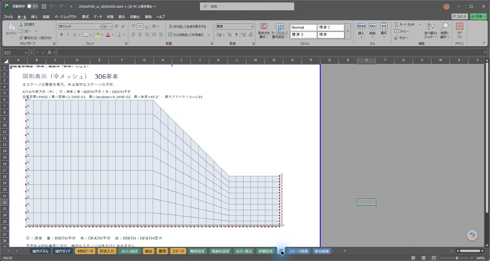
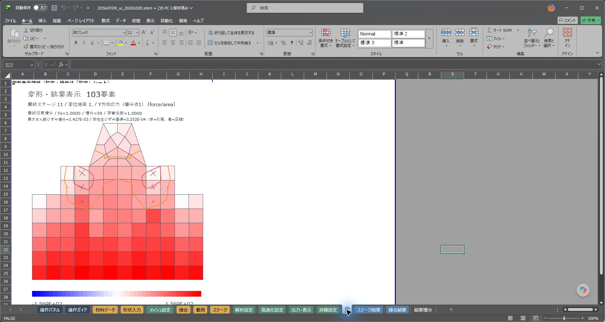
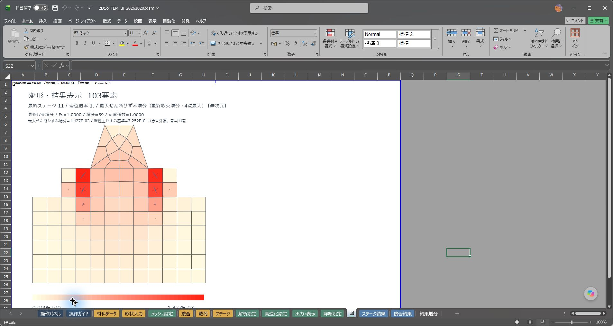
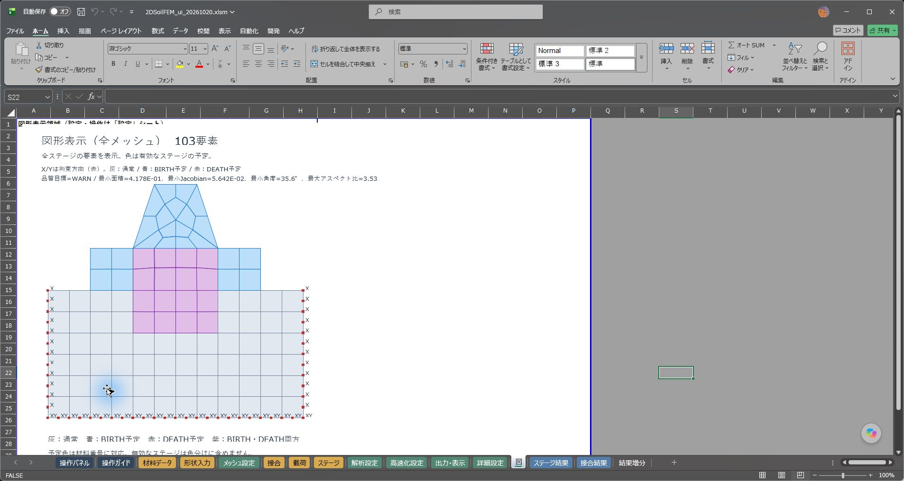

# Excel 2016のメッシュ・結果図表示の互換性修正

## 症状と修正

利用環境はExcel 2016。「解析前：メッシュを確認」と「変形・応力図を表示」で、図の位置に「この画像は表示できません」と表示されるとの報告。

両方の経路は、SVGを一時ファイルに書き、`Shapes.AddPicture`で挿入していた。SVGに対応しないExcelでも、このAPIは例外を返さず、表示できない画像を作ることがある。今回の利用環境・症状と一致する互換性上の問題である。こちらの現行Excelでは旧版SVGが表示できるため、利用者の環境での完全な再現・修正後の実機確認は未実施。

- 参考：[Microsoft Q&Aの同一症状の報告](https://learn.microsoft.com/en-us/answers/questions/5106483/how-to-detect-whether-or-not-svg-support-is-availa)。コミュニティの報告であり、全ビルドの対応表ではない。

`FEMViewer`の共通描画経路を、Excel標準のフリーフォーム・線・矩形・テキストのグループへ変更した。要素の座標、変位倍率、色の値・範囲、等値線、塑性クロスの計算は従来と同じ。既存の呼出元との互換性のため、図形グループ名`P1Agg_ViewSVG`は保持する。

画像ファイルの挿入・一時SVGの保存は不要になった。新しい図が完成してから旧図を置き換える。描画が失敗した場合は、今回作成した図形だけを消し、前の図を残してエラーを通知する。解析処理・DLL・倍精度・材料則・収束条件には変更がない。

## 確認結果

検証機はWindowsデスクトップExcel 16.0 / Build 20430。これは利用者のExcel 2016実機での確認を代替するものではない。SVG画像を使用しないこと、標準図形の実表示、保存後の再表示を確認した。

| 確認 | 結果・記録 |
|---|---|
| 汎用原版306要素のメッシュ | 全VBAコンパイル、保存・再読込、入力/保存結果9表不変。100チェック。[記録](../../tests/results/native_figure/release.json) |
| 計算済み道路施工例103要素・11工程 | メッシュ・変形応力図・増分等値線・塑性クロス、保存・再読込、入力/保存結果10表不変。111チェック。[記録](../../tests/results/native_figure/road.json) |
| 出力設定の既存回帰 | 68種類の結果表示、表示設定だけの変更後の再表示、入力変更時の旧結果表示禁止、保存後の再表示。小モデルのDLLなし重力解析もPASS。108チェック。[記録](../../tests/results/native_figure/display_regression.json) |
| 描画プリミティブ | 座標、閉じた多角形、余分な原点線がない開いたパス、色、破線、透明な日本語対応テキスト、不正な図形での後始末と旧図保持。増分7ケースもPASS。[記録](../../tests/results/native_figure/primitives.json) |

汎用メッシュの描画は約1.7～1.8秒。道路例の時間は`road.json`に記録。描画時間の観測であり、解析の高速化比較ではない。道路例の解析は再実行しておらず、既存の実計算保存結果を使って表示を検証した。Fs・変位・応力・残差などの保存データを変更しないことを表全体で照合した。

画面上でも、操作パネルのメッシュ確認ボタンと、出力・表示の結果表示ボタンを押して確認した。Aは応力図＋等値線・クロス、Bは増分カラー＋クロスである。









## 配布と再現

修正版は[配布ブック](../../workbook/ui_20261020/2DSoilFEM_ui_20261020.xlsm)。名前は維持する。DLLは従来の1個を同じ場所に置く。説明書に添付した過去の計算済みZIPは当時の記録として保持しており、今回の描画修正は含まない。

既存の入力・結果を持つブックを更新する場合は、元ファイルを保管し、下のスクリプトで**別名のコピー**に`FEMViewer`と`FEMNativeFigure`だけを取り込める。WindowsデスクトップExcelと、従来の開発用検証と同じVBAプロジェクトアクセスが必要。全Excelを閉じてから、リポジトリ直下のPowerShellで実行する。既存のExcelが起動していれば処理は開始しない。スクリプトは起動済みのExcelを終了させない。

```powershell
pwsh -NoProfile -File tests/verify_native_figure.ps1 `
  -SourceBook "元ブック.xlsm" `
  -DestinationBook "新規フォルダー/修正版.xlsm" `
  -Record "新規フォルダー/表示確認.json" -SavedResults
```

`-SavedResults`は有効な計算済み結果がある場合だけ指定する。入力と結果が不一致の場合、従来どおり結果表示を拒否する。汎用原版の古い保存結果を強制的に有効にする変更は行わない。

配布ブックの回帰確認：

```powershell
pwsh -NoProfile -File tests/test_native_figure.ps1 `
  -Book workbook/ui_20261020/2DSoilFEM_ui_20261020.xlsm
pwsh -NoProfile -File tests/test_viewer_display_settings.ps1 `
  -Book workbook/ui_20261020/2DSoilFEM_ui_20261020.xlsm `
  -Out tests/results/native_figure/display_regression.json
```

図形数は要素・クロスの数に応じて増える。非常に大きいモデルについて今回の表示時間を保証するものではない。
